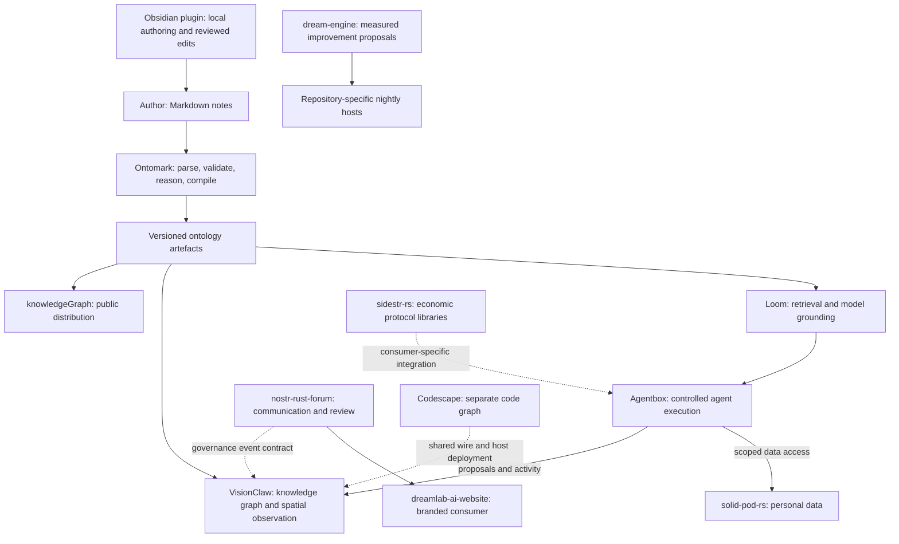

<div align="center">

# VisionFlow

### Coordination engineering for federated human–AI intelligence

**A guide to the DreamLab estate: what each system owns, how they connect, and what is ready to use.**

[Website](https://www.visionflow.info/) · [Start here](#choose-your-starting-point) · [Architecture](#how-the-pieces-fit) · [Status](#working-status) · [Documentation](docs/README.md)

</div>

VisionFlow connects knowledge authoring, formal reasoning, agent execution, human review and self-owned data. The aim is practical: let agents work on shared knowledge while people retain authority over what becomes accepted knowledge, with an inspectable record of the decision.

This repository maintains the ecosystem architecture, compatibility records, diagrams and public website. Install the individual products from their own repositories; build this checkout to preview or improve the website.

The [vision report](presentation/report/) and [ecosystem pitch](pdf-reports/visionflow-ecosystem-pitch.pdf) explain the strategic argument. The [repository map](docs/architecture/repository-map.md) and [compatibility matrix](docs/architecture/compatibility-matrix.md) describe the implementation boundaries.

## Choose your starting point

| You want to… | Start with | What it owns |
|---|---|---|
| Write an ontology as Markdown | [Ontomark](https://github.com/DreamLab-AI/ontomark) and its [Obsidian plugin](https://github.com/DreamLab-AI/ontomark-obsidian) | Parsing, typed models, reasoning, compilation and reviewed note edits |
| Explore knowledge spatially | [VisionClaw](https://github.com/DreamLab-AI/VisionClaw) | Knowledge graph, GPU layout, desktop/XR clients and governed knowledge workflows |
| Give agents a controlled working environment | [Agentbox](https://github.com/DreamLab-AI/agentbox) | Nix-composed runtime, tools, memory adapters, identity and capability policy |
| Ground model answers in your corpus | [Loom](https://github.com/DreamLab-AI/loom) | Retrieval and context assembly behind a model-swappable serving interface |
| Own and serve personal or agent data | [solid-pod-rs](https://github.com/DreamLab-AI/solid-pod-rs) | Solid storage, access control, identity and tier-specific server features |
| Host a Nostr community and governance surface | [nostr-rust-forum](https://github.com/DreamLab-AI/nostr-rust-forum) | Forum kit, relay and human/agent communication |
| Deploy DreamLab's branded site | [dreamlab-ai-website](https://github.com/DreamLab-AI/dreamlab-ai-website) | Marketing content and operator configuration consuming the forum kit |
| Inspect the published corpus | [knowledgeGraph](https://github.com/DreamLab-AI/knowledgeGraph) | Public corpus distribution at [narrativegoldmine.com](https://narrativegoldmine.com/) |
| Build agent payment or sidechain applications | [sidestr-rs](https://github.com/DreamLab-AI/sidestr-rs) | Rust protocol, wallet, settlement and channel libraries; deployment is separate |
| Propose measured repository improvements | [dream-engine](https://github.com/DreamLab-AI/dream-engine) | Evidence-gated experiment and judgement crates; a host supplies the nightly driver |
| Collaborate around a codebase in 3D | [Codescape](https://github.com/DreamLab-AI/codescape) | Code graph, layout, agent activity and voice collaboration, isolated from knowledge work |
| Study haptic graph interaction | visiontouch-rs | Private supporting device study; proof of principle, with hardware acceptance separate |

The site's **six substrates** are a conceptual grouping, not the total repository count. Libraries, authoring tools, published data and supporting studies have their own release and acceptance boundaries. The [nightly health roster](scripts/estate-health/roster.json) also includes supporting repositories beyond this table.

## How the pieces fit



Arrows describe ownership and intended data flow; they do not certify that every edge is active in one deployment. Solid pods, governance events, grounding requests and graph-position frames have different contracts. The [cross-estate diagrams](docs/diagrams/estate/) and [compatibility matrix](docs/architecture/compatibility-matrix.md) track those seams explicitly.

### One workflow: from a note to shared knowledge

1. An author writes Markdown with ontology frontmatter. Ontomark builds a typed model, reports unsupported constructs and produces machine-readable artefacts.
2. Consumers use an identified corpus generation. VisionClaw makes knowledge visible; Loom selects context for model requests. Private working knowledge and public releases remain distinct projections.
3. An agent proposes a change. The human review path and consistency checks decide whether it may proceed; a proposal is not an accepted fact.
4. A pull request or reviewed edit carries the change through the owning repository's workflow. Merge observation and downstream refresh depend on the configured adapters and credentials.

Read the [sovereign corpus contracts](docs/engineering/sovereign-corpus-contracts.md), [identity spine](docs/protocol/identity-spine.md) and [mesh smoke-test procedure](docs/protocol/mesh-smoke-test.md) for the integration requirements. These boundaries matter for research corpora, engineering handover, organisational knowledge and immersive teaching alike.

<details>
<summary><strong>Identity, reasoning and grounding: the terms used across the estate</strong></summary>

The identity spine uses `did:nostr` identifiers derived from secp256k1 public keys. Each service still needs its own verification, authorisation, replay and key-custody policy. Sharing an identifier does not grant a capability or establish that every consumer implements the same policy.

An **ontology** defines vocabulary and axioms. A **knowledge graph** holds represented knowledge using those terms. **Reasoning** derives consequences under the engine's supported formal profile. **Grounding** selects corpus material for a model's context. None of these alone proves that a claim in the corpus is true or that a generated answer is correct.

The published corpus is a testbed that includes synthetic material, rather than an authoritative encyclopaedia. Research results must retain their dataset, model and evaluation scope. See the [terminology guide](docs/terminology.md), [Loom research](https://github.com/DreamLab-AI/loom/tree/main/docs/research) and [published corpus repository](https://github.com/DreamLab-AI/knowledgeGraph).

</details>

## Build the website

The website is static HTML, CSS and JavaScript with a WebGL2 mesh experience. Its build copies the static tree, stages declared assets and writes an asset receipt. Node is required for the build scripts; there is no Rust or WASM compilation step.

```bash
npm ci
npm run build
# Output: website/dist/

# Serve it locally with any static HTTP server, for example:
python3 -m http.server 8000 --directory website/dist
```

Open `http://localhost:8000`. Python is only one option for serving the built files.

```bash
npm run check:assets
npm run test:gates

# Full verification also needs the external Chrome/CDP sidecar:
npm run verify
```

The sidecar prerequisites and browser checks are documented in [site verification](docs/site-verification.md). A successful static build establishes that the declared assets can be staged; it does not establish that a browser journey or a sibling service works.

<details>
<summary><strong>What CI publishes and checks</strong></summary>

[`deploy.yml`](.github/workflows/deploy.yml) builds [`website/static/`](website/static/) through [`website/build.sh`](website/build.sh), checks the candidate and uploads `website/dist/` as a GitHub Pages artefact. The build writes `www.visionflow.info` into its CNAME.

Blocking publication checks cover the declared asset inventory, build output, internal links, metadata, structured data and diagram baseline. The drift counter's enforcement depends on whether the pinned sibling source is available. The [build receipt tooling](scripts/website-assets.mjs) records the artefact revision, asset hashes and inventory results.

The [estate-health workflow](.github/workflows/estate-health.yml) collects repository and public-surface information into [`estate-health.json`](website/static/data/estate-health.json). The website displays that committed snapshot. It is dated evidence, not a query made when a visitor opens the page.

The [dream configuration](dream.config.json) supplies this repository's improvement evaluators. An accepted experiment is not a deployment or proof of cross-estate acceptance.

</details>

## Working status

**Reviewed 21 October 2026.** This repository ships documentation, site assets and verification tooling. Runtime claims belong to their implementation repositories. Read a status word together with its revision, feature flags, deployment configuration and acceptance evidence.

| Surface | What this checkout establishes | What needs separate evidence |
|---|---|---|
| Public website | Static source, build, asset inventory and publication workflow | Current deployed revision and browser behaviour |
| Architecture and diagrams | A traceable source map with declared revision stamps | Semantic review after source changes; live integration |
| Estate health | A CI-collected, committed snapshot | Anything that changed after collection |
| Shared ontology | Ontomark ownership and explicit consumer projections are documented | Consumer upgrades, generation alignment and deployment |
| Governance | Proposal, review and identity contracts are documented | A complete configured live session across the participating services |
| Dreaming | Repository-specific experiment configuration and records | Host activation and any estate-wide orchestration claim |
| GPU, XR and haptics | Product-specific source and evidence links | Hardware acceptance on the intended device |

The canonical maturity vocabulary is explained in the [status reconciliation](docs/architecture/status-reconciliation.md). Do not raise the maturity of a whole mesh from a passing unit test, a package release or a single working consumer.

<details>
<summary><strong>Recent changes to follow in the implementation repositories</strong></summary>

- **Shared authoring and certificates:** Ontomark's compiler is the shared producer. The recent derivation-certificate work and VisionClaw's `vault certify` / consequence-delta tooling extend the explanation of inferred consequences. Follow [Ontomark's decisions](https://github.com/DreamLab-AI/ontomark/tree/main/docs/adr) and the [VisionClaw ontology diagram](docs/diagrams/visionclaw/20-ontology-pipeline-oxigraph-whelk.md) at their declared revisions.
- **Codescape extraction:** the code-graph product has its own repository and workspace. It shares wire/deployment contracts with VisionClaw while excluding the knowledge-work stores. See [the Codescape diagram](docs/diagrams/visionclaw/39-codescape.md) and its [governing baseline](https://github.com/DreamLab-AI/codescape/blob/main/docs/BASELINE-codescape.md).
- **Dream Engine extraction:** the current Rust crates are distinct from the historical TypeScript fork. [The estate diagram](docs/diagrams/dream-engine/01-crates-licence-boundary-and-estate-status.md) separates library publication from Agentbox adapter activation.
- **Pod forge and mirror:** [ADR-2019](docs/adr/ADR-2019-forge-and-mirror-on-in-shipped-pods.md) records the consumer-specific policy. The decision, compiled features, running service and configured follow list are separate facts; the forum's Worker tier cannot run a native git forge.

</details>

## Read the architecture

| Entry point | Use it for |
|---|---|
| [Documentation index](docs/README.md) | Requirements, architecture, protocols and engineering guides |
| [Current baseline](docs/BASELINE-visionflow.md) and [decision ledger](docs/adr/README.md) | This repository's governing architecture and amendments |
| [Repository map](docs/architecture/repository-map.md) | Repository ownership and local checkout paths |
| [Compatibility matrix](docs/architecture/compatibility-matrix.md) | Cross-service integration and acceptance boundaries |
| [Diagrams as code](docs/diagrams/README.md) | Detailed sequences, dependencies, source references and revision stamps |
| [Release manifests](docs/releases/README.md) | Identified component revisions for coordinated releases |
| [Estate review](docs/estate-review/README.md) | Dated audits and their evidence limits |
| [Roadmap](docs/roadmap.md) | Work still needed to earn stronger integration claims |

To improve the canon, change the relevant source document, follow its implementation links and update assertions that the current code no longer supports. Keep historical evidence dated. For website changes, run the build and appropriate publication checks before proposing the change.

## Attribution and reuse

Maintained by [DreamLab AI](https://www.dreamlab-ai.com/) and [John O'Hare](https://github.com/jjohare); see [MAINTAINERS.md](MAINTAINERS.md). The Solid and identity lineage includes [Melvin Carvalho](https://github.com/melvincarvalho)'s [JavaScriptSolidServer](https://github.com/JavaScriptSolidServer/JavaScriptSolidServer), DID:Nostr and [Web Ledgers](https://webledgers.org/).

Licences vary across the estate: server/application code, permissive libraries, published data and third-party assets have distinct terms. Use each repository's licence and notices. This checkout has no root licence grant; its [licence notes](LICENSES/README.md) require maintainer confirmation for reuse of local documentation and website assets outside the ecosystem. The [licensing map](docs/architecture/licensing.md) is a navigation aid, not a substitute for those terms.
