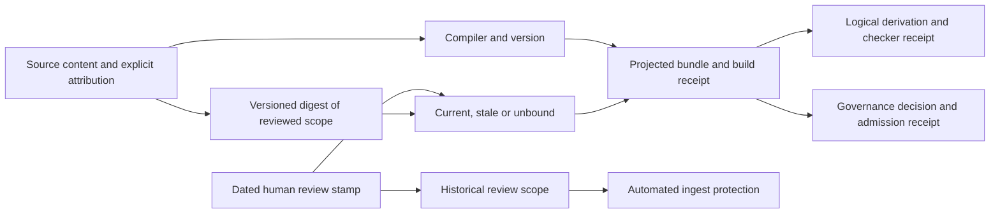

# ADR-2024 — Separate provenance roles and bind certification to reviewed content

## Context

The owner authorised this contract and its implementation on 15 November 2026.
Loom ADR-141 defaults missing unit provenance to `process:vault`, with no verification.
Ontomark ADR-OM-012 admits dated human certification but records that subsequent edits
can leave changed values certified. Bundle compilation, content attribution, logical
derivation, human review and governance admission make different claims.

## Decision

1. Content attribution and source evidence remain explicit page metadata. Missing
   attribution remains unknown. Compilation never invents a human or agent author.
2. Bundle build provenance names the compiler and its version separately from source
   generation, input digests and artefact hashes. A build receipt proves processing,
   not authorship, truth, review or governance approval.
3. Logical derivation records retain their checker, rule/profile scope and limitations.
   Governance admission retains its signer and receipt separately from human review.
4. Explicit page `generated` and `verified` records survive parsing, editing and export.
   Legacy `process:vault` remains historical processing attribution. Legacy bundles
   remain readable; missing build metadata is unknown, never guessed from the reader.
5. New human review stamps bind to a versioned SHA-256 digest of their reviewed scope.
   Key-scoped review hashes only the named values; whole-page review includes all
   frontmatter except the review list itself, and the body. Missing values, scalar
   types, sequence order and nested structures are distinguished. Map order is not
   semantic; keys are ordered before hashing. No hand-written cryptography is used.
6. A changed reviewed value makes that stamp stale. An unrelated field edit does not
   invalidate key-scoped review. Historical stamps are retained, not silently rewritten.
   Undigested legacy stamps remain visible as unbound historical review and continue
   protecting their fields against automated ingest; they cannot claim fresh binding.
   A stale stamp likewise keeps automated ingest from overwriting reviewed fields.
7. Digest attachment is an explicit review operation, never an automatic re-certification
   during build or an ordinary edit. Human actor and date remain required; a digest is
   an integrity binding, not a signature or proof that the actor actually reviewed it.
8. Ontomark owns the portable digest and status rules. Compiler, ingest and consumer
   adapters use shared fixtures. Public metadata never discloses private content;
   working-vault input stays within the private machine-bundle boundary.

## Claim boundaries

A build, derivation or admission receipt does not substitute for a human review
stamp. Freshness compares against source content; public projection may redact
parts of that source. The projection is not thereby certified as a whole.

## Consequences

Consumers can distinguish known processing from unknown authorship and distinguish
historical review from review of current values. Existing evidence and legacy readers
remain usable. Strict freshness is additive and must be displayed honestly; no bulk
certification, identity reminting or corpus reinterpretation is authorised by this ADR.
Versioned JSON-LD contexts retain immutable existing meanings; new fields require a
versioned context. Source completion, publication and deployment have separate receipts.

## Verification

Required controls: legacy/no-producer bundle; explicit producer round-trip; absent
content attribution; preservation of explicit attestations; whole-page and per-key
bindings; unchanged values; changed covered value/body; unrelated key edit; map-order
invariance; sequence/type distinctions; malformed digest; agent/process refusal;
legacy unbound and stale ingest protection; mixed current/stale stamps; public/private
projection canaries; native/WASM parity and supported consumer builds.

The producer is released as [Ontomark v0.9.0](https://github.com/DreamLab-AI/ontomark/releases/tag/v0.9.0),
source `f9ba200b8051dc3a1f5e26ff2e001d5fc2905426`. Parser 0.1.4,
ingest 0.2.2, compiler/profile/CLI 0.9.0 are published on crates.io. The WASM
engine is delivered through the checksum-pinned GitHub archive.

[The execution receipt](../evidence/ADR-2024-provenance.md) records revisions,
commands, counts, release hashes and the deployment boundary. Ontomark
[ADR-OM-013](https://github.com/DreamLab-AI/ontomark/blob/v0.9.0/docs/adr/ADR-OM-013-content-bound-review-and-build-provenance.md)
and its protocol document define the byte-level contract. Existing context and
API meanings remain intact; new `context/v3.jsonld`, `ns/v3.jsonld` and
`api/v3/pages` expose the additive source review summary.

## Activation boundary

Loom, VisionClaw, Agentbox, visionGraph and the Obsidian plugin have adopted the
contract at source. Hosted producer, consumer and plugin checks pass, including offline execution.
The public v3 surface is deployed and live-checked; v1/v2 context bytes remain
unchanged.
Agentbox image activation and running Loom/VisionClaw process replacement are
separate deployment operations, not implied by dependency pins or successful tests.
No bulk human certification, corpus rewrite, identity reminting or completed
cross-estate ontology migration is claimed. The broader decisions remain partial.
