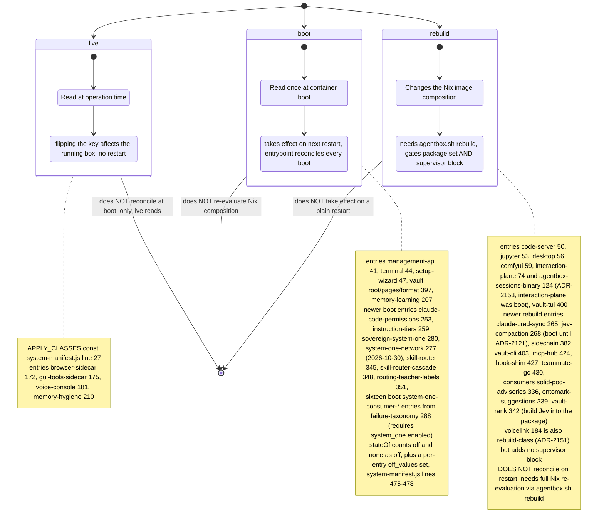
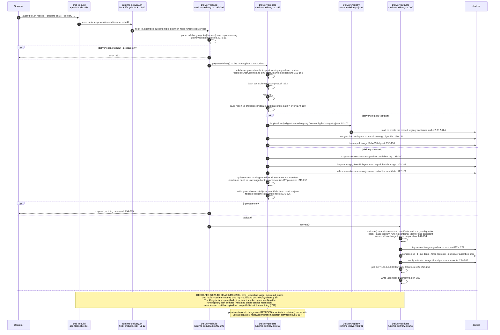
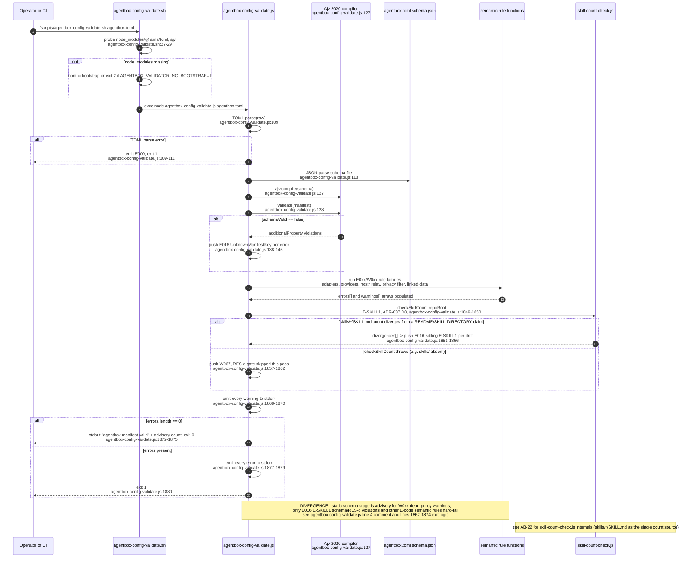
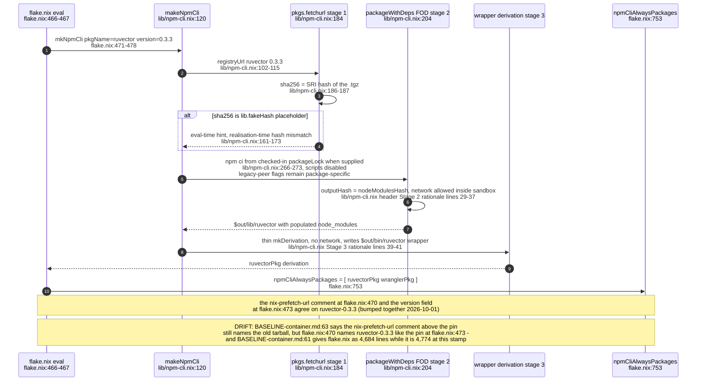
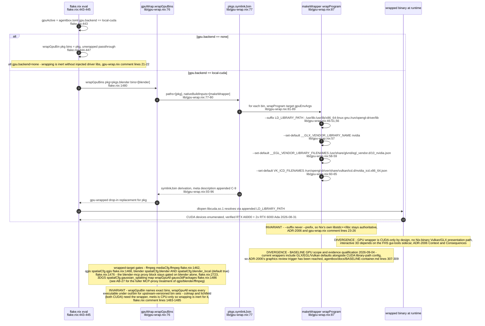
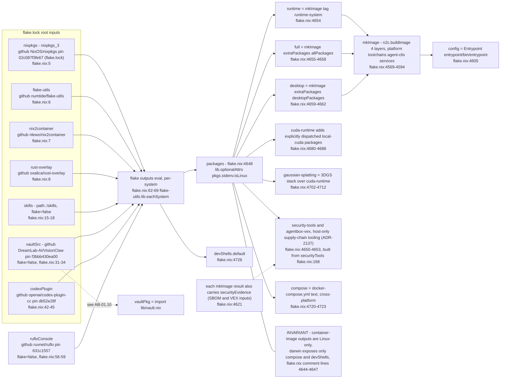
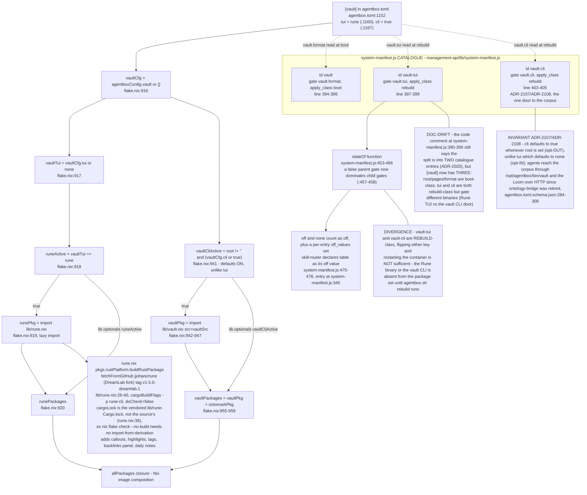
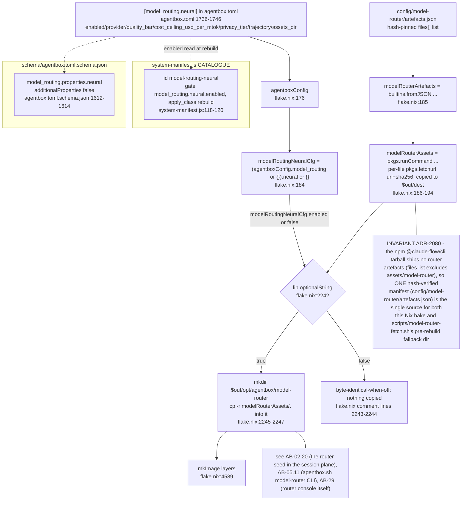

## AB-01.1 agentbox.toml gates to flake.nix conditionals to package set and supervisord text

```mermaid
flowchart TB
    TOML["agentbox.toml<br/>flake.nix:176 builtins.fromTOML"] --> CFG["agentboxConfig"]
    CFG --> DESK["desktopCfg = agentboxConfig.desktop or {}<br/>flake.nix:198"]
    CFG --> MEDIA["mediaCfg = skillsCfg.media or {}<br/>flake.nix:283"]
    CFG --> VAULT["vaultCfg = agentboxConfig.vault or {}<br/>flake.nix:916"]

    DESK -->|"desktopCfg.enabled or false"| DESKOPT["lib.optionals<br/>flake.nix:1981 desktopPackages"]
    MEDIA -->|"mediaCfg.comfyui_builtin or false"| COMFYOPT["lib.optionals<br/>flake.nix:1454 comfyuiPackages"]
    CFG -->|"comfyui_builtin or integrations.comfyui_external.enabled"| COMFYMCP["comfyuiMcpPkg only<br/>flake.nix:899"]
    COMFYMCP --> ALLPKG
    CFG --> VOICELINK["voicelinkOn = voicelink.enabled or false<br/>flake.nix:1847, voicelinkPackages flake.nix:1849<br/>voice-paned linked at /opt/agentbox/bin flake.nix:2128"]
    VOICELINK --> ALLPKG
    MEDIA -->|"mediaCfg.ffmpeg or false"| FFOPT["lib.optionals<br/>flake.nix:1462 wrapGpuBin ffmpeg"]
    VAULT -->|"vaultCfg.tui == rune"| RUNEOPT["runeActive<br/>flake.nix:918"]

    DESKOPT --> ALLPKG["allPackages closure"]
    COMFYOPT --> ALLPKG
    FFOPT --> ALLPKG
    RUNEOPT -->|"lib.optionals runeActive"| RUNEPKG["runePackages<br/>flake.nix:920"]
    RUNEPKG --> ALLPKG

    DESK -->|"lib.optionalString (desktopCfg.enabled or false)"| DESKSUP["desktopBlocks text<br/>flake.nix:2529<br/>spliced flake.nix:2725"]
    MEDIA -->|"lib.optionalString (mediaCfg.comfyui_builtin or false)"| COMFYSUP["program:comfyui-builtin block<br/>flake.nix:2874-2883"]

    CFG --> SIDE["sidechainCfg = agentboxConfig.sidechain or {}<br/>flake.nix:320, enabled default false (:321)<br/>mirror and faucet only with enabled (:322-323)"]
    SIDE -->|"lib.optionals sidechainFaucet"| SIDEPKG["sidechainPackages = sidestr-agent<br/>flake.nix:1843"]
    SIDEPKG --> ALLPKG
    SIDE -->|"lib.optionalString sidechainEnabled / Mirror / Faucet"| SIDESUP["program:sidestr-producer, -mirror, -faucet blocks<br/>flake.nix:2105, :3105, :3123, :3140"]
    SIDESUP --> SUPTEXT
    CFG --> JEVON["jevCompactionOn = features.jev_compaction.enabled<br/>flake.nix:1865, ADR-2121"]
    JEVON -->|"lib.optionals jevCompactionOn"| FRPKG["factrailPackages<br/>flake.nix:1881"]
    FRPKG --> ALLPKG
    JEVON -->|"lib.optionalString jevCompactionOn"| FRBAKE["/opt/agentbox/bin/factrail symlink (flake.nix:2115)<br/>plugin copied to config/claude-plugins/factrail (flake.nix:2196)"]

    CFG --> SOON["systemOneProxyOn = system_one.enabled<br/>flake.nix:314, ADR-2139"]
    SOON -->|"lib.optionals systemOneProxyOn"| SOPKG["systemOneProxyPackages (flake.nix:1883)<br/>/opt/agentbox/bin/system-one-proxy link (flake.nix:2133)<br/>rebuild-class consumers add jev: flake.nix:946, :957, :1537"]
    SOPKG --> ALLPKG
    SOON -->|"lib.optionalString systemOneProxyOn"| SOSUP["program:system-one-proxy<br/>flake.nix:3035"]
    SOSUP --> SUPTEXT
    CFG --> JKON["jevCheckpointsOn = features.jev_checkpoints.enabled<br/>flake.nix:1870, ADR-2135"]
    JKON -->|"config copy filter"| JKBAKE["plugin dir config/claude-plugins/jev-checkpoints dropped when the gate is off,<br/>its tests/ never shipped - flake.nix:2167-2171"]
    CFG --> SEOON["seoWatchEnabled = seo_watch.enabled (flake.nix:308)<br/>program:seo-watch-cron flake.nix:3062"]
    CFG --> TGCON["targetGcEnabled = resources.target_gc.enabled (flake.nix:243)<br/>program:target-gc flake.nix:3354"]
    CFG --> IPON["interactionPlaneEnabled flake.nix:418, ADR-2153<br/>agentboxSessionsPkg flake.nix:2057, link :2098"]
    IPON --> ALLPKG
    IPON -->|"program:agentbox-sessions flake.nix:2910"| SUPTEXT
    SEOON --> SUPTEXT
    TGCON --> SUPTEXT

    DESKSUP --> SUPTEXT["supervisorText — AUTO-GENERATED supervisord.conf<br/>flake.nix:2621 supervisorText = header"]
    COMFYSUP --> SUPTEXT
    ALLPKG --> MKIMAGE["mkImage layers<br/>flake.nix:4589"]

    ALLPKG -.->|"see AB-01.6"| WRAPTGT["wrapped GPU targets"]

    note1["INVARIANT ADR-2003 - every gate touches package set AND supervisor text AND<br/>a system-manifest.js catalogue entry, management-api/lib/system-manifest.js line 39"]
    SUPTEXT --- note1
```

**Tension (ADR-2151 vs manifest):** ADR-2151 is `decision_status: proposed`, `implementation_status: none`, `activation_status: inactive` (`docs/adr/ADR-2151-voicelink-edge-voice.md:5-7`), yet `[voicelink] enabled = true` (`agentbox.toml:2226`) makes `voicelinkOn` bake `voice-paned` into the package set and `/opt/agentbox/bin` (`flake.nix:1847-1849`, `flake.nix:2128`).
**Invariant:** the voicelink gate is the one rebuild-class gate that adds a package and a catalogue entry (`management-api/lib/system-manifest.js:184`) but no supervisor block, by design: `voice-paned` runs per ssh connection (`management-api/lib/system-manifest.js:186`).
**Open:** ADR-2154 (accepted, partial, staged; supersedes ADR-2152 and its browsercontainer `mmdc` shim) puts the pinned Pele renderer and an `mmdc` compatibility shim into the package set when `docsCfg.mermaid` is on (`flake.nix:688`, `flake.nix:767`, `lib/pele.nix:61`, `lib/pele.nix:67`); the record's activation status is still staged. ADR-2155 (`accepted`, `complete`, `staged`, `../project/agentbox/docs/adr/ADR-2155-system-one-consumer-activation.md:5-7`) likewise records the System One consumer activation as staged while `[system_one.consumers]` already sets all nineteen true, three of them rebuild-class (`../project/agentbox/agentbox.toml:902-923`).

## AB-01.2 apply_class taxonomy - live, boot, rebuild

## AB-01.3 ./agentbox.sh rebuild - runtime-delivery prepare, then activate

## AB-01.4 Static config validation - schema, semantic rules, then the skill-count gate

**Tension:** two independent semantic blocks of the same validator emit the code `E080`: the ADR-2138 absolute-path check on `[resources.target_gc]` (`../project/agentbox/scripts/agentbox-config-validate.js:656`) and the eight ADR-2139 `[system_one]` slot checks, now including `local_backend`, the bind check that admits a private address only with `network = true` (2026-10-30) and boolean `consumers` (`../project/agentbox/scripts/agentbox-config-validate.js:1582`, `:1589`, `:1611`, `:1615`), so the code alone does not identify the failing gate and only the message text does; the ADR-2139 block also documents `E081` and `W076`, while the ADR-2138 block owns `W077` (`../project/agentbox/scripts/agentbox-config-validate.js:656`).

## AB-01.5 npm-cli.nix pinned exact-semver closure - ruvector always in package set

## AB-01.6 gpu-wrap.nix wrapGpuBins - LD_LIBRARY_PATH suffix and vendor ICDs

## AB-01.8 agentbox.toml schema shape - top-level sections

```mermaid
classDiagram
    class AgentboxToml {
        +GpuSection gpu
        +VaultSection vault
        +SkillsSection skills
        +AdaptersSection adapters
        +CoreSection core
        +FederationSection federation
    }
    class GpuSection {
        +string backend
    }
    class VaultSection {
        +string root
        +string pages
        +string format
        +string tui
        +bool cli
        +string working
        +string transcripts
    }
    class SkillsSection {
        +BrowserSkills browser
        +MediaSkills media
        +SpatialSkills spatial_and_3d
        +DataScienceSkills data_science
    }
    class AdaptersSection {
        +string beads
        +string pods
        +string memory
        +string events
        +string orchestrator
    }
    class CoreSection {
        +string orchestration
        +string vector_db
    }
    class FederationSection {
        +string mode
        +string external_url
    }

    AgentboxToml "1" --> "1" GpuSection
    AgentboxToml "1" --> "1" VaultSection
    AgentboxToml "1" --> "1" SkillsSection
    AgentboxToml "1" --> "1" AdaptersSection
    AgentboxToml "1" --> "1" CoreSection
    AgentboxToml "1" --> "1" FederationSection

    note for GpuSection "backend enum: none, ollama-rocm, ollama-cuda, local-cuda - agentbox.toml.schema.json:108-117"
    note for VaultSection "required: root - agentbox.toml.schema.json:226-228. format enum obsidian ONLY (logseq-legacy withdrawn 2026-09-22, corpus migration complete) - agentbox.toml.schema.json:253-260. tui enum rune, none, default none - agentbox.toml.schema.json:275-283, ADR-2029. cli bool default true - agentbox.toml.schema.json:284-308, ADR-2107/ADR-2108"
    note for AdaptersSection "each value resolves to local-star, external, or off per slot - agentbox/CLAUDE.md adapter contract"
```

## AB-01.9 flake.lock inputs to flake outputs

## AB-01.10 ADR-2029/ADR-2107 vault gates - three catalogue entries, one section

## AB-01.11 ADR-2080 model_routing.neural gate - pinned artefacts baked into the image (rebuild-class)

