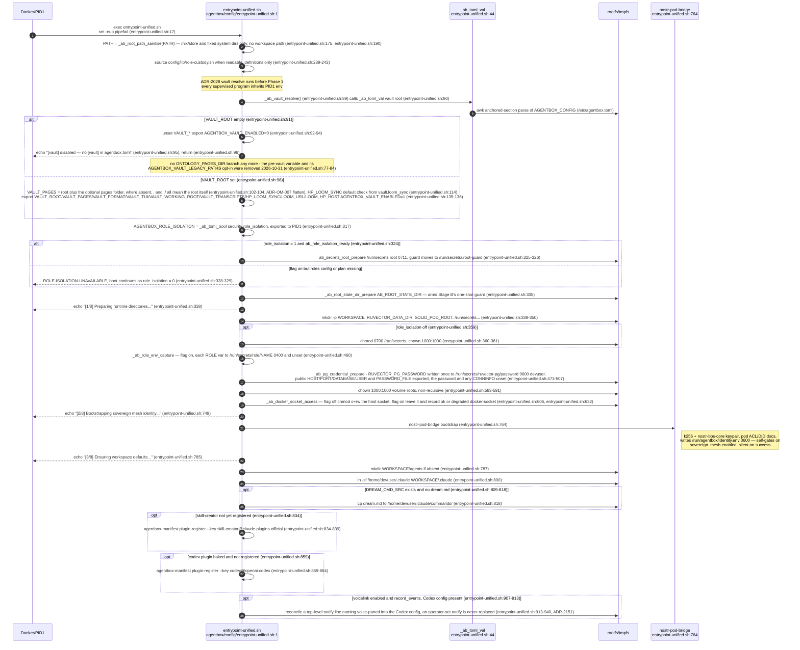
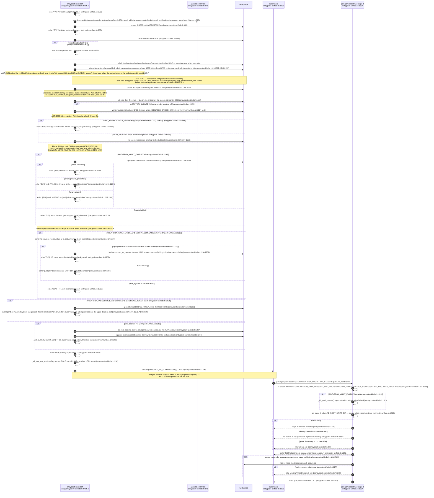
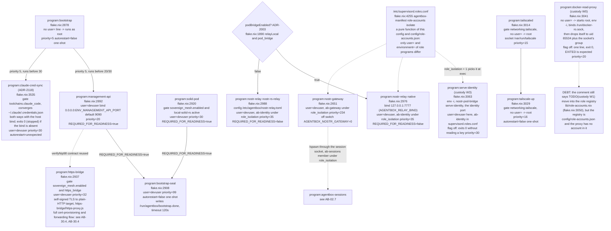
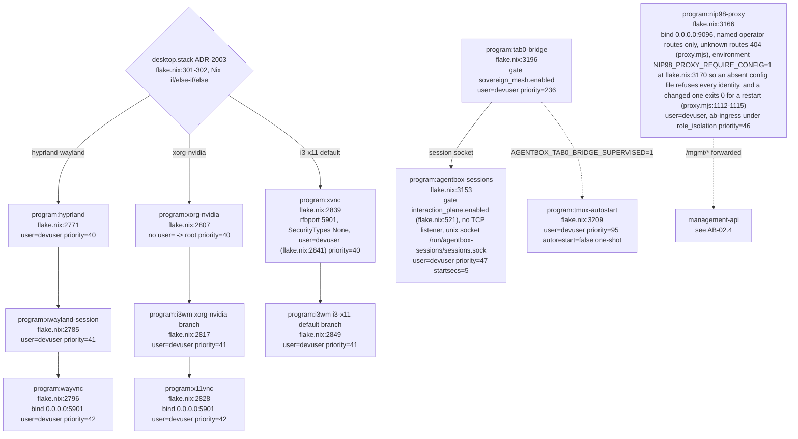

Split 2026-11-23: AB-02.9 to AB-02.14 and AB-02.16 moved to [AB-45](45-boot-readiness-lifecycle-profiles-and-seccomp.md); AB-02.8 and AB-02.17 to AB-02.24 moved to [AB-46](46-boot-mcp-hub-session-plane-and-role-isolation.md). The old IDs resolve through the aliases declared there.

## AB-02.1 boot phases 1-3 — vault resolution, directories, sovereign identity

## AB-02.2 boot phases 4-6 — provisioning, artifact validation, supervisord exec, Stage B closure probes

## AB-02.3 boot phases 7-8 — ruflo plugins, manifest projection, runtime-env publish

```mermaid
sequenceDiagram
    autonumber
    participant B as [program:bootstrap] Stage B<br/>entrypoint-unified.sh:1461
    participant AM as agentbox-manifest<br/>entrypoint-unified.sh:2275
    participant MCP as .mcp.json<br/>entrypoint-unified.sh:1557
    participant FS as rootfs/tmpfs
    participant RT as runtime-env.sh<br/>entrypoint-unified.sh:4083
    participant TS as trust-seed.cjs<br/>run once from entrypoint-unified.sh:1818

    B-->>B: echo "[7/8] Bootstrapping ruflo plugins..." (entrypoint-unified.sh:1461)
    B->>FS: mkdir ~/.claude-flow/plugins, /var/cache/ruflo-plugins (entrypoint-unified.sh:1463-1467)
    Note over B: the claude-flow config template that carried the Postgres password is gone<br/>(entrypoint-unified.sh:1469-1472), nothing writes ~/.claude-flow/config.json's memory block now
    Note over B: PRD-018/ADR-036 D6 — read RuVector memory gate flags<br/>via _ab_toml_bool memory_learning.* (entrypoint-unified.sh:1495-1507), fail-open all-off
    B->>MCP: ensure .mcp.json points at ruvector-mcp.cjs with RUVECTOR_PG_HOST/PORT/DATABASE/USER<br/>and RUVECTOR_PG_PASSWORD_FILE, never a password, idempotent (entrypoint-unified.sh:1525-1590)
    B->>MCP: inject RuVector memory gates, including evidence_refs and read_counts (entrypoint-unified.sh:1592-1675)
    opt browser-gpu sidecar reachable, its /health answers 200 or 503 while Chrome restarts (entrypoint-unified.sh:2248-2251)
        B->>AM: agentbox-manifest mcp-set-server --name browser-gpu (entrypoint-unified.sh:2253)
    end
    B->>AM: agentbox-manifest mcp-reconcile-aqe --provider "$_MR_PROVIDER_ARG" (entrypoint-unified.sh:2275)
    opt _MR_ENABLED=1 — ADR-041 model routing (entrypoint-unified.sh:2285)
        B->>AM: run_as_devuser agentbox-manifest model-routing-project --manifest AGENTBOX_CONFIG --workspace WORKSPACE<br/>(entrypoint-unified.sh:2285-2289)
        Note right of AM: projects [model_routing.routes] into every<br/>.agentic-qe/llm-config.json under the workspace,<br/>a runtime file the repository does not track
    end
    Note over B: ADR-069, ADR-2210 — interaction_plane.proxy projected every boot, and never left as an absent file (entrypoint-unified.sh:2333-2352)
    opt nip98-config.sh readable, else the older direct call (entrypoint-unified.sh:2343,entrypoint-unified.sh:2347-2351)
        B->>AM: ab_nip98_project sources the helper and calls agentbox-manifest nip98-config --manifest AGENTBOX_CONFIG --out .agentbox/nip98-proxy-config.json<br/>(entrypoint-unified.sh:2345-2346, nip98-config.sh:24)
        B->>FS: section absent writes the explicit empty config, then chown 1000:1000 and chmod 600 (nip98-config.sh:28-33)
    end
    Note over B: DEBT - the proxy program starts alongside bootstrap (flake.nix:2878-2884), so it can serve the previous boot's file until this block runs,<br/>and a failed projection leaves that last-good file serving, or no file so the door stays closed (nip98-config.sh:21,nip98-config.sh:27)
    Note over B: hook registration reconciled into root settings.json every boot, each fail-open (|| true)
    B->>FS: decline-recorder on Stop, SubagentStop and UserPromptSubmit when claude_code.floor is on, default on<br/>(entrypoint-unified.sh:2101-2160, ADR-2144)
    B->>FS: voice-paned record on Stop and Notification when voicelink.enabled and record_events<br/>(entrypoint-unified.sh:2162-2204, ADR-2151)
    B->>FS: session-state.cjs hook on UserPromptSubmit, Stop and Notification into root settings.json when<br/>interaction_plane.enabled, pruned when off (entrypoint-unified.sh:1950-1962, ADR-2153)
    B->>FS: Codex config.toml notify line set to session-state.cjs codex, keeping --voice when voicelink records, restored when<br/>off (entrypoint-unified.sh:1927-1946)
    B->>FS: activity-sink hooks when [integrations.activity_sink] has a usable url (entrypoint-unified.sh:2889-2975, ADR-2146)
    B->>AM: agentbox-manifest instructions-project, with --managed-out /etc/claude-code/CLAUDE.md when the floor is on,<br/>--no-managed otherwise (entrypoint-unified.sh:3030-3032, ADR-2144)
    Note over B: ADR-2139 vendor slot — _ab_toml_bool system_one enabled (entrypoint-unified.sh:2684) selects system-one-project<br/>(entrypoint-unified.sh:2687-2697), else sso-project (entrypoint-unified.sh:2714-2716)
    opt [system_one].enabled and the projection is non-empty (entrypoint-unified.sh:2686, entrypoint-unified.sh:2689)
        B->>AM: agentbox-manifest system-one-project --format json, then shell and plugin-config (entrypoint-unified.sh:2687,<br/>entrypoint-unified.sh:2695-2697)
        B->>FS: atomic tmp-and-mv /run/agentbox/system-one.json, the proxy's only config (entrypoint-unified.sh:2692-2693)
    end
    Note over B: unusable slot writes a disabled stub and falls back to sso-project, so the seal's promised file always exists<br/>(entrypoint-unified.sh:2699-2707)
    Note over B: RESOLVED — the ontology-bridge MCP registration that used to sit<br/>here (gated ENABLE_ONTOLOGY) is GONE (ADR-2107/2108): agents reach the<br/>corpus only through the vault CLI and the Loom over HTTP (entrypoint-unified.sh:2358-2361)
    opt AGENTBOX_TRUST_SEED not 0 and node present (entrypoint-unified.sh:1818)
        B->>TS: node trust-seed.cjs marks workspace root and worktrees trusted, once (entrypoint-unified.sh:1818-1820)
        Note right of TS: DOC-DRIFT resolved — deliberately NOT a SessionStart hook any<br/>more (it walked ~1,170 paths per session start, avg 3.2s, and raced<br/>Claude Code's own ~/.claude.json writes) — hook shim reconcile below prunes<br/>any stale registration
    end
    Note over B: after the hub projection (see AB-46.2) the claude-flow entry is mirrored into user scope<br/>(entrypoint-unified.sh:3460-3468)
    B->>AM: agentbox-manifest mcp-mirror-server --from .mcp.json --to ~/.claude/.claude.json --name claude-flow<br/>(entrypoint-unified.sh:3466-3467, mcp.rs:275)
    B->>FS: RuVector credential scrub - every boot removes any RUVECTOR_PG_CONNINFO or memory.password an earlier boot<br/>left in .mcp.json, ~/.claude.json, Codex config.toml, ~/.claude-flow/config.json and their backups,<br/>atomic rewrite, fail-open (entrypoint-unified.sh:3907-4065)
    B-->>B: echo "[8/8] Publishing environment hints..." (entrypoint-unified.sh:4070)
    B->>RT: cat RUNTIME_ENV_FILE=/run/agentbox/runtime-env.sh heredoc (entrypoint-unified.sh:4083-4170)
    Note right of RT: role_isolation on adds DOCKER_HOST=unix:///run/docker-ro.sock,<br/>the GET-only read proxy, to devuser shells (entrypoint-unified.sh:4078-4081)
    Note right of RT: exports WORKSPACE, RUVECTOR_PG_HOST/PORT/DATABASE/USER/PASSWORD_FILE (entrypoint-unified.sh:4088-4092),<br/>VAULT_ROOT/PAGES/FORMAT/TUI/WORKING_ROOT/TRANSCRIPTS, AGENTBOX_INTERACTION_PLANE_*,<br/>CUDA_PATH and friends are appended after the heredoc (entrypoint-unified.sh:4216-4226) (see AB-45.3)
    B->>FS: _ab_quarantine_stale_cargo_bins, ELF bins in WORKSPACE/.cargo/bin whose<br/>/nix/store loader was collected move to .stale-loader/, numbered, never deleted (entrypoint-unified.sh:4179-4197)
    Note right of FS: ADR-2029 D4 follow-up (2026-10-01) - .cargo/bin outlives rebuilds, so a dead loader<br/>once shadowed baked rune and agentbox-hook. Custody W0 now APPENDS it, devuser shells only,<br/>never root (entrypoint-unified.sh:4163-4165). Loader path read from bytes, nothing executed<br/>(entrypoint-unified.sh:4185-4187)
    B->>FS: ln -sf RUNTIME_ENV_FILE /etc/profile.d/agentbox-runtime.sh best-effort (entrypoint-unified.sh:4243)
    B->>FS: cp RUNTIME_ENV_FILE to durable WORKSPACE/.agentbox-runtime-env.sh (entrypoint-unified.sh:4246)
    B->>FS: write fish conf.d/agentbox-runtime.fish sourcing the env file (entrypoint-unified.sh:4252-4271)
```

## AB-02.4 supervision tree — core and identity programs

## AB-02.6 supervision tree — gated toolchain programs

```mermaid
flowchart TB
    QGIS["program:qgis-mcp<br/>flake.nix:2594<br/>gate spatial.qgis, TCP proxy to gui-tools-service:9877<br/>user=devuser priority=230"]
    BLEND["program:blender-mcp<br/>flake.nix:2621<br/>gate spatial.blender, bridges 127.0.0.1:9876 to external GUI sidecar<br/>user=devuser priority=231"]
    JLAB["program:jupyter-lab<br/>flake.nix:2694<br/>gate data_science.jupyter, bind 0.0.0.0:8888 — RESOLVED ADR-2040,<br/>JUPYTER_TOKEN now minted at boot (see AB-07.9), no longer tokenless<br/>user=devuser priority=232"]
    IMGM["program:imagemagick-mcp<br/>flake.nix:2951<br/>gate media.imagemagick<br/>user=devuser priority=210"]
    COMFY["program:comfyui-builtin<br/>flake.nix:3116<br/>gate media.comfyui_builtin, bind 127.0.0.1:8188<br/>user=devuser priority=220"]
    OPF["program:opf-router<br/>flake.nix:3001<br/>gate privacyFilterEnabled, OPF_PORT default 9092<br/>user=devuser priority=240"]
    DREAM["program:dream-engine<br/>flake.nix:3139<br/>gate dreamEngineEnabled (flake.nix:1940), LOOM_URL default a LAN address, port 8084<br/>user=devuser priority=230"]
    SIDEP["program:sidestr-producer<br/>flake.nix:3374<br/>gate sidechain.enabled (flake.nix:424), shipped true (agentbox.toml:2030, re-enabled on recovered validated prefixes after the ENOSPC failure, agentbox.toml:2029) so the producer block is emitted; runs the baked upstream, refuses on a pin mismatch<br/>user=devuser, ab-sidestr-dreamlab under role_isolation priority=260 startretries=5"]
    SIDEM["program:sidestr-mirror<br/>flake.nix:3392<br/>gate sidechain.mirror, only with enabled (flake.nix:425)<br/>user=devuser priority=261"]
    SIDEF["program:sidestr-faucet<br/>flake.nix:3409<br/>gate sidechain.faucet, only with enabled (flake.nix:426)<br/>user=devuser, ab-faucet-dreamlab under role_isolation priority=262"]
    CODES["program:code-server<br/>flake.nix:3092<br/>gate toolchains.code_server, bind 0.0.0.0:8080 — RESOLVED ADR-2040,<br/>auth password with a boot-minted credential (see AB-07.9), not auth none<br/>user=devuser priority=50"]

    SO1["program:system-one-proxy (ADR-2139)<br/>flake.nix:3284<br/>gate system_one.enabled (flake.nix:417), typed-decision proxy (loopback; configured 0.0.0.0:8094 on the docker networks when system_one.network, agentbox.toml:915-916, live with the next image),<br/>reads only /run/agentbox/system-one.json, vendor keys from env<br/>user=devuser priority=60 autorestart=unexpected"]
    SEO["program:seo-watch-cron<br/>flake.nix:3331<br/>gate seo_watch.enabled (flake.nix:410), supercronic over the website repo crontab<br/>user=devuser priority=250"]
    TGC["program:target-gc (ADR-2138)<br/>flake.nix:3623<br/>gate resources.target_gc.enabled (flake.nix:345), idle Cargo target sweeper<br/>user=devuser priority=246"]
    OPF -.->|"privacy filter mode gate"| DREAM
    SIDEP -->|"block files"| SIDEM
    SIDEP -->|"local producer"| SIDEF
    DREAM -.->|"ZAI_ANTHROPIC_API_KEY inherited from PID1; the memory DB password is read from<br/>the 0600 file named by RUVECTOR_PG_PASSWORD_FILE, flake.nix:3134-3138"| RVNOTE["note: secrets never written<br/>into generated supervisor text"]
    UCRON["program:user-cron<br/>flake.nix:3305<br/>gate user_cron.enabled (flake.nix:411), shipped true (agentbox.toml:1311), supercronic over<br/>~/workspace/.local/etc/agentbox/user.crontab, idle until the file exists<br/>user=devuser priority=250"]
```

## AB-02.7 supervision tree — desktop stack and interaction plane

