## AB-02.1 boot phases 1-3 — vault resolution, directories, sovereign identity
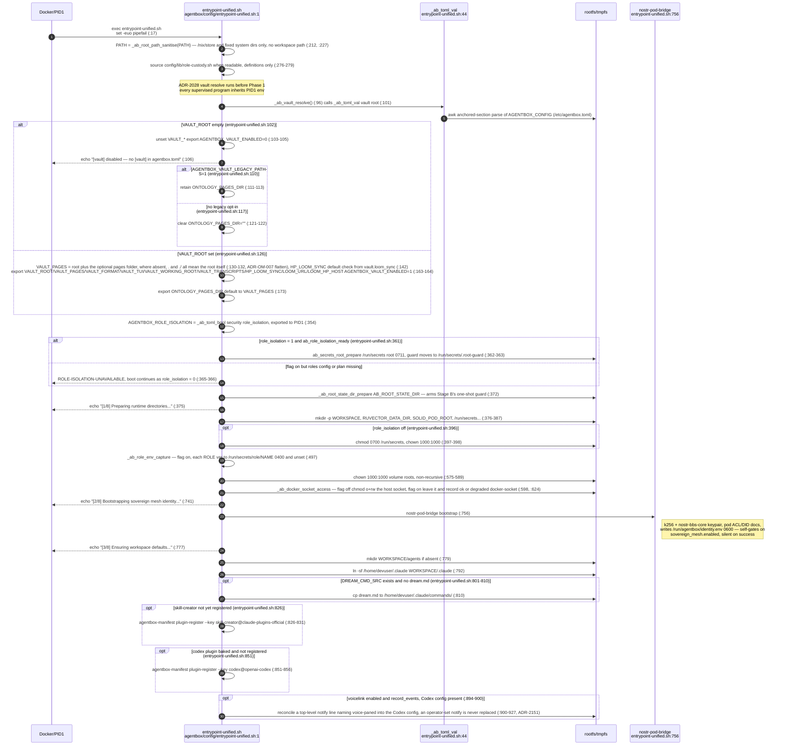

## AB-02.2 boot phases 4-6 — provisioning, artifact validation, supervisord exec, Stage B closure probes
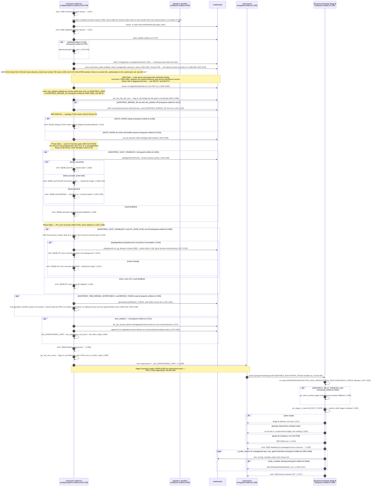

## AB-02.3 boot phases 7-8 — ruflo plugins, manifest projection, runtime-env publish
```mermaid
sequenceDiagram
    autonumber
    participant B as [program:bootstrap] Stage B<br/>entrypoint-unified.sh:1451
    participant AM as agentbox-manifest<br/>entrypoint-unified.sh:2270
    participant MCP as .mcp.json<br/>entrypoint-unified.sh:1556
    participant FS as rootfs/tmpfs
    participant RT as runtime-env.sh<br/>entrypoint-unified.sh:3820
    participant TS as trust-seed.cjs<br/>run once from entrypoint-unified.sh:1812

    B-->>B: echo "[7/8] Bootstrapping ruflo plugins..." (:1451)
    B->>FS: mkdir ~/.claude-flow/plugins, /var/cache/ruflo-plugins (:1453-1457)
    opt claude-flow-config.template.json present, config.json stale (entrypoint-unified.sh:1467)
        B->>FS: sed RUVECTOR_PG_PASSWORD into ~/.claude-flow/config.json (:1468-1473)
    end
    Note over B: PRD-018/ADR-036 D6 — read RuVector memory gate flags<br/>via _ab_toml_bool memory_learning.* (:1493-1505), fail-open all-off
    B->>MCP: ensure .mcp.json points at ruvector-mcp.cjs, idempotent (:1523-1585)
    B->>MCP: inject PRD-018 RuVector memory gate env (:1587-1664)
    opt browser-gpu sidecar reachable (entrypoint-unified.sh:2245-2246)
        B->>AM: agentbox-manifest mcp-set-server --name browser-gpu (:2248)
    end
    B->>AM: agentbox-manifest mcp-reconcile-aqe --provider "$_MR_PROVIDER_ARG" (:2270)
    opt _MR_ENABLED=1 — ADR-041 model routing (entrypoint-unified.sh:2280)
        B->>AM: run_as_devuser agentbox-manifest model-routing-project --manifest AGENTBOX_CONFIG --workspace WORKSPACE (:2280-2284)
        Note right of AM: projects [model_routing.routes] into every<br/>.agentic-qe/llm-config.json under the workspace,<br/>a runtime file the repository does not track
    end
    Note over B: ADR-069 — interaction_plane.proxy projected every boot (:2335-2346)
    opt AGENTBOX_CONFIG exists and agentbox-manifest present (entrypoint-unified.sh:2341)
        B->>AM: agentbox-manifest nip98-config --manifest AGENTBOX_CONFIG --out .agentbox/nip98-proxy-config.json (:2342)
        B->>FS: chown 1000:1000, chmod 600 nip98-proxy-config.json (:2344-2345)
    end
    Note over B: hook registration reconciled into root settings.json every boot, each fail-open (|| true)
    B->>FS: decline-recorder on Stop, SubagentStop and UserPromptSubmit when claude_code.floor is on, default on (:2098-2157, ADR-2144)
    B->>FS: voice-paned record on Stop and Notification when voicelink.enabled and record_events (:2159-2201, ADR-2151)
    B->>FS: session-state.cjs hook on UserPromptSubmit, Stop and Notification into root settings.json when interaction_plane.enabled, pruned when off (:1944-1956, ADR-2153)
    B->>FS: Codex config.toml notify line set to session-state.cjs codex, keeping --voice when voicelink records, restored when off (:1921-1940)
    B->>FS: activity-sink hooks when [integrations.activity_sink] has a usable url (:2853-2939, ADR-2146)
    B->>AM: agentbox-manifest instructions-project, with --managed-out /etc/claude-code/CLAUDE.md when the floor is on, --no-managed otherwise (:2994-2996, ADR-2144)
    Note over B: ADR-2139 vendor slot — _ab_toml_bool system_one enabled (entrypoint-unified.sh:2670) selects system-one-project (:2673-2683), else sso-project (:2700-2702)
    opt [system_one].enabled and the projection is non-empty (entrypoint-unified.sh:2672, :2675)
        B->>AM: agentbox-manifest system-one-project --format json, then shell and plugin-config (:2673, :2681-2683)
        B->>FS: atomic tmp-and-mv /run/agentbox/system-one.json, the proxy's only config (:2678-2679)
    end
    Note over B: unusable slot writes a disabled stub and falls back to sso-project, so the seal's promised file always exists (entrypoint-unified.sh:2685-2693)
    Note over B: RESOLVED — the ontology-bridge MCP registration that used to sit<br/>here (gated ENABLE_ONTOLOGY) is GONE (ADR-2107/2108): agents reach the<br/>corpus only through the vault CLI and the Loom over HTTP (:2352-2355)
    opt AGENTBOX_TRUST_SEED not 0 and node present (entrypoint-unified.sh:1812)
        B->>TS: node trust-seed.cjs marks workspace root and worktrees trusted, once (:1812-1814)
        Note right of TS: DOC-DRIFT resolved — deliberately NOT a SessionStart hook any<br/>more (it walked ~1,170 paths per session start, avg 3.2s, and raced<br/>Claude Code's own ~/.claude.json writes) — hook shim reconcile below prunes<br/>any stale registration
    end
    Note over B: after the hub projection (see AB-02.17) the claude-flow entry is mirrored into user scope (entrypoint-unified.sh:3389-3397)
    B->>AM: agentbox-manifest mcp-mirror-server --from .mcp.json --to ~/.claude/.claude.json --name claude-flow (:3395-3396, mcp.rs:143)
    B-->>B: echo "[8/8] Publishing environment hints..." (:3807)
    B->>RT: cat RUNTIME_ENV_FILE=/run/agentbox/runtime-env.sh heredoc (:3820-3911)
    Note right of RT: role_isolation on adds DOCKER_HOST=unix:///run/docker-ro.sock,<br/>the GET-only read proxy, to devuser shells (entrypoint-unified.sh:3815-3818)
    Note right of RT: exports WORKSPACE, RUVECTOR_PG_CONNINFO, VAULT_ROOT/PAGES/<br/>FORMAT/TUI/WORKING_ROOT/TRANSCRIPTS, ONTOLOGY_PAGES_DIR,<br/>AGENTBOX_INTERACTION_PLANE_*, CUDA_PATH etc (see AB-02.11)
    B->>FS: _ab_quarantine_stale_cargo_bins, ELF bins in WORKSPACE/.cargo/bin whose<br/>/nix/store loader was collected move to .stale-loader/, numbered, never deleted (:3912-3930)
    Note right of FS: ADR-2029 D4 follow-up (2026-10-01) - .cargo/bin outlives rebuilds, so a dead loader<br/>once shadowed baked rune and agentbox-hook. Custody W0 now APPENDS it, devuser shells only,<br/>never root (entrypoint-unified.sh:3896-3898). Loader path read from bytes, nothing executed (:3918-3920)
    B->>FS: ln -sf RUNTIME_ENV_FILE /etc/profile.d/agentbox-runtime.sh best-effort (:3976)
    B->>FS: cp RUNTIME_ENV_FILE to durable WORKSPACE/.agentbox-runtime-env.sh (:3979)
    B->>FS: write fish conf.d/agentbox-runtime.fish sourcing the env file (:3985-4004)
```

## AB-02.4 supervision tree — core and identity programs
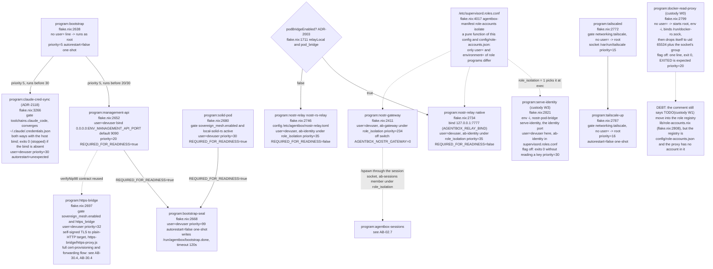

## AB-02.6 supervision tree — gated toolchain programs
```mermaid
flowchart TB
    QGIS["program:qgis-mcp<br/>flake.nix:2354<br/>gate spatial.qgis, TCP proxy to gui-tools-service:9877<br/>user=devuser priority=230"]
    BLEND["program:blender-mcp<br/>flake.nix:2381<br/>gate spatial.blender, bridges 127.0.0.1:9876 to external GUI sidecar<br/>user=devuser priority=231"]
    JLAB["program:jupyter-lab<br/>flake.nix:2454<br/>gate data_science.jupyter, bind 0.0.0.0:8888 — RESOLVED ADR-2040,<br/>JUPYTER_TOKEN now minted at boot (see AB-07.9), no longer tokenless<br/>user=devuser priority=232"]
    IMGM["program:imagemagick-mcp<br/>flake.nix:2711<br/>gate media.imagemagick<br/>user=devuser priority=210"]
    COMFY["program:comfyui-builtin<br/>flake.nix:2874<br/>gate media.comfyui_builtin, bind 127.0.0.1:8188<br/>user=devuser priority=220"]
    OPF["program:opf-router<br/>flake.nix:2759<br/>gate privacyFilterEnabled, OPF_PORT default 9092<br/>user=devuser priority=240"]
    DREAM["program:dream-engine<br/>flake.nix:2896<br/>gate dreamEngineEnabled (:1761), LOOM_URL default 192.168.2.132:8084/v1<br/>user=devuser priority=230"]
    SIDEP["program:sidestr-producer<br/>flake.nix:3105<br/>gate sidechain.enabled (:321), shipped true (agentbox.toml:1918, re-enabled on recovered validated prefixes after the ENOSPC failure, :1917) so the producer block is emitted; runs the baked upstream, refuses on a pin mismatch<br/>user=devuser, ab-sidestr-dreamlab under role_isolation priority=260 startretries=5"]
    SIDEM["program:sidestr-mirror<br/>flake.nix:3123<br/>gate sidechain.mirror, only with enabled (:322)<br/>user=devuser priority=261"]
    SIDEF["program:sidestr-faucet<br/>flake.nix:3140<br/>gate sidechain.faucet, only with enabled (:323)<br/>user=devuser, ab-faucet-dreamlab under role_isolation priority=262"]
    CODES["program:code-server<br/>flake.nix:2850<br/>gate toolchains.code_server, bind 0.0.0.0:8080 — RESOLVED ADR-2040,<br/>auth password with a boot-minted credential (see AB-07.9), not auth none<br/>user=devuser priority=50"]

    SO1["program:system-one-proxy (ADR-2139)<br/>flake.nix:3035<br/>gate system_one.enabled (:314), loopback typed-decision proxy,<br/>reads only /run/agentbox/system-one.json, vendor keys from env<br/>user=devuser priority=60 autorestart=unexpected"]
    SEO["program:seo-watch-cron<br/>flake.nix:3062<br/>gate seo_watch.enabled (:308), supercronic over the website repo crontab<br/>user=devuser priority=250"]
    TGC["program:target-gc (ADR-2138)<br/>flake.nix:3354<br/>gate resources.target_gc.enabled (:243), idle Cargo target sweeper<br/>user=devuser priority=246"]
    OPF -.->|"privacy filter mode gate"| DREAM
    SIDEP -->|"block files"| SIDEM
    SIDEP -->|"local producer"| SIDEF
    DREAM -.->|"ZAI_ANTHROPIC_API_KEY, RUVECTOR_PG_CONNINFO inherited from PID1"| RVNOTE["note: secrets never written<br/>into generated supervisor text"]
```

## AB-02.7 supervision tree — desktop stack and interaction plane
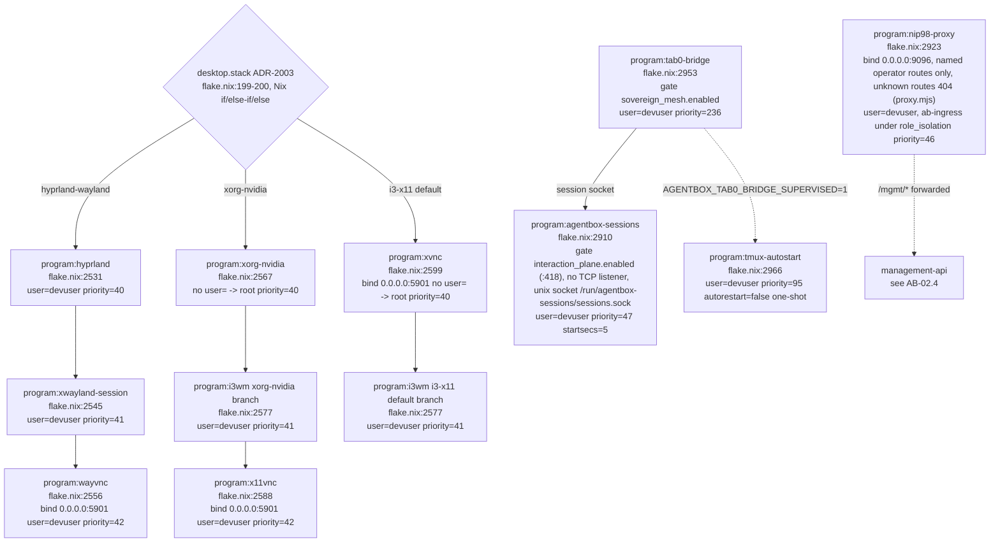

## AB-02.8 PID1 root, priority ordering and bootstrap-seal
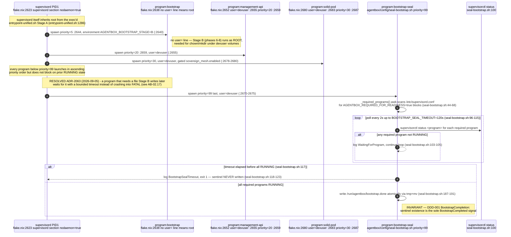

## AB-02.9 readiness — /ready vs /health
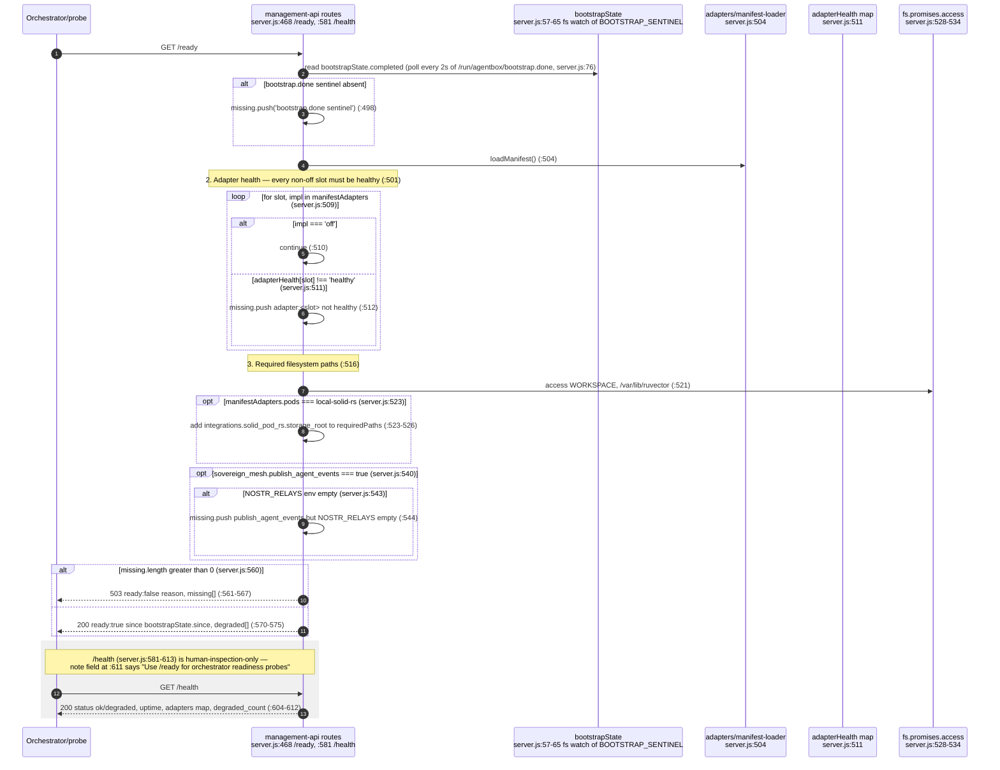

## AB-02.10 supervisord program lifecycle
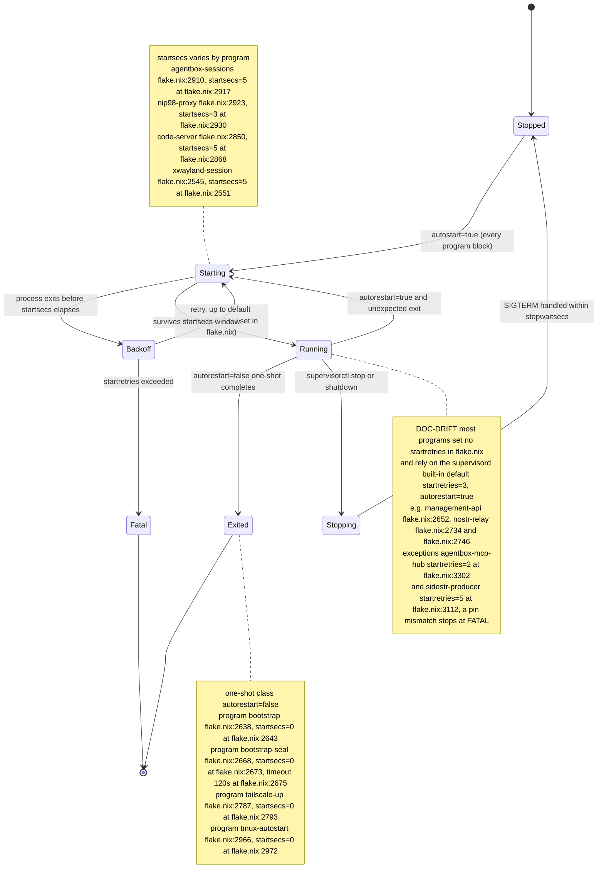

## AB-02.11 tmux-autostart window layout
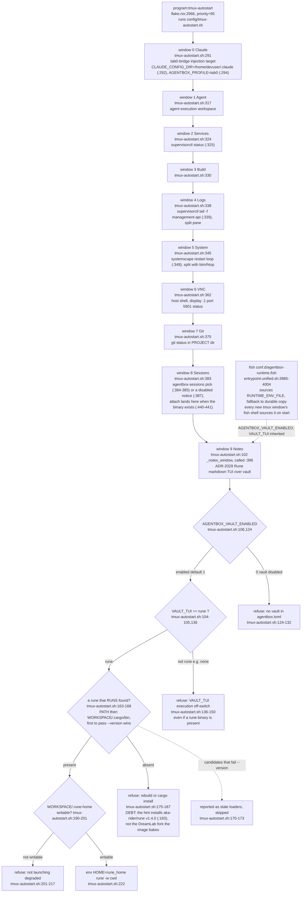

## AB-02.12 profile isolation — per-profile HOME and CLAUDE_CONFIG_DIR (ADR-2007)
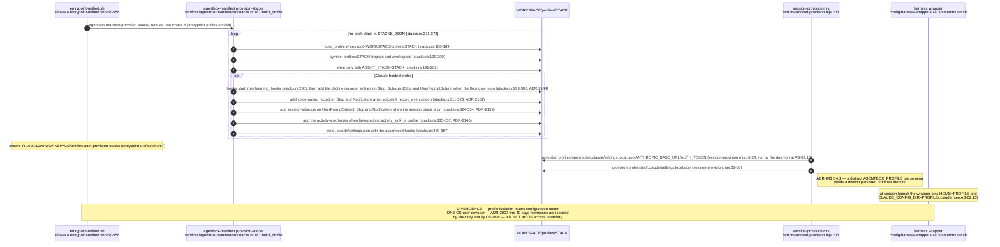

## AB-02.13 harness wrapper invocation — Z.AI / OpenRouter redirect assertion
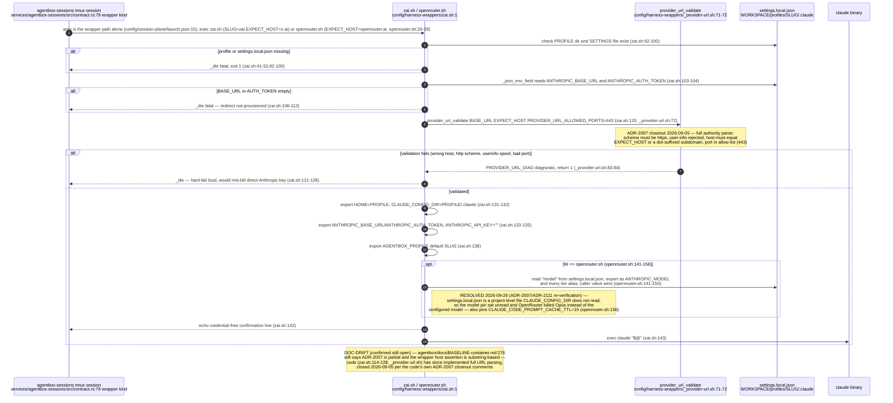

## AB-02.14 VAULT env propagation — resolve to PID1 to supervised programs
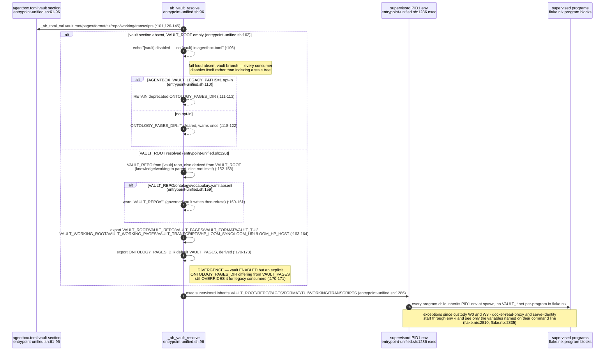

## AB-02.16 seccomp profile — supplemental denylist
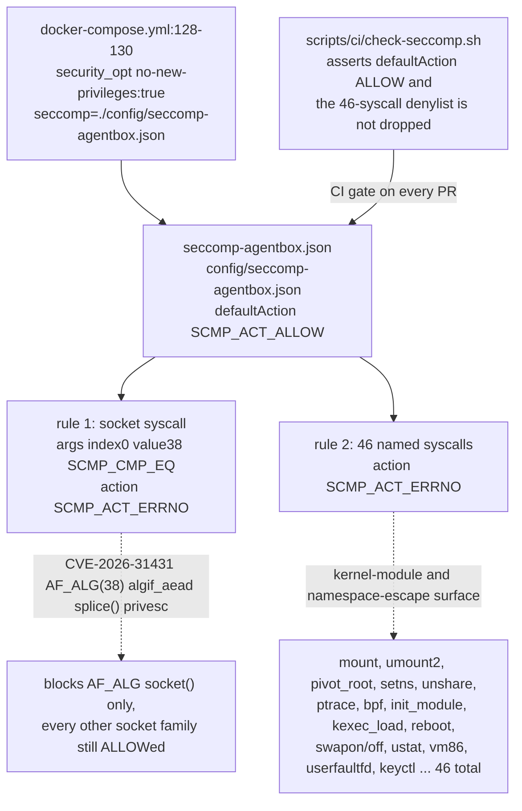

## AB-02.17 shared MCP hub: bounded wait, then a loud FATAL (ADR-2034, ADR-2104)
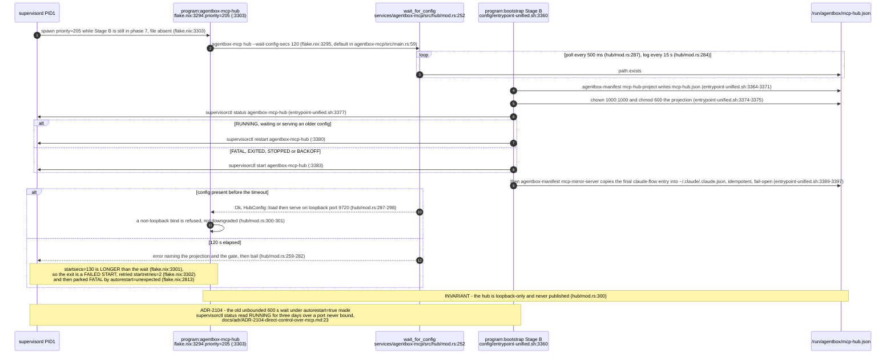

**Invariant:** a hub that never receives its projection now fails the start rather than idling, because `startsecs=130` outlives the 120 s wait (`../project/agentbox/flake.nix:3301`, `../project/agentbox/services/agentbox-mcp/src/main.rs:59`).

**Debt:** nine MCP servers are hub-routed and exactly one has a call site in this repository, so a silent hub cost nothing that was noticed for three days (`../project/agentbox/docs/adr/ADR-2104-direct-control-over-mcp.md:30`).

## AB-02.18 session plane — provision, bind, reconcile, bounded restarts (ADR-2153)
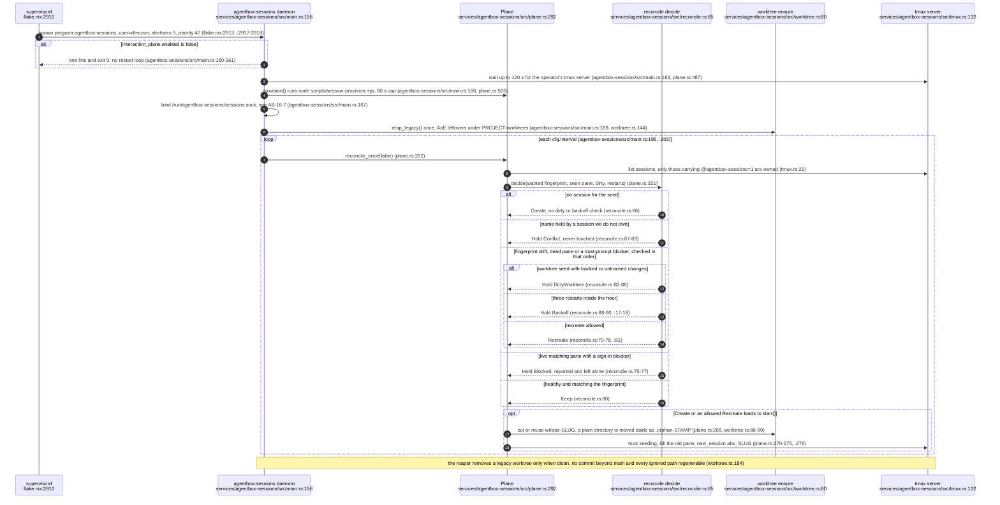

**Invariant:** ownership is a marker, not a name: only sessions carrying `@agentbox-sessions=1` are ever recreated, so `agentbox:0` (tab0), a leftover `aoe_*` session and operator sessions are never touched, and a worktree seed holding work in progress is held rather than recreated (`../project/agentbox/services/agentbox-sessions/src/tmux.rs:21`, `../project/agentbox/services/agentbox-sessions/src/reconcile.rs:67-69`, `../project/agentbox/services/agentbox-sessions/src/reconcile.rs:82-86`).
**Invariant:** trust seeding moved into the daemon: `trust::seed` writes the root store, every wrapper-profile store that already exists and the Codex config (`../project/agentbox/services/agentbox-sessions/src/trust.rs:34-39`, `../project/agentbox/services/agentbox-sessions/src/trust.rs:102`), while `trust-seed.cjs` still writes only the root store and an existing profile store (`config/hooks/trust-seed.cjs:78-86`, `config/hooks/trust-seed.cjs:91-95`).
**Open:** ADR-2153 reads `accepted`, `partial`, `live` (`../project/agentbox/docs/adr/ADR-2153-session-plane-replaces-aoe.md:5-7`) and calls its cutover "implementation evidence, not a cold-boot acceptance claim" (`../project/agentbox/docs/adr/ADR-2153-session-plane-replaces-aoe.md:144`); the unused `aoe-profiles` volume stays mounted for recovery (`../project/agentbox/docs/adr/ADR-2153-session-plane-replaces-aoe.md:145-148`).

## AB-02.19 session-provision.mjs run-as-script guard — realpath fix carried over from the AoE seeder
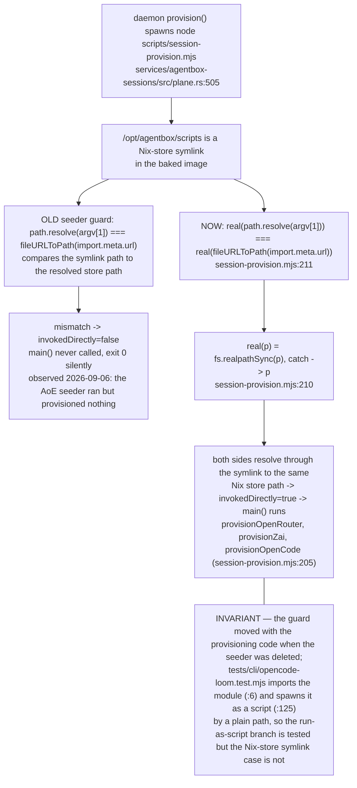

## AB-02.20 launch contract wrapper kind — router seed joins openrouter/zai (ADR-2080, ADR-2153)
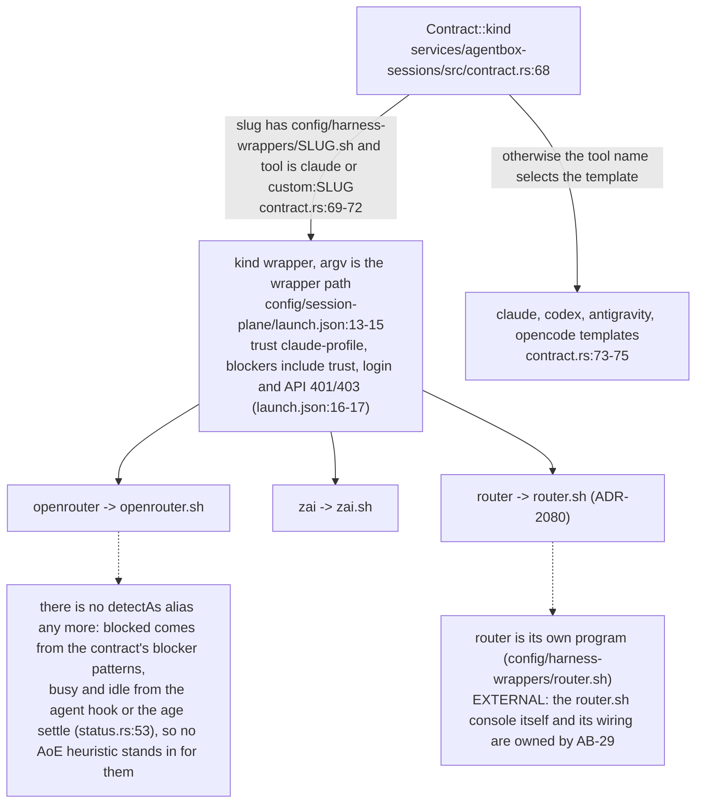

- `Contract::kind` resolves each `[[interaction_plane.session_seeds]]` slug that has a `config/harness-wrappers/<slug>.sh` and a `claude` or `custom:<slug>` tool to the `wrapper` template (`../project/agentbox/services/agentbox-sessions/src/contract.rs:68-72`), so the `router` seed (`tool = "custom:router"`, `../project/agentbox/agentbox.toml:2184`) launches exactly like `openrouter` and `zai`.
- **Drift:** two comments still describe the deleted seeder: `agentbox.toml` says `custom:router` is "resolved by the seeder's WRAPPER_SLUGS" (`../project/agentbox/agentbox.toml:2184`) and `router.sh` says it is "registered as the AoE custom_agents.router entry" (`../project/agentbox/config/harness-wrappers/router.sh:5-6`); see AB-01.11, AB-05.11 for the `[model_routing.neural]` gate that bakes `router.sh`'s artefact directory.

## AB-02.22 bootstrap.done now means the promised projections exist (ADR-2104)
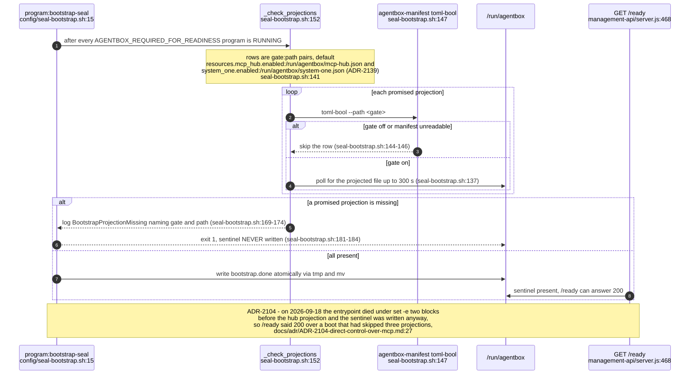

**Invariant:** the sentinel is written only after every gate-on projection in `_PROJECTIONS` exists, so `bootstrap.done` means more than "the daemons came up" (`../project/agentbox/config/seal-bootstrap.sh:181`).

**Open:** the projection table carries two rows today (`mcp_hub` and, since ADR-2139, `system_one`), and nothing forces a new boot-written file into it (`../project/agentbox/config/seal-bootstrap.sh:141`).

## AB-02.23 registry reconciliation at boot: skills, agents, commands (ADR-2092)
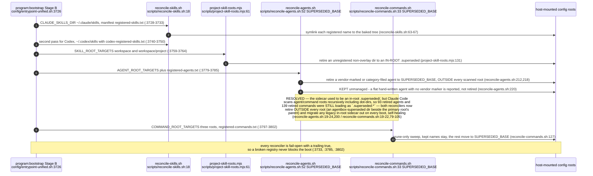

**What it shows.** The four boot-phase reconcilers that make the visible skill, agent and command sets a function of checked-in manifests rather than of whatever a vendor installer last dumped into the host mounts.
**Why it is this way.** ADR-2092: the agent roots were ungoverned, so `ruflo init` and `aqe init --auto` accreted 97 agents across two roots, 74 duplicated and 37 byte-divergent, with the nested root shadowing the user root (`config/entrypoint-unified.sh:3762-3769`).

**Invariant:** retirement is always to a recoverable sidecar, never a delete, in all three reconcilers — for agents and commands that sidecar now sits OUTSIDE every scanned root (`../project/agentbox/scripts/reconcile-agents.sh:94-105`, `../project/agentbox/scripts/reconcile-commands.sh:13-14`).

**Invariant:** a hand-written agent placed flat in the root with no vendor marker is preserved and reported, so experiments survive the sweep (`../project/agentbox/scripts/reconcile-agents.sh:220`).

**Debt:** the registries are four separate manifests in three formats (12 agents, 1 command, 20 Claude skills and 17 Codex skills), each reconciled by its own script with its own retirement rules (`../project/agentbox/agents/registered-agents.txt:1`, `../project/agentbox/config/registered-commands.txt:1`).

## AB-02.24 the role_isolation boot branch — one image, two supervisor configs (ADR-2122)
```mermaid
flowchart TB
    START["Stage A as root<br/>entrypoint-unified.sh:227 PATH sanitised to store and system dirs<br/>before the stage dispatch, in BOTH modes"]
    READ{"AGENTBOX_ROLE_ISOLATION<br/>entrypoint-unified.sh:354 _ab_toml_bool security role_isolation<br/>schema default false"}
    READY{"image can honour it?<br/>role-custody.sh:59 ab_role_isolation_ready<br/>roles config and delivery plan readable"}
    UNAV["ROLE-ISOLATION-UNAVAILABLE logged, flag forced to 0<br/>entrypoint-unified.sh:365-366"]
    subgraph OFF["role_isolation = 0 (shipped default)"]
        O1["/run/secrets chowned to devuser 0700<br/>entrypoint-unified.sh:396-398"]
        O2["host docker socket widened o+rw for devuser<br/>entrypoint-unified.sh:598-600"]
        O3["nostr.key written 0400 devuser<br/>entrypoint-unified.sh:1111-1120"]
        O4["exec supervisord -c /etc/supervisord.conf<br/>entrypoint-unified.sh:1272, :1286"]
        O5["Stage B guard /tmp/.agentbox-root<br/>entrypoint-unified.sh:245"]
        O1 --> O2 --> O3 --> O4 --> O5
    end
    subgraph ON["role_isolation = 1"]
        I1["/run/secrets kept root 0711, its own mount<br/>role-custody.sh:89 ab_secrets_root_prepare"]
        I2["ROLE vars written to /run/secrets/role/NAME 0400 and unset<br/>entrypoint-unified.sh:431 _ab_role_env_capture"]
        I3["socket left as found, ok or degraded docker-socket recorded<br/>entrypoint-unified.sh:598 _ab_docker_socket_access"]
        I4["volume and env secrets delivered per role from role-secrets.tsv<br/>role-custody.sh:218 ab_role_secrets_deliver"]
        I5["any ROLE var still in PID1 env logged as a LEAK and unset<br/>entrypoint-unified.sh:475 _ab_role_env_scrub"]
        I6["exec supervisord -c /etc/supervisord.roles.conf<br/>role-custody.sh:48 ab_supervisord_conf_pick"]
        I7["Stage B guard /run/secrets/.root-guard<br/>role-custody.sh:36 ab_root_state_dir_pick"]
        I1 --> I2 --> I3 --> I4 --> I5 --> I6 --> I7
    end
    CLAIM["Stage B claims the guard with an atomic mkdir<br/>a supervisorctl replay is a no-op exit 0<br/>entrypoint-unified.sh:266 _ab_stage_b_claim"]
    START --> READ
    READ -->|"0"| OFF
    READ -->|"1"| READY
    READY -->|"no"| UNAV --> OFF
    READY -->|"yes"| ON
    OFF --> CLAIM
    ON --> CLAIM
    ON -.-> RO["devuser shells get DOCKER_HOST=/run/docker-ro.sock<br/>GET-only, exec and run answer 403<br/>docker-read-proxy.cjs:134-136 drops to 65534 after bind"]
    OFF -.-> SIDOFF["serve-identity and docker-read-proxy print one line and exit 0<br/>identity_port/mod.rs:93-96, docker-read-proxy.cjs:144-146"]
```

**What it shows.** The single decision the custody change adds to the boot: `[security].role_isolation` is read once in Stage A and exported, and it selects between today's boot and the isolated one. Both supervisor configs, the role accounts and the delivery plan ship in every image, so the flag is boot-class: a restart flips it, a rebuild does not. The PATH sanitiser and the Stage B one-shot guard sit outside the branch and apply in both modes.
**Why it is this way.** The custody design (ADR-2122, X-1 step 1) closes three bypasses: root running devuser-planted code, devuser driving the host Docker daemon, and role secrets inherited by every process from PID 1. The first is closed unconditionally. The other two change what devuser can do, so they sit behind a flag that ships off until the owner's boot rehearsal passes. Per-role detail, the identity port and the rehearsal are in AB-36.

**Invariant:** root's boot PATH holds only `/nix/store` entries and the image's fixed system directories, in both modes, so a binary planted in the devuser-owned workspace cargo bin can no longer run as root (`../project/agentbox/config/entrypoint-unified.sh:212`, `../project/agentbox/config/entrypoint-unified.sh:227`). The cargo bin reaches devuser shells only, appended (`../project/agentbox/config/entrypoint-unified.sh:3898`).

**Invariant:** Stage B runs once per container start: a `supervisorctl start bootstrap` replay finds `stage-b.claimed` already made and exits 0 without running anything, and a missing or squatted guard directory makes Stage B refuse (`../project/agentbox/config/entrypoint-unified.sh:266-270`, `config/entrypoint-unified.sh:1315-1319`).

**Invariant:** devuser is not a member of group `root`, unconditionally: the baked group file now reads `root:x:0:` with no members, and undoing it needs a rebuild (`../project/agentbox/flake.nix:4044`).

**Invariant (under role_isolation):** no ROLE variable is in PID 1's environment when supervisord starts, so no supervised program inherits a signing key. The capture writes each to a 0400 file and unsets it, and a final scrub logs and unsets any that reappear (`../project/agentbox/config/entrypoint-unified.sh:419`, `../project/agentbox/config/entrypoint-unified.sh:1285`). With the flag off both functions return at their first line, and PID 1 still carries every `.env` key.

**Invariant (under role_isolation):** the entrypoint does not widen the host Docker socket for devuser (`../project/agentbox/config/entrypoint-unified.sh:601-601`). With the flag off it still runs `chmod o+rw` on every boot.

**Debt:** `[program:docker-read-proxy]` has no `user=` and drops privilege itself. Its comment still names a W1 follow-up to move it into `lib/role-accounts.nix` with its own account (`flake.nix:2808-2809`), but the role registry W1 shipped is `config/role-accounts.json` (`../project/agentbox/config/role-accounts.json:3`), and it has no row for the proxy.

**Drift:** `docs/BASELINE-container.md:77` calls `[security].role_isolation` boot-class, but the manifest catalogue entry is `apply_class: 'rebuild'` (`management-api/lib/system-manifest.js:97-99`) and the entrypoint comment says rebuild-class since ER-9 because the devuser sudo drop is baked (`config/entrypoint-unified.sh:351`, `flake.nix:4052-4059`).
