## AB-03.1 server.js boot part 1 — Fastify construction, hooks, static route registers

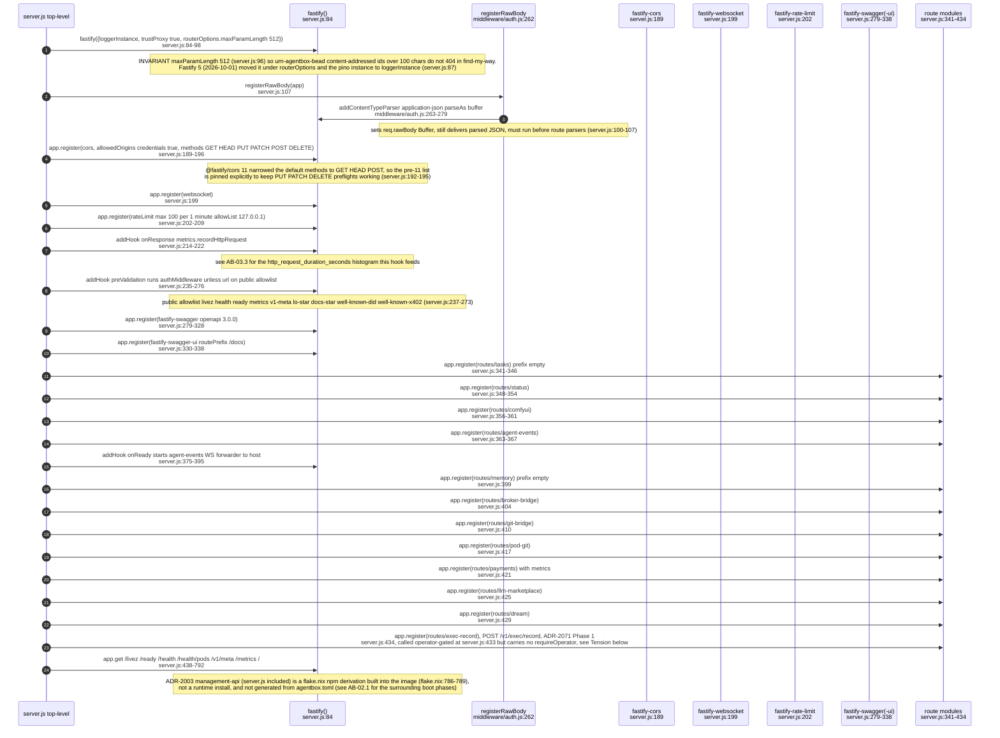

**Tension:** `POST /v1/exec/record` is described as "operator-gated" (`../project/agentbox/management-api/server.js:433`, `../project/agentbox/management-api/routes/exec-record.js:6-7`), but the only gate is the global `preValidation` auth hook (`../project/agentbox/management-api/server.js:235-276`). The route attaches no `requireOperator` preHandler, unlike `routes/mandate.js` (`../project/agentbox/management-api/routes/mandate.js:311`). In `hybrid` or `nip98` mode any NIP-98-verified signer passes `authMiddleware` (`../project/agentbox/management-api/middleware/auth.js:194-199`), so any authenticated principal can append to the journal, not only the operator.

## AB-03.2 server.js boot part 2 — async start() manifest-gated route mounts

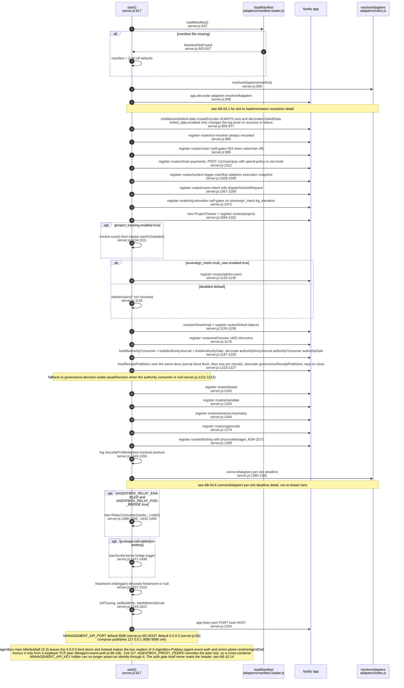

**Drift:** the route tables AB-03.6 to AB-03.11 do not draw four mounted surfaces: `routes/status` (`../project/agentbox/management-api/server.js:348`), `routes/chain` (`../project/agentbox/management-api/server.js:999`), `routes/chain-payments` (`../project/agentbox/management-api/server.js:1012`) and `routes/briefing` (`../project/agentbox/management-api/server.js:1289`). The topic is a partial route census, not the complete one its title implies.

## AB-03.3 generic request lifecycle — Fastify hook phases, auth and validation failure

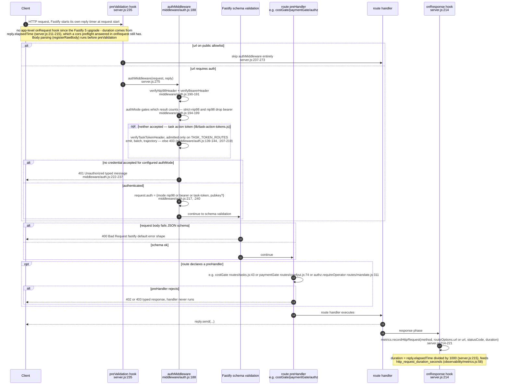

## AB-03.4 lib/authz.js — identity resolution predicates

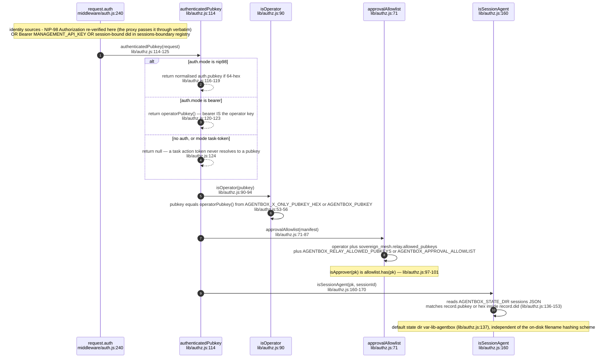

## AB-03.5 lib/authz.js — requireOperator and requireApprover preHandler gates

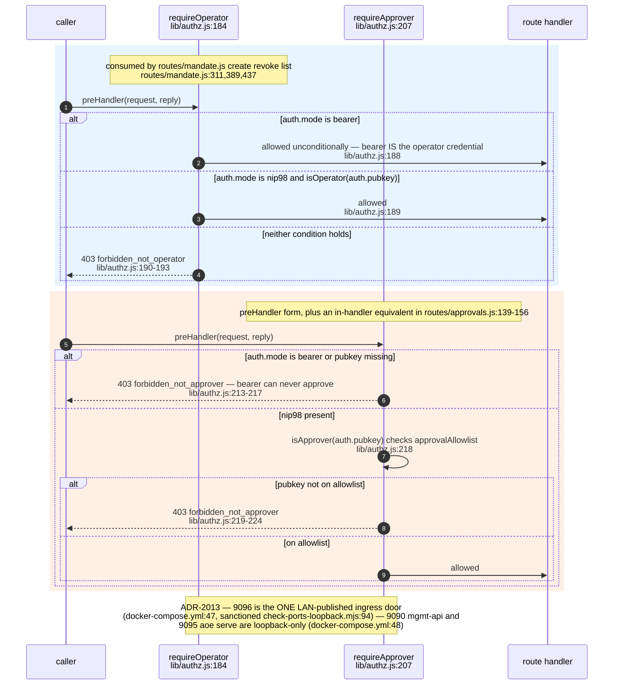

## AB-03.6 route table (a) — system, status, well-known, uri-resolver, meta probes

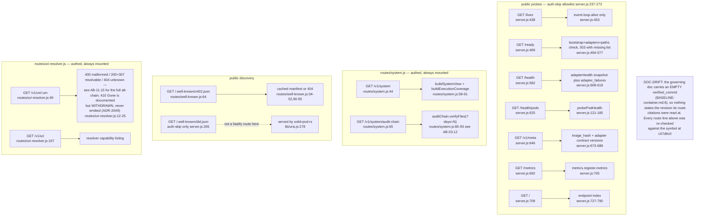

## AB-03.7 route table (b) — tasks, beads, projects

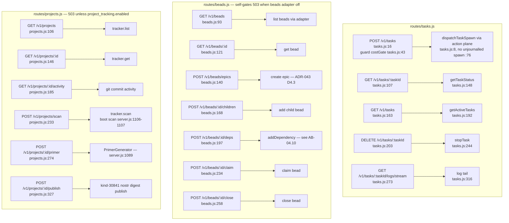

## AB-03.8 route table (c) — memory, kg-elevation, linked-objects

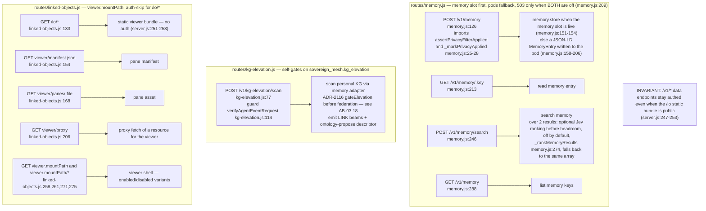

**Drift:** the panel previously labelled `POST /v1/memory` as guarded by `wrapWithPrivacyFilter` at `middleware/privacy-filter.js:649`. The route never calls that wrapper. It imports only the marker and assertion helpers (`../project/agentbox/management-api/routes/memory.js:25-28`). Redaction happens one layer down, where `wrapDispatch` wraps every adapter method (`../project/agentbox/management-api/observability/metrics.js:127`), see AB-04.4.

## AB-03.9 route table (d) — sessions-boundary, agent-events, admin-users, approvals, mandate

```mermaid
flowchart TD
    subgraph sb["routes/sessions-boundary.js — ADR-043 D4.1-D4.5"]
        S1["POST /v1/sessions/boundary<br/>sessions-boundary.js:167"] --> SH1["bind did:nostr + URN + beads epic + memory namespace"]
    end
    subgraph ae["routes/agent-events.js"]
        E1["GET /v1/agent-events/stream<br/>agent-events.js:58<br/>websocket true"] --> EH1["WS push of agent action events"]
        E2["GET /v1/agent-events<br/>agent-events.js:129"] --> EH2["poll recent events"]
        E3["POST /v1/agent-events/emit<br/>agent-events.js:320<br/>guard verifyAgentEventRequest + reconcileTaskScope + reconcileSourceUrn<br/>agent-events.js:377-398"] --> EH3["emitAgentAction — failure classified via AB-03.13"]
        E4["POST /v1/agent-events/batch<br/>agent-events.js:455<br/>same guard per event"] --> EH4["batch emit"]
        E9["POST /v1/agent-events/trajectory<br/>agent-events.js:571<br/>ADR-2164, task token confined to its own task (agent-events.js:635)"] --> EH9["persistTrajectory, 503 without the external-pg memory adapter<br/>agent-events.js:626-636"]
        E10["POST /v1/agent-events/routing-label<br/>agent-events.js:661"] --> EH10["persistRoutingLabels over the same pool<br/>agent-events.js:699"]
        E5["GET /v1/agent-events/types<br/>agent-events.js:721"] --> EH5["AgentActionType enum listing"]
        E6["POST /v1/agent-events/hook<br/>agent-events.js:755"] --> EH6["Claude Code hook ingest"]
        E7["GET /v1/agent-events/registry<br/>agent-events.js:805"] --> EH7["registry snapshot"]
        E8["GET /v1/agent-events/status<br/>agent-events.js:828"] --> EH8["forwarder status"]
    end
    subgraph au["routes/admin-users.js — mounted only if sovereign_mesh.multi_user.enabled"]
        AU1["POST /admin/users/provision<br/>admin-users.js:138"] --> AUH1["501 stub — see PRD-007 (server.js:1140)"]
        AU2["POST /admin/users/:pubkey/git-init<br/>admin-users.js:196"] --> AUH2["501 stub"]
        AU3["POST /admin/users/:pubkey/suspend<br/>admin-users.js:230"] --> AUH3["501 stub"]
        AU4["POST /admin/users/:pubkey/archive<br/>admin-users.js:246"] --> AUH4["501 stub"]
    end
    subgraph ap["routes/approvals.js — ADR-043 D4.7"]
        AP1["GET /v1/approvals<br/>approvals.js:55"] --> APH1["authorityConsumer.listPending or wired false<br/>then annotateApprovals, advisory review_aid, Jev option off by default<br/>approvals.js:88-95"]
        AP2["POST /v1/approvals/:id/decide<br/>approvals.js:99<br/>guard nip98-only + isApprover approvals.js:139-156"] --> APH2["sign+publish kind-31403 — see AB-03.5"]
    end
    subgraph md["routes/mandate.js — ADR-043 D4.5, guard requireOperator"]
        MD1["POST /v1/mandate<br/>mandate.js:310<br/>guard requireOperator mandate.js:311"] --> MDH1["create scoped WAC mandate"]
        MD2["POST /v1/mandate/revoke<br/>mandate.js:388<br/>guard requireOperator mandate.js:389"] --> MDH2["revoke mandate"]
        MD3["GET /v1/mandate<br/>mandate.js:436<br/>guard requireOperator mandate.js:437"] --> MDH3["list mandates"]
    end
    sb ~~~ ae
    ae ~~~ au
    au ~~~ ap
    ap ~~~ md
```

**Drift:** two agent-events write routes joined since the previous stamp, `POST /v1/agent-events/trajectory` and `POST /v1/agent-events/routing-label` (`../project/agentbox/management-api/routes/agent-events.js:571`, `../project/agentbox/management-api/routes/agent-events.js:661`). Trajectory joins emit and batch as the only three routes a per-task action token may reach (`../project/agentbox/management-api/middleware/auth.js:139-144`). Routing-label is not on that list, so a task token gets 403 there.

## AB-03.10 route table (e1) — payments, llm-marketplace, dream, comfyui

```mermaid
flowchart TD
    subgraph pay["routes/payments.js — x402 web ledger"]
        PY1["GET /v1/pay/info<br/>payments.js:147"] --> PYH1["ledger info"]
        PY2["GET /v1/pay/balance<br/>payments.js:205"] --> PYH2["balance via solid-pod-rs"]
        PY3["POST /v1/pay/deposit<br/>payments.js:286"] --> PYH3["deposit — consumed by middleware/consumer-payer.js"]
        PY4["POST /v1/pay/estimate<br/>payments.js:315"] --> PYH4["cost estimate"]
        PY5["POST /v1/pay/buy<br/>payments.js:402"] --> PYH5["buy compute/LLM resource"]
        PY6["POST /v1/pay/withdraw<br/>payments.js:525"] --> PYH6["withdraw"]
    end
    subgraph llm["routes/llm-marketplace.js — Nostr kinds 38300-38305"]
        LM1["POST /v1/llm/advertise<br/>llm-marketplace.js:100"] --> LMH1["advertise LLM compute"]
        LM2["DELETE /v1/llm/advertise<br/>llm-marketplace.js:161"] --> LMH2["withdraw advert"]
        LM3["GET /v1/llm/discover<br/>llm-marketplace.js:180"] --> LMH3["discover offers"]
        LM4["POST /v1/llm/request<br/>llm-marketplace.js:221"] --> LMH4["request a grant"]
        LM5["POST /v1/llm/grant<br/>llm-marketplace.js:275"] --> LMH5["grant access"]
        LM6["POST /v1/llm/deny<br/>llm-marketplace.js:341"] --> LMH6["deny request"]
        LM7["POST /v1/llm/receipt<br/>llm-marketplace.js:378"] --> LMH7["settle receipt"]
        LM8["POST /v1/llm/revoke<br/>llm-marketplace.js:438"] --> LMH8["revoke grant"]
        LM9["GET /v1/llm/grants<br/>llm-marketplace.js:534"] --> LMH9["list grants"]
        LM10["GET /v1/llm/stats<br/>llm-marketplace.js:556"] --> LMH10["marketplace stats"]
    end
    subgraph dream["routes/dream.js — operator-gated, ADR-055"]
        DR1["GET /dream/status<br/>dream.js:24"] --> DRH1["read-only per-repo dream ledgers"]
    end
    subgraph comfy["routes/comfyui.js — guard paymentGate GPU-metered"]
        CF1["POST /v1/comfyui/workflow<br/>comfyui.js:23<br/>guard paymentGate costSats 100 tier gpu comfyui.js:74"] --> CFH1["submit ComfyUI workflow"]
        CF2["GET /v1/comfyui/workflow/:workflowId<br/>comfyui.js:112"] --> CFH2["workflow status"]
        CF3["GET /v1/comfyui/models<br/>comfyui.js:163"] --> CFH3["list models"]
        CF4["GET /v1/comfyui/outputs<br/>comfyui.js:207"] --> CFH4["list outputs"]
        CF5["DELETE /v1/comfyui/workflow/:workflowId<br/>comfyui.js:251"] --> CFH5["cancel workflow"]
        CF6["GET /v1/comfyui/stream<br/>comfyui.js:319<br/>websocket true"] --> CFH6["WS progress stream"]
    end
    pay ~~~ llm
    llm ~~~ dream
    dream ~~~ comfy
```

## AB-03.11 route table (e2) — voice-intent, broker-bridge, git-bridge, pod-git

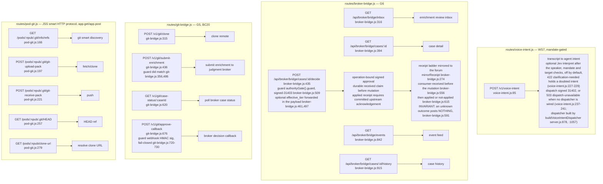

## AB-03.12 lib/audit-chain.js — hash-chained events append and verify

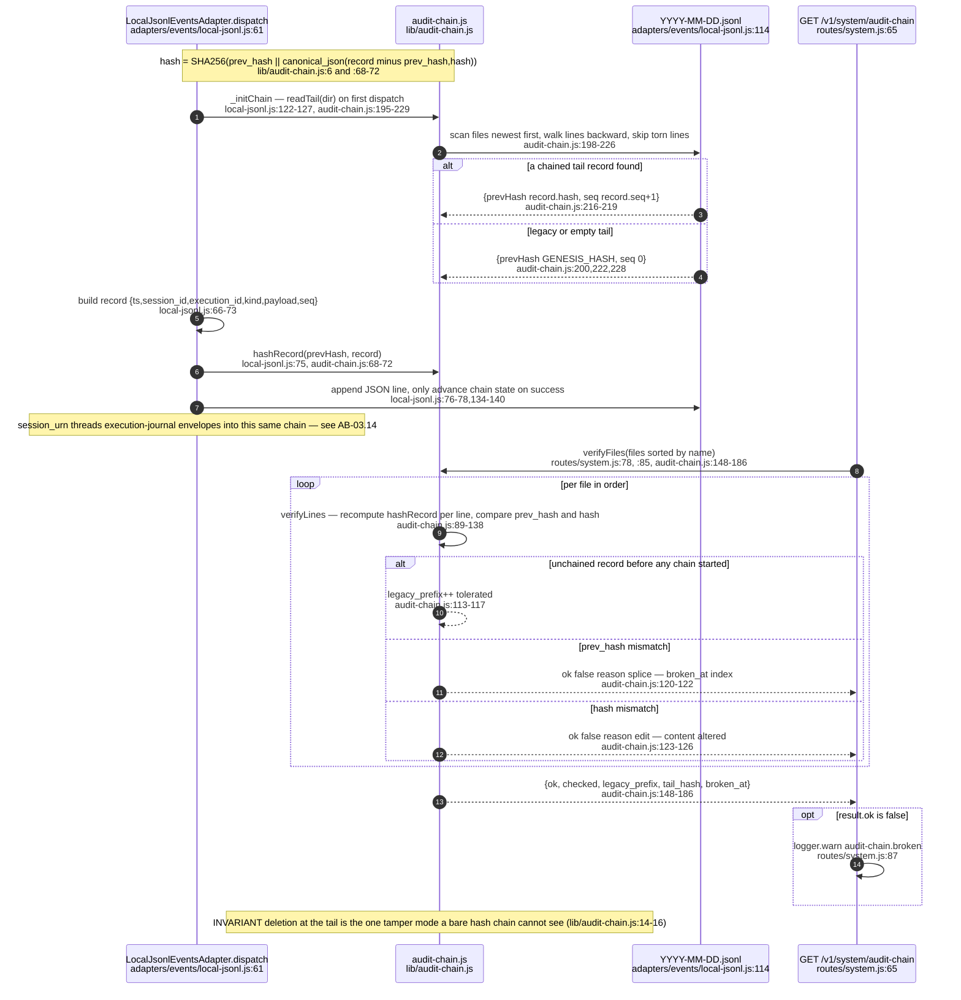

## AB-03.13 lib/failure-taxonomy.js — MAST classifier on agent-events failure returns

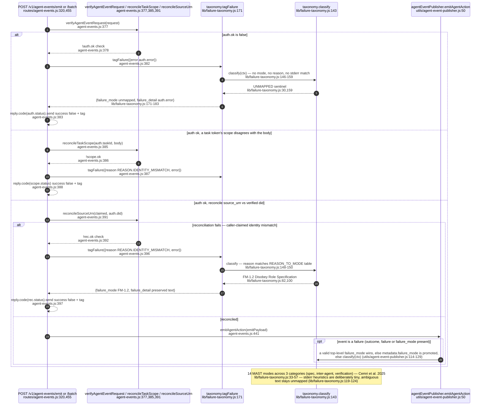

## AB-03.14 lib/execution-journal.js — ExecutionJournal.append envelope + D2 provenance gate

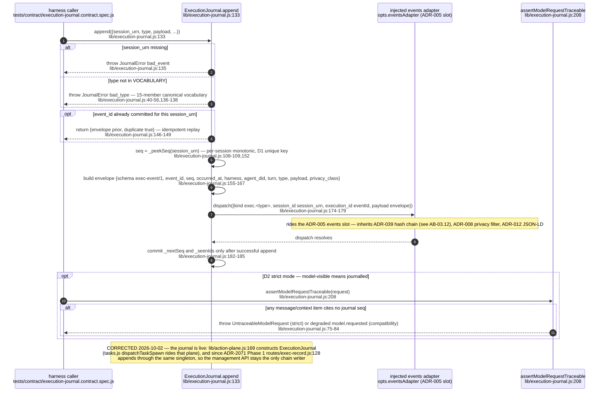

## AB-03.15 end-to-end authenticated write — nip98-proxy through the mandate registry

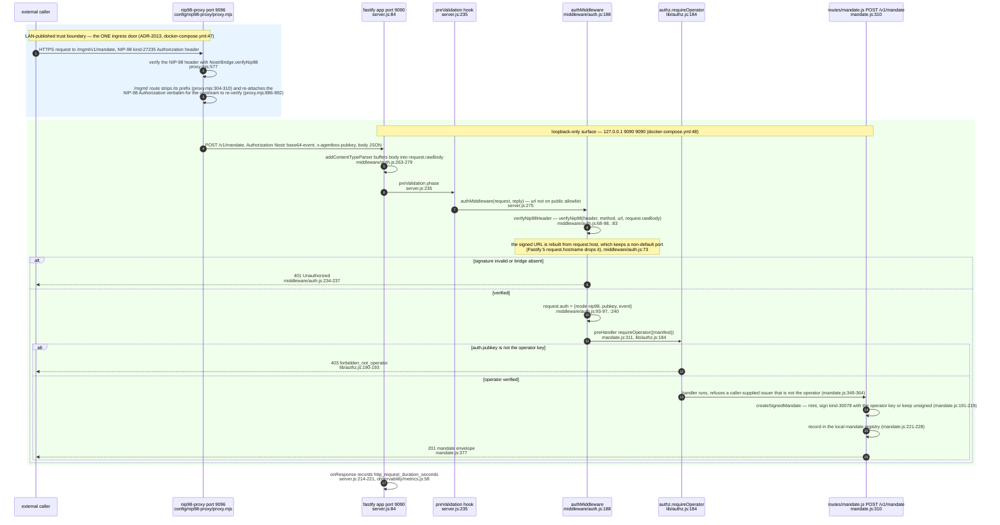

**Drift:** the earlier panel drew this write ending in an events-adapter dispatch (`mandate.created`, hash-chained into the JSONL log). `createSignedMandate` dispatches nothing to the events slot. It signs a kind-30078, or warns and keeps the mandate unsigned, and saves a local registry entry (`../project/agentbox/management-api/routes/mandate.js:191-231`). The panel also had the proxy forwarding `/mgmt/v1/mandate`, but the `/mgmt/` route strips its prefix (`../project/agentbox/config/nip98-proxy/proxy.mjs:304-310`).

**Open:** source does not show that the forwarded NIP-98 header verifies a second time at the management API. The proxy forwards the caller's header verbatim after stripping `/mgmt/` (`../project/agentbox/config/nip98-proxy/proxy.mjs:886-892`). The API rebuilds the URL from the stripped path (`../project/agentbox/management-api/middleware/auth.js:73`). `verifyNip98` accepts only an exact or suffix match of the signed `u` tag against that URL (`../project/agentbox/mcp/servers/nostr-bridge.js:545-546`). A tag that keeps `/mgmt/` is not a suffix match of the stripped URL, so this path may answer 401. Only a runtime request through `:9096/mgmt/` can settle it.

## AB-03.16 middleware/*.js inventory — which routes and hooks actually consume each file

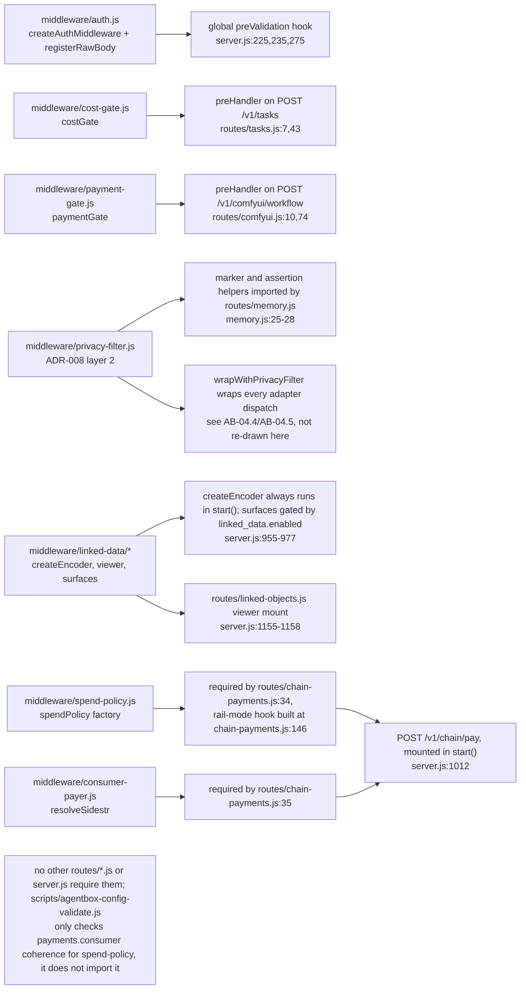

**Drift:** this panel previously drew `spend-policy.js` and `consumer-payer.js` as "consumed only by scripts/agentbox-config-validate.js", with no `require()` from any route. Its own note contradicted that, and it misattributed the `chain-payments.js` line numbers to the two middleware files. At the pin, `routes/chain-payments.js` requires both (`../project/agentbox/management-api/routes/chain-payments.js:34-35`). The validator mentions spend-policy only in its rule text (`../project/agentbox/scripts/agentbox-config-validate.js:1730-1755`).

## AB-03.18 lib/elevation-stage.js — gateElevation, ADR-2116 vault-propose gate before federation

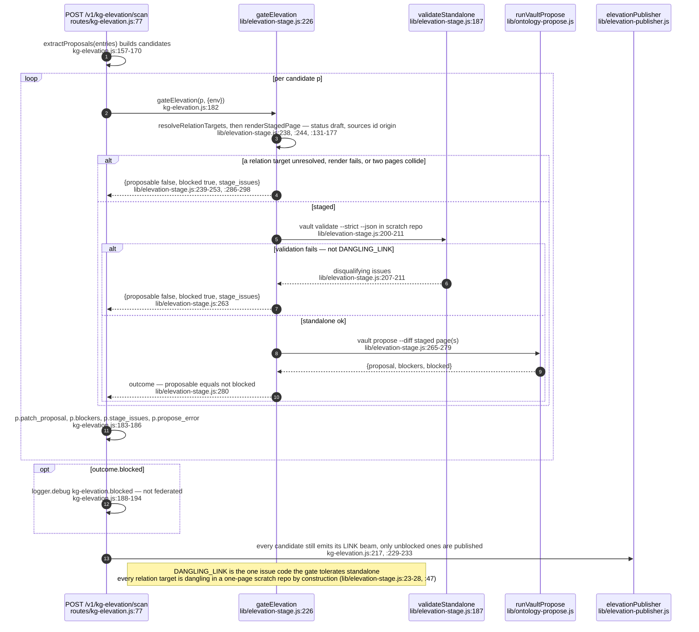
