## AB-04.1 resolveAdapters — slot to implementation resolution
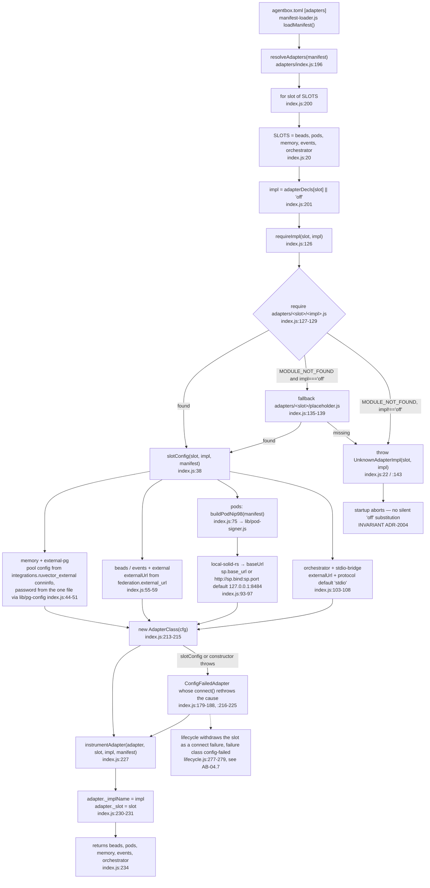

**Drift:** since the previous stamp a slot whose configuration cannot be built no longer aborts boot. `resolveAdapters` substitutes a `ConfigFailedAdapter` whose `connect()` rethrows the cause (`../project/agentbox/management-api/adapters/index.js:179-188`, `../project/agentbox/management-api/adapters/index.js:216-225`). The lifecycle then quarantines it and records `config-failed` with the offending file path, never its value (`../project/agentbox/management-api/adapters/lifecycle.js:277-279`). An unknown implementation name still throws `UnknownAdapterImpl` before construction (`../project/agentbox/management-api/adapters/index.js:143`).

## AB-04.2 Adapter class hierarchy across the three implementation classes
```mermaid
classDiagram
    class BaseAdapter {
        +String slot
        +String impl
        +String CONTRACT_VERSION
        +Boolean enabled
        +constructor(slot, impl, contractVersion) base.js:20
    }
    class EmbeddedRuvectorMemoryAdapter {
        +store(key, value, namespace) embedded-ruvector.js:76
        +search(query, opts) embedded-ruvector.js:98
        +retrieve(key, namespace) embedded-ruvector.js:119
        +del(key, namespace) embedded-ruvector.js:137
        +list(namespace) embedded-ruvector.js:149
        -_ns(namespace) embedded-ruvector.js:63
    }
    class OffMemoryAdapter {
        +store() throws AdapterDisabled off.js:19
        +search() throws AdapterDisabled off.js:20
        +retrieve() throws AdapterDisabled off.js:21
        +del() throws AdapterDisabled off.js:22
        +list() throws AdapterDisabled off.js:23
    }
    class LocalSqliteBeadsAdapter {
        +createEpic(opts) local-sqlite.js:78
        +createChild(opts) local-sqlite.js:113
        +claim(id, actor) local-sqlite.js:145
        +close(id, outcome) local-sqlite.js:168
        +addDependency(childId, blockerId, type) local-sqlite.js:195
        +getReady(filter) local-sqlite.js:236
        +show(id) local-sqlite.js:259
    }
    class SolidHttpPodsAdapter {
        -_nip98 signer or null _solid-http-base.js:54
        -_requireSigned ADR-2064 fail-closed _solid-http-base.js:55
        -_fetch signed when signer OR requireSigned _solid-http-base.js:62-64
        +write(uri, body, contentType) _solid-http-base.js:119
        +read(uri) _solid-http-base.js:135
        +patch(uri, patch) _solid-http-base.js:150
        +del(uri) _solid-http-base.js:165
        +list(container, opts) _solid-http-base.js:178
    }
    class LocalSolidRsPodsAdapter {
        +probeCapabilities() local-solid-rs.js:51
        +list(container, opts) local-solid-rs.js:72
        +patch(uri, patch, opts) local-solid-rs.js:126
    }
    class LocalJsonlEventsAdapter {
        +dispatch(event) local-jsonl.js:61
        +subscribe(filter, handler) local-jsonl.js:94
        +unsubscribe(subscriptionId) local-jsonl.js:106
        -_initChain() local-jsonl.js:122
    }
    class LocalProcessManagerOrchestratorAdapter {
        +spawnAgent(spec) local-process-manager.js:45
        +streamEvent(agentId, handler) local-process-manager.js:106
        +listAgents() local-process-manager.js:119
        +handleGovernanceDecision(event, opts) local-process-manager.js:142
        +terminateAgent(agentId) local-process-manager.js:549
    }
    BaseAdapter <|-- EmbeddedRuvectorMemoryAdapter
    BaseAdapter <|-- OffMemoryAdapter
    BaseAdapter <|-- LocalSqliteBeadsAdapter
    BaseAdapter <|-- SolidHttpPodsAdapter
    SolidHttpPodsAdapter <|-- LocalSolidRsPodsAdapter
    BaseAdapter <|-- LocalJsonlEventsAdapter
    BaseAdapter <|-- LocalProcessManagerOrchestratorAdapter
```

## AB-04.3 instrumentAdapter — prototype-chain walk that installs the wrappers
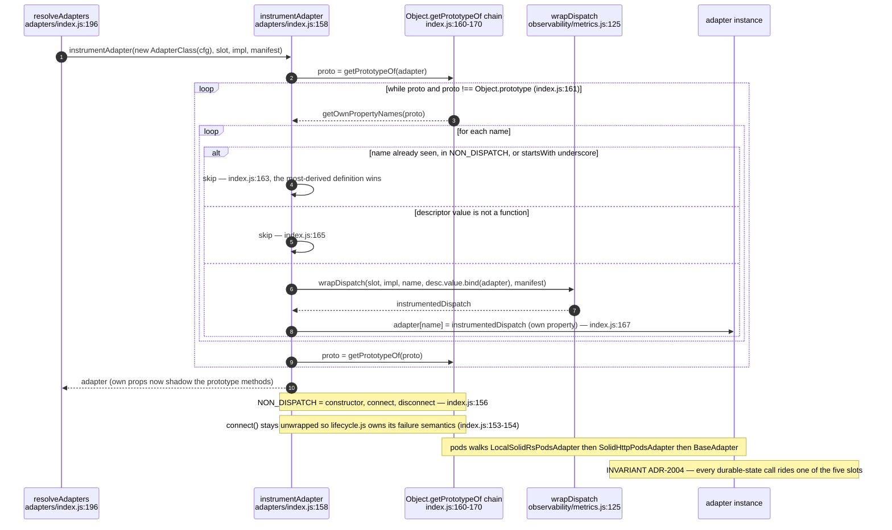

## AB-04.4 wrapDispatch — the middleware order actually wired
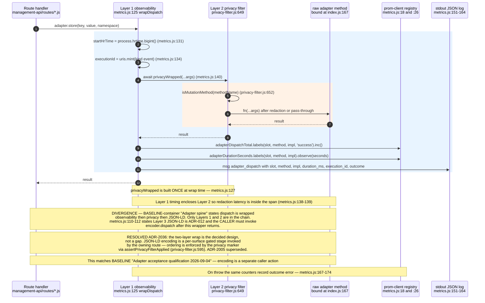

## AB-04.5 Layer 2 privacy filter — write-op gating and fail policy
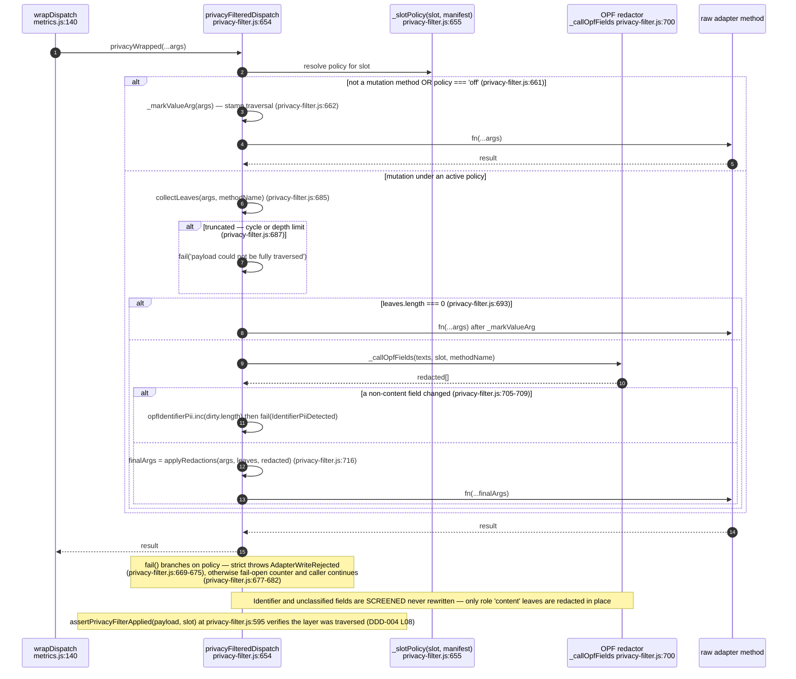

**Tension:** write-op gating is by method name. The exact set and prefix rule (`../project/agentbox/management-api/middleware/privacy-filter.js:283-313`) do not classify `dispatch`, `claim`, `close`, `del` or `spawnAgent` as mutations. The events slot's only write, `dispatch`, therefore reaches the hash-chained JSONL log without redaction, whatever the slot policy says. So do beads `claim` and `close`. The rule redacts what the vocabulary names, not everything that writes.

## AB-04.6 connectAdapters — per-slot deadline, not one aggregate budget
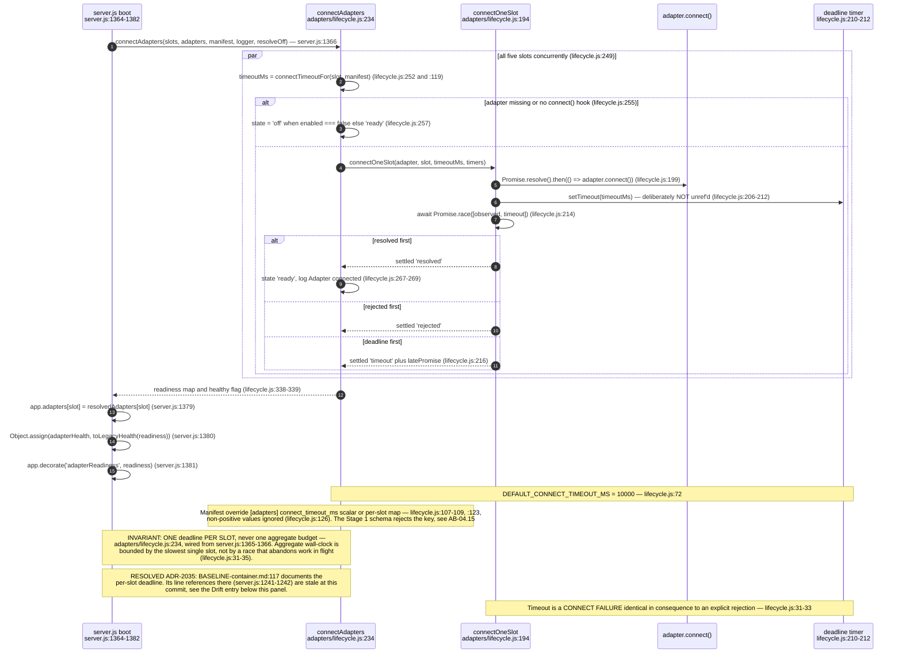

**Drift:** `docs/BASELINE-container.md` still cites `connectAdapters` as wired from `server.js:1241-1242` and `app.adapterReadiness` at `server.js:1257` (`../project/agentbox/docs/BASELINE-container.md:117`). At the pin those calls sit at `../project/agentbox/management-api/server.js:1365-1381`. It also places `instrumentAdapter` at `index.js:131` (`../project/agentbox/docs/BASELINE-container.md:112`), where the function is now at `../project/agentbox/management-api/adapters/index.js:158`. The governing document carries line numbers that no longer resolve.

## AB-04.7 Failure path — quarantine before replacement, fail-closed slots abort
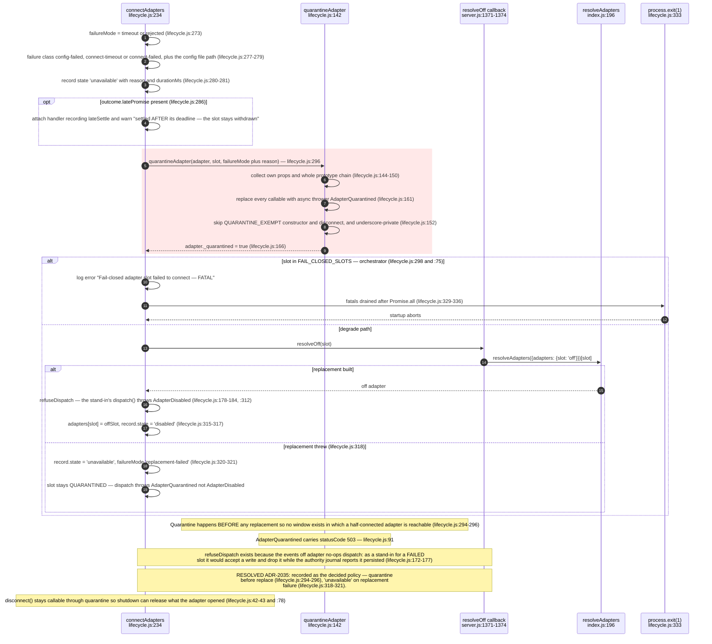

## AB-04.8 Per-slot readiness lifecycle and the legacy health collapse
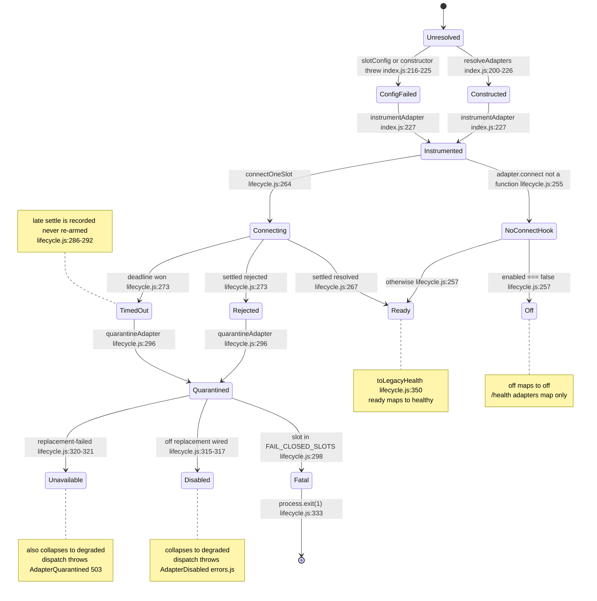

**Drift:** this panel used to map the legacy states onto the `agentbox_adapter_health` gauge as off 0, degraded 1, healthy 2. `setAdapterHealth` encodes healthy as 1, degraded as 2 and anything else as 0 (`../project/agentbox/management-api/observability/metrics.js:202-204`). Nothing in the management API calls it, so the gauge is never set at this revision. The collapse feeds only the `/health` JSON (`../project/agentbox/management-api/server.js:1380`, `../project/agentbox/management-api/server.js:608-619`).

## AB-04.9 memory.store — the configured external-pg dispatch through both layers
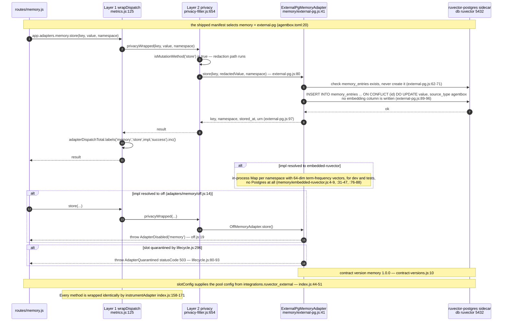

**Drift:** the previous panel drew `EmbeddedRuvectorMemoryAdapter` upserting into `memory_entries` with a 384-dimension embedding. The embedded adapter is an in-process `Map` with 64-dimension naive vectors (`../project/agentbox/management-api/adapters/memory/embedded-ruvector.js:4-9`, `../project/agentbox/management-api/adapters/memory/embedded-ruvector.js:31-47`). The Postgres writer is `external-pg`, which the manifest selects (`../project/agentbox/agentbox.toml:20`).

**Open:** `ExternalPgMemoryAdapter.store` writes `id, namespace, key, value, source_type, metadata` and no embedding (`../project/agentbox/management-api/adapters/memory/external-pg.js:89-96`). Agentbox's own `search` is an `ILIKE` text match over agentbox-owned rows (`../project/agentbox/management-api/adapters/memory/external-pg.js:103-115`), so `/v1/memory/search` is unaffected. Source cannot show whether a database-side trigger embeds these rows. If none does, estate-side semantic search over the shared table (HNSW) cannot reach agentbox-written entries.

## AB-04.10 beads.addDependency and beads.getReady — the 1.1.0 work-DAG pair
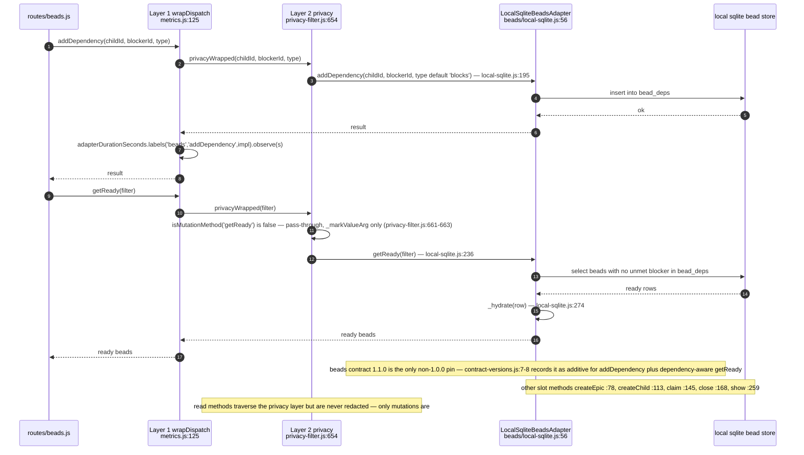

## AB-04.11 pods.write — NIP-98 origination through the signed fetch
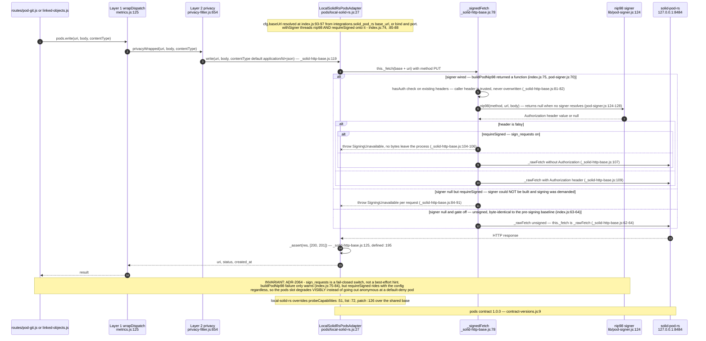

## AB-04.13 orchestrator.spawnAgent and handleGovernanceDecision — the ADR-2109 ontology write
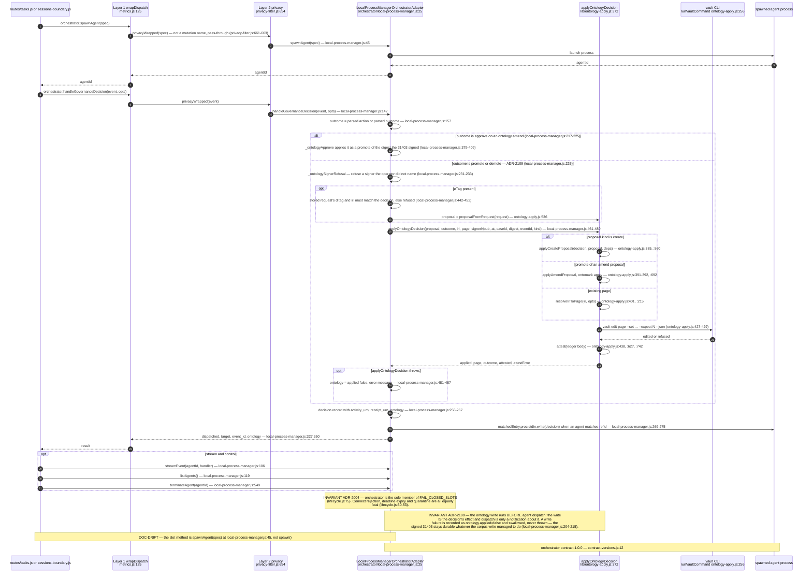

## AB-04.14 Contract-version pins per slot
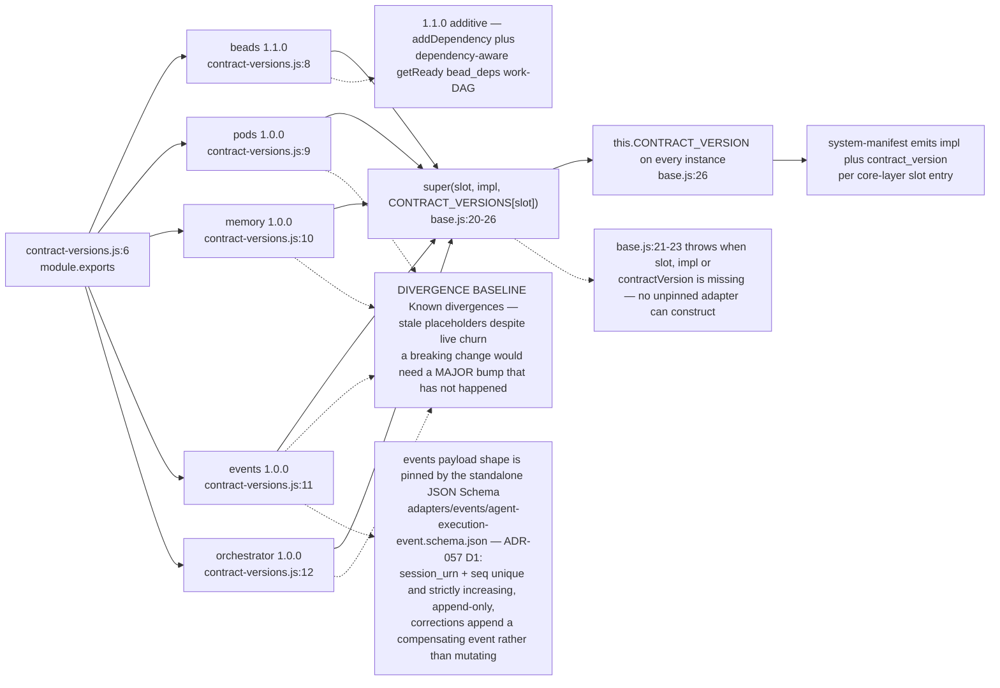

## AB-04.15 The four validation stages — different files, different lifecycle points
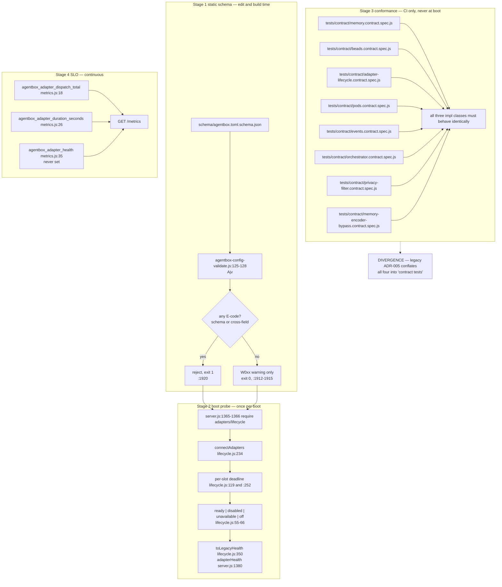

**Tension:** the schema's `[adapters]` table sets `additionalProperties: false` and does not declare `connect_timeout_ms` (`../project/agentbox/schema/agentbox.toml.schema.json:50-52`). Stage 1 compiles that schema with Ajv (`../project/agentbox/scripts/agentbox-config-validate.js:125-128`). The per-slot override that Stage 2 reads (`../project/agentbox/management-api/adapters/lifecycle.js:107-109`) is therefore rejected by Stage 1 as an unknown key, so the documented knob cannot pass validation.

**Drift:** BASELINE stage 4 says the slot SLO is "surfaced as the `agentbox_adapter_health` gauge ∈ {0,1,2}" (`../project/agentbox/docs/BASELINE-container.md:119`). The gauge is declared (`../project/agentbox/management-api/observability/metrics.js:35-40`), but its only setter has no caller in the repository. The help text and the setter agree on the encoding: 0 unhealthy (so `off` would read as 0), 1 healthy, 2 degraded (`../project/agentbox/management-api/observability/metrics.js:37`, `../project/agentbox/management-api/observability/metrics.js:202-204`). Earlier versions of this topic gave healthy as 2, which contradicts both. Stage 1's rejection is also wider than "structural only": cross-field E-rules such as E-PAY1 reject as well (`../project/agentbox/scripts/agentbox-config-validate.js:1755`).

## AB-04.16 SLO surfacing and the agentbox.sh health exit contract
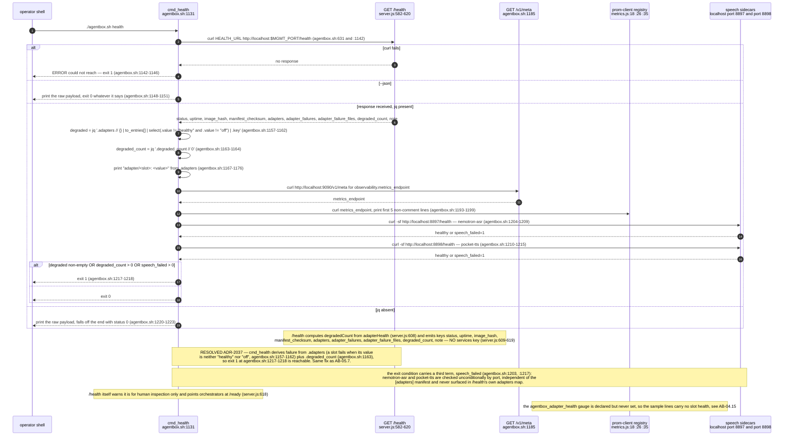

**Tension:** the non-zero exit is reachable only on the pretty-print path. `--json` prints the payload and exits 0 (`../project/agentbox/agentbox.sh:1148-1151`). A host without `jq` prints the raw payload and returns 0 even when slots are degraded (`../project/agentbox/agentbox.sh:1220-1223`). A script that pipes `agentbox.sh health --json` gets no failure signal.
