## AB-05.1 GET /v1/system — catalogue plus live introspection
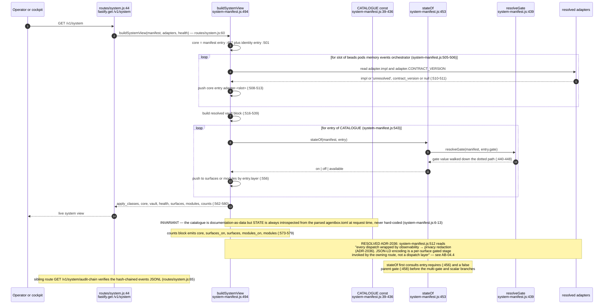

## AB-05.2 Catalogue shape and the real surface/module census
```mermaid
flowchart TD
    CAT["CATALOGUE array<br/>system-manifest.js:39-436<br/>121 entries total"] --> SURF["layer 'surface' — 14 entries"]
    CAT --> MOD["layer 'module' — 107 entries"]
    SURF --> S1["ungated: management-api, terminal, setup-wizard,<br/>uri-resolver, agent-events-stream, metrics<br/>system-manifest.js:41-71"]
    SURF --> S2["gated: code-server, jupyter, desktop, comfyui,<br/>linked-data-viewer, interaction-plane, tab0-bridge<br/>system-manifest.js:50-77"]
    MOD --> M1["toolchain + CLI: ruflo, agentic-qe, nagual-qe, deepsec,<br/>role-isolation ADR-2122, codebase-memory, metaharness-binaries,<br/>metaharness-plugin, ruflo-console, codex, model-routing,<br/>model-routing-neural ADR-2080, antigravity, agentbox-sessions-binary,<br/>rust-toolchain, opencode — system-manifest.js:85-130"]
    MOD --> M2["GPU/media: qgis-mcp, blender-mcp, imagemagick-mcp, ffmpeg,<br/>pytorch, docs-toolchain, code-interpreter, web-researcher,<br/>compression, tailscale, dream-machine, cuda<br/>system-manifest.js:133-169, gaussian-splatting :415-417"]
    MOD --> M3["sidecars flagged heavy: browser-sidecar :172, gui-tools-sidecar :175,<br/>voice-console :181, privacy-filter :241<br/>system-manifest.js:172-182, :241-243"]
    MOD --> M4["sovereign/governance: sovereign-mesh :190, solid-pod :195,<br/>linked-data :214, payments :217, payments-sidestr :220,<br/>poker-citizen :223, poker-citizen-dreamlab-txbt4 :226,<br/>poker-coach :229, llm-marketplace :232, project-tracking :235,<br/>consultants :238, plugins :244, orchestration-proxy :247<br/>system-manifest.js:190-247"]
    MOD --> M5["memory: ruvector-external :204, memory-learning :207,<br/>memory-hygiene :210, ruvnet-brain :250<br/>system-manifest.js:204-212, :250-252"]
    MOD --> M6["NEW ADR-2116/ADR-2118: claude-code-permissions :253,<br/>claude-code-model-roles :256 (ADR-2134), instruction-tiers :259,<br/>claude-cred-sync :265<br/>system-manifest.js:253-267"]
    MOD --> M7["System One / Jev routing ADR-2091/2093/2094/2095/2110:<br/>jev-compaction :268, jev-checkpoints :271 (ADR-2135), system-one-proxy :274 (ADR-2139), system-one-network :277 (2026-10-30),<br/>sovereign-system-one :280, 19 system-one-consumer-* gates :288-344,<br/>skill-router :345, skill-router-cascade :348, routing-teacher-labels :351<br/>system-manifest.js:268-352 — see AB-05.13"]
    MOD --> M8["ontology :360, harness-bridge :367, colloquy :370,<br/>podcast-ingest :373, NEW diagram-review :376, NEW seo-watch :379<br/>system-manifest.js:360-381"]
    MOD --> M9["corpus: vault :397, vault-tui :400,<br/>vault-cli :403 NEW ADR-2107/ADR-2108<br/>system-manifest.js:397-405"]
    MOD --> M10["aci-shell :409, tree-search-coder :412, resources-envelope :421,<br/>mcp-hub :424, hook-shim :427, teammate-gc :430, NEW target-gc :433 (ADR-2138)<br/>system-manifest.js:409-435"]
    MOD --> M11["NEW since e4993a3b: sidechain system-manifest.js:382 (three gates,<br/>requires sidechain.enabled), sidechain-dreamlab-txbt4 :385 ADR-2103"]
    MOD --> M12["NEW since 3f05ae9e7: junkiejarvis :80 (surface), blender-local :139, isaac-sim-sidecar :178,<br/>voicelink :184, voicelink-hooks :187, solid-pod-forge :198, solid-pod-trust-proxy :201,<br/>collaboration-floor :262, activity-sink :357, vault-loom-sync :406 — see AB-05.17"]
    CAT --> FIELDS["per-entry fields: id, name, layer, gate or gates,<br/>service, apply_class, summary, heavy, requires"]
    FIELDS --> CORE["core layer emitted separately by buildSystemView<br/>manifest, identity, five adapter-<slot> entries<br/>system-manifest.js:495-513"]
```

## AB-05.3 stateOf — how a gate value becomes a state word
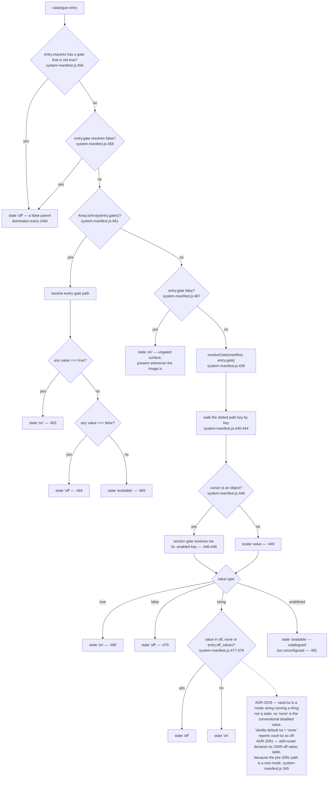

## AB-05.4 [vault] — the single corpus path authority, catalogued as three entries
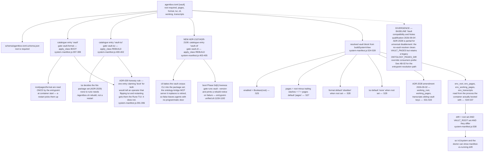

## AB-05.5 agentbox.sh top-level subcommand dispatch
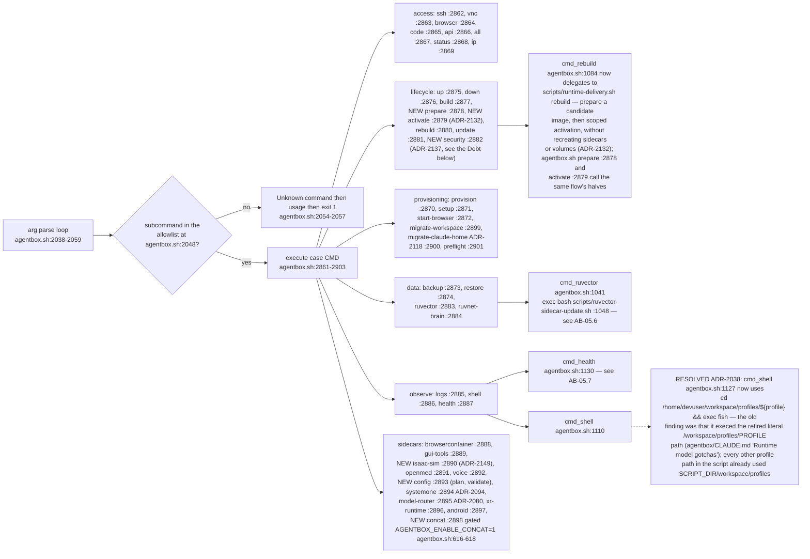

**Debt:** the `config` arm of the dispatch case (`../project/agentbox/agentbox.sh:2893`) is unreachable: the argument loop admits only the allowlisted subcommands and `config` is not among them (`../project/agentbox/agentbox.sh:2048`), so `./agentbox.sh config plan "<request>"` prints "Unknown command" although `cmd_config` exists (`../project/agentbox/agentbox.sh:2441-2447`); `scripts/config-plan.cjs` and `scripts/agentbox-config-validate.js` still run directly.

**Drift (resolved, `security` subcommand):** the `security` arm used to be unreachable because the allowlist omitted it; the allowlist at this stamp lists `security` (`../project/agentbox/agentbox.sh:2048`) and the arm runs `scripts/security-scan.sh` (`../project/agentbox/agentbox.sh:2882`), which `cmd_up --build` and `cmd_build` also call directly (`../project/agentbox/agentbox.sh:765`, `:940`).

## AB-05.6 agentbox.sh ruvector — a dispatch table split across two files
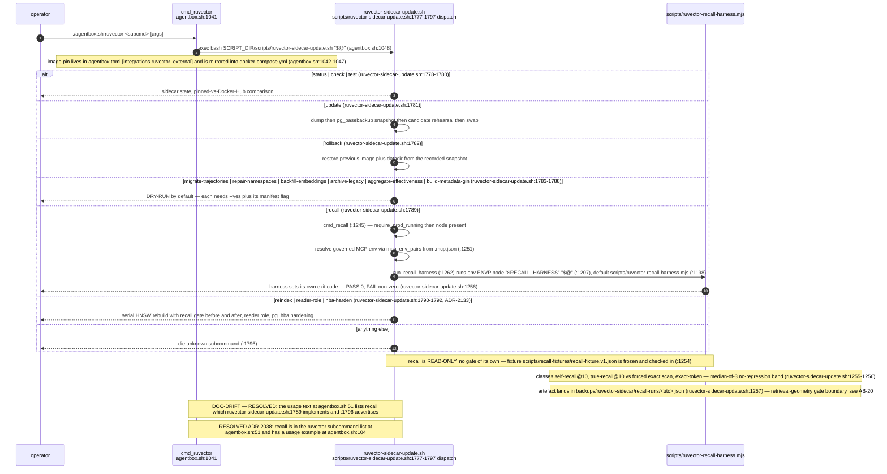

## AB-05.7 agentbox.sh health — exit-code contract
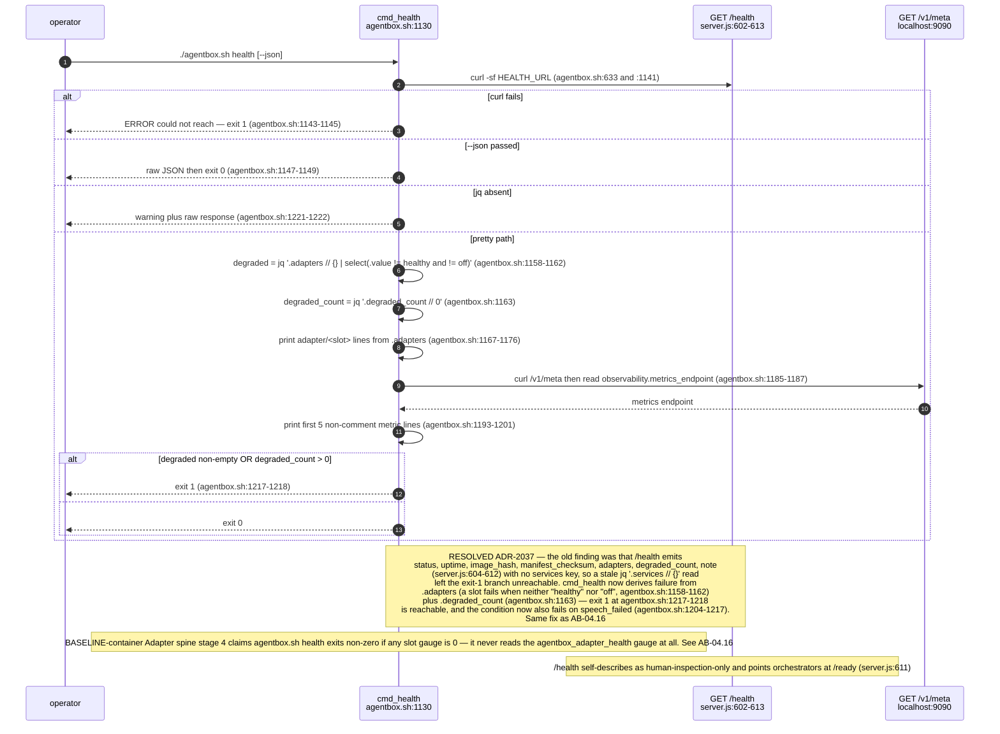

## AB-05.8 Artifact validation gate — the last check before exec supervisord
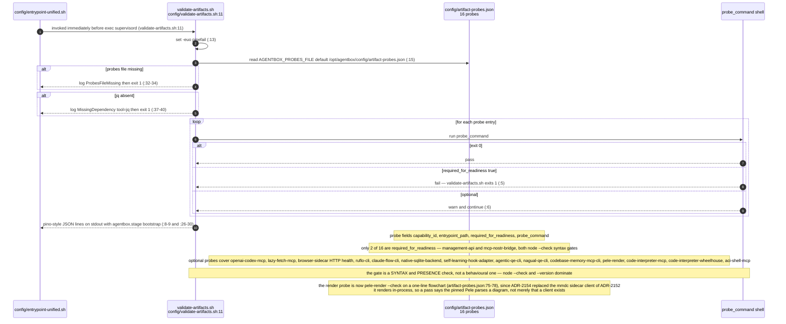

## AB-05.9 Apply-class as an operator decision procedure
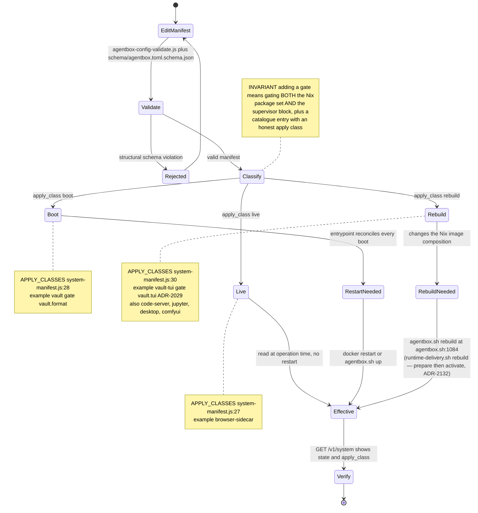

## AB-05.10 Schema surfaces and the setup wizard boundary
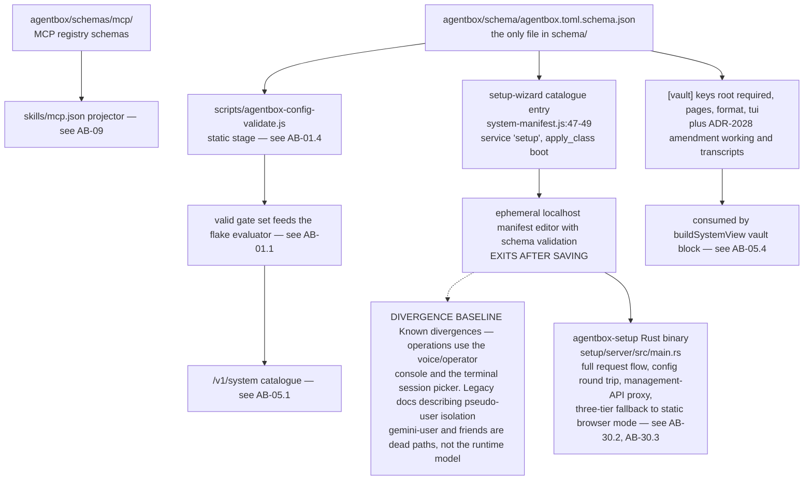

## AB-05.11 agentbox.sh model-router — ADR-2080 CLI dispatch, gated by [model_routing.neural]
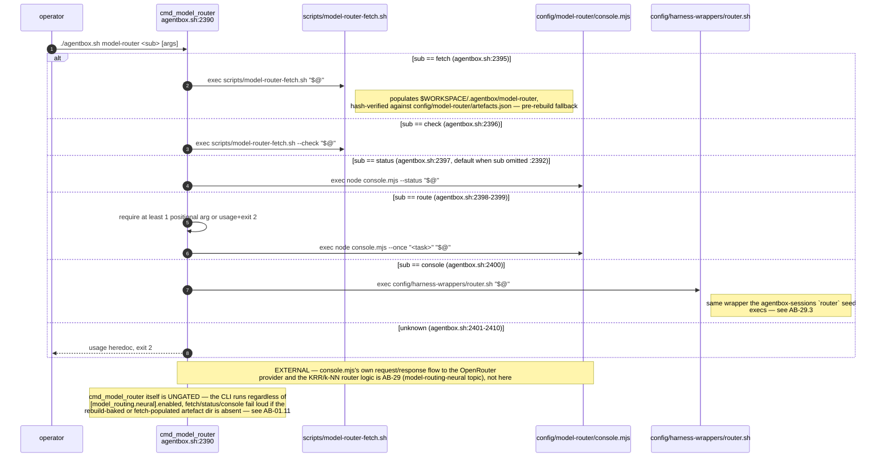

## AB-05.13 The gate families added since 2026-09-06: System One, compaction, permissions, instructions, cred-sync, resources
```mermaid
flowchart TB
    TOML["agentbox.toml"]
    TOML --> F1["[features.jev_compaction] enabled = true, fallback = rules<br/>agentbox.toml:742, :780, :802"]
    TOML --> F2["[features.sovereign_system_one] enabled = false<br/>agentbox.toml:966, :991"]
    TOML --> F3["[skills.routing] router = jev, cascade, label_log<br/>label_log = false since 2026-10-04 — the bounded EXP-B8 run<br/>STOPPED (WITHDRAW, commit b1e42f148)<br/>agentbox.toml:1273, :1293, :1309, :1323"]
    TOML --> F4["[resources] mcp_hub, hooks.shim, session_hygiene<br/>agentbox.toml:1578, :1596, :1608, :1612"]
    TOML --> F5["[voice] enabled = true<br/>agentbox.toml:2209-2210"]
    TOML --> F6["NEW ADR-2116: [claude_code] permission_mode :704,<br/>permission_deny :713-741"]
    TOML --> F7["NEW ADR-2118: config/instructions/ (not a toml key —<br/>gate is null, the directory's own presence)"]
    TOML --> F8["NEW ADR-2118: [toolchains] claude_code = true :2237<br/>service claude-cred-sync"]
    TOML --> F9["NEW PRD-024 P1: [sidechain] enabled, mirror, faucet<br/>agentbox.toml:1919-1925; enabled = true again after the ENOSPC recovery (:1921)"]
    TOML --> F11["NEW ADR-2134: [claude_code] model, effort, advisor_model<br/>agentbox.toml:727-729"]
    TOML --> F12["NEW ADR-2135: [features.jev_checkpoints] enabled = true<br/>agentbox.toml:807"]
    TOML --> F13["NEW ADR-2139: [system_one] enabled = true, backend typesafe again (amendment 2026-10-29),<br/>bind 0.0.0.0:8094 with network = true (docker networks only, never published, 2026-10-30),<br/>local_only = [] (every consumer takes the proxy), local_backend laya kept as the opt-in private route,<br/>skill_list_at_least = 0.6 (router lists runner-up skills, needs skill_verify)<br/>agentbox.toml:863, :890-896"]
    TOML --> F14["NEW ADR-2155: [system_one.consumers], 19 keys all true<br/>14 exported as AGENTBOX_JEV_*, 5 exported only for other repos<br/>agentbox.toml:902-923"]
    F9 ~~~ F10["NEW 2026-10-02: [sovereign_mesh] junkiejarvis = true<br/>the only switch, the env override is gone<br/>agentbox.toml:50, junkiejarvisEnabled junkiejarvis-clarify.js:447-453"]
    TOML --> F10

    F1 --> C1["catalogue jev-compaction (factrail), apply_class REBUILD<br/>since ADR-2121, was boot - system-manifest.js:268-269"]
    F2 --> C2["catalogue sovereign-system-one, apply_class boot<br/>system-manifest.js:280-281"]
    F3 --> C3["catalogue skill-router :345-346, skill-router-cascade :348-349,<br/>routing-teacher-labels :351-352, off_values table, all apply_class boot"]
    F4 --> C4["catalogue mcp-hub, hook-shim, teammate-gc, all rebuild<br/>system-manifest.js:424-432"]
    F5 --> C5["catalogue voice-console, apply_class live<br/>system-manifest.js:181-182"]
    F6 --> C6["NEW catalogue claude-code-permissions, apply_class boot<br/>system-manifest.js:253-255"]
    F7 --> C7["NEW catalogue instruction-tiers, gate null, apply_class boot<br/>system-manifest.js:259-261"]
    F8 --> C8["NEW catalogue claude-cred-sync, apply_class rebuild<br/>system-manifest.js:265-267"]
    F9 --> C9["NEW catalogue sidechain, three gates, apply_class rebuild<br/>a false parent gate reports off - system-manifest.js:382-384, :458"]

    C1 --> B1["flake.nix bakes factrail pinned to rev d270a0a1 (lib/factrail.nix:36), which records the judge that answered from the proxy headers,<br/>then the entrypoint sets CLAUDE_CODE_ENABLE_FUNCTION_HOOKS,<br/>drops any retired jev-compaction install, migrates its store, installs factrail@agentbox<br/>entrypoint-unified.sh:3045, :3055-3059, :3069, :3142 - gate off uninstalls :3153-3164"]
    C2 --> B2["the entrypoint runs agentbox-manifest sso-project and<br/>projects baseUrl, model and backendLocal into the plugin<br/>entrypoint-unified.sh:2700-2703"]
    C3 --> B3["the entrypoint registers or de-registers the<br/>UserPromptSubmit hook, see AB-08<br/>entrypoint-unified.sh:2791, :2809"]
    C6 --> B6["agentbox-manifest permissions-project reconciles root<br/>settings.json and every profile's settings every boot — not seed-if-unset<br/>entrypoint-unified.sh:1831-1840"]
    C7 --> B7["agentbox-manifest instructions-project composes<br/>~/.claude/CLAUDE.md, ~/workspace/AGENTS.md, ~/workspace/CLAUDE.md<br/>from config/instructions/ every boot — entrypoint-unified.sh:2985-3007"]
    F11 --> C11["NEW catalogue claude-code-model-roles, gate claude_code.advisor_model,<br/>off_values off, apply_class boot - system-manifest.js:256-258"]
    F12 --> C12["NEW catalogue jev-checkpoints, apply_class rebuild<br/>system-manifest.js:271-273"]
    F13 --> C13["NEW catalogue system-one-proxy, service system-one-proxy, apply_class boot (system-manifest.js:274-276),<br/>and system-one-network, gate system_one.network, apply_class boot (system-manifest.js:277-279)"]
    C11 --> B11["permissions-project writes model, effortLevel and advisorModel into settings<br/>every boot, skipping gateway profiles<br/>services/agentbox-manifest/src/main.rs:226"]
    C12 --> B12["the entrypoint installs jev-checkpoints@agentbox with the manifest as userConfig<br/>entrypoint-unified.sh:3168, :3036"]
    C13 --> B13["system-one-project writes /run/agentbox/system-one.json and projects the proxy URL<br/>entrypoint-unified.sh:2670-2683, see AB-02.3"]
    F14 --> C14["NEW catalogue system-one-consumer-* x19, requires system_one.enabled, boot class<br/>except solid-pod-advisories, ontomark-suggestions and vault-rank, rebuild<br/>system-manifest.js:288-344"]
    C14 --> B14["system_one.rs exports one AGENTBOX_JEV_* flag per in-repo consumer (:409-516, the skill_list_at_least rate only with skill_verify on, :469-481), then AGENTBOX_JEV_X_LOCAL_ONLY=0 for all twelve unless the consumer is named in [system_one].local_only (empty by default; :522-577);<br/>the five external consumers get VISIONFLOW_JEV, DREAMLAB_JEV, SOLID_POD_JEV, VISIONCLAW_JEV_PATCH_RANK and ONTOMARK_JEV exports, each with _ALLOW_CLOUD=1 and no laya endpoint unless listed, which pins it to the laya route or switches it off (:537-623)<br/>services/agentbox-manifest/src/system_one.rs:409-623"]
    C9 --> B9["flake.nix bakes program:sidestr-producer, -mirror, -faucet<br/>see AB-01.1 and AB-02.6"]
    C8 --> B8["[program:claude-cred-sync] polls container ~/.claude/.credentials.json<br/>against host-claude bind every 2s, later expiresAt wins<br/>flake.nix:3266-3278, services/agentbox-manifest/src/cred_sync.rs"]

    C5 --> DIV["RESOLVED - the manifest now declares voice on, apply-class sidecar,<br/>so a running console no longer reports state off, agentbox.toml:2210"]
    F10 --> C10["catalogue junkiejarvis, layer surface, gate sovereign_mesh.junkiejarvis,<br/>apply_class boot - system-manifest.js:80-82;<br/>server.js:1449-1450 and the forum-suggestions tenant<br/>both call junkiejarvisEnabled(manifest)"]
    C4 --> REB["INVARIANT - mcp-hub is rebuild-class because its supervisor<br/>program is composed into the image, so flipping the gate and<br/>restarting does not add it, system-manifest.js:424-426"]
```

**What it shows.** The thirteen manifest gate families added since 2026-09-06 — System One, Jev compaction (now factrail, ADR-2121) and its cascade/teacher-label addenda, the ADR-2116 permission posture, ADR-2118 instruction tiers and credential sync, the PRD-024 `[sidechain]` gate of 2026-09-30, and, since 2026-10, the ADR-2134 model roles, the ADR-2135 Jev checkpoints and the ADR-2139 System One vendor slot (`[system_one]`, one proxy in front of every typed-decision consumer, loopback in the container and, since the 2026-10-30 amendment, `bind = "0.0.0.0:8094"` with `network = true` for the private docker networks, `../project/agentbox/agentbox.toml:893-895`; the manifest ships it on with backend `typesafe` again since 2026-10-29, `../project/agentbox/agentbox.toml:892`, and nineteen `[system_one.consumers]` switches, `../project/agentbox/agentbox.toml:902-923`) — each traced from its `agentbox.toml` section to its catalogue entry and to the boot step that applies it.
**Why it is this way.** ADR-039's honesty rule: a gate is catalogued with the apply class of the place it is consumed, so `sovereign_system_one` is boot-class here even though its sidecar has a lifecycle of its own (`../project/agentbox/management-api/lib/system-manifest.js:281`); `claude-cred-sync` is rebuild-class because the polling daemon is a supervised program baked into the image (`flake.nix:3267`), not because the credential merge logic itself needs a rebuild. The same rule moved `jev-compaction` from boot to rebuild when ADR-2121 replaced the vendored plugin with a factrail binary and plugin that `flake.nix` bakes only when the gate is on (`../project/agentbox/management-api/lib/system-manifest.js:269`).

**Tension (resolved by this revision, manifest vs running estate):** the manifest used to declare `[voice].enabled = false` while the voice console ran under its own compose lifecycle, so the live view reported `voice-console` off for a surface that was up. It now reads `enabled = true`, apply-class sidecar (`../project/agentbox/agentbox.toml:2210`), which the catalogue entry gates on (`../project/agentbox/management-api/lib/system-manifest.js:181-182`).

**Open:** the nineteen consumer switches and the unified route are configured, not live: ADR-2155 is `accepted`, `implementation_status: complete`, `activation_status: staged` (`../project/agentbox/docs/adr/ADR-2155-system-one-consumer-activation.md:5-7`), so the running container keeps the old routing until the new image is activated, and five consumers (visionflow, website, solid pod, ontomark, vault rank) are projected as exports only (`../project/agentbox/services/agentbox-manifest/src/system_one.rs:537-623`), their deployment sitting outside Agentbox (`../project/agentbox/docs/reference/system-one-activation.md:23-26`).

**Drift:** the activation note still says the running public vendor remains SubQ and that private consumers use the `laya` backend (`../project/agentbox/docs/reference/system-one-activation.md:3-6`), but ADR-2139's amendments record the switch back to `typesafe` with a 200 from model `jev-1.14.0` and, on 2026-10-30, every consumer through the proxy with `local_only` empty (`../project/agentbox/docs/adr/ADR-2139-system-one-judge-as-a-vendor-slot.md:256-270`, `:274-295`), factrail `d270a0a1` recording the answering backend from the proxy headers (`../project/agentbox/lib/factrail.nix:36`).

**Debt:** `payment_settlement` is declared `zero-tolerance` with its own task properties (`../project/agentbox/agentbox.toml:1405`, `:1429`) but no route passes that action class to the authority gate; `mandate_revoke` is the only class any route names (`../project/agentbox/management-api/routes/llm-marketplace.js:473`).

**Drift (resolved 2026-10-02, JunkieJarvis gate):** the manifest comment used to promise that `JUNKIEJARVIS_ENABLED` overrode `[sovereign_mesh].junkiejarvis`; `f63760e19` made the key the only switch and turned it on (`../project/agentbox/agentbox.toml:45-50`, still true at this revision), and management-api now reads it through `junkiejarvisEnabled(manifest)` alone (`../project/agentbox/management-api/server.js:1449-1450`, `../project/agentbox/management-api/lib/junkiejarvis-clarify.js:447-453`).

**Drift (resolved, JunkieJarvis catalogue entry):** `junkiejarvis` gates a forum-facing agent and the forum-suggestions tenant's clarifying DMs and used to have no `CATALOGUE` entry; it now has one, a `surface` entry gated on `sovereign_mesh.junkiejarvis` with apply-class `boot` (`../project/agentbox/management-api/lib/system-manifest.js:80-82`), so `GET /v1/system` can say whether it is on.

**Drift (golden fixture vs manifest):** the manifest parser's golden copy of the live manifest still carries the retired wording, with BOTH the gate and the env var required and the gate false (`../project/agentbox/services/agentbox-manifest/tests/golden/live-agentbox.toml:45-51`).

**Tension (ADR-030 gate vs EXP-B8):** EXP-B8 stopped on 2026-10-04 (WITHDRAW, `b1e42f148`; `label_log = false` since, `../project/agentbox/agentbox.toml:1323`), but the experiment tick itself signs its one forum summary with the JunkieJarvis key (`../project/agentbox/scripts/experiments/exp-b8-label-log.cjs:528-530`; since custody W2 the key is read as a role secret and, under `[security].role_isolation`, never from the repo `.env`) and publishes it (`../project/agentbox/scripts/experiments/exp-b8-label-log.cjs:550-563`) without consulting `junkiejarvisEnabled`, so a manifest with `junkiejarvis = false` would still see a JunkieJarvis post if the withdrawn tick fires again.

**Debt:** the agent, command and skill registries governed by ADR-2092 are manifest files of their own (`registered-agents.txt`, `registered-commands.txt`, `registered-skills.txt`) with no `agentbox.toml` gate and no catalogue entry, so `GET /v1/system` cannot report what the reconcilers did (`../project/agentbox/config/entrypoint-unified.sh:3783`, `../project/agentbox/management-api/lib/system-manifest.js:39`).

**Drift (resolved 2026-09-30, gate catalogue vs the sealed chain):** `[sidechain]` used to be a fully specified gate the schema refused; it now exists in the schema (`../project/agentbox/schema/agentbox.toml.schema.json:3971-3975`, itself `additionalProperties: false`), in `agentbox.toml` (`../project/agentbox/agentbox.toml:1919-1925`) and in the catalogue (`../project/agentbox/management-api/lib/system-manifest.js:382-384`), gating the interim producer, mirror and faucet (see AB-32.5, AB-34.5).

**Tension (proposed design vs the landed gate):** the BASELINE's PROPOSED supervised-set table still gates `sidestr-producer` on `[sidechain.signer].enabled` (`../project/agentbox/docs/BASELINE-container.md:402`), while the code gates it on the top-level `[sidechain].enabled`, which the live manifest now sets true after the ENOSPC recovery (`../project/agentbox/agentbox.toml:1921`); the `signer` and `bridge` sub-blocks (`../project/agentbox/docs/BASELINE-container.md:361-362`) have no schema entry, so adding either is a schema change too.

## AB-05.14 Instruction tier projection (ADR-2118, floor ADR-2144) — the mount contract four tiers rewrite every boot
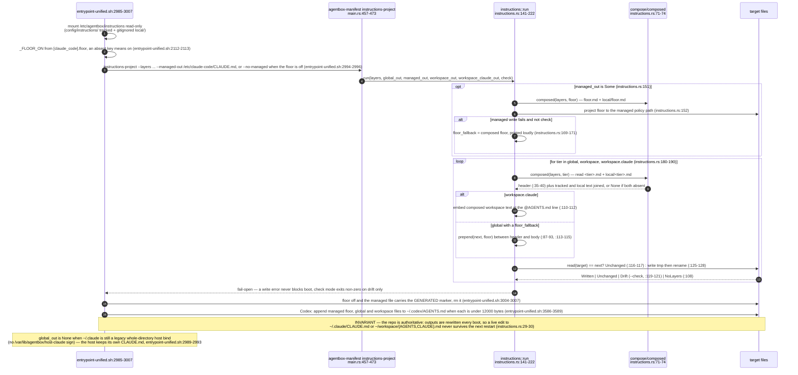

**What it shows.** How the instruction tiers that sit above every repository get from `config/instructions/` layers (tracked public, gitignored `local/` estate) to the files every agent reads, on every single boot. Since ADR-2144 there are four tiers: the floor goes to Claude Code's managed policy path `/etc/claude-code/CLAUDE.md` (loaded by every session and subagent, `claudeMdExcludes` cannot drop it), and only if that write fails is it prepended to the global tier. Codex has no managed path, so the entrypoint appends the managed file, then the global and workspace files, to its `AGENTS.md`.
**Why it is this way.** ADR-2118: the files used to be hand-kept on a host bind and a Docker volume with no history and no review; composing them from the repo makes the global/workspace tiers a reviewable, versioned product surface instead of drift-prone container state. ADR-2144 (accepted, live) adds the floor tier so custom subagents that start without the user and project notes still meet it, and ties it to the `decline-recorder` hook under the same `[claude_code].floor` gate (`../project/agentbox/config/entrypoint-unified.sh:2112`, `../project/agentbox/management-api/lib/system-manifest.js:262`).

**Invariant:** an unwritable managed path never drops the floor: the projector falls back into the global tier (`../project/agentbox/services/agentbox-manifest/src/instructions.rs:169-172`).

## AB-05.15 Claude OAuth credential sync (ADR-2118) — converging container and host `.credentials.json`
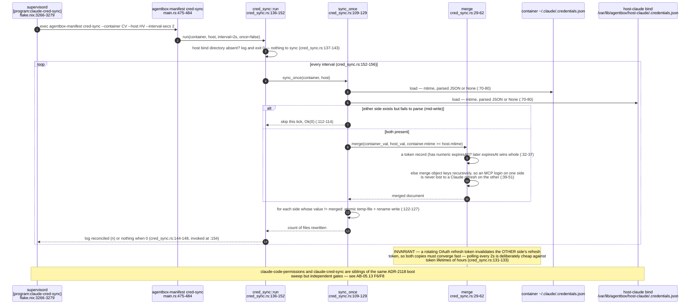

**What it shows.** The polling reconciliation loop that keeps the container-owned `agentbox-claude-home` volume's OAuth tokens converged with the host's bound `~/.claude`, so a refresh on either side never logs the other out.
**Why it is this way.** `~/.claude` became a container-owned volume (not a host bind) so the container's private key material is never exposed on the host filesystem; the host still needs current tokens to run its own Claude Code, hence a merge daemon rather than a symlink — Claude Code's write strategy (in-place vs temp+rename) is unknown, so a symlink is not trusted to survive a refresh (cred_sync.rs:1-17).

## AB-05.16 [security].role_isolation — one rebuild-class gate, one table, four derived artefacts (ADR-2122)
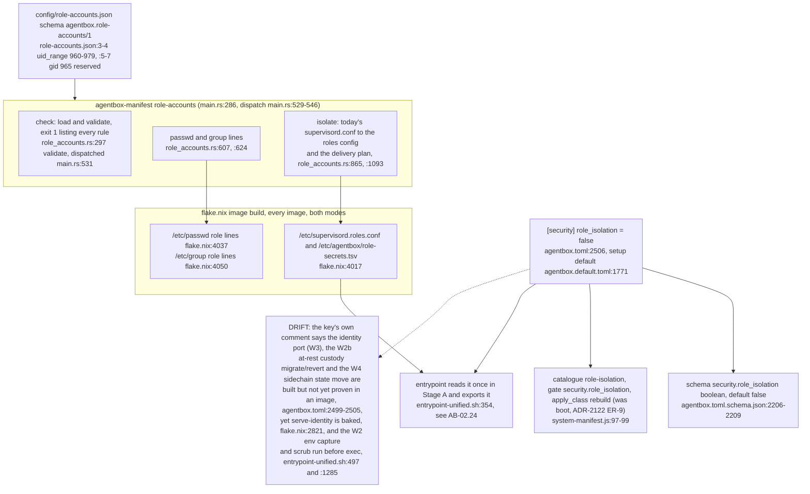

**What it shows.** The custody gate as the manifest sees it. `[security].role_isolation` is a plain boolean, false in the live manifest and in the setup default, declared in the schema and catalogued as apply-class `rebuild` since ADR-2122 ER-9 (it was `boot`). Everything it switches between is derived at image build from one table, `config/role-accounts.json`, by the `agentbox-manifest role-accounts` subcommands: the passwd and group lines, the isolated supervisor config and the delivery plan. The supervisor pick, the secrets delivery and the environment scrub are read at boot, but the devuser sudo route is removed at image build from the build-time flag (`roleIsolationBaked`), so a boot-time flip alone leaves the box reporting `degraded:devuser-sudo` and needs `./agentbox.sh rebuild` (`../project/agentbox/management-api/lib/system-manifest.js:97-99`, `../project/agentbox/flake.nix:3664`, `:4081`).
**Why it is this way.** The custody design originally made the flag boot-class so the owner's rehearsal could flip it and roll it back without a rebuild; ADR-2122's ER-9 closed that as rebuild-class because `config/bake-devuser-privilege.sh` takes the build-time flag and leaves devuser in `wheel` with passwordless sudo otherwise. Deriving the roles config from today's rendered config, rather than writing it by hand, keeps the two configs from drifting: only `user=` and `environment=` of role programs change (`../project/agentbox/services/agentbox-manifest/src/role_accounts.rs:11-15`).

**Tension (catalogue vs manifest comment):** the catalogue classes `role-isolation` as `rebuild` (`../project/agentbox/management-api/lib/system-manifest.js:97-99`) while the comment above the key still says "Boot-class: the image ships both supervisor configs; restart to apply" (`../project/agentbox/agentbox.toml:2499`).

**Invariant:** the isolated supervisor config is a pure function of today's rendered config and the role table, so no role program can exist in one config and not the other (`../project/agentbox/flake.nix:4017`, `../project/agentbox/services/agentbox-manifest/src/role_accounts.rs:865`).

**Drift (manifest comment vs this revision):** the comment above `role_isolation` says the identity port and the custody migration (W2-W4) are not in the image yet, so role programs fail closed under the flag (`../project/agentbox/agentbox.toml:2499-2505`). At this revision `[program:serve-identity]` is baked (`../project/agentbox/flake.nix:2821`) and the W2 capture and scrub run before `exec supervisord` (`../project/agentbox/config/entrypoint-unified.sh:497`, `../project/agentbox/config/entrypoint-unified.sh:1285`). The comment also adds a new condition the old text did not have: until the W3b consumer cutover lands, JunkieJarvis, the mirror hook and dream-engine cannot sign under the flag. The advice to leave the flag off until the rehearsal passes still holds. The stated reason is stale.

## AB-05.17 Gate families added in October 2026: floor, voicelink, activity sink, forge, Blender sidecar-first, Loom sync, Isaac Sim
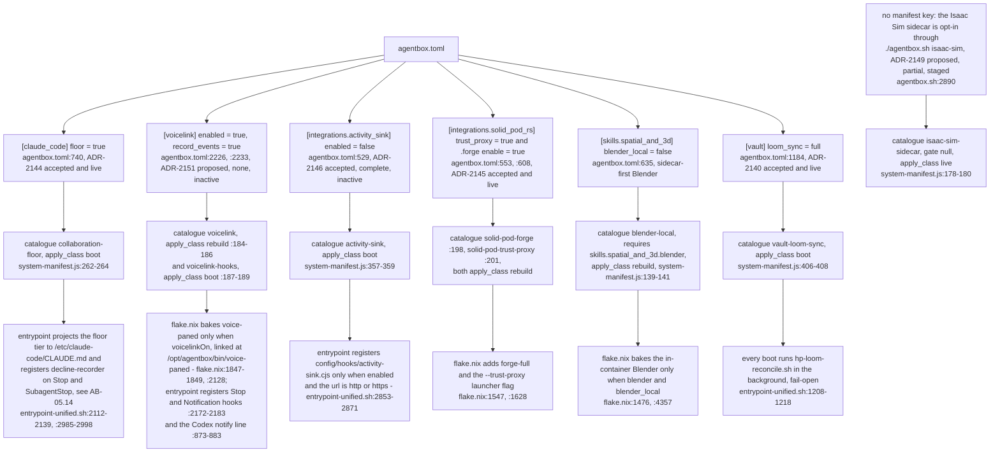

**What it shows.** The gate families that arrived between the previous stamp and this one, from manifest key through catalogue entry and apply class to the code that consumes it. Ten entries joined the catalogue (one surface, nine modules), taking it to 102 (`../project/agentbox/management-api/lib/system-manifest.js:39`, `:379`). The apply class follows where the gate is consumed: the voicelink binary is baked at image composition, so `voicelink` is rebuild-class, while the hook registration that feeds its event spool is reconciled every boot.
**Why it is this way.** ADR-039's honesty rule again: each entry carries the class of its consumer. ADR-2144 (accepted, live) and ADR-2145 (accepted, live) are drawn as live. ADR-2146 is accepted but inactive and ADR-2149 is proposed, so the activity sink is drawn off (its manifest key is false) and the Isaac sidecar is shown only as an opt-in CLI path with no manifest gate.

**Tension (ADR-2151 vs manifest):** ADR-2151 is `proposed`, implementation `none`, activation `inactive` (`../project/agentbox/docs/adr/ADR-2151-voicelink-edge-voice.md:5`), while the live manifest sets `[voicelink].enabled = true` and `record_events = true` (`../project/agentbox/agentbox.toml:2226`, `:2235`), so the image bakes voice-paned and boot registers its hooks (`../project/agentbox/flake.nix:1847`, `../project/agentbox/config/entrypoint-unified.sh:2168`).

**Open (status moved 2026-10-30):** ADR-2146 is now `decision_status: accepted` with `implementation_status: complete` and `activation_status: inactive` (`../project/agentbox/docs/adr/ADR-2146-activity-sink-hook.md:5-7`); the decision question is closed, but is the activity sink meant to stay off until a consumer sets the endpoint? The manifest ships `enabled = false` with an empty `url` (`../project/agentbox/agentbox.toml:529`).

**Open:** ADR-2149 (Isaac Sim) is proposed and staged, yet the catalogue already carries an ungated `live` entry for it (`../project/agentbox/docs/adr/ADR-2149-isaac-sim-sidecar.md:5`, `../project/agentbox/management-api/lib/system-manifest.js:178`).

**Open:** ADR-2152 (Mermaid rendering in browsercontainer) is `superseded` by ADR-2154, which is `accepted`, `implementation_status: partial` and `activation_status: staged` (`../project/agentbox/docs/adr/ADR-2152-render-mermaid-in-browsercontainer.md:5`, `../project/agentbox/docs/adr/ADR-2154-pele-renders-mermaid-in-the-image.md:5-7`); the artifact probe already runs the Pele check rather than `mmdc` (`../project/agentbox/config/artifact-probes.json:75-78`).
