Registration ground truth (2026-09-29): `~/.claude/settings.json` is boot-generated and never tracked, so AB-08.1–AB-08.7
cite the sites that WRITE it — `config/entrypoint-unified.sh` for the root session and
`services/agentbox-manifest/src/stacks.rs` `learning_hooks#40;#41;` for per-profile stacks — the split `config/hooks/README.md` owns. All hook `timeout` values are now SECONDS, not
milliseconds (`services/agentbox-manifest/src/stacks.rs:29-30`); a bare `UserPromptSubmit` → `route` per-profile hook no
longer exists (ADR-2091 consolidated per-turn routing into `skill-route.cjs`, see AB-08.5).

## AB-08.1 Root-session registration — what entrypoint-unified.sh seeds into ~/.claude/settings.json
```mermaid
flowchart TB
    S["settings path resolved once, CLAUDE_CONFIG_DIR<br/>fallback /home/devuser/.claude/settings.json<br/>entrypoint-unified.sh:1695"]
    subgraph MIR["nostr-live-mirror.cjs — always registered, defaults to Stop only"]
    direction TB
    M1["block entrypoint-unified.sh:1695, baked /opt hook path :1696"]
    M2["entrypoint-unified.sh:1705 events SessionStart, UserPromptSubmit, Stop, SessionEnd<br/>idempotent marker test on the command string :1707"]
    M3["entrypoint-unified.sh:1710 push node HOOK EVENT, timeout 8 SECONDS<br/>each event registered, but bodyForEvent skips any event outside<br/>AGENTBOX_LIVE_MIRROR_EVENTS (default Stop only) nostr-live-mirror.cjs:278-279"]
    M1 --> M2 --> M3
    end
    subgraph FLT["fleet-session-start.sh — SessionStart"]
    direction TB
    F1["block entrypoint-unified.sh:1722, baked hook path :1721<br/>off switch AGENTBOX_NOSTR_GATEWAY=0 gates the gateway launch inside the script, not registration"]
    F2["entrypoint-unified.sh:1729 marker test, :1730 push timeout 8 seconds"]
    F1 --> F2
    end
    subgraph ONT["ontology-monitor.cjs — SessionEnd, gated, detached"]
    direction TB
    O1["entrypoint-unified.sh:1747 gate read via agentbox-manifest toml-bool<br/>defaults to 0 on any read failure"]
    O2["entrypoint-unified.sh:1770 ON: push timeout 10 seconds (hook returns at once,<br/>a detached child does the 180s review) AND seed env AGENTBOX_ONTOLOGY_MONITOR=1 :1775"]
    O3["entrypoint-unified.sh:1779-1783 OFF: filter the hook back out<br/>delete the emptied SessionEnd array :1783<br/>INVARIANT ADR-2020 byte-identical-when-off"]
    O4["gate source agentbox.toml:115-116 enabled = true"]
    O1 --> O2
    O1 --> O3
    O1 --> O4
    end
    subgraph TRU["trust-seed.cjs — boot-time run ONLY, no longer a hook"]
    direction TB
    T1["entrypoint-unified.sh:1812 hook path, :1813 gate AGENTBOX_TRUST_SEED != 0<br/>DELIBERATELY not a SessionStart hook: walked ~1,170 paths/session (avg 3.2s),<br/>raced Claude Code's own ~/.claude.json writes"]
    T2["entrypoint-unified.sh:1814 node trust-seed.cjs, output to stderr<br/>callable by hand for a post-boot worktree: node trust-seed.cjs #60;path#62;"]
    T1 --> T2
    end
    subgraph TRJ["trajectory-recorder.cjs — Stop and SubagentStop, gated"]
    direction TB
    J1["block entrypoint-unified.sh:2025, hook path :2038<br/>gate: BOTH memory_learning flags checked before the block runs"]
    J2["entrypoint-unified.sh:2063 specs = Stop, SubagentStop ONLY<br/>reconcile strips prior wiring over 4 legacy events :2063-2066<br/>then push timeout 10 seconds behind an inline env prefix :2067-2071"]
    J3["entrypoint-unified.sh:2087 gate off: strip over the same 4 events<br/>:2090 keep-filter, :2093 log the de-registration"]
    J4["gate source agentbox.toml:476-477 enabled + record_trajectories"]
    J1 --> J2
    J1 --> J3
    J1 --> J4
    end
    subgraph OTH["turn-sink, dream-inbox, ruvnet-brain"]
    direction TB
    X1["entrypoint-unified.sh:1902 tab0-bridge turn-sink.cjs deployed path<br/>:1910 events UserPromptSubmit and Stop, :1913 timeout 5 seconds"]
    X2["entrypoint-unified.sh:2208 dream-inbox-surface.cjs, live-checkout fallback :2209<br/>gate DREAM_INBOX_HOOK :2210, UserPromptSubmit timeout 5 seconds :2224"]
    X3["entrypoint-unified.sh:2623 ruvnet-brain-ground.cjs<br/>gate RUVNET_BRAIN_GROUNDING_HOOK :2624, timeout 5 seconds :2637"]
    X4["gate source agentbox.toml:1075 grounding_hook = true"]
    X1 --> X2 --> X3 --> X4
    end
    subgraph SHM["hook shim reconcile — ADR-2034 §1"]
    direction TB
    H1["entrypoint-unified.sh:1827 block, gate AGENTBOX_HOOK_SHIM"]
    H2["entrypoint-unified.sh:1828 agentbox-hook reconcile --root WORKSPACE --depth 2<br/>rewrites per-project ruflo CLI hooks to the resident shim"]
    H1 --> H2
    end
    S --> MIR --> FLT --> ONT --> TRU --> TRJ --> OTH --> SHM
```

## AB-08.2 Per-profile registration — stacks.rs learning_hooks, and what is NOT a hook
```mermaid
flowchart TB
    subgraph PP["workspace/profiles/#60;stack#62;/.claude/settings.json"]
    direction TB
    P0["build_profile starts from learning_hooks#40;env, gates#41; stacks.rs:290, fn at :34,<br/>then appends floor, voicelink, session-plane (:324-334) and activity-sink entries :293-337, writes hooks at :350<br/>see AB-08.16 for those four gated additions"]
    P1["every learning_hooks entry is node ADAPTER action #124;#124; true<br/>stacks.rs:38, timeouts are SECONDS :29-30"]
    P2["PreToolUse stacks.rs:69<br/>Bash → pre-command t=5 :70<br/>Write#124;Edit#124;MultiEdit → pre-edit t=5 :71"]
    P3["PostToolUse :73<br/>Write#124;Edit#124;MultiEdit → post-edit t=10 :74<br/>Bash → post-command t=5 :75"]
    P4["SessionStart → session-restore t=15 :77<br/>NO UserPromptSubmit entry: the per-profile route hook<br/>is RETIRED, comment stacks.rs:31-33, test :527-528"]
    P5["SessionEnd :78 = session-end t=10 :43<br/>+ nostr summary hook when mobile_bridge, DETACHED via setsid :44-56<br/>+ ontology-monitor when ontology_monitor, also DETACHED t=10 :58-65"]
    P0 --> P1 --> P2 --> P3 --> P4 --> P5
    end
    subgraph NOT["NOT hooks — hooks/README.md"]
    direction TB
    N1["project-tracking-publish.cjs — a CLI the management API spawns<br/>from POST /v1/projects/:id/publish, reads a digest on stdin<br/>hooks/README.md:68, see AB-08.12"]
    N2["fleet-tab-name.sh — shelled by fleet-session-start.sh:17<br/>hooks/README.md:69"]
    N3["lib/egress-policy.cjs, lib/trajectory-util.cjs, lib/skill-route.cjs — required<br/>libraries, skill-route.cjs shared with the /route CLI<br/>hooks/README.md:71, see AB-08.14. DOC-DRIFT: lib/hook-output.cjs, lib/jev-option.cjs,<br/>lib/failure-jev.cjs and lib/ontology-proposal-jev.cjs are not listed here"]
    N1 --> N2 --> N3
    end
    subgraph INV["invariants and divergences"]
    direction TB
    I1["INVARIANT: claude-flow-hook-adapter.cjs is wired ONLY per-profile<br/>through learning_hooks stacks.rs:290 into the file written at :350 — never into the root settings.json"]
    I2["INVARIANT ADR-2068: the root ontology gap is closed —<br/>entrypoint-unified.sh:1770 registers and :1779-1783 retracts,<br/>so the off state leaves no trace"]
    I3["INVARIANT: a new hook is not wired by dropping a file in config/hooks/ —<br/>register it in the site that owns its session class<br/>hooks/README.md:99-102"]
    I1 --> I2 --> I3
    end
    PP --> NOT --> INV
```

## AB-08.5 UserPromptSubmit — five root hooks; the per-profile route hook no longer exists
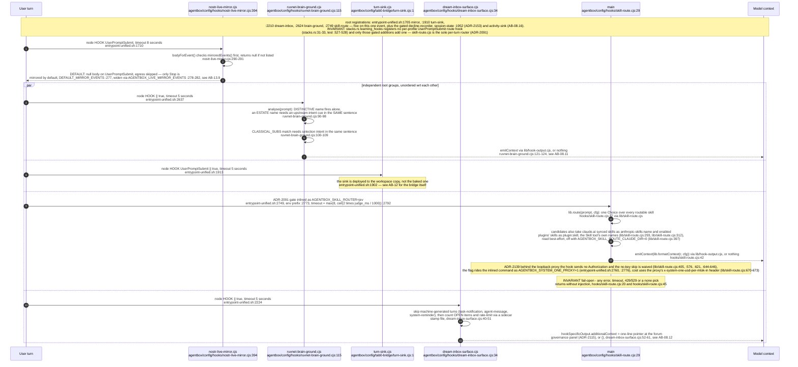

## AB-08.6 SessionStart — mirror, fleet tab, and the per-profile restore; trust-seed is boot-only now
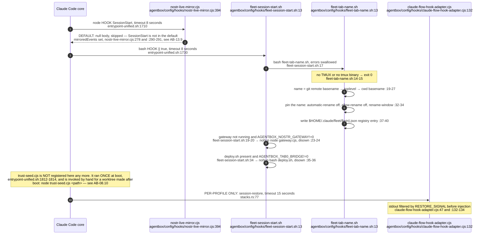

## AB-08.7 SessionEnd, Stop and SubagentStop — consolidation, mirror, detached ontology, trajectory close
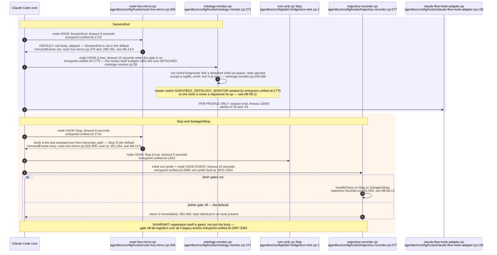

## AB-08.8 claude-flow-hook-adapter.cjs — stdin-to-CLI translation (per-profile stacks only)
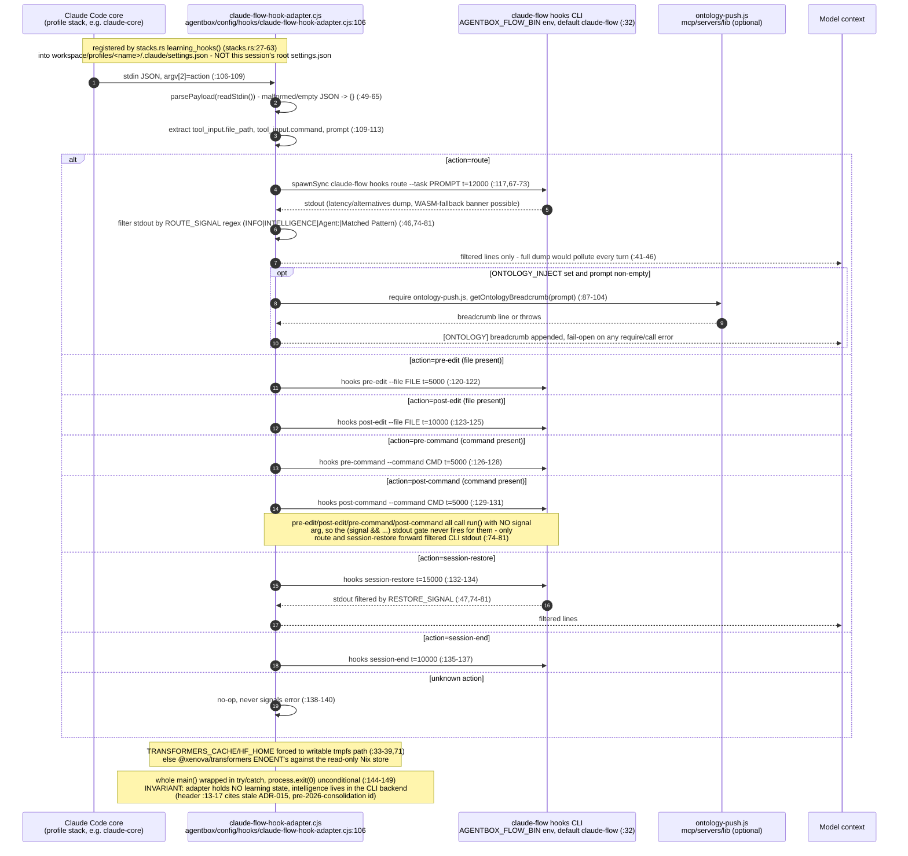
## AB-08.10 trust-seed.cjs — a BOOT-TIME script now, not a hook; folder-trust, worktree discovery and per-profile stores
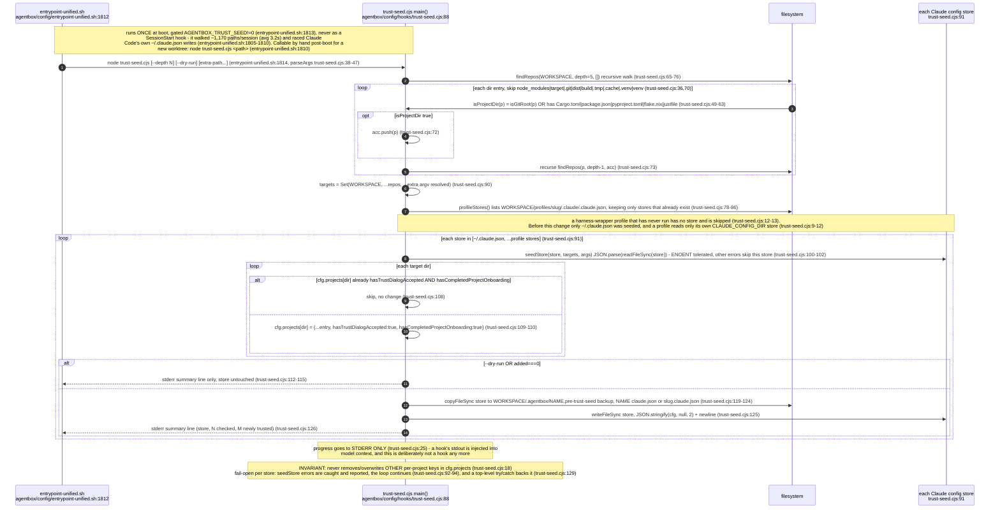
## AB-08.11 ruvnet-brain-ground.cjs (rewritten trigger logic) and ontology-monitor.cjs (now detached)
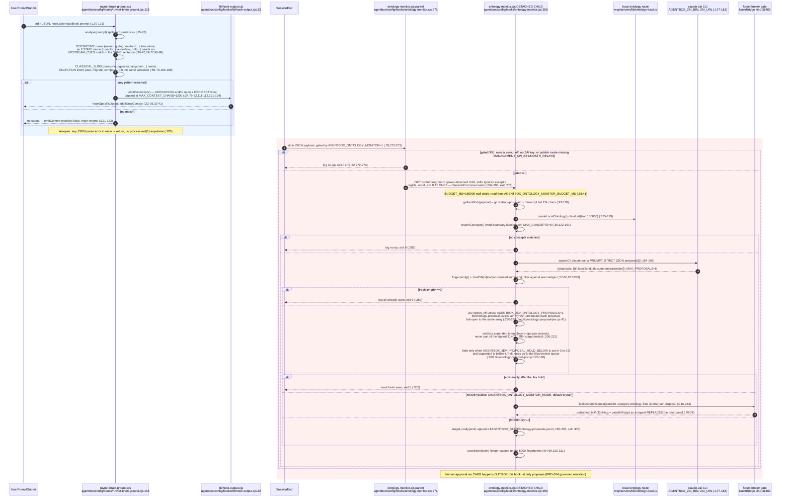
## AB-08.12 project-tracking-publish.cjs and dream-inbox-surface.cjs — DREAM-2115: a reminder pointer, not a relay
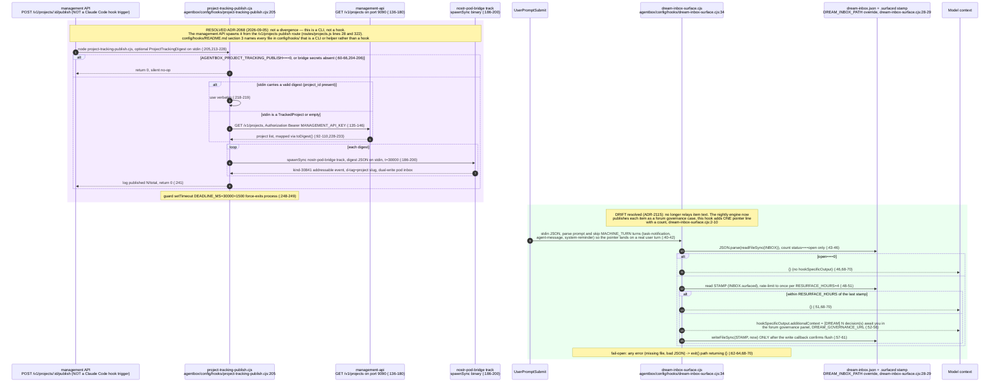
## AB-08.13 trajectory-recorder.cjs — Stop/SubagentStop boundary
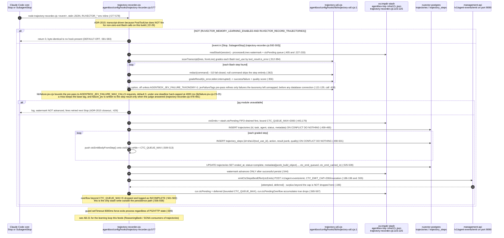
## AB-08.14 lib/ shared helpers — consumers
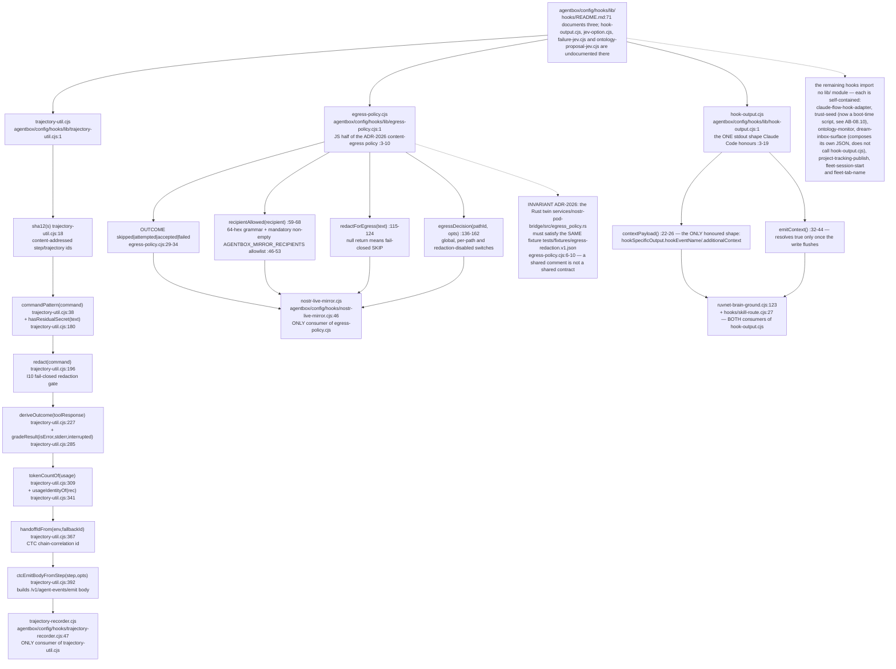

Session-mirror egress: see AB-13.9.

## AB-08.15 A third registration mechanism: the factrail function-hook plugin (ADR-2093, implemented by ADR-2121)
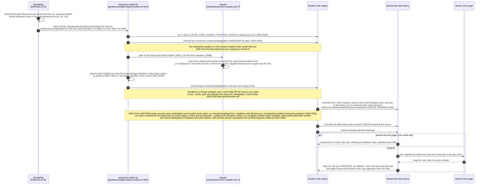

**What it shows.** A plugin is neither a shell hook in `config/hooks/` nor an MCP server: the engine loads the shim in process, the shim hands every decision to a Rust binary, and nothing in the hooks directory registers either. Since ADR-2121 (2026-10-02) both halves come from one pinned factrail commit baked into the image, and the vendored `jev-compaction` plugin is deleted and actively uninstalled.
**Why it is this way.** ADR-2093 wanted compaction to drop and truncate tool calls rather than rewrite text, which the `settings.json` hook contract cannot express (`../project/agentbox/config/hooks/README.md:73-78`); ADR-2121 kept that policy and replaced the implementation, because fact rails kept 50 of 50 pre-registered facts where the deleting plugin kept 4 (`../project/agentbox/docs/adr/ADR-2121-factrail-implements-jev-compaction.md:42-45`).

**Drift (resolved 2026-10-02):** `hooks/README.md` listed four plugin events where the plugin registered seven; it now lists all seven for `factrail` (`../project/agentbox/config/hooks/README.md:83`).

**Invariant:** the sticky email taint survives the change of plugin — the boot migration only widens taint and never overwrites factrail's own switch (`../project/agentbox/scripts/factrail-store-migrate.mjs:86-94`), and it runs before the install (`../project/agentbox/config/entrypoint-unified.sh:3069`).

**Invariant:** the shim and the binary can never disagree on the hook protocol, because one `rev` supplies both and the plugin's `binary` option is the stable `/opt/agentbox/bin/factrail` path (`../project/agentbox/lib/factrail.nix:36`, `../project/agentbox/config/entrypoint-unified.sh:3039`).

**Open:** the shim's event handlers and the binary's fact-rail logic live in the factrail repository, which this corpus does not map, so no claim about them here is checked at a revision; the events and the fence are cited from the agentbox README and ADR-2121 only (`../project/agentbox/docs/adr/ADR-2121-factrail-implements-jev-compaction.md:55-60`).

**Open:** ADR-2121 is `activation_status: staged` — no image with factrail has yet been built and booted, and the residency soak that gates `live` has not run (`../project/agentbox/docs/adr/ADR-2121-factrail-implements-jev-compaction.md:152-154`).

**Debt:** three registration mechanisms (plus four gated additions, AB-08.16) now decide what runs on a session boundary (the entrypoint's root `settings.json`, `stacks.rs` per profile, and the plugin marketplace), and only the README relates them (`../project/agentbox/config/hooks/README.md:53-63`).

## AB-08.16 Four gated additions to both registration sites — decline-recorder, voice-paned record, session-state, activity-sink
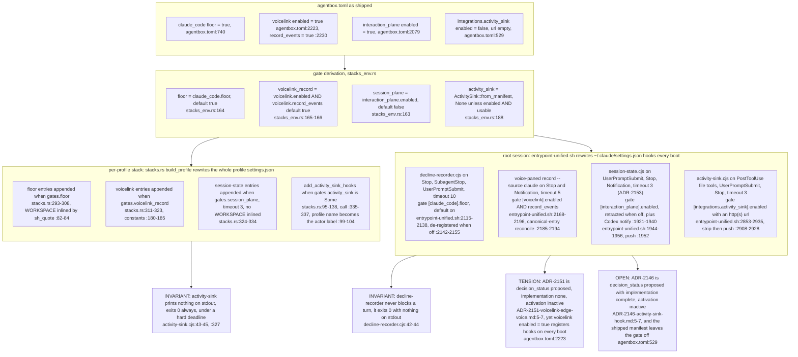

**What it shows.** Since the last stamp four more handlers ride the same two registration sites as the learning hooks: the floor's `decline-recorder.cjs` (ADR-2144, live), `voice-paned record` (ADR-2151), `session-state.cjs` (ADR-2153, live, status marks for the session plane, silent and fail-open, `../project/agentbox/config/hooks/session-state.cjs:3`, `../project/agentbox/config/hooks/session-state.cjs:13-20`) and `activity-sink.cjs` (ADR-2146). Each is written twice, once as inline Node in the entrypoint for the root session and once in Rust for every wrapper profile, and each is stripped when its gate is off so a container without the gate is byte-identical.

**Why it is this way.** Isolated profiles replace `CLAUDE_CONFIG_DIR`, so root settings are not inherited and the floor's recording promise has to be repeated per profile (`../project/agentbox/services/agentbox-manifest/src/stacks.rs:291-292`); the profile file is rewritten whole on every projection, which is why a stale command self-heals there without a reconcile step (`../project/agentbox/services/agentbox-manifest/src/stacks.rs:309-310`). The token value of the activity sink is never written into `settings.json`, only the file path or the environment variable name (`../project/agentbox/config/entrypoint-unified.sh:2858-2859`).

**Tension (ADR-2151 vs manifest):** ADR-2151 is `decision_status: proposed`, `implementation_status: none` and `activation_status: inactive` (`../project/agentbox/docs/adr/ADR-2151-voicelink-edge-voice.md:5-7`) while `[voicelink] enabled = true` and `record_events = true` register the recorder hooks on every boot (`../project/agentbox/agentbox.toml:2223`, `../project/agentbox/agentbox.toml:2230`).

**Open:** ADR-2146 is `decision_status: proposed` with `implementation_status: complete` and `activation_status: inactive` (`../project/agentbox/docs/adr/ADR-2146-activity-sink-hook.md:5-7`); is the sink meant to ship enabled anywhere, given the manifest leaves it off with an empty `url` (`../project/agentbox/agentbox.toml:529`)?

**Debt:** each of the four registrations exists as two hand-kept implementations, entrypoint JavaScript and `stacks.rs`, and the entrypoint comment names the Rust file as the "per-profile twin" (`../project/agentbox/config/entrypoint-unified.sh:2159-2167`).

**Invariant:** the floor gate off leaves no decline-recorder entry in either site, because the entrypoint filters existing entries out and the profile projection appends only `if gates.floor` (`../project/agentbox/config/entrypoint-unified.sh:2142-2155`, `../project/agentbox/services/agentbox-manifest/src/stacks.rs:293`).
