## AB-10.1 Door inventory and port topology

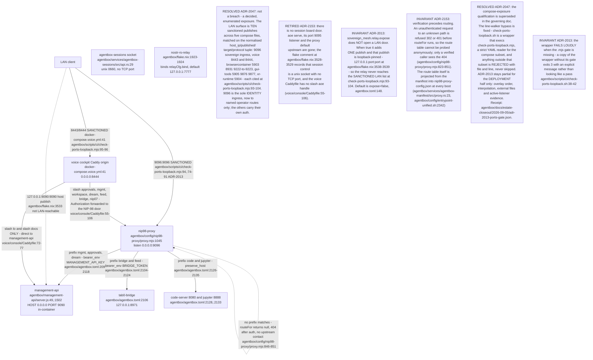

**Drift:** the governing doc still quotes a flake comment reading `# (aoe serve, --auth token) is NEVER published.` as live at flake.nix line 2647 (`agentbox/docs/INGRESS-identity.md:199-202`) and anchors `verifyIdentity` at proxy.mjs line 626 (`agentbox/docs/INGRESS-identity.md:68`), the break-glass bullet at proxy.mjs lines 753-760 (`agentbox/docs/INGRESS-identity.md:229`) and the session secret at proxy.mjs line 107 (`agentbox/docs/INGRESS-identity.md:232`), but that comment is gone, the function is at `proxy.mjs:523` (`agentbox/config/nip98-proxy/proxy.mjs:523`), and the doc's own 0.2.4 entry already records the AoE retirement (`agentbox/docs/INGRESS-identity.md:9`).

## AB-10.2 proxy.mjs boot sequence — config, routes, verifier load

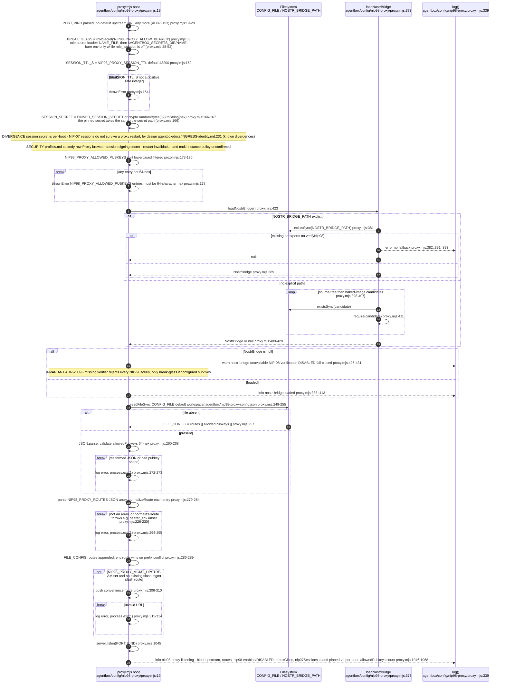

## AB-10.3 verifyIdentity — full auth precedence

```mermaid
sequenceDiagram
    autonumber
    participant REQ as Request<br/>HTTP forward() or WS upgrade
    participant VI as verifyIdentity<br/>agentbox/config/nip98-proxy/proxy.mjs:523
    participant CTE as constantTimeEqual<br/>agentbox/config/nip98-proxy/proxy.mjs:437
    participant NB as NostrBridge.verifyNip98<br/>agentbox/mcp/servers/nostr-bridge.js:500
    participant CAN as canonicalPubkey<br/>agentbox/config/nip98-proxy/proxy.mjs:196
    participant PA as pubkeyAllowed<br/>agentbox/config/nip98-proxy/proxy.mjs:182
    participant VST as verifySessionToken<br/>agentbox/config/nip98-proxy/proxy.mjs:458

    REQ->>VI: verifyIdentity(req, bearerToken, rawBody) proxy.mjs:523
    VI->>VI: authHeader = req.headers.authorization proxy.mjs:524
    alt BREAK_GLASS configured and a Bearer token or query bearerToken matches
        VI->>CTE: constantTimeEqual(token, BREAK_GLASS) proxy.mjs:533
Note over VI,CTE: DIVERGENCE (historical) break-glass bearer over the LAN - a single shared secret<br/>bypasses NIP-98 entirely while NIP98_PROXY_ALLOW_BEARER is set. See the RESOLVED note below -<br/>ADR-2027 (closeout 2026-09-05) bounds it with expiry + scope, still tracked as INGRESS-identity.md:227<br/>(known divergences) pending a doc update
        VI->>VI: RESOLVED ADR-2027 — breakGlassNotExpired() proxy.mjs:534
        alt expiry configured and elapsed, or malformed
            VI-->>REQ: ok false, reason break_glass_expired, audited by fingerprint proxy.mjs:535-543
        end
        VI->>VI: breakGlassScopeAllows(method, url) proxy.mjs:544
        alt NIP98_PROXY_BEARER_SCOPE configured and request outside it
            VI-->>REQ: ok false, reason break_glass_out_of_scope, audited by fingerprint proxy.mjs:545-553
        end
        Note over VI: SECURITY-profiles.md custody row Proxy break-glass bearer - captured at process start,<br/>ADR-2027 adds optional expiry + scope bounds and a per-use fingerprint audit trail (breakGlassUse<br/>counters), still an in-process receipt, not a durable audit store
        VI->>VI: breakGlassUse.accepted++, log warn break-glass USED with fingerprint proxy.mjs:554-566
        VI-->>REQ: ok true, pubkey NIP98_PROXY_BEARER_PUBKEY default break-glass, mode break-glass proxy.mjs:567
    else Authorization starts with Nostr
        VI->>NB: verifyNip98(authHeader, method, signedUrlFor(req), rawBody) proxy.mjs:577
        alt NostrBridge unavailable
            VI-->>REQ: ok false, reason nip98_verifier_unavailable proxy.mjs:573
        else verifyNip98 throws
            VI-->>REQ: ok false, reason nip98_verify_error proxy.mjs:578-579
        else result not valid
            VI-->>REQ: ok false, reason nip98_invalid proxy.mjs:595
        else result.valid true
            VI->>CAN: canonicalPubkey(result.pubkey) proxy.mjs:586
            alt not lowercase 64-hex
                VI-->>REQ: ok false, reason nip98_noncanonical_pubkey proxy.mjs:587-588
            else canonical
                VI->>PA: pubkeyAllowed(pubkey) proxy.mjs:590
                alt allowlist non-empty and pubkey missing
                    VI-->>REQ: ok false, reason pubkey_not_allowed proxy.mjs:590-591
                else
                    VI-->>REQ: ok true, pubkey, mode nip98 proxy.mjs:593
                end
            end
        end
    else Cookie carries agentbox_nip07_session
        VI->>VST: verifySessionToken(cookie) proxy.mjs:602
        VST->>CTE: constantTimeEqual(mac, expected) proxy.mjs:466
        VST->>PA: pubkeyAllowed(pubkey) proxy.mjs:467
        alt session valid, not expired, HMAC matches, and allowed
            VI-->>REQ: ok true, pubkey, mode nip07-session proxy.mjs:603-604
        else
            VI-->>REQ: ok false, reason session_invalid_or_expired proxy.mjs:606
        end
    else no credentials at all
        VI-->>REQ: ok false, reason no_credentials proxy.mjs:609
    end
```

## AB-10.4 verifyNip98 internals — header, tags, payload, signature, replay

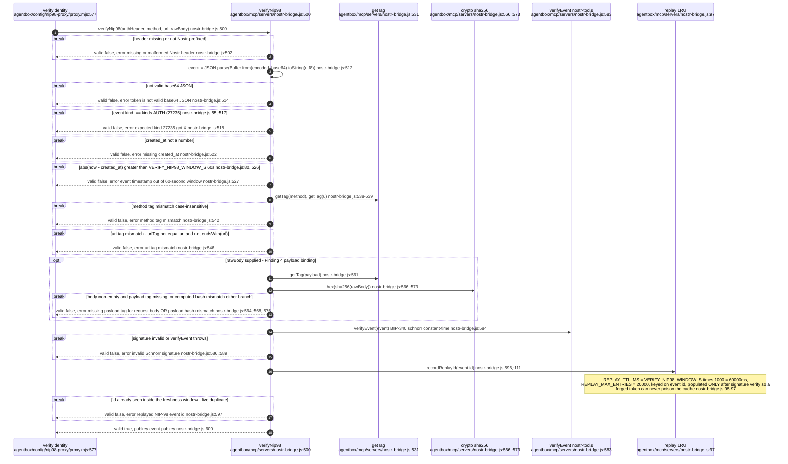

## AB-10.5 Request auth state machine

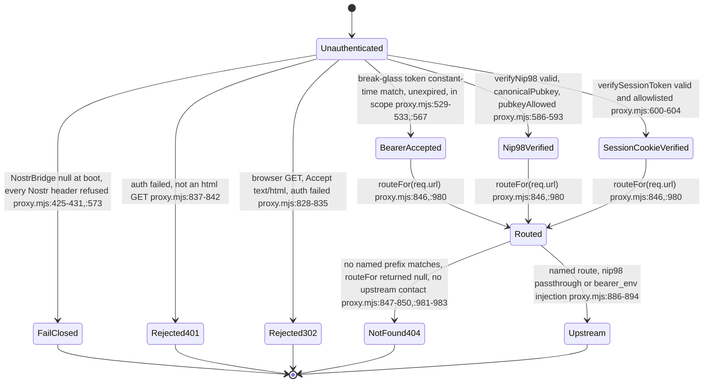

Every anchor above was re-derived from its symbol at agentbox 0b0f791 (2026-10-29), after
ADR-2153 removed the AoE transitions, so the old set no longer applies.

## AB-10.6 Unknown-route door — no default upstream, 404 after verification

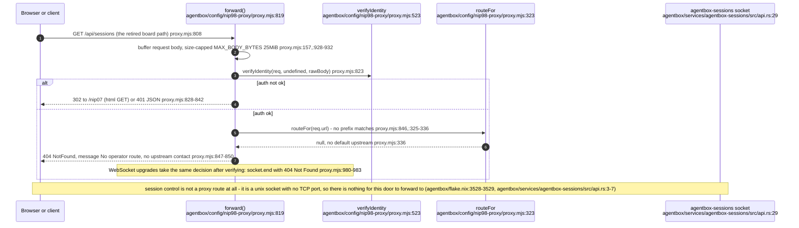

**Debt:** `routeFor` still returns an `isAoe: false` field and two branches still test `!route.isAoe`, so a dead flag outlives the retired daemon-token path and misleads the next reader (`agentbox/config/nip98-proxy/proxy.mjs:334`, `agentbox/config/nip98-proxy/proxy.mjs:886`, `agentbox/config/nip98-proxy/proxy.mjs:1016`).

## AB-10.7 /mgmt/* router door — bearer_env gated behind NIP-98

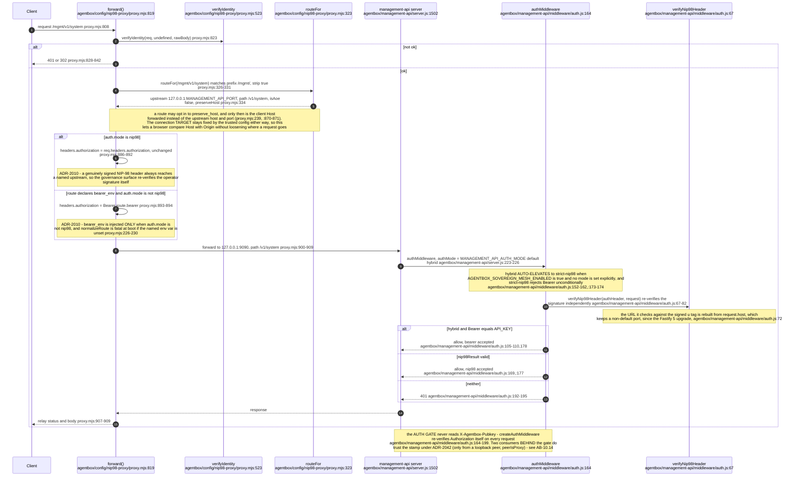

## AB-10.8 NIP-07 browser session handshake

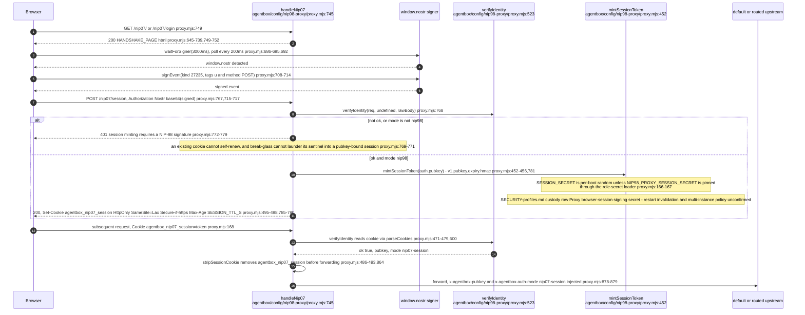

GET `/nip07/session` is a separate, unauthenticated-upstream probe: it reads the
cookie and calls `verifySessionToken` itself, nothing else, proxy.mjs:755-757.
INVARIANT: unrelated upstream availability or authorisation must not make a
signed-in browser start prompting its signer again — the probe never touches the
route or upstream, proxy.mjs:756-757. Response is `cache-control: no-store`,
proxy.mjs:761, so a cached 200 can never stand in for a live check.

## AB-10.9 WebSocket upgrade auth path

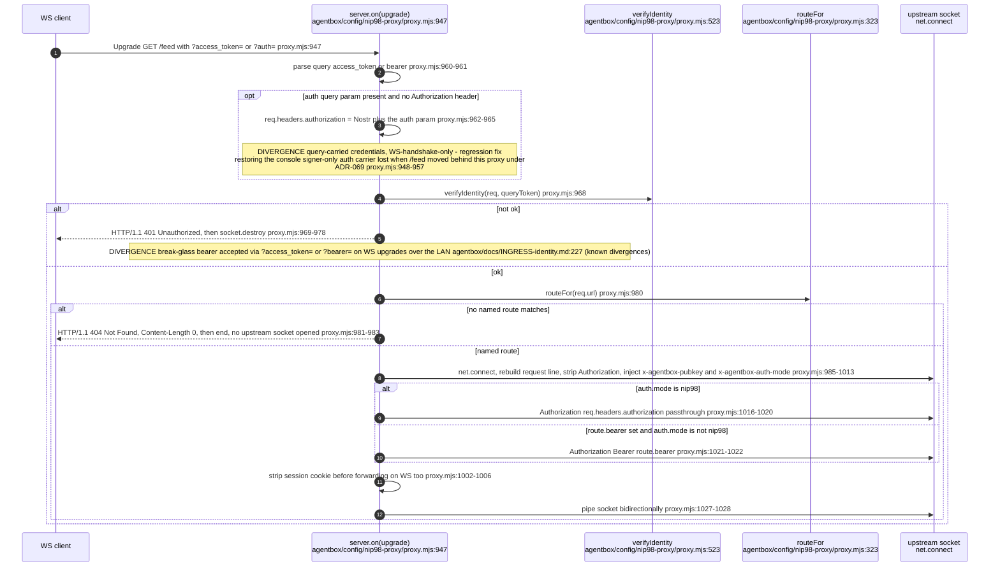

## AB-10.10 Direct :9090 path vs proxied :9090 path

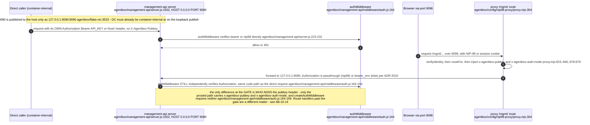

## AB-10.11 Session-socket door — SO_PEERCRED ACL and the nostr-gateway client

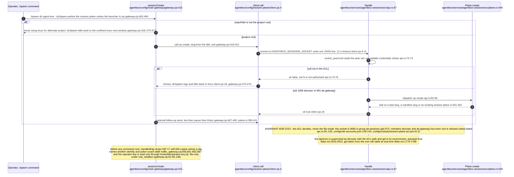

## AB-10.12 selftest.mjs assertion families

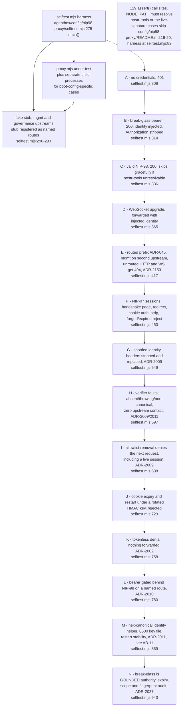

The A-to-N chain is execution order: `main()` runs the families in sequence, so a
failure in an early family short-circuits the ones after it.

**Debt:** family K still asserts that the retired AoE daemon token is neither injected nor leaked (`agentbox/config/nip98-proxy/selftest.mjs:762-767`), which can no longer fail because the proxy holds no such token; the live ADR-2153 coverage is E2's 404 pair for HTTP and WS (`agentbox/config/nip98-proxy/selftest.mjs:433-440`).

## AB-10.14 ADR-2042 — who actually trusts X-Agentbox-Pubkey

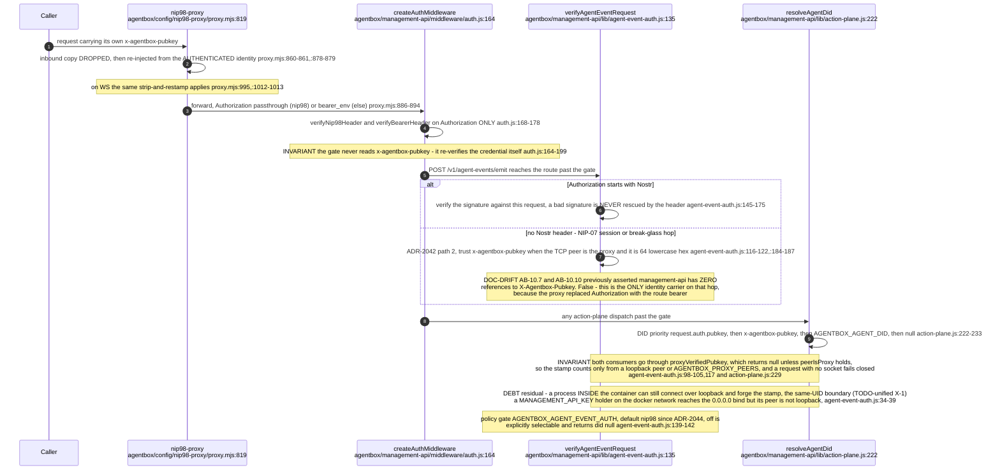

The governing doc states Invariant 2 as "X-Agentbox-Pubkey always proxy-injected,
never trusted inbound" — true at the ingress, and the two ADR-2042 consumers above
are the deliberate, documented exception on the far side of the gate.

**Invariant:** the stamp counts only when `request.raw.socket.remoteAddress` is loopback (`127.0.0.1`, `::1`, `::ffff:127.0.0.1`) or an exact address in `AGENTBOX_PROXY_PEERS`, and a request with no socket information fails closed; `server.js` binds `0.0.0.0`, so a `MANAGEMENT_API_KEY` holder on the docker network reaches the port but cannot forge any `did:nostr` (`agentbox/management-api/lib/agent-event-auth.js:98-105`, `agentbox/management-api/lib/agent-event-auth.js:117`, `agentbox/management-api/server.js:49`). `resolveAgentDid` calls the same exported helper, so the two ADR-2042 consumers share one rule (`agentbox/management-api/lib/action-plane.js:229`).

**Debt:** the loopback test authenticates the network position, not the process: anything inside the container can open its own loopback connection and forge the stamp (the same-UID boundary, TODO-unified X-1), (`agentbox/management-api/lib/agent-event-auth.js:37-39`).
