## AB-12.2 Bridge boot — reconcile, listen, coordinator resolve
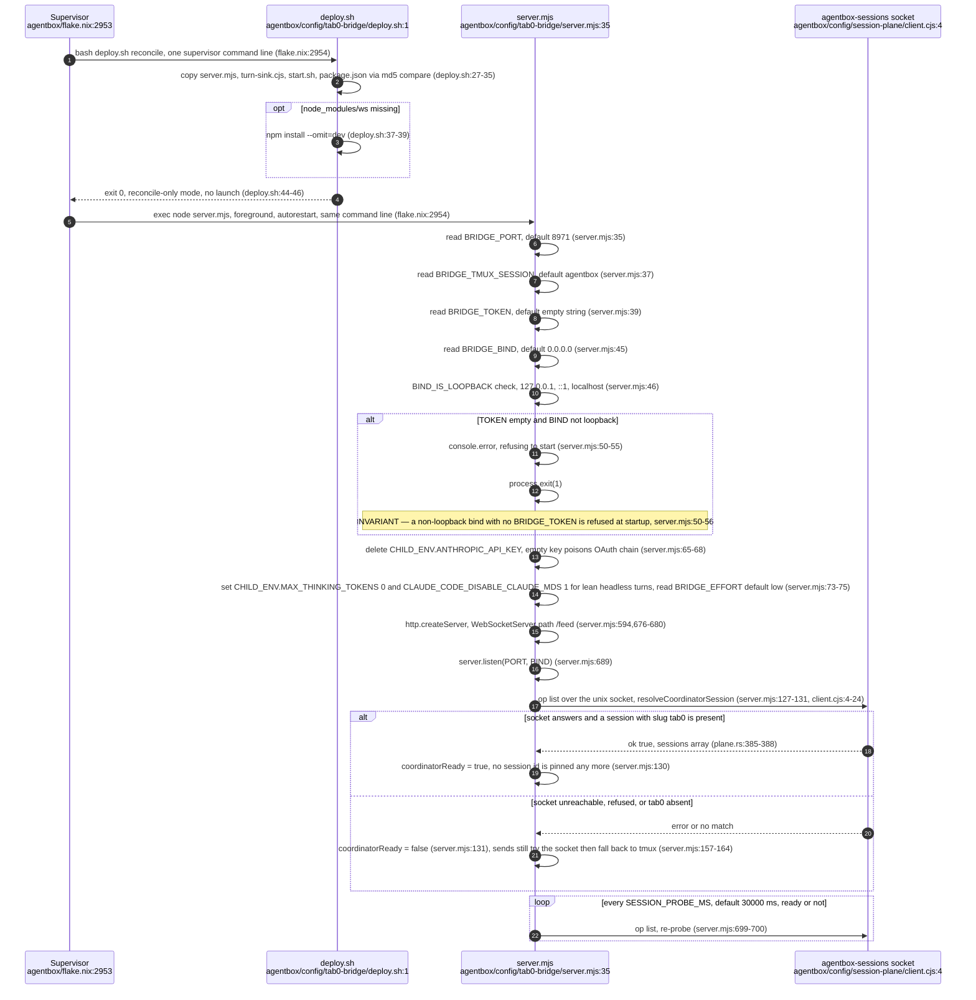

## AB-12.3 Global HTTP auth gate
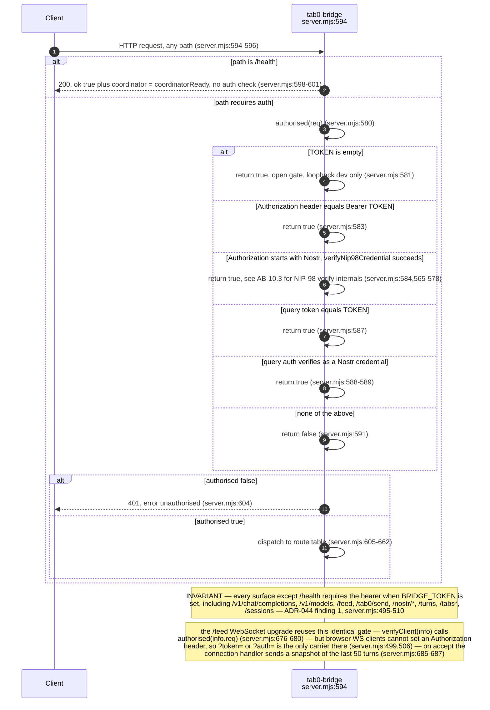

## AB-12.5 Inject into tmux window 0 — sendToTab0
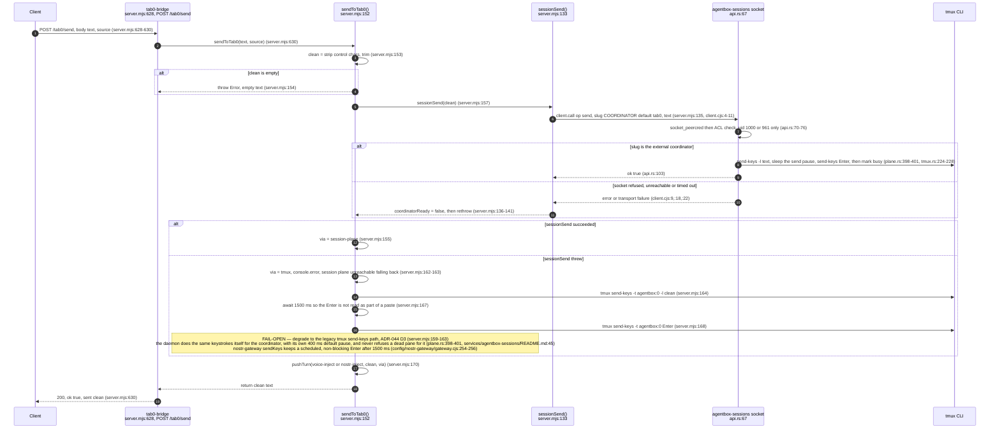

## AB-12.6 Coordinator readiness probe and the 30 s retry
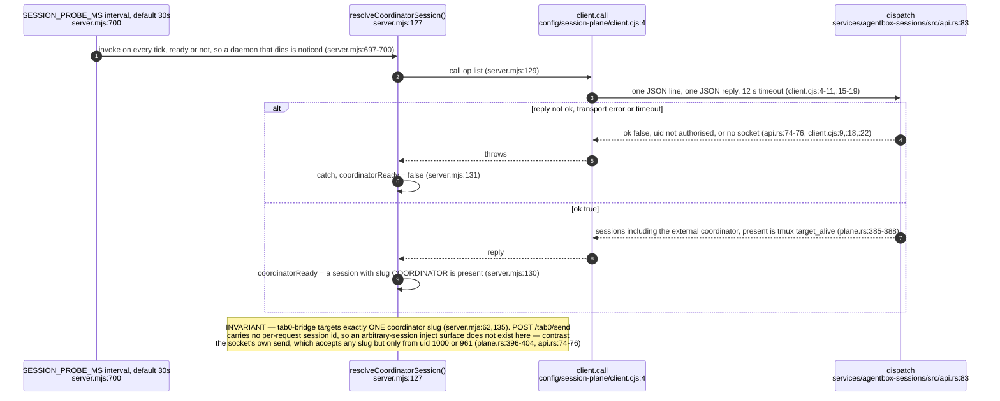

**Debt (resolved 2026-10-30, in source):** `coordinatorReady` used to be cleared only inside a probe that stopped once it was true, so after the daemon died the voice prompt kept telling the controller to run `session-control.cjs`, which has no tmux fallback; the interval now probes on every tick (`config/tab0-bridge/server.mjs:697-700`), a failed send clears readiness at once (`config/tab0-bridge/server.mjs:136-141`), the prompt branches on it (`config/tab0-bridge/server.mjs:264-270`, `scripts/session-control.cjs:9-15`) and `/health` reports it (`config/tab0-bridge/server.mjs:600`).

## AB-12.7 Unmute voice loop through tab0-bridge
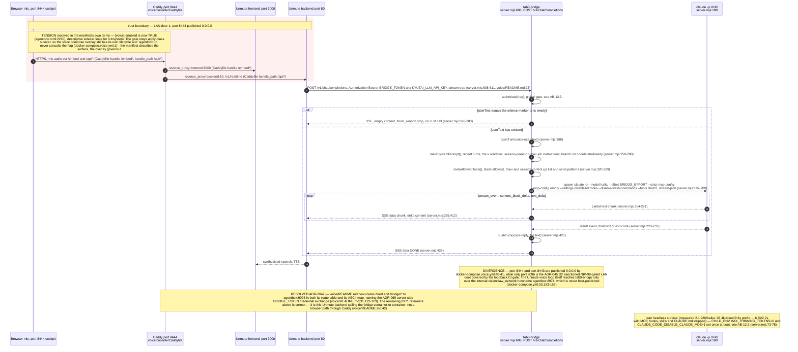

## AB-12.8 mgmt-api voice-intent — mandate-gated ACSP dispatch
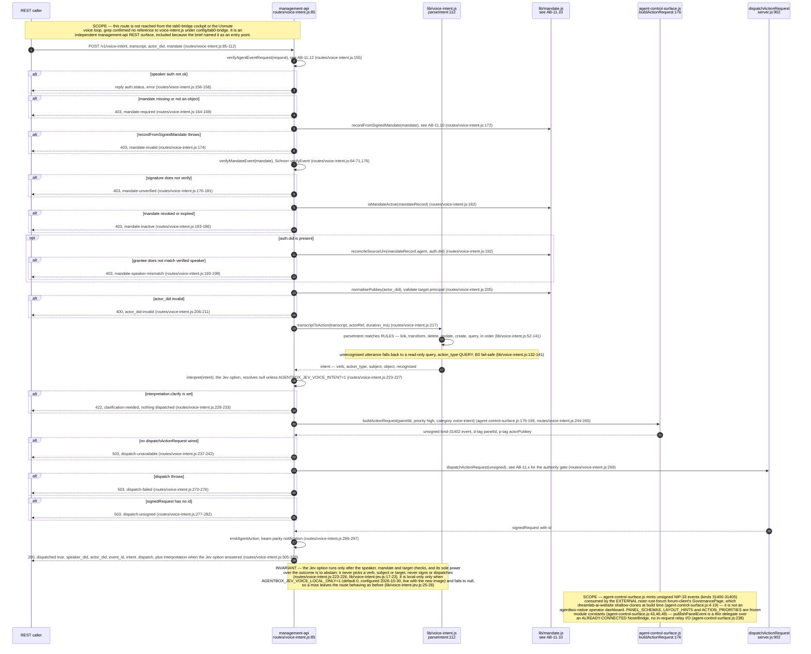

## AB-12.9 Inline NIP-98 approval decision
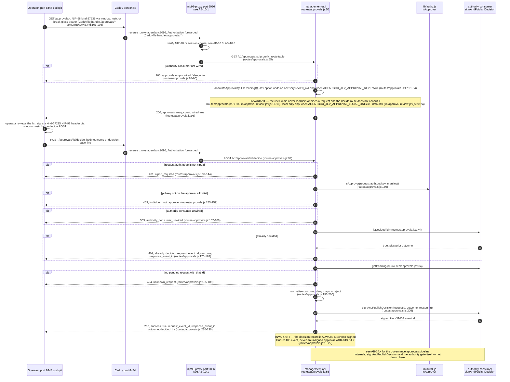

## AB-12.10 Session list — the bridge's /sessions passthrough and the retired cockpit board
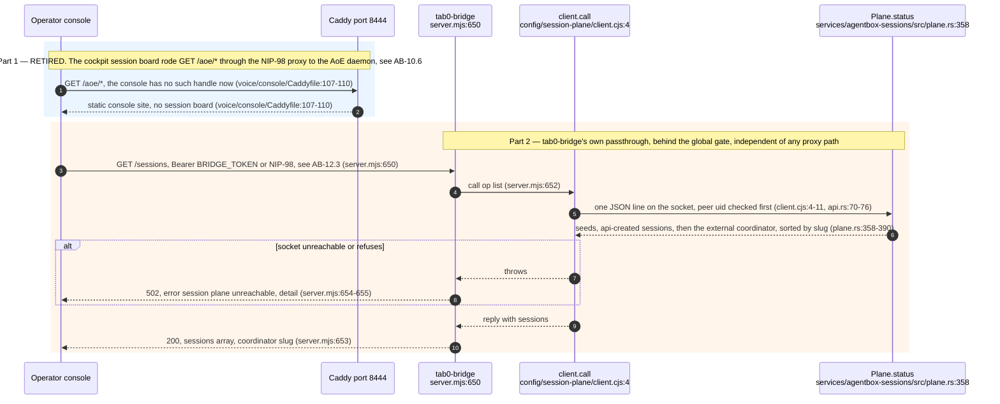

## AB-12.11 junkiejarvis-agent.js listen, zone-key grants and reply flow
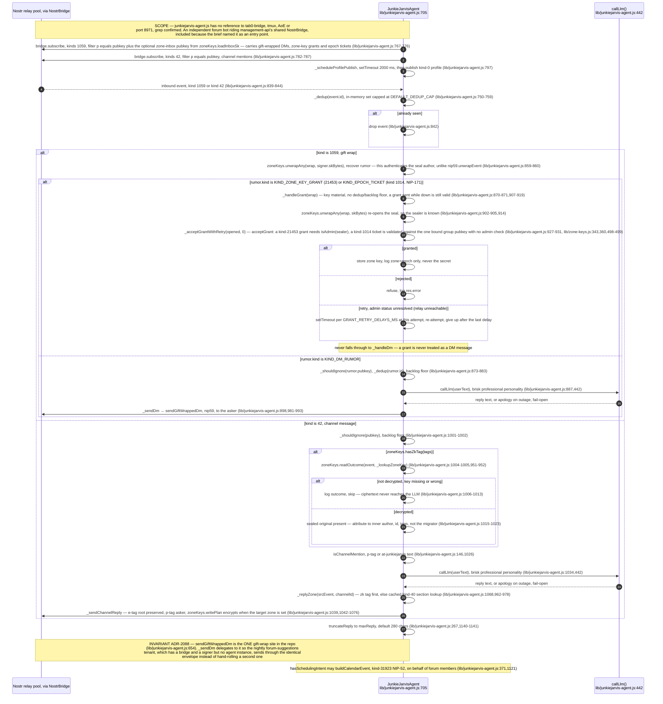

## AB-12.13 turn-sink capture
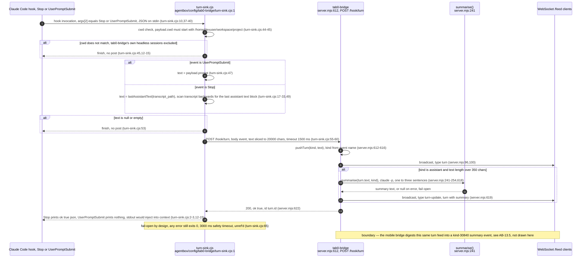

## AB-12.14 Read-only and outbound route family
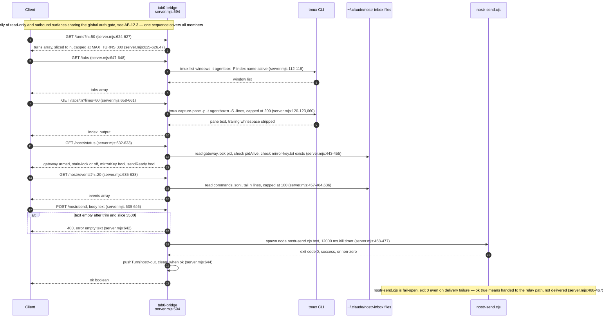

## AB-12.15 Session plane — reconcile, ownership and the paths that reach it
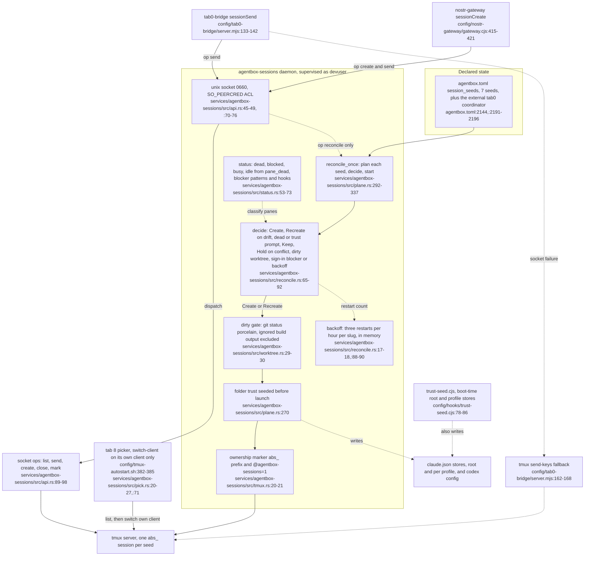
**What it shows.** The live session plane at the verified commit: the daemon compares each manifest seed with what tmux runs, recreates a missing, dead, drifted or trust-blocked pane unless the worktree holds work or the slug has restarted three times in the hour, and touches only sessions carrying its own marker. tab0-bridge and the nostr-gateway reach it over the socket, tab 8 runs the picker (`config/tmux-autostart.sh:382-385`), and the bridge keeps a tmux fallback.
**Why it is this way.** ADR-2153 replaced the create-only AoE seeder after five of ten AoE sessions were found dead on 2026-10-28, and it records the cut-over as live with the implementation still partial (`docs/adr/ADR-2153-session-plane-replaces-aoe.md:40,:6-7`).

**Open:** the acceptance run left antigravity blocked on sign-in and openrouter on a 401, and session-boundary turn events returned HTTP 500 from the beads redactor, so a successful reply is not proof the session epic is bound (`docs/adr/ADR-2153-session-plane-replaces-aoe.md:169-172,:195-198`).
**Debt:** the restart counter is a process-local map, so a restart of the daemon itself forgets the hour's history and a command that dies on launch gets three fresh attempts (`services/agentbox-sessions/src/reconcile.rs:96-98`).
**Drift:** the crate comment says `trust-seed.cjs` only ever wrote the root store (`services/agentbox-sessions/src/trust.rs:10-11`), but it enumerates every existing wrapper profile store, which the ADR's later note records (`config/hooks/trust-seed.cjs:78-86`, `docs/adr/ADR-2153-session-plane-replaces-aoe.md:102`).
**Invariant:** the daemon, like trust-seed, offers folder trust to a wrapper profile store only when `profiles/<slug>/.claude/.claude.json` already exists, so a missing profile file is never created (`services/agentbox-sessions/src/trust.rs:34-43`, `config/hooks/trust-seed.cjs:78-86`).
**Tension (ADR-2151 vs manifest):** ADR-2151 (its pin commit 11dafbde9 landed after d9477245d held it proposed) records the VoiceLink edge voice slot as proposed, implementation none, inactive (`docs/adr/ADR-2151-voicelink-edge-voice.md:5-7`), while the live manifest sets `[voicelink] enabled = true` and `record_events = true` (`agentbox.toml:2226,2233`); that path reaches the container by `voice-paned --stdio` over ssh and bypasses tab0-bridge and the Unmute loop (`agentbox.toml:2218-2222`).
