## AB-15.1 Gate lattice — manifest to package set to supervisor to runtime trace
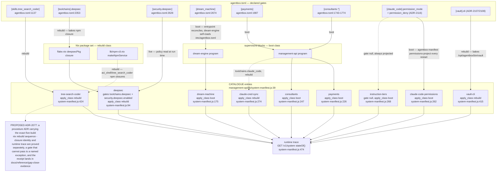

## AB-15.2 A gated tool call — off, on, and spend-capped branches
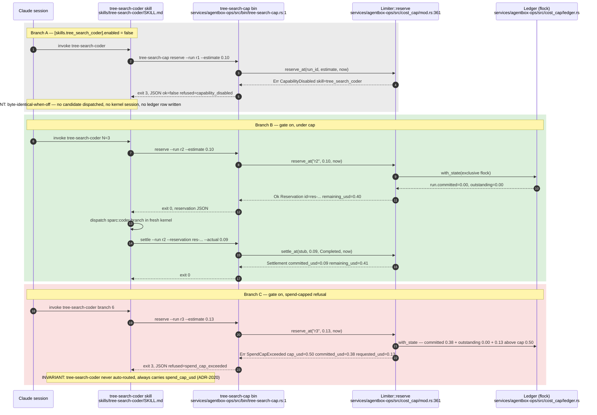

## AB-15.3 Boot projection — manifest to catalogue to runtime state
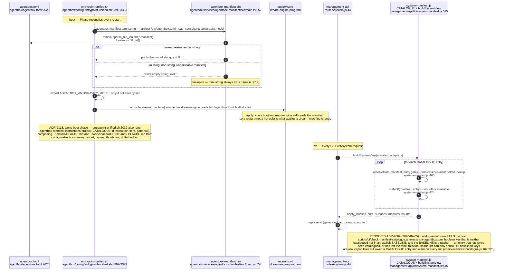

## AB-15.4 Apply-class lifecycle of a gate
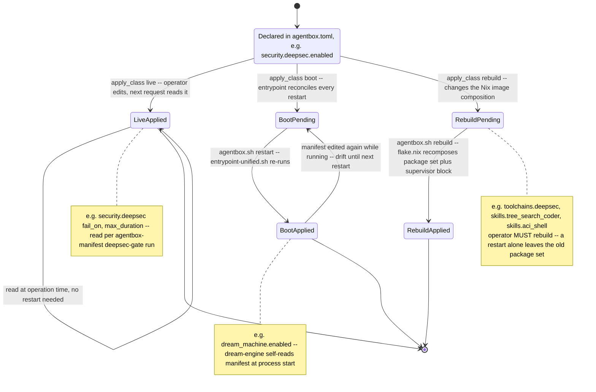

## AB-15.5 tree-search-coder spend cap — manifest to validator to enforcement
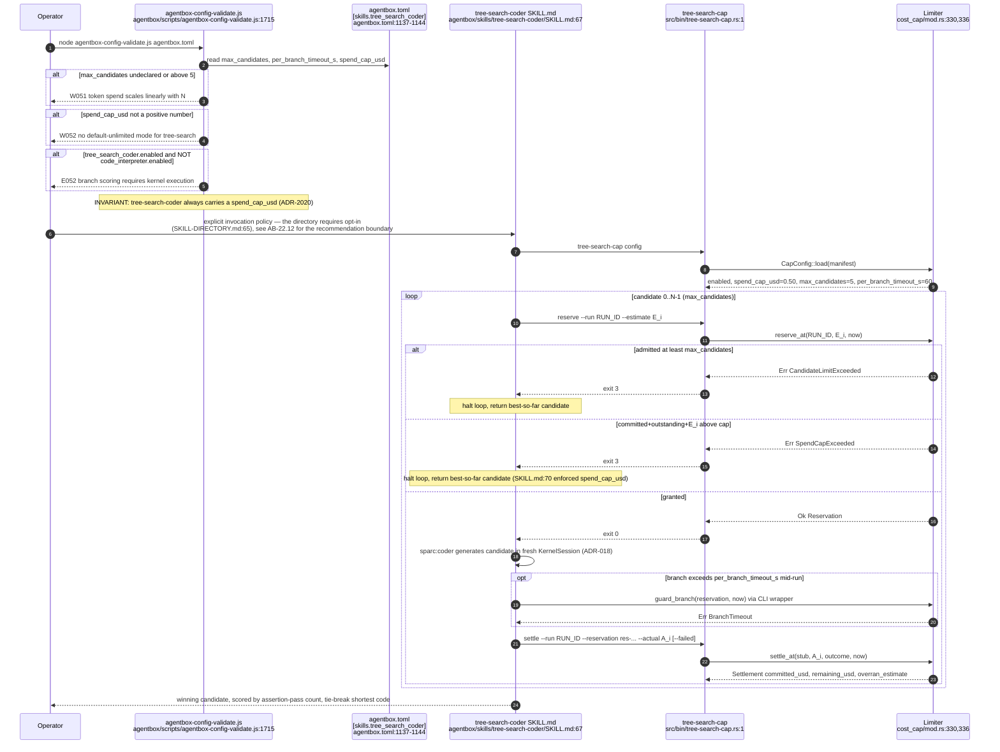

## AB-15.6 Full HTTP 402 challenge, payment, retry, settle
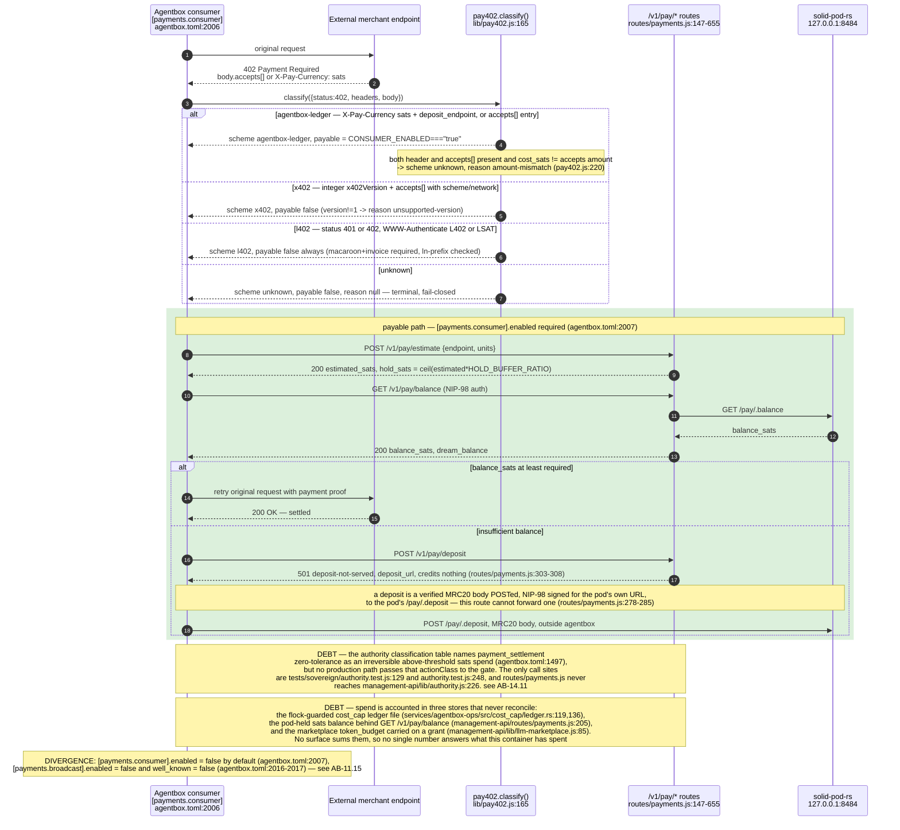

## AB-15.7 routes/payments.js — GET info, GET balance, POST deposit
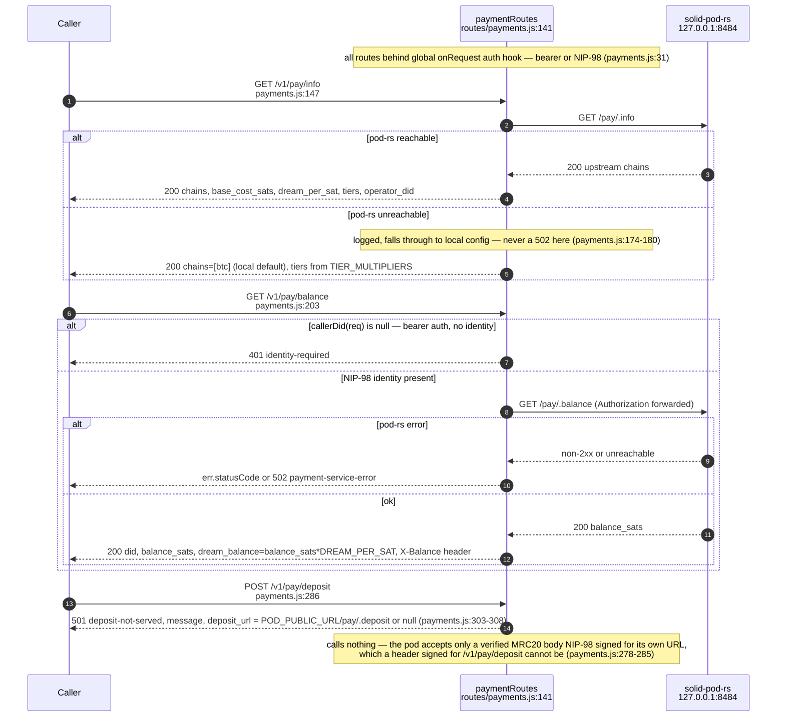

## AB-15.8 routes/payments.js — POST estimate, POST buy, POST withdraw
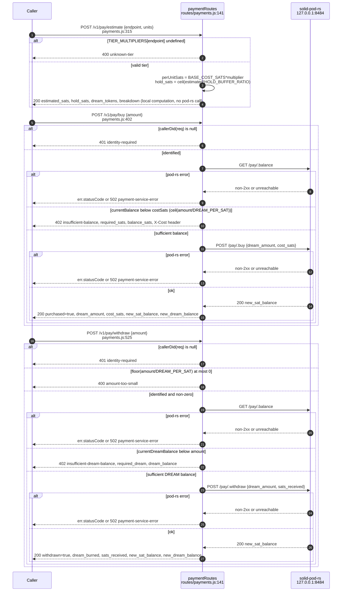

## AB-15.9 LLM marketplace — advertise, discover, request, grant, receipt, revoke
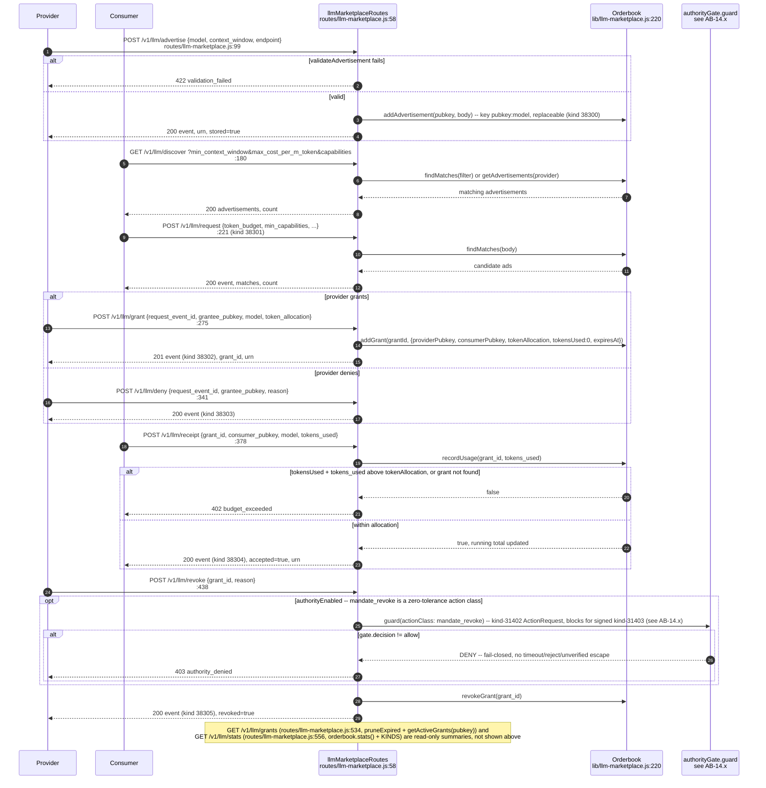

## AB-15.10 headroom compression-capacity model and its 3 MCP tools
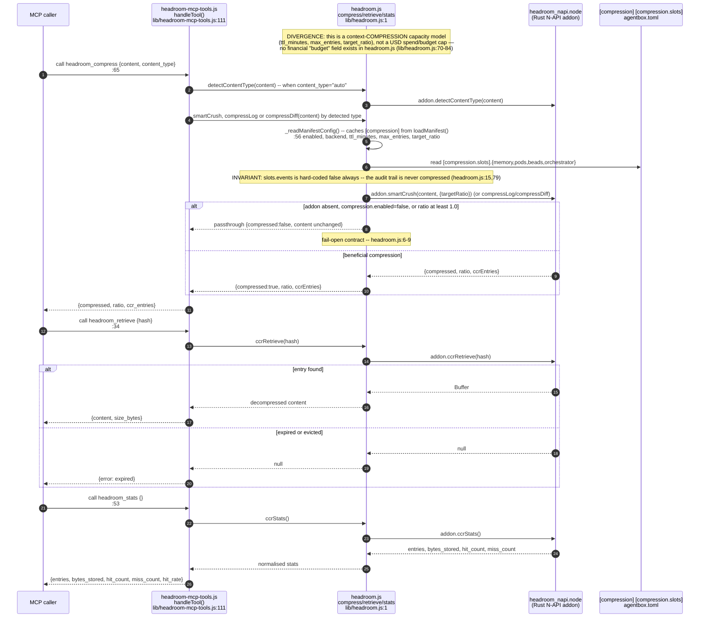

## AB-15.11 Consultant model projection at boot — env wins, TUI preserves (ADR-2031)
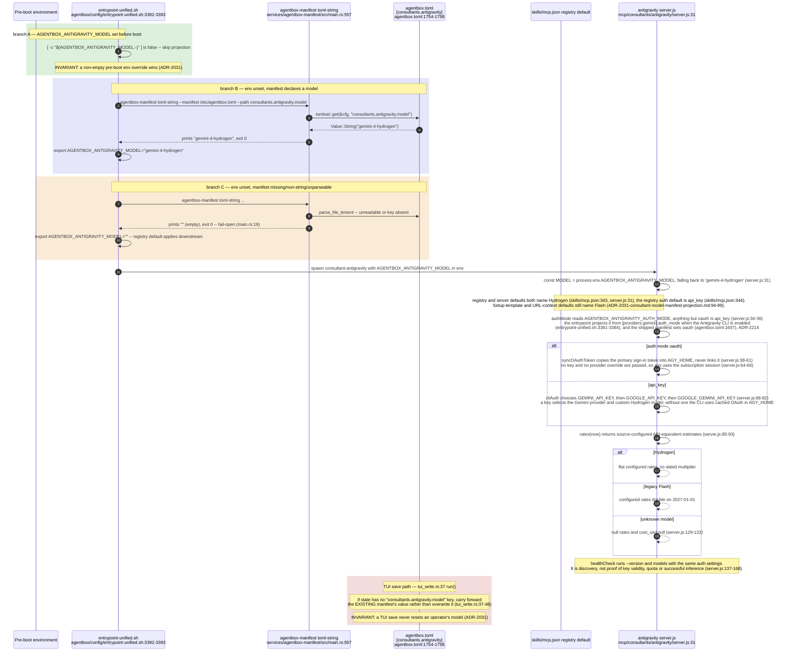

## AB-15.12 Consultant consult() call — consultant-base.js, model-diversity, memory-logger
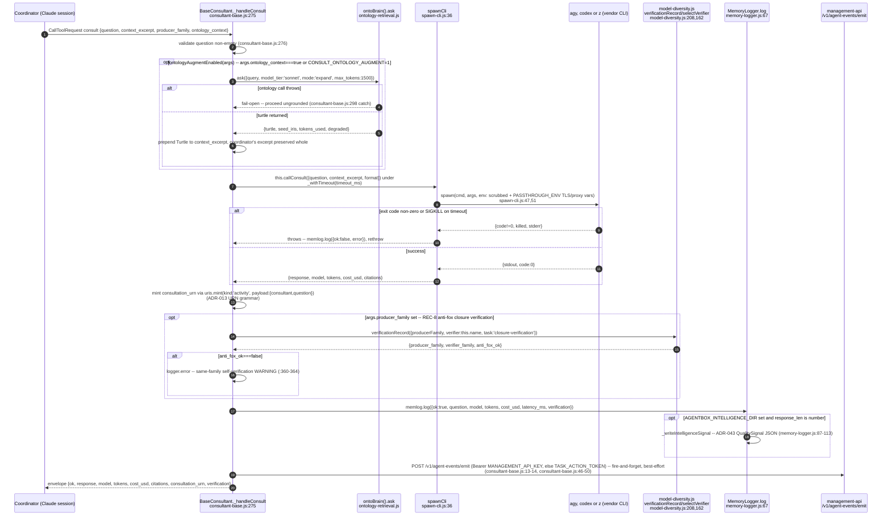

## AB-15.13 deepsec gate — host adapter, policy projection, hand-off to the VisionCraft executor
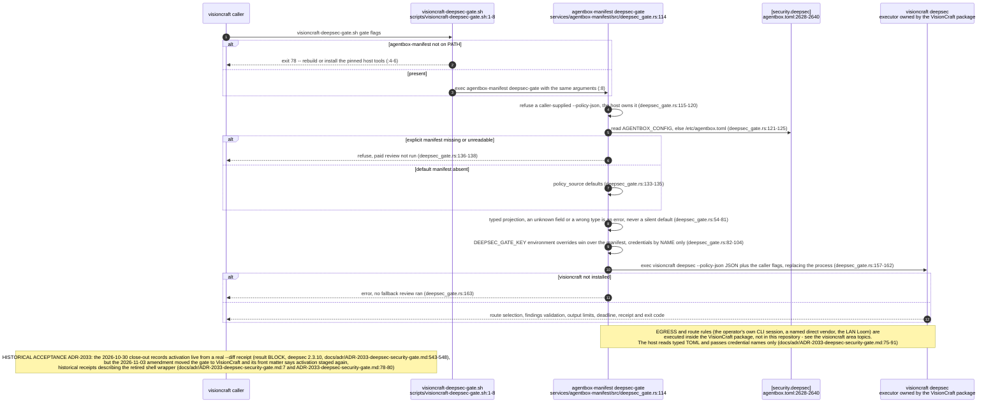

## AB-15.14 ADR-2080 — the metaharness router console gate
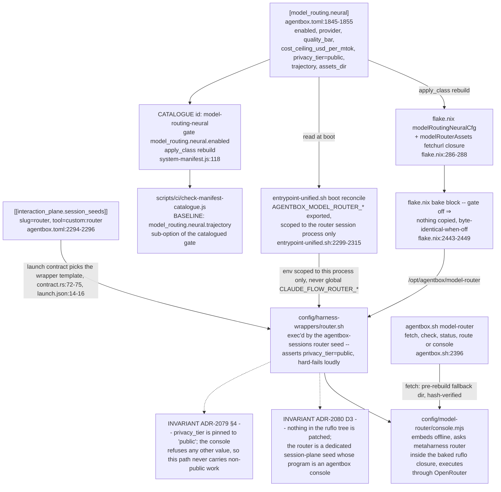

**Open:** ADR-2153 is now `accepted`, `implementation_status: partial`, `activation_status: live` and supersedes ADR-2079, so the router console is an ordinary session-plane seed (`../project/agentbox/docs/adr/ADR-2153-session-plane-replaces-aoe.md:5-7`, `../project/agentbox/agentbox.toml:2294-2296`); its acceptance round trip excludes `router`, so the wrapper's hard-fail path is exercised by launch only, not by a routed task (`../project/agentbox/docs/adr/ADR-2153-session-plane-replaces-aoe.md:211`).

**Drift (spend gating vs the wallet that now exists):** the capability lattice above gates LLM spend and HTTP 402 settlement, and a second spend surface has since been published — `sidestr-wallet` consults a `SpendPolicy` before every signature and ships only a permissive implementation, leaving the authority gate (ADR-2100) to the caller, which nothing in this topic yet supplies (see AB-33.7). The level-2 review that reshaped the federation design was itself run through the consultant tier drawn at AB-15.12 (see AB-35).

**Drift (manifest comment and ADR vs pin):** the manifest comment still names Deepsec 2.3.10 (`../project/agentbox/agentbox.toml:2353`), while the flake now pins 2.3.13 (`../project/agentbox/flake.nix:843-847`). ADR-2033's Decision still says the exact pin is 2.3.12 (`../project/agentbox/docs/adr/ADR-2033-deepsec-security-gate.md:175-176`), so neither the comment nor the record names the current pin; the host-to-VisionCraft hand-off it records is unchanged (`../project/agentbox/docs/adr/ADR-2033-deepsec-security-gate.md:183-188`) and the older execution receipt remains historical.

## AB-15.15 consult_advice — an advisory, flag-gated route suggestion on every consultant server
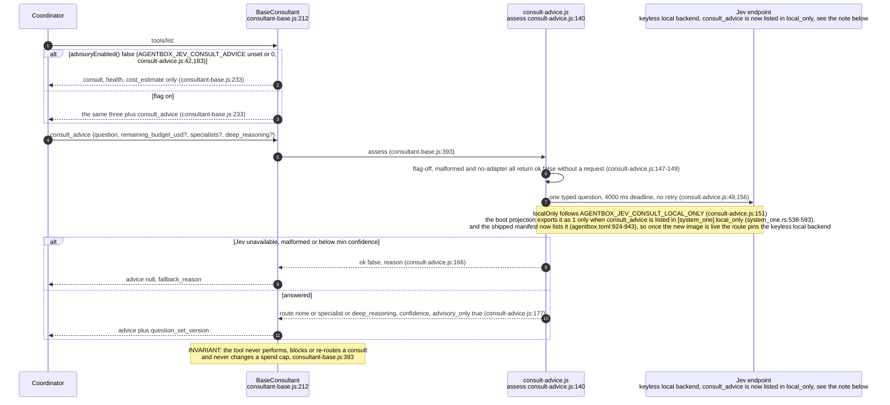

**What it shows.** An opt-in fourth tool on every consultant MCP server. It is not listed unless its flag is set; when set it asks a Jev endpoint whether the coordinator should consult at all, and returns a typed suggestion that the coordinator is free to ignore.
**Why it is this way.** Whether to call a consultant was the one decision no gate or hook covered, and spend caps stay deterministic code, so the model only advises (`../project/agentbox/mcp/consultants/shared/consult-advice.js:20`).

**Open:** the flag is now projected by `[system_one.consumers].consult_advice` (`../project/agentbox/agentbox.toml:962`, `../project/agentbox/services/agentbox-manifest/src/system_one.rs:453-458`) and SECURITY-profiles records the route as STAGED for rebuild, local-only, with no measured uplift claimed (`../project/agentbox/docs/SECURITY-profiles.md:96`). The manifest now makes the local-only half true in its own terms: `consult_advice` is in `[system_one].local_only` and `backend` is the local `laya` route (`../project/agentbox/agentbox.toml:913-943`), so the projection pins it to the keyless local backend (`../project/agentbox/services/agentbox-manifest/src/system_one.rs:578-593`). **Drift (code comment vs manifest):** the projector's comment still says `local_only` is empty by default (`../project/agentbox/services/agentbox-manifest/src/system_one.rs:534-537`). Until the candidate image boots the flag stays unset; whether a measured uplift will be recorded is not stated.
