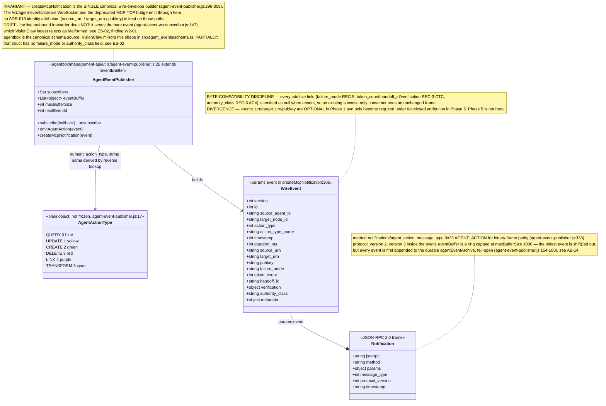
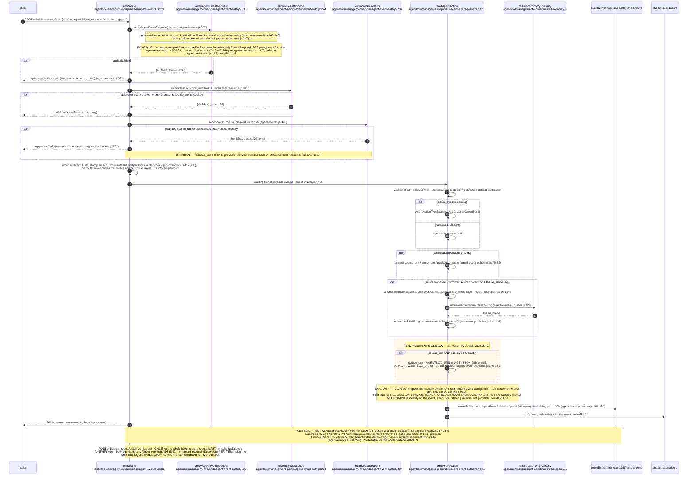
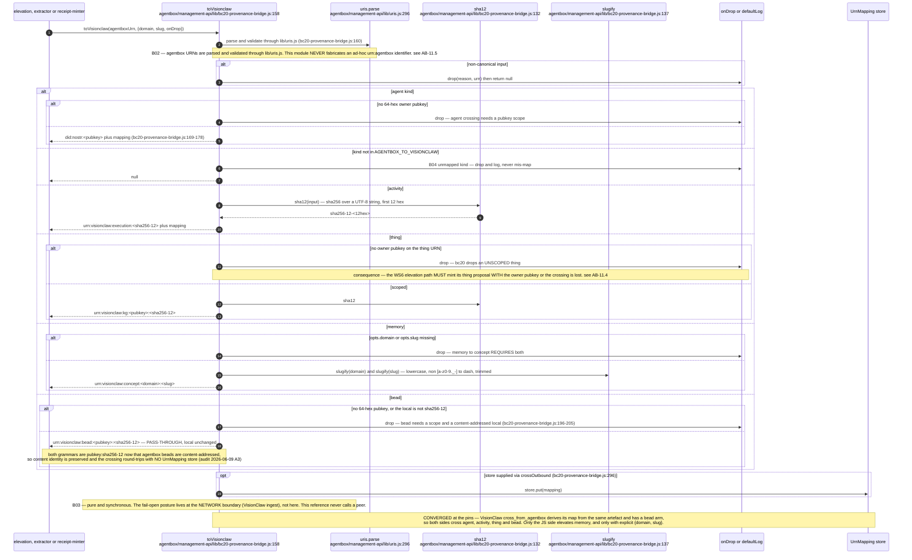
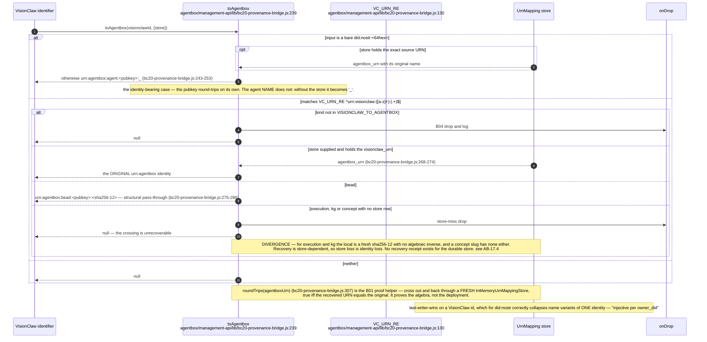
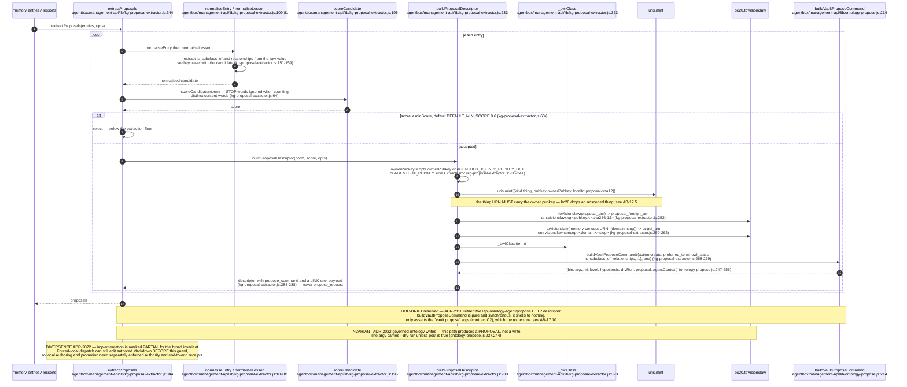
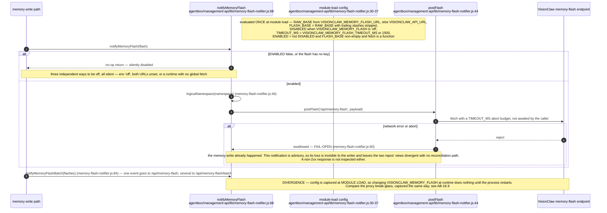
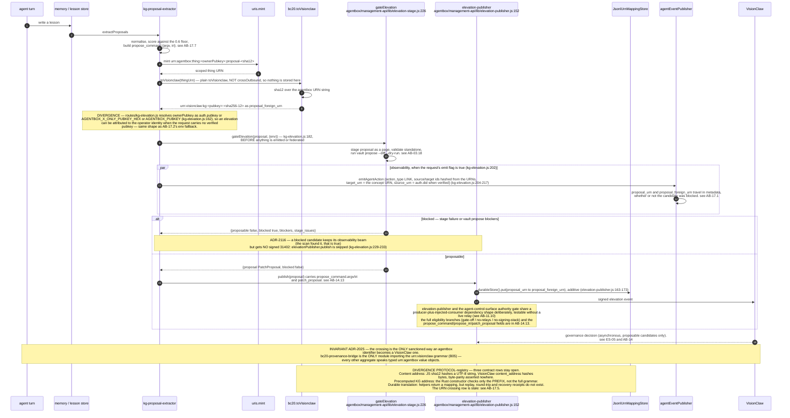

## AB-17.1 The agent-event wire envelope — single canonical builder

**Drift:** the publisher comment says VisionClaw mirrors this envelope in `src/agent_events/schema.rs` (`agentbox/management-api/utils/agent-event-publisher.js:296-298`), but at VisionClaw `86cdd7635582` `AgentActionEnvelope` carries `source_urn`, `target_urn`, `pubkey`, `token_count`, `handoff_id` and `verification` and no `failure_mode` or `authority_class` field, so serde drops those two wire fields on ingest. The mirror covers the identity and CTC fields only (`agentbox/management-api/utils/agent-event-publisher.js:326`, `agentbox/management-api/utils/agent-event-publisher.js:335`).

## AB-17.2 POST /v1/agent-events/emit — provable attribution

**Invariant:** the proxy-stamped `X-Agentbox-Pubkey` is read only when the TCP peer is the proxy: `proxyVerifiedPubkey` returns null unless `peerIsProxy` holds, which accepts `127.0.0.1`, `::1` and `::ffff:127.0.0.1` or the exact addresses in `AGENTBOX_PROXY_PEERS`, and refuses a request with no socket information (`agentbox/management-api/lib/agent-event-auth.js:98-105`, `agentbox/management-api/lib/agent-event-auth.js:117`). A `MANAGEMENT_API_KEY` holder on the docker network reaches the port because `server.js` binds `0.0.0.0`, but its forged header is ignored, so `reconcileSourceUrn` reconciles against an identity a cross-container caller cannot assert (`agentbox/management-api/lib/agent-event-auth.js:34-39`, `agentbox/management-api/lib/agent-event-auth.js:192-195`).

**Debt:** a process inside the container can still forge it over loopback (the same-UID boundary, TODO-unified X-1), so under path 2 provenance is bounded by that boundary (`agentbox/management-api/lib/agent-event-auth.js:37-39`).

**Debt:** the batch route rejects a mismatched item from inside the emit loop, after the items before it have already been emitted (`agentbox/management-api/routes/agent-events.js:506-519`, `agentbox/management-api/routes/agent-events.js:547`). The caller gets a 403 for a batch that was partly published, and the reply carries no ids for the events that went out.

**Tension:** a task-token request passes verification with `did` null (`agentbox/management-api/lib/agent-event-auth.js:143-145`), `reconcileTaskScope` forbids it from asserting an identity (`agentbox/management-api/lib/agent-event-auth.js:232-234`), and the route stamps nothing (`agentbox/management-api/routes/agent-events.js:427-430`), so the publisher's environment fallback attributes every task-token action to the container identity (`agentbox/management-api/utils/agent-event-publisher.js:146-151`). The task travels only in `metadata.taskId`.

## AB-17.4 BC20 kind map — the closed cross-namespace contract

```mermaid
classDiagram
    class FEDERATION_KINDS_json {
        <<versioned artefact 1.1.0, ADR-2061, federation-kinds.json:3>>
        21 kind rows, 4 crossing
        agent to did:nostr identity
        activity to execution content-address
        thing to kg content-address
        bead to bead structural-passthrough
        memory to concept crosses false deliberate
        16 kinds crosses false not-federated
        knowledge added ADR-2085 federation-kinds.json:279
        chain added ADR-2098 federation-kinds.json:291
        event_kinds band added ADR-2105
    }
    class AGENTBOX_TO_VISIONCLAW {
        <<frozen, DERIVED bc20-provenance-bridge.js:117-124>>
        fromEntries over kinds with target_kind
        excluding did:nostr - not a URN kind
        activity to execution
        thing to kg
        memory to concept
        bead to bead
    }
    class VISIONCLAW_TO_AGENTBOX {
        <<frozen, INVERTED bc20-provenance-bridge.js:125-127>>
        execution to activity
        kg to thing
        concept to memory
        bead to bead
    }
    class UrnMapping {
        <<returned by toVisionclaw>>
        +string agentbox_urn
        +string visionclaw_urn
        +string owner_did
    }
    class JsonlUrnMappingStore {
        <<durableStore bc20-provenance-bridge.js:346>>
        +string path
        +put(mapping)
        +getByAgentbox(urn)
        +getByVisionclaw(id)
    }
    class InMemoryUrnMappingStore {
        <<reference and test store>>
        +Map _byAb
        +Map _byVc
    }
    FEDERATION_KINDS_json --> AGENTBOX_TO_VISIONCLAW : read at require time, derived not transcribed
    AGENTBOX_TO_VISIONCLAW <--> VISIONCLAW_TO_AGENTBOX : injective per owner_did
    UrnMapping --> JsonlUrnMappingStore : crossOutbound or elevation-publisher persists
    UrnMapping --> InMemoryUrnMappingStore : roundTrips proof helper
    note for AGENTBOX_TO_VISIONCLAW "There is deliberately NO agent kind in the map. An agent's identity IS its did:nostr,<br/>so urn:agentbox:agent:pubkey:name crosses as the BARE DID did:nostr:pubkey rather than a relabelled URN.<br/>bc20-provenance-bridge.js:14"
    note for FEDERATION_KINDS_json "INVARIANT: ADR-2061 — neither side transcribes the kind list. This bridge reads the artefact<br/>at require time (bc20-provenance-bridge.js:112-115); VisionClaw embeds the same bytes with<br/>include_str! in src/uri/mod.rs and derives cross_from_agentbox from it. A paired fixture<br/>(tests/contract/federation-kind-parity.contract.spec.js and federation_kind_artefact_matches_translator)<br/>makes a one-sided kind addition a test failure, not a runtime surprise. bc20-provenance-bridge.js:88-98<br/>INVARIANT ADR-2085: the colloquy knowledge kind is minted scoped and content-addressed<br/>(uris.js:111-115) and refused at the crossing (federation-kinds.json:279), so urn:agentbox:knowledge<br/>and the cq id ku_hex share the same twelve digest characters while the URN never crosses."
    note for VISIONCLAW_TO_AGENTBOX "B04 — the kind map is CLOSED. An unmapped kind is DROPPED and LOGGED, never silently mis-mapped.<br/>defaultLog writes '[bc20] drop: reason (urn)' to stderr (bc20-provenance-bridge.js:141,143)."
    note for UrnMapping "B01 — provenance is continuous, bidirectional and injective per owner_did.<br/>Where the VisionClaw kind is content-addressed (execution, kg) the local is a FRESH sha256-12 and the original<br/>urn:agentbox identity is recovered only from the durable UrnMapping store — lose the store, lose the crossing.<br/>Where it is identity-bearing (agent to did:nostr) the pubkey round-trips structurally with no store."
    note for JsonlUrnMappingStore "path = BC20_URN_MAPPING_PATH or /var/lib/agentbox/code-harness/bc20-urn-mappings.jsonl (bc20-provenance-bridge.js:380-387).<br/>A failed append degrades to in-memory only with a stderr line (bc20-provenance-bridge.js:359-368).<br/>DIVERGENCE PROTOCOL-registry 'Durable translation' row — the registry requires persistence, replay, round-trip and recovery receipts.<br/>roundTrips() proves the algebra against a FRESH IN-MEMORY store (bc20-provenance-bridge.js:307), which is not a durability or recovery proof."
```

## AB-17.5 toVisionclaw — outbound crossing and its drops

**Drift:** the PROTOCOL-registry "URN crossing" row still says the Rust side has a narrower closed map with no `bead` arm and calls ADR-2061 planned (`agentbox/docs/PROTOCOL-registry.md:8`). The artefact is versioned and shared (`agentbox/schema/federation-kinds.json:3`), and at VisionClaw `86cdd7635582` `cross_from_agentbox` embeds it with `include_str!` and carries a structural `bead` arm, so the row's current-state column is stale.

## AB-17.6 toAgentbox — inbound recovery

## AB-17.7 kg-proposal-extractor — lessons to a governed vault-propose command

## AB-17.8 memory-flash-notifier — fail-open cross-repo notification

## AB-17.10 End-to-end — a lesson becoming a VisionClaw KG proposal

**Debt:** the kg URN a beam carries in `metadata.proposal_foreign_urn` is persisted to the durable mapping store only inside `elevationPublisher.publish` (`agentbox/management-api/lib/elevation-publisher.js:163-173`), which runs only for an unblocked candidate after the signing stack loads (`agentbox/management-api/lib/elevation-publisher.js:153-155`, `agentbox/management-api/routes/kg-elevation.js:229-233`). A blocked candidate, or one emitted while federation is unavailable, puts a `urn:visionclaw:kg` address on the wire that `toAgentbox` can never resolve back (`agentbox/management-api/lib/bc20-provenance-bridge.js:287-289`).
