## AB-20.1 Server boot — fail-closed on Postgres, advisory on Xinference

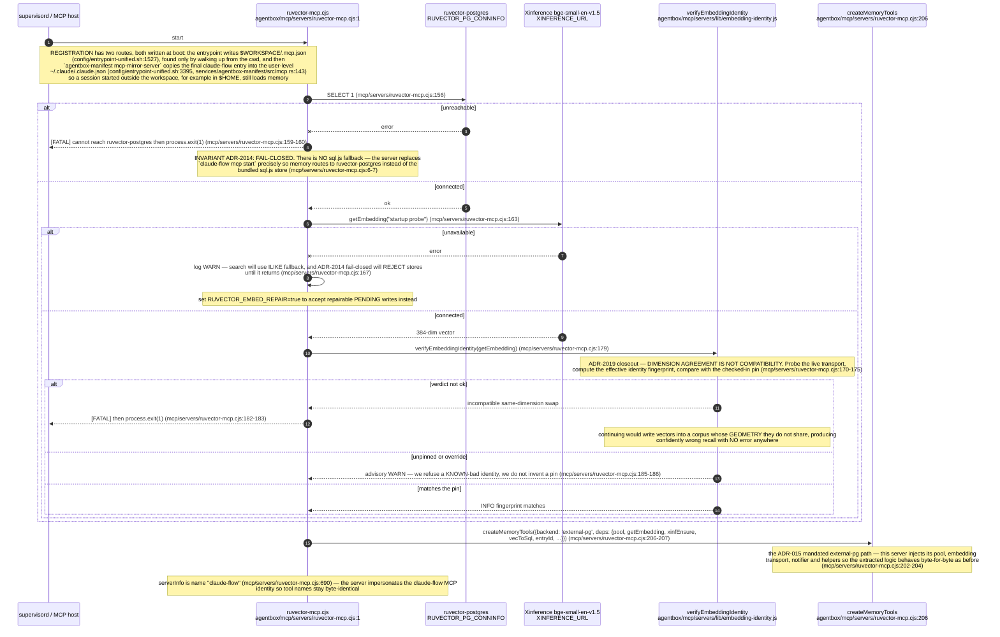

## AB-20.2 memory_store — the write path

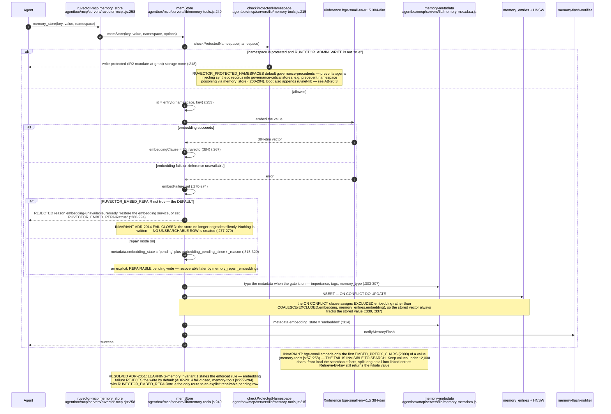

## AB-20.3 memory_search — vector ANN, wildcard namespace exclusion, output shaping and the degraded fallback

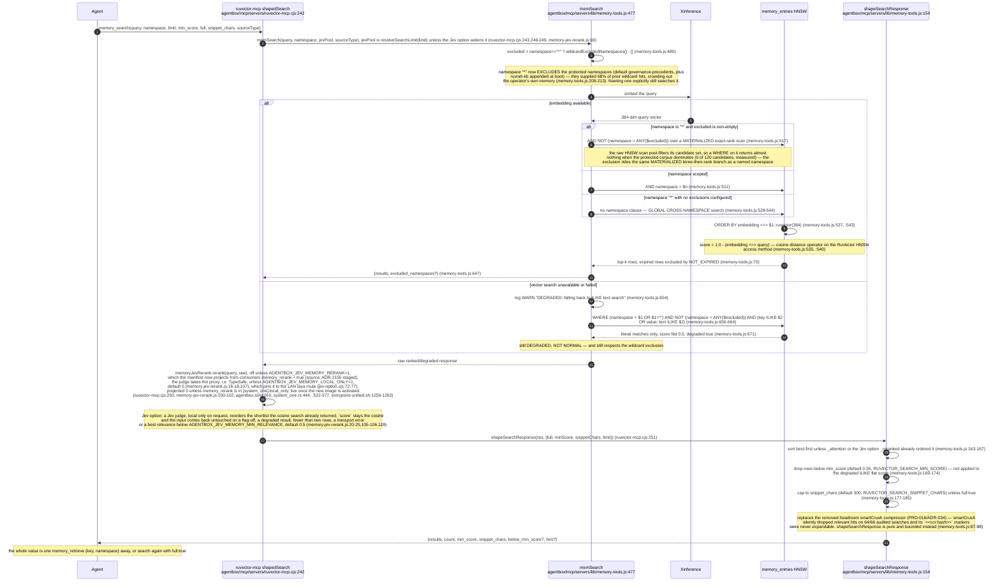

## AB-20.4 memory_retrieve and memory_list

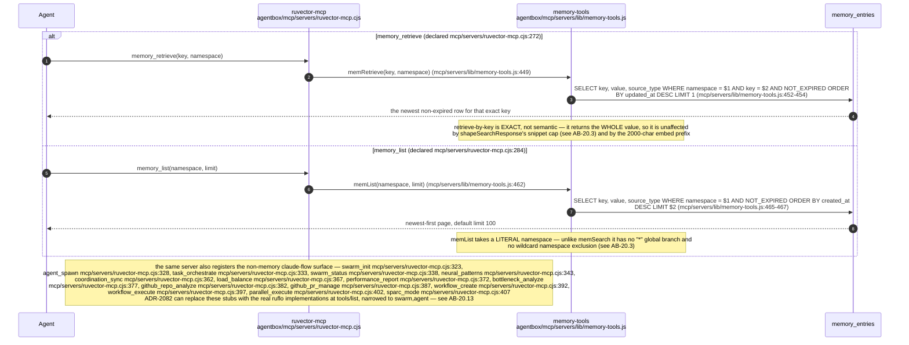

**Invariant:** a row whose `metadata.expires_at` is not a valid timestamp is neither hidden nor swept: the visibility predicate treats it as not expired and the sweep predicate as never expired, because `pg_input_is_valid` guards the cast after the prefix test (`../project/agentbox/mcp/servers/lib/memory-metadata.js:44`, `../project/agentbox/mcp/servers/lib/memory-metadata.js:61`). A value such as `2026-99-99T00` passes the prefix check, and before this guard one such row failed every read and the sweep that should delete it threw too (`../project/agentbox/mcp/servers/lib/memory-metadata.js:32-36`).

## AB-20.5 memory_hybrid_search

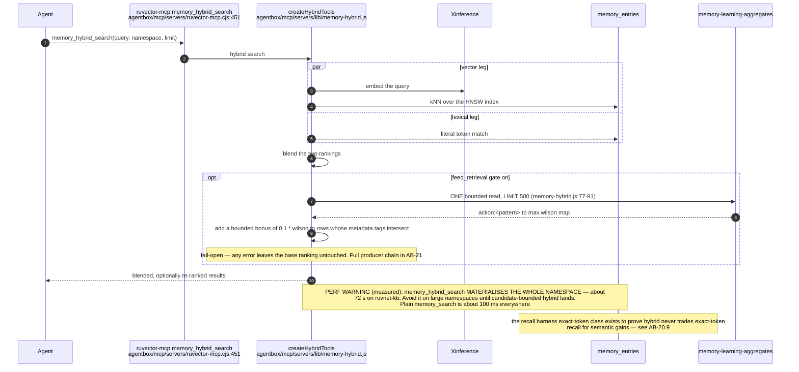

## AB-20.6 memory_orient — the OODA cold-start bundle

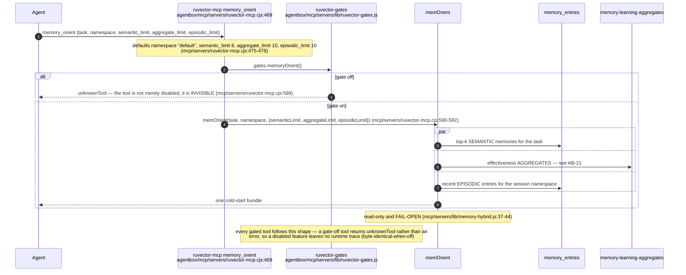

## AB-20.7 memory_sweep_episodic and memory_repair_embeddings

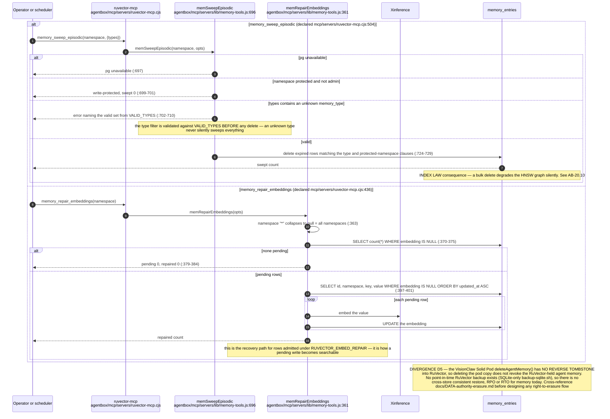

## AB-20.8 The FORBIDDEN write paths

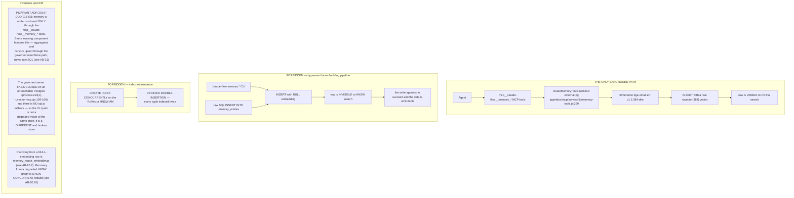

## AB-20.9 The recall harness — the geometry merge gate

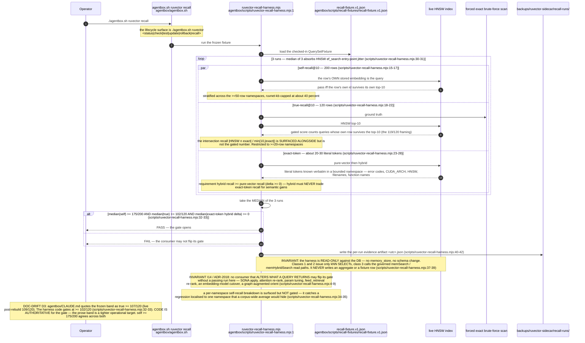

## AB-20.10 The index law

```mermaid
stateDiagram-v2
    [*] --> Healthy
    Healthy --> Degraded : bulk ingest
    Healthy --> Degraded : bulk deletion, e.g. memory_sweep_episodic
    note right of Degraded
        HNSW recall can fall after maintenance. Latest incident was parallel build, not proven churn. Recall drops with
        no error anywhere — nothing in the query path reports it, which is
        why the harness is the only detector.
    end note
    Degraded --> Rebuilding : SERIAL, non-concurrent rebuild; max_parallel_maintenance_workers=0
    note right of Rebuilding
        Takes about 5 minutes. This is the ONLY sanctioned recovery. It is now one command,
        ./agentbox.sh ruvector reindex --yes (ADR-2133, agentbox.sh:105): serial build beside the
        live index, one-transaction swap, recall measured before and after.
    end note
    Rebuilding --> Verifying : rebuild complete
    Verifying --> Healthy : recall harness PASSES the band (see AB-20.9)
    Verifying --> Degraded : harness FAILS
    Corrupted --> [*]
    Degraded --> Corrupted : CREATE INDEX CONCURRENTLY
    note right of Corrupted
        FORBIDDEN on the RuVector HNSW access method — VERIFIED
        DOUBLE-INSERTION, every tuple indexed twice. Never do this.
        agentbox/docs/reference/claude-context/ruvector-memory-state.md
    end note
    Healthy --> [*]
```

## AB-20.11 384-dim freeze and the inert SONA branch

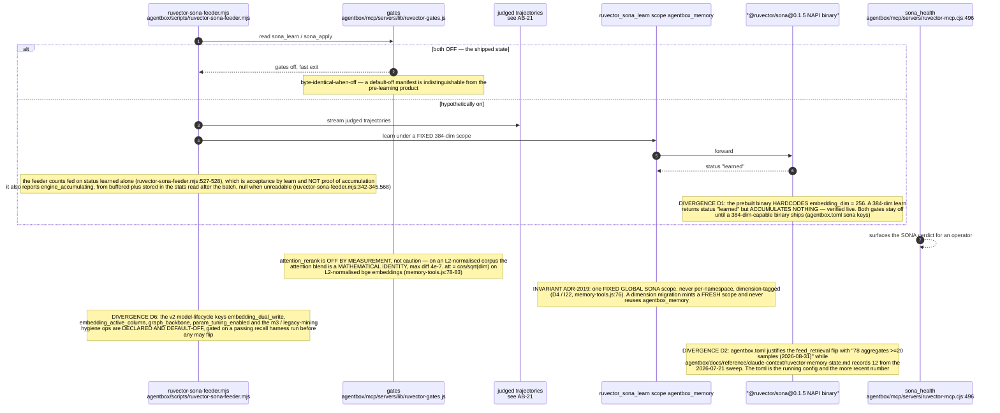

**Drift (resolved at this stamp):** the previous stamp's feeder reported only `fed`, the count of `ruvector_sona_learn` calls that returned `status:"learned"` (`agentbox/scripts/ruvector-sona-feeder.mjs:527-528`). That figure is not proof the engine kept anything: the 256-dim surface answers `learned` for a 384-dim learn it buffers nowhere (header note, `agentbox/scripts/ruvector-sona-feeder.mjs:55-56`). At this stamp `fed` still drives the cursor and the event contract, and `engineAccumulating` is added, true only when `trajectories_buffered + patterns_stored` is above zero in the post-batch stats and null when they could not be read (`agentbox/scripts/ruvector-sona-feeder.mjs:342-345`). `SonaRunCompleted` carries it as `engine_accumulating` (`agentbox/scripts/ruvector-sona-feeder.mjs:568`), and the human line now reads "N accepted by learn, M failed, engine accumulating: yes/no/unknown" (`agentbox/scripts/ruvector-sona-feeder.mjs:647`). A high `fed` beside `engine accumulating: no` therefore means the D1 binary kept nothing.

**Open:** once a 384-dim-capable binary ships, is `engine_accumulating` true or the recall harness the reading that flips the SONA gates, given the reseed guard still treats `buffered + stored == 0` as the steady state of a healthy 384-dim scope (`agentbox/scripts/ruvector-sona-feeder.mjs:55-60`)?

## AB-20.12 memory_health and the store schema

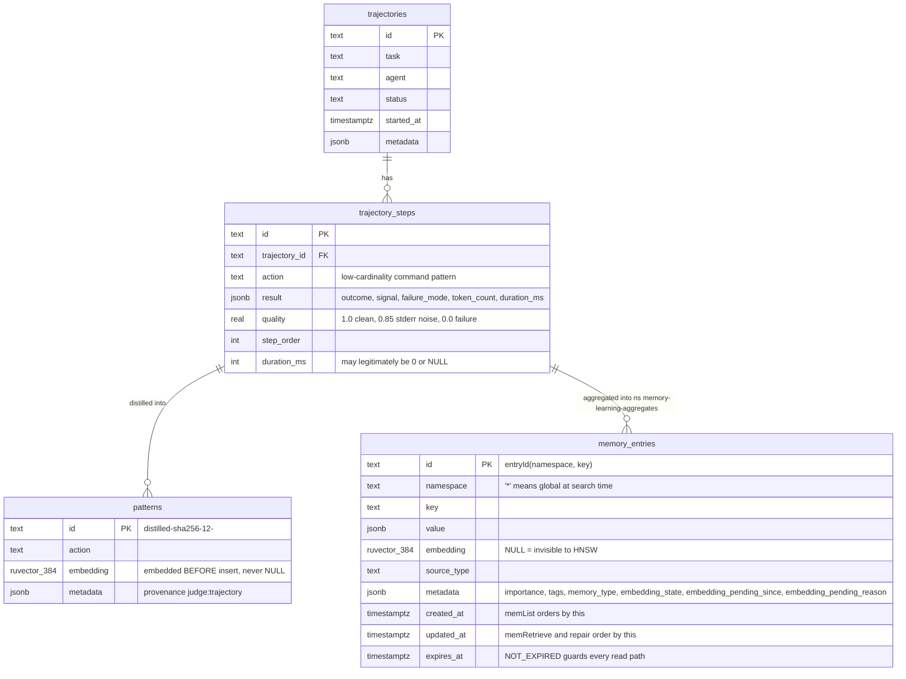

## AB-20.13 ADR-2082 — one pinned Ruflo capability, orchestration forwarded to a filtered child, memory never

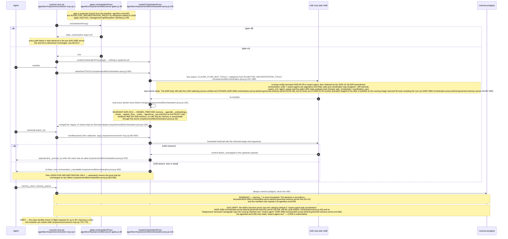

**What it shows.** The governed server is the only registered MCP entry; the orchestration families it forwards come from one lazily spawned, allowlisted Ruflo child, and the proxy drops every `memory_*` and sibling prefix before merging the child's list, whatever the child honours.

**Why it is this way.** ADR-2082 was amended on 2026-10-23 to treat Ruflo as one pinned capability projected differently per host (`../project/agentbox/docs/adr/ADR-2082-orchestration-proxy-behind-governed-memory-server.md:48-54`), and on 2026-10-26 to add the `rure` category to the same child rather than register a second server (`../project/agentbox/docs/adr/ADR-2082-orchestration-proxy-behind-governed-memory-server.md:33-40`).

**Tension (ADR-2082 vs manifest) - RESOLVED 2026-10-30:** the ADR was `activation_status: staged` and required an image build and a live tool-list/call check before claiming activation (`../project/agentbox/docs/adr/ADR-2082-orchestration-proxy-behind-governed-memory-server.md:45-46`) while the running manifest already listed `rure` in `orchestration_tools` (`../project/agentbox/agentbox.toml:456`). The ADR is now `accepted` / `complete` / `live` (`../project/agentbox/docs/adr/ADR-2082-orchestration-proxy-behind-governed-memory-server.md:5-7`): the close-out ran `initialize` then `tools/list` against the baked server and got 56 tools, the projected `agent_*`, `swarm_*` and eight `rure_*` tools among them and no forwarded `memory_*` tool (`../project/agentbox/docs/adr/ADR-2082-orchestration-proxy-behind-governed-memory-server.md:267-269`). The proxy's denial of a forwarded `memory_*` call was not re-exercised.

**Invariant:** the ruRE widening does not touch the deny list; `DENIED_PREFIXES` is enforced on the proxy side whatever categories the child is given (`../project/agentbox/mcp/servers/lib/orchestration-proxy.js:43`).

## Audit qualification — 2026-09-07

The 2026-09-05 Agentbox recall closeout records self 189/200 and true 115/120 after a **serial** rebuild, versus self 151/200 after parallel rebuilding. These are historical receipts, not a fresh benchmark. The local RuVector source contains `hnsw_bulkdelete` and deleted-node flags; neither proves a deployed bulk-delete recall regression. Keep cross-store reverse tombstones (ADR-2060) distinct from index tombstones. No database mutation or reindex was performed. See [audit](../../estate-review/2026-09-07-agentbox-audit.md).
