This topic draws the adapter and the boundary after the 2026-10-15 extraction (agentbox ADR-2141). The judgement and the loop mechanism moved to the permissive repository DreamLab-AI/dream-engine, mapped in DE-01 and in its own corpus at `../dream-engine/docs/diagrams/README.md`, which is not duplicated here. AB-23.9 onward are adapter-owned and re-cited at the new revision.

State at this stamp: the adapter pins `dream-core =0.4.0` and `dream-gate =0.3.0` from the registry (`../project/agentbox/services/dream-engine/Cargo.toml:26-27`), and the extraction is live: ADR-2141 is `accepted`, `complete`, `live`, with the operator's rebuild activated on 2026-10-16 and later releases adopted since (`../project/agentbox/docs/adr/ADR-2141-extract-the-dream-engine-core-into-a-standalone-permissive-repo.md:6-8`). Three adapter-owned changes since the first stamp are drawn here: source supply as plumbing (AB-23.21, ADR-2143), the opt-in Jev triage before the candidate build (AB-23.22, AB-23-S1-01) and the formatter step inside the core's candidate run (AB-23.4, ADR-DE-009). The crates.io versions are recorded in DE-01.

## AB-23.1 One repo-night — run phases

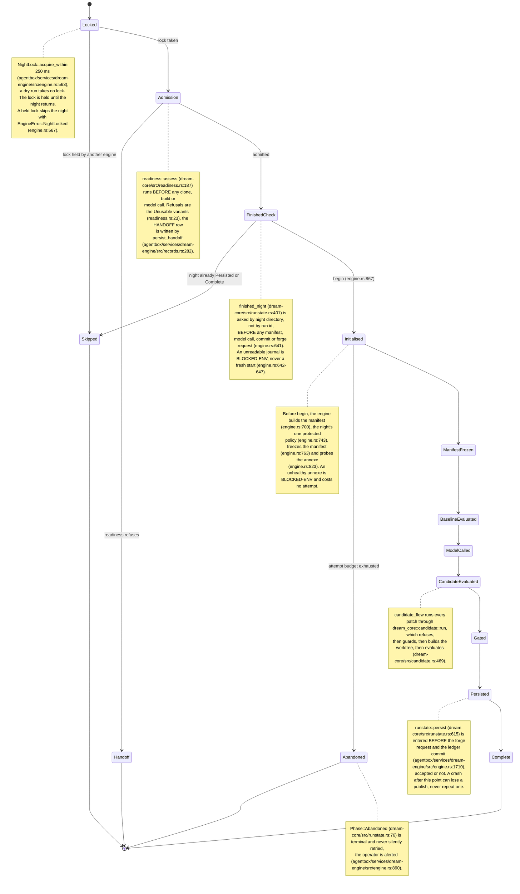

**What it shows.** The states one repo-night can pass through, now including the per-night lock that comes first and the `Persisted` phase that sits between the gate and `Complete`. Every night that reaches the gate passes through `Persisted`, whatever the verdict, because the journal write at `engine.rs:1710` precedes the accepted-or-not match.

**Why it is this way.** ADR-2141 and the core repository's ADR-DE-007 (`../dream-engine/docs/adr/ADR-DE-007-a-night-is-identified-by-its-directory.md:21`) make the night, not the run id, the unit of "finished": the run id folds in the baseline commit, which the engine's own ledger commit moves.

**Open:** admission (`../project/agentbox/services/dream-engine/src/engine.rs:576`) runs before the finished-night check (`../project/agentbox/services/dream-engine/src/engine.rs:641`), and a refusal writes a HANDOFF ledger row (`../project/agentbox/services/dream-engine/src/records.rs:282`). A night that already finished, whose evaluator configuration was then edited into an unusable state, would therefore be re-judged at admission rather than skipped. The record does not say whether that ordering is intended.

## AB-23.2 Nightly cycle — the adapter's night, in order

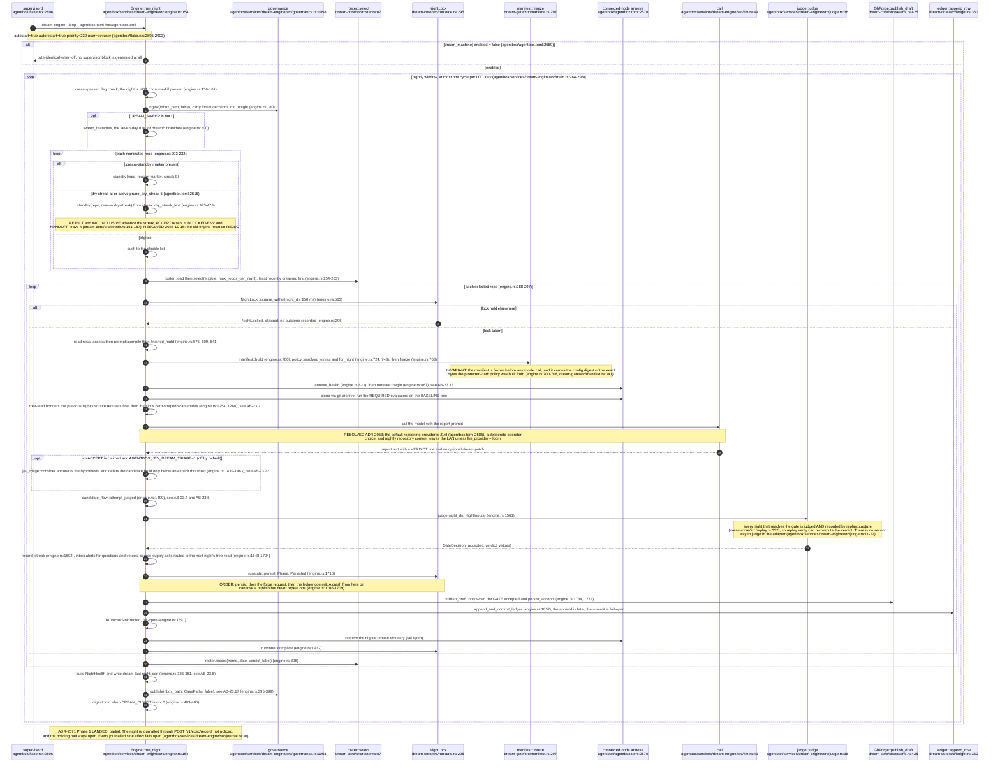

**What it shows.** The adapter's night, with the core's calls named where they happen. The order inside a repo-night is lock, admission, prompt, finished-night check, manifest, policy, freeze, annexe probe, journal begin, baseline, model, candidate, judge, persist, forge, ledger, memory, complete.

**Why it is this way.** Each step that moved into the core is still driven from `engine.rs`, because the composition root is the only place that knows the estate's seams. The judge call replaces the pre-extraction direct call of `gate::decide`, so that capture and verdict cannot diverge. The terminal, persist-before-effect ordering is ADR-2141's restart-safety consequence (`../project/agentbox/docs/adr/ADR-2141-extract-the-dream-engine-core-into-a-standalone-permissive-repo.md:39`).

**Drift:** `../project/agentbox/docs/GOVERNANCE-capabilities.md:513` (was :520 at the previous stamp) still says ADR-2071 is proposed, not landed, while the journal ships Phase 1 (`../project/agentbox/services/dream-engine/src/journal.rs:1-3`).

**Tension:** the persist-before-effect order trades a lost publish for never publishing twice. Nothing records the forge or ledger outcome after `Persisted`, so a crash between the journal write and the pull request leaves a night marked finished with no draft (`../dream-engine/crates/dream-core/src/runstate.rs:22-28`, `../dream-engine/docs/adr/ADR-DE-007-a-night-is-identified-by-its-directory.md:34`). Recovery is the operator's `dream-engine reset-night <repo> <date>` (`../project/agentbox/services/dream-engine/src/main.rs:142-144`).

## AB-23.3 Module map and the licence boundary

```mermaid
flowchart TB
    subgraph adapter["agentbox/services/dream-engine, AGPL-3.0-only (the adapter)"]
        direction TB
        E1["engine.rs, the composition root<br/>agentbox/services/dream-engine/src/engine.rs:95"]
        E2["estate.rs, every estate default as an explicit parameter<br/>agentbox/services/dream-engine/src/estate.rs:21"]
        E3["candidate_flow.rs, the ONLY caller of candidate::run<br/>agentbox/services/dream-engine/src/candidate_flow.rs:100"]
        E4["policy.rs, the night's single protected-path policy<br/>agentbox/services/dream-engine/src/policy.rs:107"]
        E5["judge.rs, the one way to judge a night<br/>agentbox/services/dream-engine/src/judge.rs:36"]
        E6["llm.rs, the Z.AI and Loom clients as the Llm seam<br/>agentbox/services/dream-engine/src/llm.rs:49"]
        E7["runner.rs SshRunner, dispatch.rs, ruvector.rs, notify.rs<br/>agentbox/services/dream-engine/src/runner.rs:34"]
        E8["governance.rs, relay.rs, inbox.rs, digest.rs, zone_crypto.rs<br/>the forum drivers, linked to nostr-bbs-core"]
        E9["journal.rs, prompt.rs, records.rs, present.rs, baseline.rs, config.rs"]
        E10["wanted.rs, the source-request store, and jev_triage.rs, the opt-in hypothesis annotation<br/>agentbox/services/dream-engine/src/wanted.rs:1, agentbox/services/dream-engine/src/jev_triage.rs:1"]
    end
    subgraph core["DreamLab-AI/dream-engine, MIT OR Apache-2.0 (public, five crates, dream-core 0.4.0 and dream-gate 0.3.0)"]
        direction TB
        C1["dream-core: runner, ledger, readiness, runstate and NightLock, roster, sweep, compile,<br/>source, context, candidate, persist, seams, testfmt, streak, replay, automerge, screen<br/>dream-core/src/lib.rs:1"]
        C2["dream-gate: verdict, manifest, receipts, witness, gate, guard, patch, outcome, config schema<br/>dream-gate/src/lib.rs:1"]
        C3["pairwise-gate and failure-fingerprint, leaf crates<br/>pairwise-gate/src/lib.rs:1"]
        C4["dream-cli, a thin shell over the core<br/>dream-cli/src/lib.rs:1"]
    end
    E1 -->|"registry dependency, exact pin"| C1
    E1 -->|"registry dependency, exact pin"| C2
    C1 --> C2
    C2 --> C3
    C4 --> C1
    E6 -.->|"implements the Llm seam"| C1
    E7 -.->|"implements EvaluatorRunner, MemorySink and Notifier"| C1
    BARRIER["INVARIANT: the adapter depends on the core and never the reverse. zone_crypto is never published<br/>and the adapter links nostr-bbs-core, which is why it stays AGPL-3.0-only<br/>agentbox/services/dream-engine/Cargo.toml:8"]
    E8 --- BARRIER
    STAMP["RESOLVED: the extraction is live (ADR-2141 activation live), agentbox stamped at 1da8d2171,<br/>dream-engine at 61581d3 whose workspace version is 0.4.0"]
    BARRIER --- STAMP
```

**What it shows.** Which modules stayed in the adapter and which moved. The line between them follows the licence: anything that links `nostr-bbs-core` or holds the private zone envelope stays under AGPL-3.0-only, and everything else is permissive and reusable by any repository.

**Why it is this way.** ADR-2141 chose the boundary so that the gate and the loop can be reviewed and versioned without the estate. The seams (`Llm`, `EvaluatorRunner`, `MemorySink`, `Notifier`, `Forge`) are implemented in the adapter and defined in `dream-core` (CRT-02 in the core corpus).

**Resolved (pin):** the two core crates are registry dependencies pinned `dream-core =0.4.0` and `dream-gate =0.3.0` (`../project/agentbox/services/dream-engine/Cargo.toml:26-27`), the lockfile carries their checksums, and ADR-2141 records that `lib/dream-engine.nix` needs no `outputHashes` because every dependency is a registry crate (`../project/agentbox/docs/adr/ADR-2141-extract-the-dream-engine-core-into-a-standalone-permissive-repo.md:31`). The image rebuild that bakes them in was done on 2026-10-16 (`../project/agentbox/docs/adr/ADR-2141-extract-the-dream-engine-core-into-a-standalone-permissive-repo.md:47`).

**Invariant:** both pins must stay on one `dream-gate` release, because a mismatch links two copies of `dream-gate` whose types would not unify (`../project/agentbox/services/dream-engine/Cargo.toml:22-27`).

**Drift:** the record's Pinning bullet still names `=0.2.0` for both crates (`../project/agentbox/docs/adr/ADR-2141-extract-the-dream-engine-core-into-a-standalone-permissive-repo.md:31`) and its last re-verification stops at `=0.3.0` (`../project/agentbox/docs/adr/ADR-2141-extract-the-dream-engine-core-into-a-standalone-permissive-repo.md:55`), while the manifest pins `dream-core =0.4.0` (`../project/agentbox/services/dream-engine/Cargo.toml:26`); no activation receipt for the 0.4.0 image is in the record.

**Resolved (CI):** the agentbox GitHub Actions run again, with CI, ShellCheck and Secret Scan green on 2026-10-29 (`gh run list`); the earlier gap since 2026-10-08 is closed.

## AB-23.4 The guard ordering and the deterministic gate

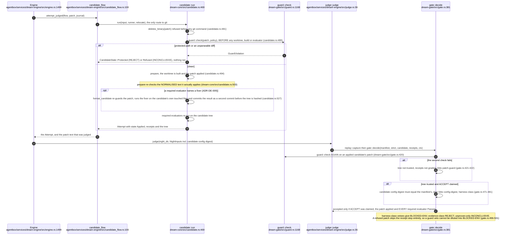

**What it shows.** Where the protected-path guard sits: once inside `candidate::run` before anything is applied, and once more inside `gate::decide`, which re-derives the touched paths from the patch text rather than trusting the caller. The config-digest check binds the environment the candidate was evaluated in to the one the manifest froze.

**Why it is this way.** The old engine had no guard before apply (ADR-2141, Context). Making `candidate_flow` the only caller of `candidate::run` means the apply-repair pass is guarded too, because its corrected diff re-enters `run` (`../project/agentbox/services/dream-engine/src/candidate_flow.rs:5-9`). The second check is defence in depth, owned by the core (GAT-01).

**Open:** the formatter step is inert at this stamp, because it runs only when a required evaluator names a `fixer` and no evaluator in the repository's own `dream.config.json` does (`../dream-engine/crates/dream-core/src/candidate.rs:527`, `../project/agentbox/dream.config.json:43`); `judge.rs` asserts the adapter itself holds no `rustfmt` or `cargo fmt`, so the mechanism stays in the core (`../project/agentbox/services/dream-engine/src/judge.rs:303`).

**Invariant:** no path in the adapter builds a gate context without the night's one policy, and no path calls `gate::decide` directly (`../project/agentbox/services/dream-engine/src/judge.rs:11-12`, `../project/agentbox/services/dream-engine/src/policy.rs:5-9`).

**Invariant:** evaluator failure vetoes acceptance, and an ACCEPT with no applied candidate is unproven, not a harness fault (`../dream-engine/crates/dream-gate/src/gate.rs:461`, see AB-23.13).

## AB-23.5 Candidate re-evaluation on an isolated worktree

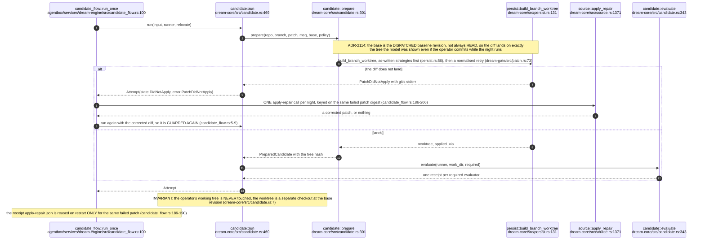

**What it shows.** The adapter side of the candidate step and the core calls beneath it. The apply strategies, the normalisation rule that never edits a plus or minus line, and the typed `AttemptError` are all in the core and are drawn in NIT-01 and GAT-01 there.

**Why it is this way.** ADR-2114 (candidate diffs are written against engine-read source) fixed the base revision, and ADR-2141 collapsed the engine's four separate call sites into `candidate::run` so that the guard cannot be skipped.

## AB-23.6 Persistence and the human merge gate

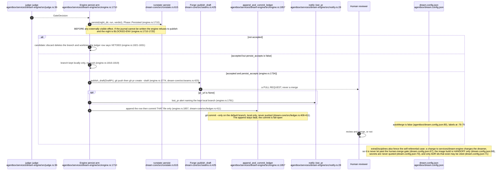

**What it shows.** The persistence order after the gate has ruled: journal, then the forge request, then the ledger, with the human still deciding the merge.

**Why it is this way.** Persist-before-effect is the at-most-once guarantee (ADR-DE-007). The merge gate stays a process, not a code control, because `autoMerge` is false and, as below, is not consulted by the adapter at all.

**Open:** `autoMerge` is read from the repository's `dream.config.json` and defaults to off (`../dream-engine/crates/dream-gate/src/config.rs:437-442`), and the core ships a pure decision tree plus a `persist::publish` that applies it (`../dream-engine/crates/dream-core/src/persist.rs:291`, `../dream-engine/crates/dream-core/src/automerge.rs:110`). The adapter calls `Forge::publish_draft` directly (`../project/agentbox/services/dream-engine/src/engine.rs:1774`) and never `persist::publish`, so setting `autoMerge: true` would have no effect here: the option is inert in the adapter. The core now says so itself, that only `persist::publish` applies the policy and a host publishing through `Forge::publish_draft` never merges whatever `autoMerge` says (`../dream-engine/README.md:130-135`, `../dream-engine/docs/adr/ADR-DE-006-automerge-is-an-option.md:44-48`), and that the first consuming host is exactly that case. The forge calls behind the option have not been exercised against real GitHub (`../dream-engine/docs/adr/ADR-DE-006-automerge-is-an-option.md:41-42`). See ES-05.

**Tension (dream.config.json vs the prompt):** RESOLVED. The previous stamp recorded that every night's prompt cited "agentbox ADR-2024" while the discipline `cite-existing-adrs` listed ADR-2024 as non-existent (`../project/agentbox/dream.config.json:71`). The estate tag is now stripped from the shared compiler's output: the prompt test removes the string from the pre-extraction golden before comparing (`../project/agentbox/services/dream-engine/src/prompt.rs:82`).

**Drift:** the pull request body gains a note when a fixer reformatted the candidate, so a reviewer reads the logic as the model's and the layout as the formatter's (`../project/agentbox/services/dream-engine/src/engine.rs:1753-1760`); the option is inert here for the reason recorded in AB-23.4.

**Debt:** RETIRED. `persist::persist_accept` and `push_and_open_pr`, recorded as dead code at the previous stamp, no longer exist in either repository.

**Tension (forge step):** the forge request is the one effect of a night the engine cannot undo and, per the core, cannot reconcile after a crash. Its only test double is the `Forge` trait object the engine accepts (`../project/agentbox/services/dream-engine/src/engine.rs:112`); the real `GhForge` shells out to `git push` and `gh` (`../dream-engine/crates/dream-core/src/seams.rs:424-440`) and no record at these revisions shows a full night publishing a pull request through the extracted path.

## AB-23.7 Run journal — restart, resume, abandonment and the finished-night rule

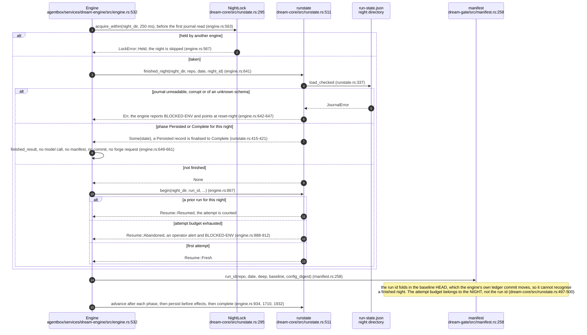

**What it shows.** The restart rules after the extraction. A night is identified by its directory, so a restart after its own ledger commit cannot start a second experiment, and a damaged journal is a fault, never a fresh start. An operator reopens a night only with `dream-engine reset-night`.

**Why it is this way.** Before 2026-10-15 the run id was the only identity, and the engine's ledger commit moved HEAD and therefore the run id, so a restart could repeat a publish. ADR-DE-007 is the repair. The adapter changes are the lock and the early skip at `engine.rs:563-661`.

**Invariant:** `Persisted` is journalled before the forge request and the ledger commit (`../dream-engine/crates/dream-core/src/runstate.rs:22-23`, `../project/agentbox/services/dream-engine/src/engine.rs:1710`).

## AB-23.8 Core types

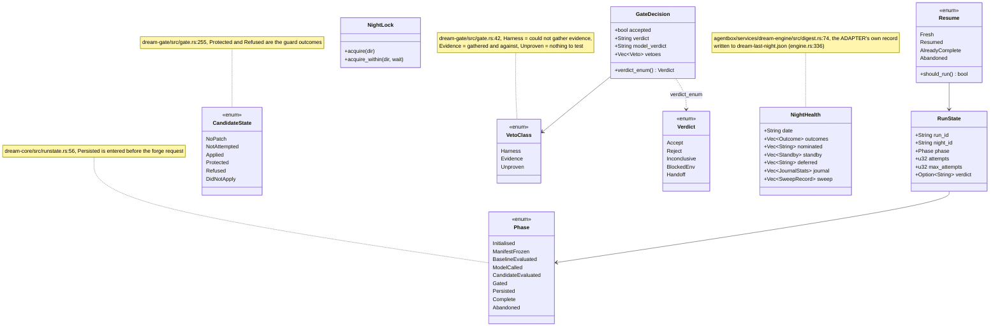

**What it shows.** The types that cross the boundary. `Phase`, `Resume` and `NightLock` live in `dream-core`, the gate types in `dream-gate`, and `NightHealth` is the adapter's.

**Why it is this way.** The `Unusable` readiness variants and `ExperimentManifest` are omitted here: they are drawn in the core corpus. The `Persisted` phase and `NightLock` are new since the previous stamp, and `CandidateState` gained `Protected` for a guard refusal.

## AB-23.9 Dream-inbox surfacing hook

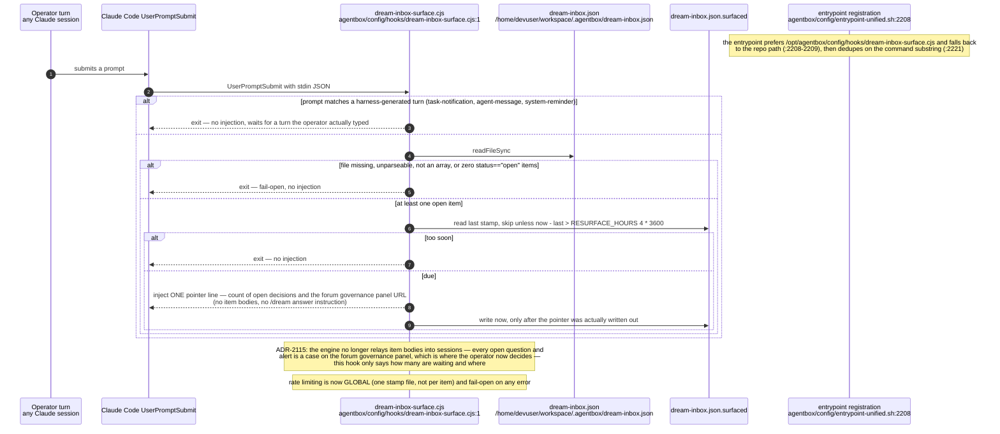

## AB-23.10 Control and reporting surfaces

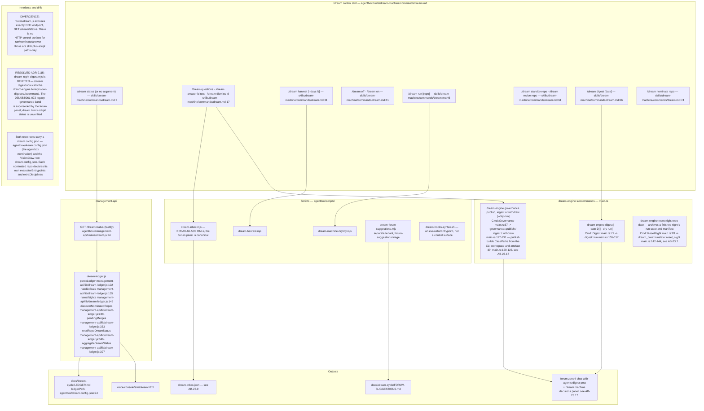

**Invariant (2026-10-02, owner decision Q10):** the forum-suggestions tenant asks a member to clarify only when JunkieJarvis may speak; it reads the same `junkiejarvisEnabled(manifest)` that management-api uses, and with it off an unclear post is held — no DM, no ledger row, not parked — so it is asked once JunkieJarvis is on (`../project/agentbox/scripts/dream-forum-suggestions.mjs:246-252`, `../project/agentbox/scripts/dream-forum-suggestions.mjs:421-424`).

## AB-23.11 ADR-2081 — the annexe mirrors real workspace depth

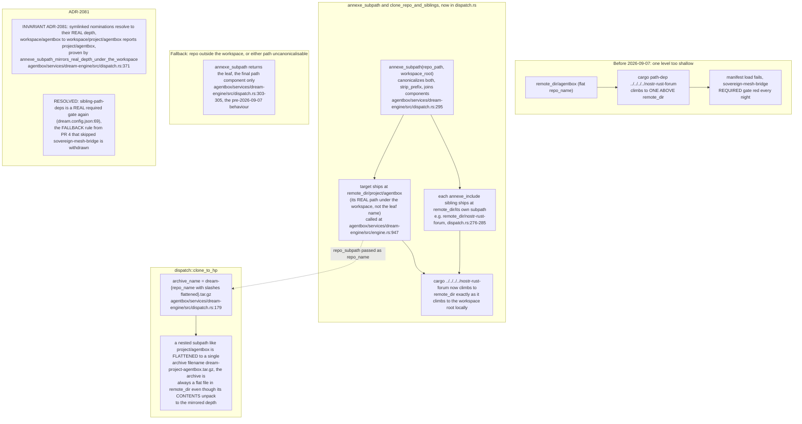

**What it shows.** The depth law for the build machine: the target and each sibling are unpacked at their real position under the workspace so relative cargo path dependencies resolve there exactly as they do locally. The functions moved from `engine.rs` into `dispatch.rs` in the extraction, with the same behaviour.

**Why it is this way.** ADR-060 (archived) and the 2026-09-07 night that found the sovereign-mesh gate vacuous. The mechanism is adapter-owned because the annexe is an estate machine.

## AB-23.12 ADR-2081 — pipefail closes the tail-masking false positive

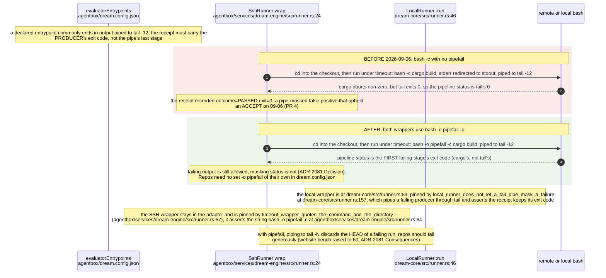

**What it shows.** The two evaluator runners after the split. `SshRunner` (estate-specific) and `LocalRunner` (a core seam implementation) both wrap the command in `bash -o pipefail`, so a producer's failure is never masked by `tail`.

**Why it is this way.** The `EvaluatorRunner` seam is defined in `dream-core`, so the receipts, the gate and the verdict consume one `ExecOutcome` type and never know which runner produced it (`../project/agentbox/services/dream-engine/src/runner.rs:1-6`).

## AB-23.13 ADR-2081 — a no-patch ACCEPT is unproven, not a harness fault

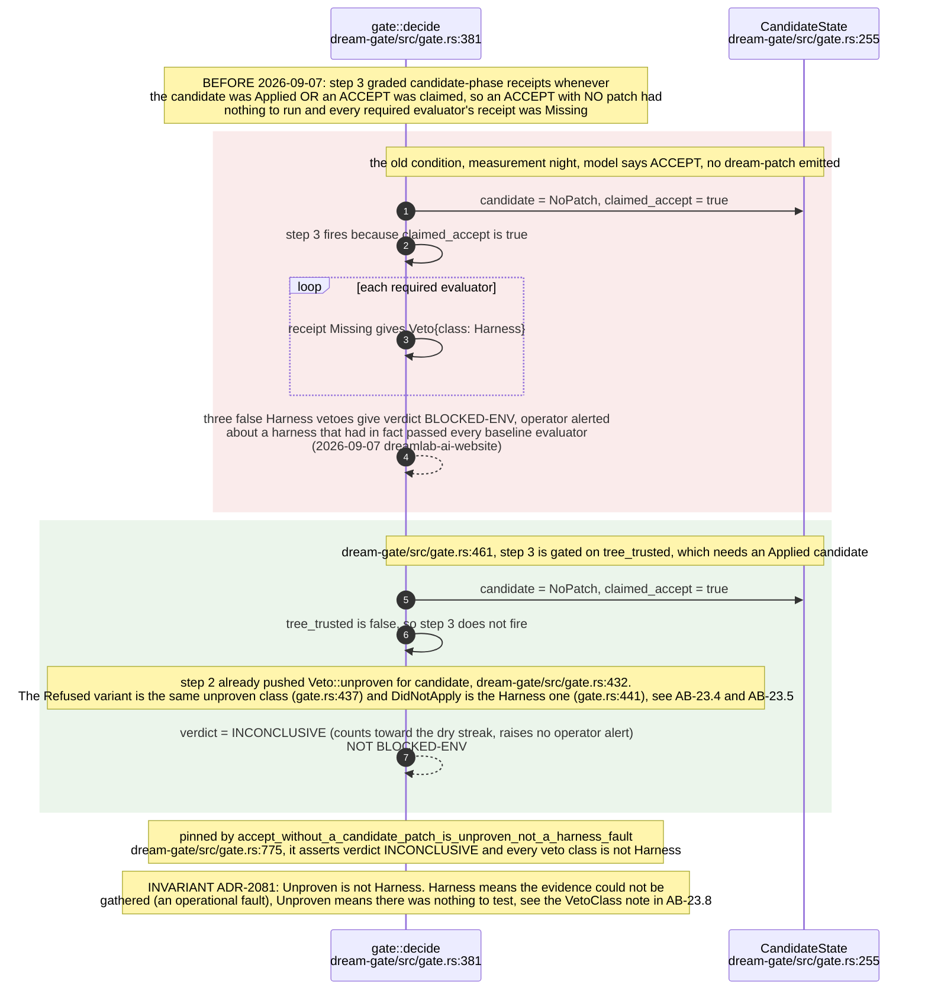

**What it shows.** The one rule that stops a measurement night from being reported as a broken harness. The code moved to `dream-gate` with the same behaviour, and the gate gained the `Protected` candidate state in the same file (GAT-01 in the core corpus).

**Why it is this way.** The two receipt fixes (this and AB-23.12) landed together: pipefail with the siblings still unresolved would have vetoed every annexe ACCEPT.

## AB-23.14 ADR-2081 — Step-19 ledger cell provenance

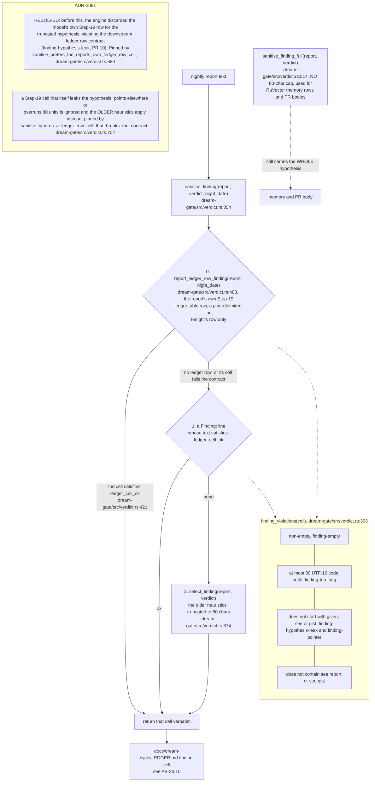

**What it shows.** Where the ledger's finding cell comes from. The functions moved unchanged into `dream-gate`, and the one difference is that the length is counted in UTF-16 code units so that it agrees with the TypeScript ledger contract the previous fork shipped (`../dream-engine/crates/dream-gate/src/verdict.rs:379`).

**Why it is this way.** The extracted crate has exactly one implementation of the finding rules, which the adapter's ledger-row contract (`../dream-engine/crates/dream-core/src/ledger.rs:254`) builds on.

## AB-23.15 ADR-2084 - the Loom call goes through the published loom-client

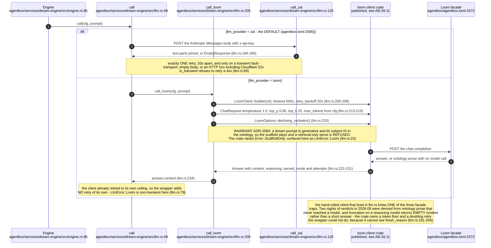

**Debt:** `agentbox/agentbox.toml:2585` keeps `llm_provider = "zai"` as the default, so nightly repository content leaves the LAN on every unattended night; the LAN-only Loom path at `../project/agentbox/services/dream-engine/src/llm.rs:205` is opt-in.

## AB-23.16 Placeholder resolution and the refusal to dispatch to nowhere

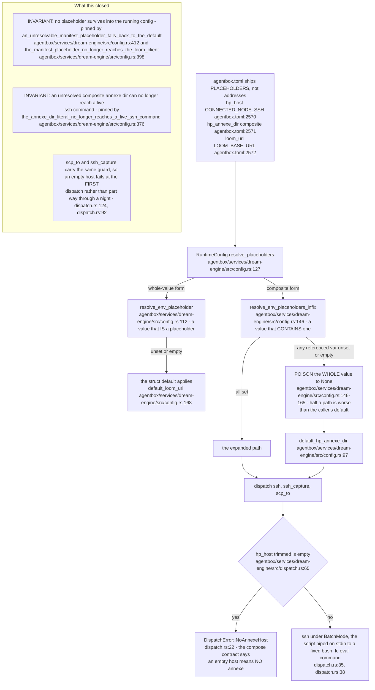

**Invariant:** every dispatch entry point refuses an empty annexe host with a typed error rather than shelling out (`../project/agentbox/services/dream-engine/src/dispatch.rs:65`, `../project/agentbox/services/dream-engine/src/dispatch.rs:124`).

**What changed (fish-safe transport):** the remote login shell is fish, which reads a backslash before a quote as an escape even inside single quotes, so a script embedded in the ssh command line broke on nested quoting; the script now travels over stdin and the only text fish parses is a fixed command with no backslash and two single quotes (`../project/agentbox/services/dream-engine/src/dispatch.rs:35`, `../project/agentbox/services/dream-engine/src/dispatch.rs:38`).

**Drift (diagram corpus vs repo):** `2899b3b7e` generalised estate addressing out of this public repository, so `../project/agentbox/dream.config.json:68` now says "the connected node annexe" where the corpus previously named a host and a rail address.

## AB-23.17 ADR-2115 — the forum governance round trip

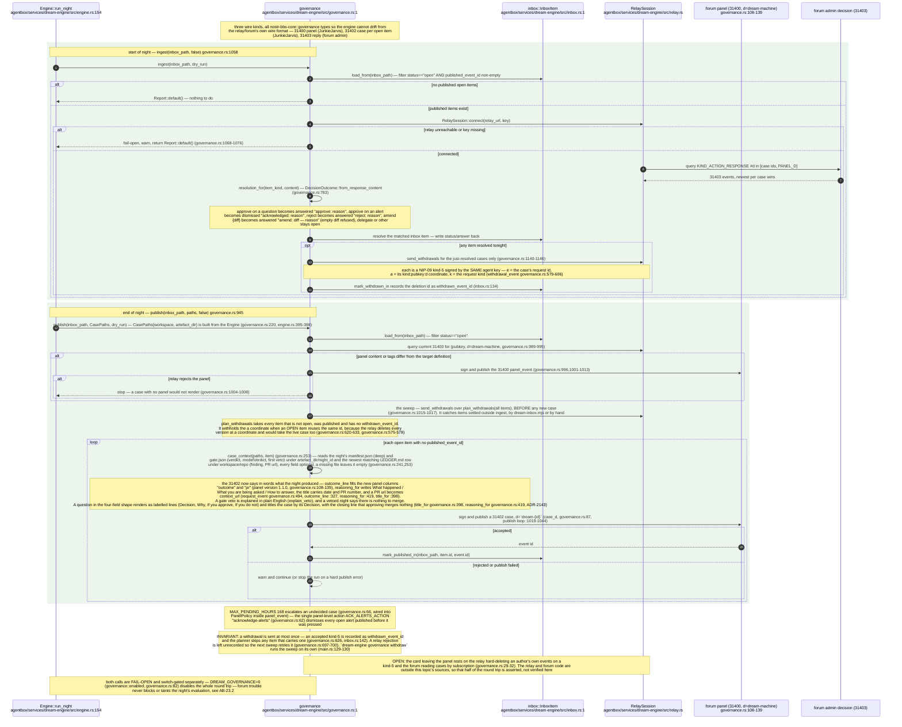

## AB-23.18 Annexe preflight — the write-then-measure health probe

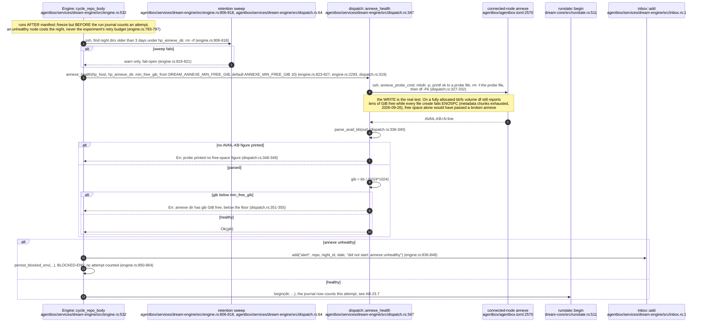

**Invariant:** the annexe probe writes and deletes a file before it trusts `df`'s free-space figure, so a metadata-exhausted btrfs volume that still reports free capacity is still caught (`../project/agentbox/services/dream-engine/src/dispatch.rs:327-332`).

## AB-23.19 ADR-2071 clause (c) — the one-shot night with management-api stopped

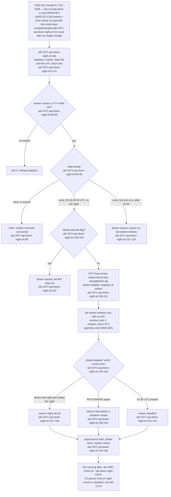

**What it shows.** How the estate will run its first dream night with the management API deliberately down: a marker file names the night, a ten-minute cron tick stops the API in the half-hour before the window, and the first tick that sees the night record, the 07:30 UTC deadline or an API that came back on its own restarts it and retires the marker.
**Why it is this way.** ADR-2071 can only be accepted once clause (c) shows the night still completes, and journals its failures, with nothing to journal to. The owner fixed the night of Monday 5 October (owner decision 2026-10-02, Q9; `../project/agentbox/docs/adr/ADR-2071-journal-the-nightly-dream-cycle.md:191`), then asked for it early: clause (c) ran on 4 October in place of the 6 October night, all three Phase 1 clauses passed on the live image, and the record is **accepted, implementation complete, activation live** (`../project/agentbox/docs/adr/ADR-2071-journal-the-nightly-dream-cycle.md:195`). The schedule rode the checkout crontab rather than the image so that a container restart neither lost it nor needed a rebuild; that crontab block was removed once clause (c) passed and the 6 October marker was retired (`../project/agentbox/docs/adr/ADR-2071-journal-the-nightly-dream-cycle.md:203`). The tick is pure bash plus coreutils because that cron PATH has no `sed` or `awk` (`../project/agentbox/scripts/activation/adr-2071-api-down-night.sh:59-60`).

**Invariant:** the API is never left down by a dying tick: an EXIT trap restarts management-api from the moment the stop is attempted until the state write lands (`../project/agentbox/scripts/activation/adr-2071-api-down-night.sh:106-110`).

**Debt:** the checkout crontab that `[program:podcast-cron]` reads still ticks the EXP-B8 label-log experiment every 30 minutes until its own PR merges (`../project/agentbox/skills/podcast-knowledge-ingest/crontab:34-44`), so a supervised program named for podcast ingest carries a schedule that has nothing to do with podcasts. The retired api-down-night script and its tests are kept in `scripts/activation/` for reuse after a future image change (`../project/agentbox/docs/adr/ADR-2071-journal-the-nightly-dream-cycle.md:203`).

## AB-23.20 Which key signs the forum round trip — role isolation off and on

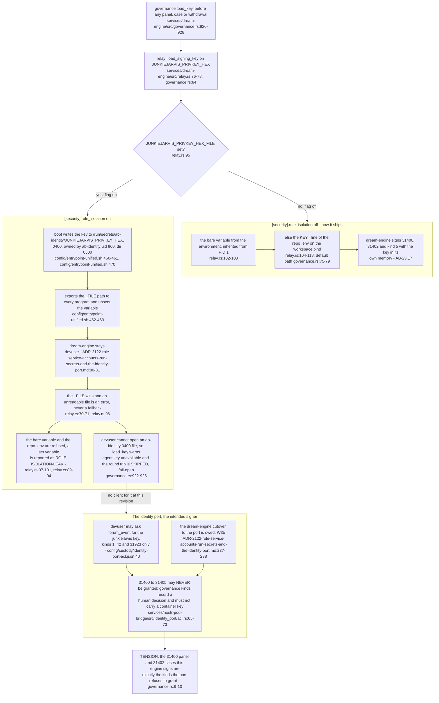

**Invariant (under role_isolation):** dream-engine never reads the JunkieJarvis key from its environment or from the repo `.env` on the workspace bind: with the flag on only `JUNKIEJARVIS_PRIVKEY_HEX_FILE` is consulted, and its absence is an error (`../project/agentbox/services/dream-engine/src/relay.rs:95-101`). With the flag off, which is how it ships, the pre-W2 order stands: the bare variable, then the `.env` line (`../project/agentbox/services/dream-engine/src/relay.rs:102-118`), the same loader contract as `scripts/dream-forum-suggestions.mjs`, which reads it through `role-secret.js` (`../project/agentbox/scripts/dream-forum-suggestions.mjs:215-221`, `../project/agentbox/management-api/lib/role-secret.js:120`).

**Tension (identity port ACL vs the forum governance round trip):** the port's loader refuses to grant kinds 31400-31405 to anyone, because a governance event records a human decision and must not carry a container key (`../project/agentbox/services/nostr-pod-bridge/src/identity_port/acl.rs:65-73`). Yet the dream engine publishes the 31400 panel and 31402 cases signed with the JunkieJarvis key (`../project/agentbox/services/dream-engine/src/governance.rs:9-10`), and ADR-2122 still plans to move dream-engine onto the port in W3b (`../project/agentbox/docs/adr/ADR-2122-role-service-accounts-run-secrets-and-the-identity-port.md:237-238`). As written, the port can never sign what AB-23.17 sends.

**Open:** under `[security].role_isolation` the forum governance round trip stops without an error. The delivered key file belongs to `ab-identity`, dream-engine runs as devuser, and `load_key` treats the refusal as fail-open and skips (`../project/agentbox/config/entrypoint-unified.sh:460-462`, `../project/agentbox/services/dream-engine/src/governance.rs:920-928`). Nothing at this revision says whether that is the intended state until W3b, or a gap the boot rehearsal must catch.

## AB-23.21 ADR-2143 — source supply is plumbing, not a decision

```mermaid
sequenceDiagram
    autonumber
    participant ENG as Engine, step 11b<br/>agentbox/services/dream-engine/src/engine.rs:1648
    participant WNT as wanted.rs<br/>agentbox/services/dream-engine/src/wanted.rs:231
    participant STORE as dream-source-requests.json<br/>agentbox/services/dream-engine/src/wanted.rs:62
    participant INB as dream inbox and forum panel
    participant NEXT as Engine tree-read, next night<br/>agentbox/services/dream-engine/src/engine.rs:1254
    participant CORE as dream_core::source::gather<br/>dream-core/src/source.rs:1040

    Note over ENG: the night's report lists files under Sources wanted next night and may carry Human action lines
    ENG->>WNT: extract_wanted(report), one key per list item, path or path:a-b (engine.rs:1648, wanted.rs:105)
    loop each Human action line (engine.rs:1649)
        alt a supply, inline or bundle verb naming a path, and not in the four-field shape
            ENG->>WNT: is_source_supply then path_tokens, the paths join the wanted keys (engine.rs:1650-1657, wanted.rs:191)
            Note over ENG,INB: the line is NOT queued as a question, the operator is never asked to supply source
        else a real decision
            ENG->>INB: plain_decision rewrites an If approved that promises a merge, then inbox::add (engine.rs:1659-1662)
        end
    end
    ENG->>WNT: record(repo, deep, keys, night_id, report) (engine.rs:1668)
    WNT->>STORE: a new key is stored active with nights_seen 0 (wanted.rs:231)
    alt a key asked again after it was read, or after MAX_NIGHTS 3 nights unmet
        WNT-->>ENG: returned as looped and NOT re-armed (wanted.rs:26)
        ENG->>INB: ONE alert from loop_alert, the window was wrong or something else blocks the night (engine.rs:1669-1683, wanted.rs:343)
    end
    NEXT->>WNT: take_for(repo, deep), active requests oldest first, each counted as offered (engine.rs:1254, wanted.rs:276)
    NEXT->>NEXT: a slot's path-shaped scan entries are appended after the explicit requests (engine.rs:1266-1273)
    NEXT->>CORE: GatherInput::new(...).with_requested(requested) (engine.rs:1275)
    Note over CORE: requested paths are read FIRST, capped at half the file slots and half the byte budget,<br/>and pass the same checks as a planner pick (dream-core/src/source.rs:474, dream-core/src/source.rs:795)
    CORE-->>NEXT: SourceRecord with requested_honoured (dream-core/src/source.rs:716)
    NEXT->>WNT: settle marks every matching key met (engine.rs:1299, wanted.rs:295)
```

**What it shows.** How a file a night could not read goes back to the next night's tree-read instead of to a person. The store is keyed on repository, deep slot and path, and a request is active until it has been inlined once or offered for three nights. **Why it is this way.** On 2026-10-17 nine of fifty-seven open governance cases asked the operator to supply named files, several for the third time, because the planner never saw the previous night's ask; ADR-2143 makes source supply plumbing so the panel shows decisions only (`../project/agentbox/docs/adr/ADR-2143-source-supply-is-plumbing-and-decisions-are-plain-english.md:22-24`). The core half is ADR-DE-008 (`../dream-engine/docs/adr/ADR-DE-008-requested-sources-are-honoured-first.md:6-8`).

**Invariant:** every operator question is one line in four labelled fields, Decision, Why, If approved, If not, parsed by `decision_fields`, and an If approved that promises a merge, promotion or release is rewritten because approval never merges anything (`../project/agentbox/services/dream-engine/src/inbox.rs:237`, `../project/agentbox/services/dream-engine/src/inbox.rs:288`).

**Tension (ADR-2143 vs the scan offer):** a slot whose `scan` entries are paths offers them after the explicit requests, so on a quiet night they take the reserved half of the read, and ADR-2143 calls that intended (`../project/agentbox/docs/adr/ADR-2143-source-supply-is-plumbing-and-decisions-are-plain-english.md:23`) while the engine appends them for every slot without checking that a request is pending (`../project/agentbox/services/dream-engine/src/engine.rs:1266-1273`).

## AB-23.22 AB-23-S1-01 — the opt-in Jev triage before the candidate build

```mermaid
sequenceDiagram
    autonumber
    participant ENG as Engine, step 8b<br/>agentbox/services/dream-engine/src/engine.rs:1439
    participant JT as jev_triage::consider<br/>agentbox/services/dream-engine/src/jev_triage.rs:497
    participant S1 as System One endpoint, the proxy on 127.0.0.1:8094 or the vendor
    participant SCR as dream_core::screen<br/>dream-core/src/screen.rs:362
    participant REC as jev-triage.json in the night directory
    participant GATE as candidate build and the deterministic gate

    ENG->>ENG: only when the report claims ACCEPT (engine.rs:1439)
    ENG->>JT: Config::from_env, report, patch, evaluator names, declared disciplines (engine.rs:1440-1447)
    alt AGENTBOX_JEV_DREAM_TRIAGE not set, no endpoint, or a local-only refusal
        JT-->>ENG: false, nothing built and nothing sent (jev_triage.rs:147, jev_triage.rs:383)
    else enabled
        JT->>S1: one request, two typed questions: usefulness as a four-level Score, problem_supported as a Noul (jev_triage.rs:319, jev_triage.rs:383)<br/>to the keyless LAN local_backend only when AGENTBOX_JEV_DREAM_TRIAGE_LOCAL_ONLY is set (jev_triage.rs:151-158),<br/>else the proxy and its selected backend, refused only when local-only is set and the backend is not declared local (jev_triage.rs:165-167)
        S1-->>JT: signals, or a timeout of 15 seconds, a non-2xx or an unparsable body, each a fallback (jev_triage.rs:72, jev_triage.rs:346)
        JT->>SCR: a second call, the library screen of the hypothesis against declared_disciplines (jev_triage.rs:431, dream-core/src/screen.rs:91)
        JT->>REC: annotation only, authority none, written as jev-triage.json (jev_triage.rs:70, jev_triage.rs:497)
        alt AGENTBOX_JEV_DREAM_TRIAGE_DEFER_BELOW is set in 0 to 0.5 and problem_supported is below it
            JT-->>ENG: true, defer
            ENG->>GATE: the candidate build is skipped, the state stays NotAttempted and the gate vetoes the ACCEPT claim as unproven (engine.rs:1461-1465)
        else the default, no threshold
            JT-->>ENG: false
            ENG->>GATE: the build and the gate run exactly as before (engine.rs:1465)
        end
    end
    Note over GATE: INVARIANT: a high usefulness never means ACCEPT. The signals never reach the gate,<br/>the deferral is the only action and it is inert until a threshold is configured (jev_triage.rs:490)
```

**What it shows.** An optional annotation step between the model's report and the costly candidate build. **Why it is this way.** The candidate evaluation is the expensive part of a night, and a hypothesis that the evidence does not support is cheaper to hold back than to build; but the verdict is advice about where to spend measurement, never about the change, so the deterministic gate, the protected-path guard and the human merge gate decide everything that does run (`../project/agentbox/services/dream-engine/src/jev_triage.rs:1-30`). The screening mechanism itself lives in `dream-core` 0.4.0 (`../dream-engine/crates/dream-core/src/screen.rs:1-30`).

**Resolved (configured, not live):** the manifest sets `jev_triage = true` with `[system_one] enabled = true` (`../project/agentbox/agentbox.toml:2612`, `../project/agentbox/agentbox.toml:890`), and the projector now exports `AGENTBOX_JEV_DREAM_TRIAGE_LOCAL_ONLY=0` unless `dream_triage` is named in `[system_one].local_only`, which is empty (`../project/agentbox/services/agentbox-manifest/src/system_one.rs:535`, `../project/agentbox/services/agentbox-manifest/src/system_one.rs:564-577`, `../project/agentbox/agentbox.toml:895`), so triage takes the proxy and the selected `typesafe` backend, with the private LAN route still projected for the opt-in (`../project/agentbox/services/agentbox-manifest/src/system_one.rs:402`, `../project/agentbox/config/entrypoint-unified.sh:1259-1263`); the flake bakes `AGENTBOX_JEV_DREAM_TRIAGE=1` into the dream-engine program only when the System One proxy is on (`../project/agentbox/flake.nix:280-281`). All of this is configured, not live: it is rebuild-class and ADR-2155 records the consumer activation as `staged` (`../project/agentbox/docs/adr/ADR-2155-system-one-consumer-activation.md:7`), so no running night is annotated or deferred until an image carrying that manifest is activated.

**Debt:** the module re-implements the System One request body that `crates/system-one/system-one-client` speaks, because the service builds from `services/dream-engine` alone and the client is a workspace path dependency (`../project/agentbox/services/dream-engine/src/jev_triage.rs:44-48`).

## Audit qualification — 2026-10-29

This topic describes the extraction as source at the stamped revisions. ADR-2141 records `implementation_status: complete` and `activation_status: live`: the operator rebuilt and activated the registry-pinned image on 2026-10-16 and the supervised daemon was RUNNING with no degradation (`../project/agentbox/docs/adr/ADR-2141-extract-the-dream-engine-core-into-a-standalone-permissive-repo.md:47`). The later pins (0.2.0, 0.3.0, 0.4.0) are source in `Cargo.toml`; the record carries activation evidence for 0.2.0 only (`../project/agentbox/docs/adr/ADR-2143-source-supply-is-plumbing-and-decisions-are-plain-english.md:35`).

**Resolved:** the earlier follow-on that `ontomark/dream.config.json` (`"adrConvention": "ADR-OM-NNN"`) would not load under the stricter `dream-gate` validation is closed: the legacy free-form template is accepted and rendered with its prefix from `dream-gate` 0.1.1 (`../project/agentbox/docs/adr/ADR-2141-extract-the-dream-engine-core-into-a-standalone-permissive-repo.md:35`).

**Tension (activation records):** ADR-2141 says the image running the adapter was rebuilt and activated (`../project/agentbox/docs/adr/ADR-2141-extract-the-dream-engine-core-into-a-standalone-permissive-repo.md:8`), while ADR-2081 still records `activation_status: staged` for the annexe-depth and receipt corrections that the same engine source carries (`../project/agentbox/docs/adr/ADR-2081-annexe-depth-law-and-honest-evaluator-receipts.md:7`); AB-23.11 to AB-23.14 describe source behaviour and claim no live receipt.
