Split 2026-11-23: AB-23.13 to AB-23.24 moved to [AB-44](44-dream-adapter-selection-decisions-and-delivery-limits.md) as AB-44.1 to AB-44.12. The old IDs resolve through the aliases declared there.

Repair follow-up, 2026-11-03: [AB-41.3](41-process-governance-and-dream-repairs.md#ab-413-supply-the-reusable-core-with-verifiable-host-inputs) and [DE-06](../dream-engine/06-formatting-and-evidence-repairs.md) record the adapter's registry adoption and core formatting/source/integrity repairs. This topic retains its historical source stamp.

This topic draws the adapter and the boundary after the 2026-10-15 extraction (agentbox ADR-2141). The judgement and the loop mechanism moved to the permissive repository DreamLab-AI/dream-engine, mapped in DE-01 and in its own corpus at `../dream-engine/docs/diagrams/README.md`, which is not duplicated here. AB-23.9 onward are adapter-owned and re-cited at the new revision.

State at this stamp: the adapter pins `dream-core =0.5.0` (adopted in agentbox e31fe2f, PR #53) and `dream-gate =0.3.0` from the registry (`../project/agentbox/services/dream-engine/Cargo.toml:26-27`), and the extraction is live: ADR-2141 is `accepted`, `complete`, `live`, with the operator's rebuild activated on 2026-10-16 and later releases adopted since (`../project/agentbox/docs/adr/ADR-2141-extract-the-dream-engine-core-into-a-standalone-permissive-repo.md:6-8`). Three adapter-owned changes since the first stamp are drawn here: source supply as plumbing (AB-44.9, ADR-2143), the opt-in Jev triage before the candidate build (AB-44.10, AB-23-S1-01) and the formatter step inside the core's candidate run (AB-23.4, ADR-DE-009). The crates.io versions are recorded in DE-01.

## AB-23.1 Repo-night phases and early exits

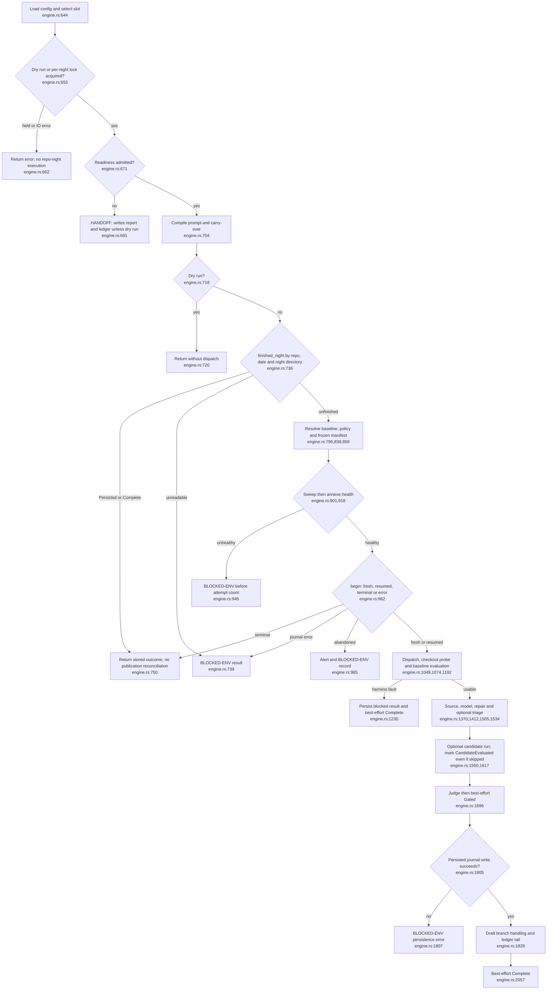

This is the control-flow overview; phase names record progress, not proof that every named action ran. Config loading precedes the lock, admission precedes the finished-night check, and several intermediate phase writes ignore errors (`../project/agentbox/services/dream-engine/src/engine.rs:1029,1192,1473,1617,1696`). AB-23.7 covers recovery in detail.

The [controls probe](../../estate-review/2026-11-01-dream-adapter-controls-and-egress.md) reproduced a completed night gaining a HANDOFF row and an overwritten report after its evaluator config became unusable. `Persisted` suppresses a repeat after a process crash; it neither confirms a draft was delivered nor supplies a power-loss transaction. Those limits are assessed in the [recovery](../../estate-review/2026-11-01-dream-recovery-and-source-supply.md) and [forge](../../estate-review/2026-11-01-dream-forge-and-seam-contracts.md) reviews.

## AB-23.2 Scheduling, admission and finished-night boundaries

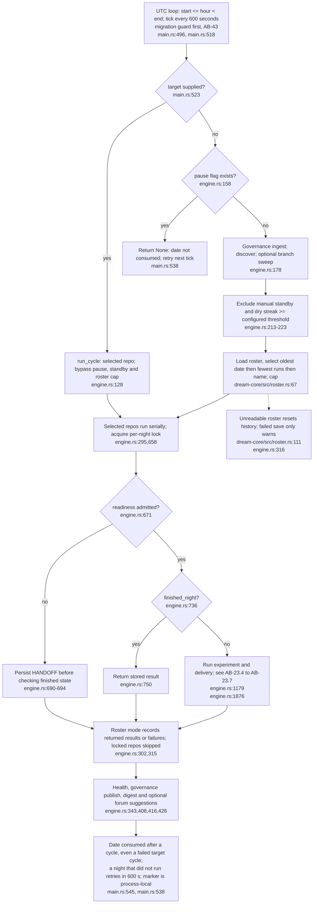

**Limits.** The window controls start time, not a night deadline. Pause is checked only at roster entry, not during a night or targeted execution. Readiness can append HANDOFF to an already finished night; see the 1 November controls audit.

## AB-23.3 Module map and the licence boundary

> **Superseded** by AB-23.25 at 1ea5494 (frozen at 59b1aca).

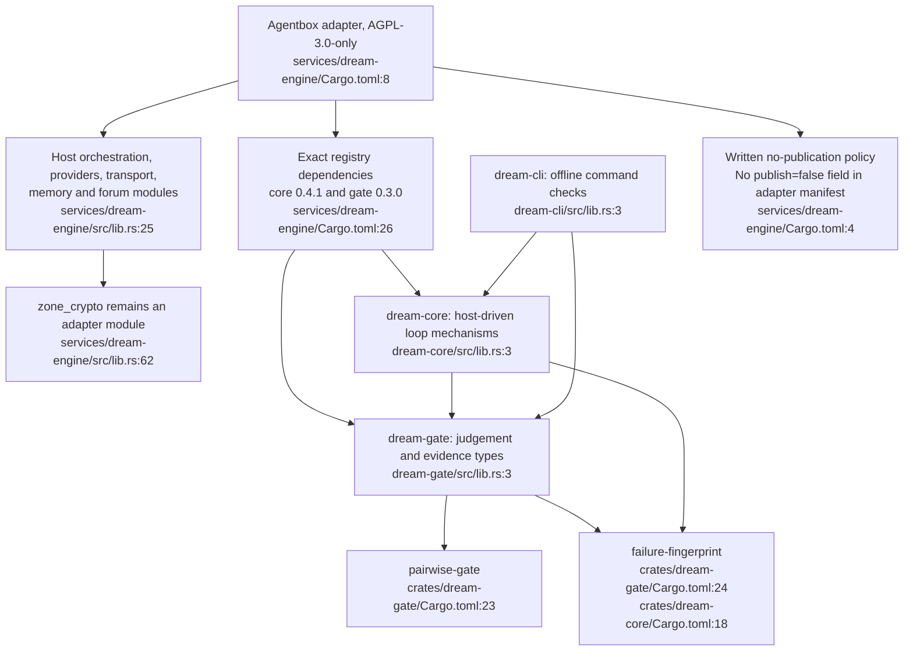

**What it shows.** The adapter imports the reusable engine and retains product-specific modules. Its exact pins resolve to one dream-gate version. The [migration/provenance audit](../../estate-review/2026-11-01-dream-migration-and-provenance.md) compares all 36 Rust source files in the four consumed crate releases and checks their cached archives against the consumer lockfile.

**Why it is this way.** ADR-2141 separates the engine mechanism from host orchestration. That dependency boundary does not itself enforce the adapter's no-publication policy: offline Cargo metadata leaves publication unrestricted and the selected package files include zone_crypto. No package was uploaded.

**Open (publication control):** the adapter's manifest declares its licence and version but no publication restriction (`../project/agentbox/services/dream-engine/Cargo.toml:4`, `../project/agentbox/services/dream-engine/Cargo.toml:8`). Source placement and stated policy must not be presented as a registry guard.

**Drift (activation evidence):** ADR-2141 records activation on 16 October and a later 0.3.0 re-verification (`../project/agentbox/docs/adr/ADR-2141-extract-the-dream-engine-core-into-a-standalone-permissive-repo.md:84`, `../project/agentbox/docs/adr/ADR-2141-extract-the-dream-engine-core-into-a-standalone-permissive-repo.md:92`). Current source pins core 0.4.1 (`../project/agentbox/services/dream-engine/Cargo.toml:26`); those historical records do not establish its current running image. The local tests in the dated audit use fixture services.

## AB-23.4 Guard ordering and the gate's evidence boundary

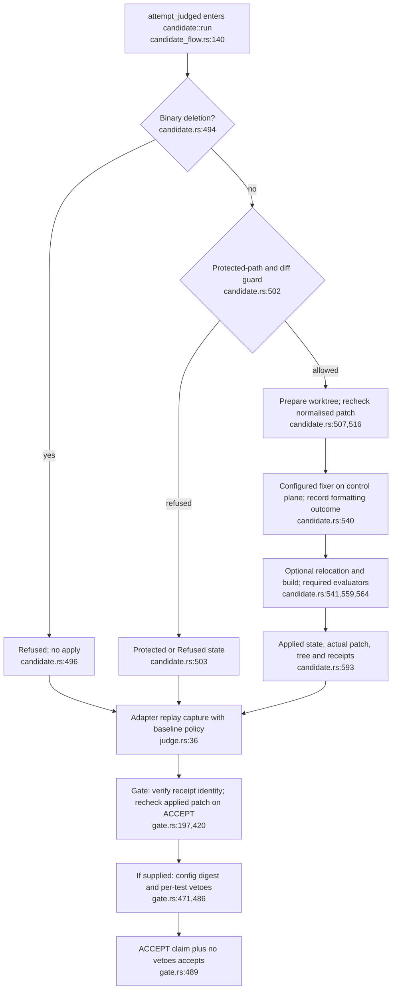

Both the pre-apply guard and the pure gate recheck are present. The gate trusts caller-supplied receipt outcomes and candidate state; it is not an execution attestation. The adapter obtains a candidate config digest through an Option-returning helper, so a missing digest skips that comparison (`../project/agentbox/services/dream-engine/src/candidate_flow.rs:330`; `../dream-engine/crates/dream-gate/src/gate.rs:471`). Required evaluator failures veto an otherwise eligible ACCEPT; unreadable or absent evidence has its own classification.

Formatting is not a confinement boundary: a valid spaced Rust path attribute caused rustfmt to modify an external temporary file in the [candidate probe](../../estate-review/2026-11-01-dream-candidate-and-evidence.md). The same review reproduced an evaluator changing tracked files after the candidate tree was recorded. The repository's own config names no fixer at this stamp, but another nominated repository can enable one (`../project/agentbox/dream.config.json:43`; `../dream-engine/crates/dream-core/src/candidate.rs:540`).

## AB-23.5 Candidate worktree, relocation and apply repair

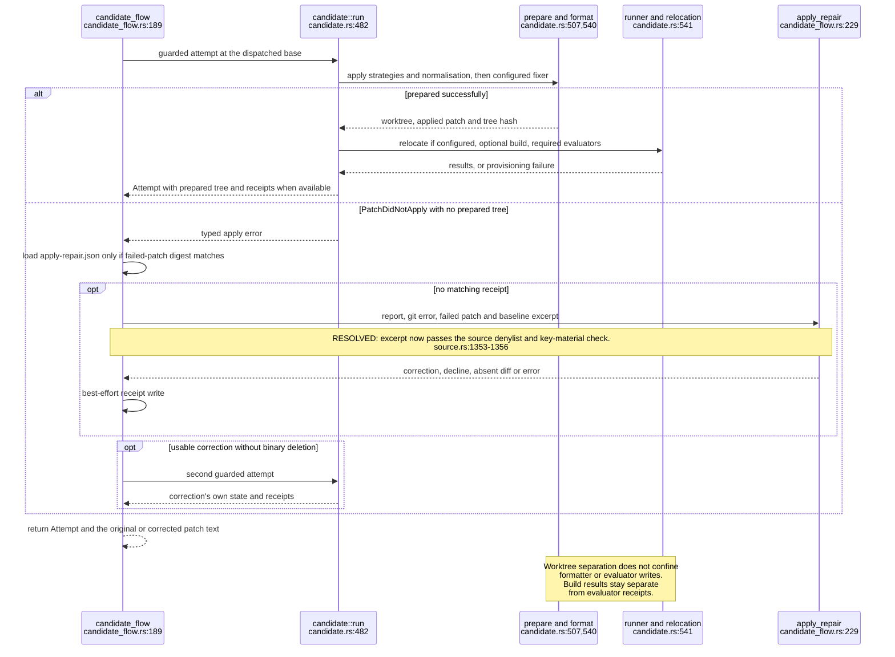

The baseline revision is passed into the candidate worktree, which protects against ordinary HEAD movement. The failing-hunk excerpt bypass the execution review reproduced is RESOLVED at dream-engine b40d507: `failing_excerpt_with` validates the path against the host denylist and withholds a blob with key material (`../dream-engine/crates/dream-core/src/source.rs:1343-1356`), and the adapter passes the source denylist (`../project/agentbox/services/dream-engine/src/candidate_flow.rs:208-214`). Apply repair is keyed to the failed patch, not to a complete baseline/prompt identity, and its receipt write is best effort (`../project/agentbox/services/dream-engine/src/candidate_flow.rs:198-238`). A missing receipt after a crash can therefore permit another repair request; the code does not establish exactly one external call across all failures.

The formatter runs locally before relocation. A successful worktree build does not establish the identity of a remote extracted tree or protect the operator's filesystem from subprocess effects. The [candidate](../../estate-review/2026-11-01-dream-candidate-and-evidence.md) and [annexe](../../estate-review/2026-11-01-dream-annexe-and-receipts.md) probes qualify those guarantees. Full ADR-2114 dispositions are in the [execution review](../../estate-review/2026-11-01-dream-execution-and-triage.md).

## AB-23.6 Persistence and the external merge decision

> **Superseded** by AB-23.26 at 1ea5494 (frozen at 59b1aca).

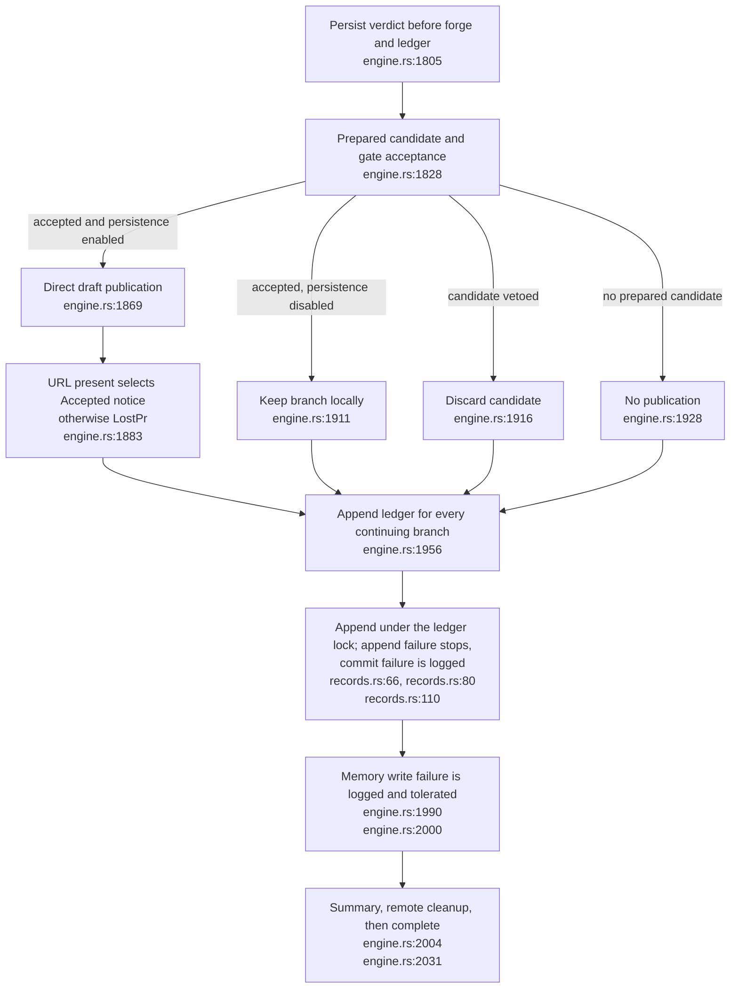

**What it shows.** The adapter checks publication eligibility before calling the forge, and calls `Forge::publish_draft` directly. The common ledger path follows all continuing branches, including vetoed and locally retained candidates. A publication failure does not erase the verdict; it changes the PR reference and notice. Earlier inbox and request-store effects precede the persistence boundary described here.

**Why it is this way.** The engine does not merge. The command policy also permits an operator-delegated `/dream sweep` on non-excluded repositories, with green head checks, protected paths respected and a recorded sweep comment; it must not invent human review evidence (`skills/dream-machine/commands/dream.md:80-105`). The core's `autoMerge` policy is only used by `persist::publish`, which this adapter does not call. The [1 November forge/seam audit](../../estate-review/2026-11-01-dream-forge-and-seam-contracts.md) exercises the real GhForge subprocess boundary with local Git remotes and an offline replacement for gh; it does not establish live GitHub behaviour or current deployment.

**Open (publication identity):** at the dream-engine head the core `DraftPr` carries `head_sha`, the commit at the branch tip that was reviewed and pushed (`../dream-engine/crates/dream-core/src/seams.rs:351-355`), but it is used only to pin automerge with `--match-head-commit` (`../dream-engine/crates/dream-core/src/seams.rs:506-521`); `publish_draft` never reads it (`../dream-engine/crates/dream-core/src/seams.rs:433`). The agentbox adapter's request still carries only a branch name, not the verified commit hash: it builds `DraftPr` without `head_sha` (`../project/agentbox/services/dream-engine/src/engine.rs:1869-1875`) against the registry pin `dream-core =0.4.1` (`../project/agentbox/services/dream-engine/Cargo.toml:26`). A successful create command returns Some even for empty stdout (`../dream-engine/crates/dream-core/src/seams.rs:566`); the adapter then selects the acceptance notice by Option presence. The tested command boundary does not validate the URL or bind the pushed head to the evaluated tree.

**Tension (error ownership):** draft creation exposes only pushed and an optional URL, losing the command error detail (`../dream-engine/crates/dream-core/src/seams.rs:433`, `../dream-engine/crates/dream-core/src/seams.rs:547`). Memory errors are journalled and logged but tolerated (`../project/agentbox/services/dream-engine/src/engine.rs:1994`); they are not automatically written into the core run-state last_error field. ADR-DE-005's universal error-propagation wording is broader than this implementation.

## AB-23.7 Run journal — restart, resume, abandonment and the finished-night rule

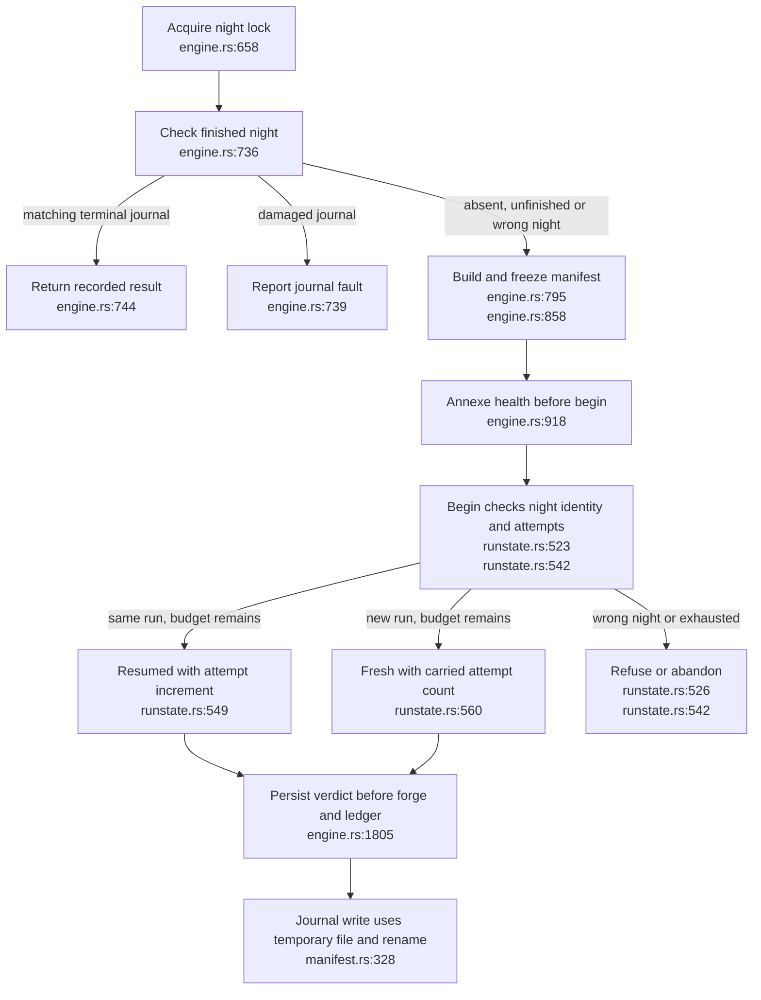

**What it shows.** The early terminal check precedes manifest freezing, but it returns no result for a journal belonging to another night. `begin` rejects that identity later, after freezing and annexe health. Same-run retries increment the attempt; changed-run retries start at Initialised while carrying the night's count. A persisted verdict stops a restart even if HEAD moved.

**Why it is this way.** ADR-DE-007 repairs the earlier run-id-only rule. The [1 November recovery audit](../../estate-review/2026-11-01-dream-recovery-and-source-supply.md) verifies lock release and restart decisions after killing a fixture process before and after persistence. These tests cover process death, not power loss or successful publication. The writer does not synchronise file or directory contents (`../dream-engine/crates/dream-gate/src/manifest.rs:328`); the reset helper uses several link/unlink operations with best-effort rollback (`../dream-engine/crates/dream-core/src/runstate.rs:466`).

**Invariant:** the adapter checks the result of `persist` before attempting accepted-candidate publication (`../project/agentbox/services/dream-engine/src/engine.rs:1805`). At-most-once claims depend on the journal surviving, the lock being honoured and no explicit reset; the library does not reconcile forge outcomes.

## AB-23.8 Core types

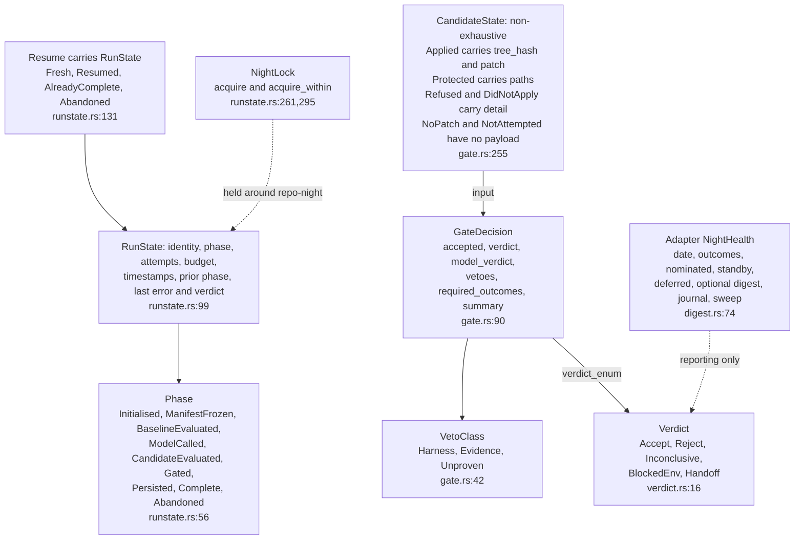

This graph shows selected record fields, phase/resume variants, lock methods, gate result and night-health fields. `CandidateState` is non-exhaustive and its payloads are abbreviated. `NotAttempted` also represents optional triage deferral, and `CandidateEvaluated` can be written when no evaluator ran (`../project/agentbox/services/dream-engine/src/engine.rs:1560,1617`). A type name does not establish execution or delivery.

`NightHealth.digest` is an optional status string. Health records are adapter reporting inputs; they do not attest that ledger rows, publication or all journal calls succeeded. AB-44.11 and AB-44.12 show those evidence boundaries (`../project/agentbox/services/dream-engine/src/digest.rs:86`).

## AB-23.9 Reminder counts local open items, not confirmed forum cases

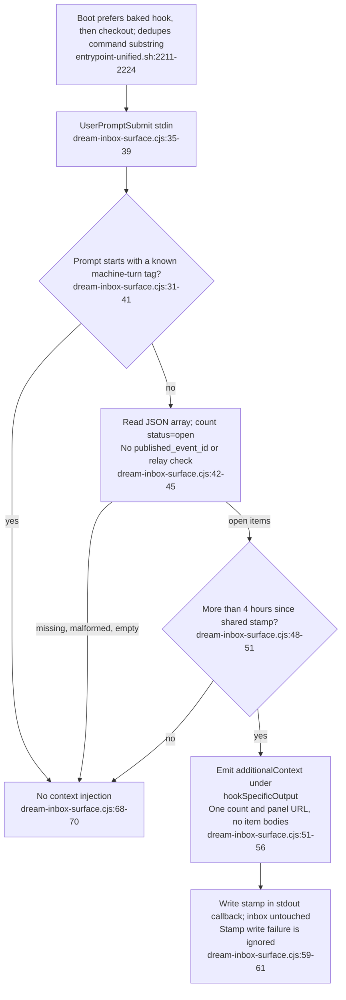

**Meaning.** The pointer says decisions await on the panel even when all open items lack a publication receipt. It measures local backlog; publication success and panel visibility need separate evidence. Existing fixture tests use unpublished items and still receive that wording.
**Limits.** The timestamp is shared by sessions but read and written without locking, so four hours is a sequential suppression policy, not a concurrent delivery guarantee. Failed stamp writes permit another reminder. See the [governance audit](../../estate-review/2026-11-01-dream-governance-and-delivery.md).
**Source pin.** The boot registration is read at the topic revision (`config/entrypoint-unified.sh:2211-2224`). The earlier audit remains a dated receipt.

## AB-23.10 Control and reporting surfaces

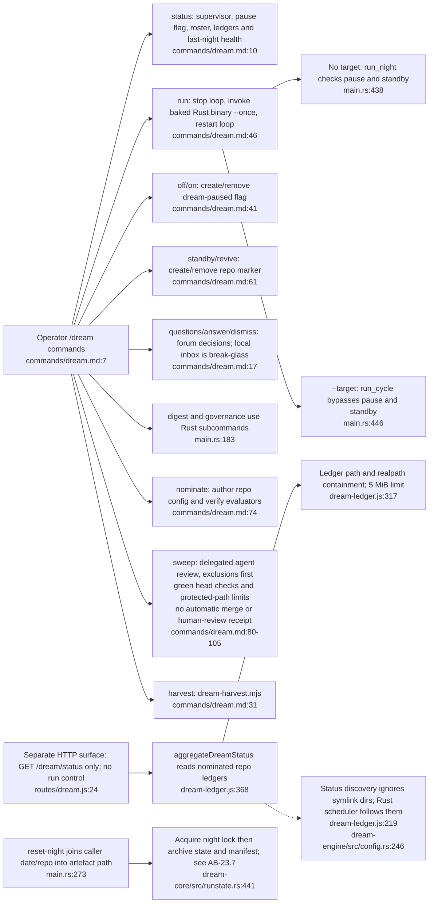

**Scope.** This corrects the stale route from `/dream run` to the legacy JavaScript orchestrator. The skill's fixed window/cap summary is guidance, not effective-config reporting; HTTP status and scheduler discovery can disagree on symlinked nominations.

## AB-23.11 Annexe depth preserves layout, not immutable input identity

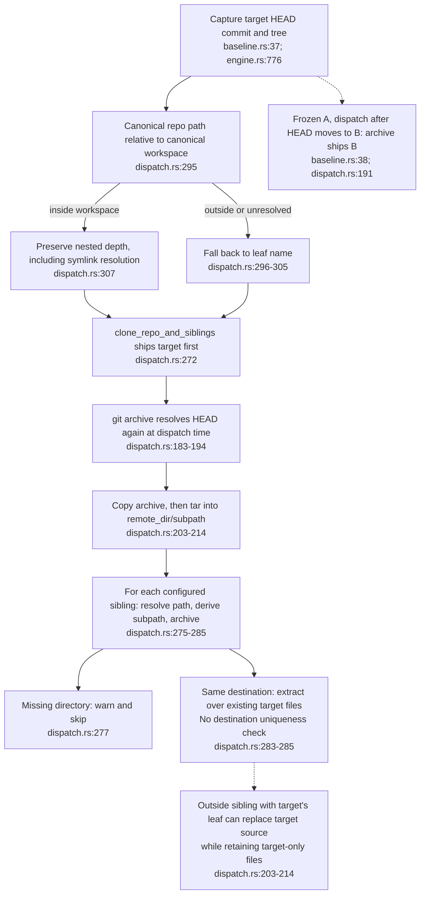

**Boundary.** Canonical depth fixes ordinary relative path dependencies. It does not freeze target/sibling revisions or prevent leaf-name overlays; the receipt audit reproduces both using local transport substitutes. Missing siblings are skipped, while archive/transfer errors propagate.

## AB-23.12 Pipefail preserves pipeline failure, with classification limits

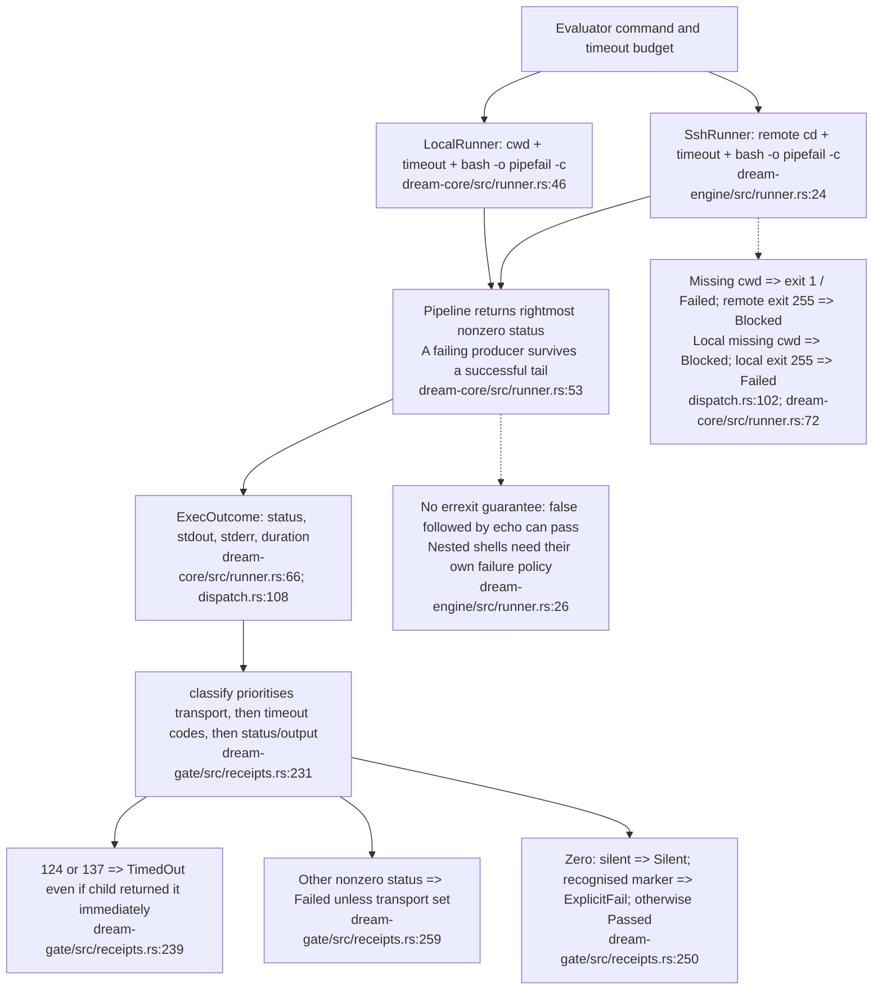

**Scope.** Pipefail preserves the status of this shell's pipeline; it does not prove evaluator sensitivity or identify which process failed. The local and SSH paths can classify the same environment fault differently. GNU Bash specifies the rightmost failing stage, correcting the former first-stage claim.

## Audit qualification — 2026-10-29

1 November continuation: AB-23.7 and AB-44.9 were reassessed against matching current source and updated for recovery and source-supply limits. Later forge/seam and migration passes also reassessed AB-23.6 and AB-23.3. The controls pass reassessed AB-23.2, AB-23.10, AB-44.3 and AB-44.4. The receipt/depth pass reassessed AB-23.11 to AB-44.2. The execution/triage pass subsequently assessed the six remaining original panels (1, 4, 5, 8, 18 and 22). All 22 original panels and additions 23–24 now have a source assessment across the linked passes; open findings, the separate nested engine corpus and the wider estate audit remain outstanding.

This topic describes the extraction as source at the stamped revisions. ADR-2141 records `implementation_status: complete` and `activation_status: live`: the operator rebuilt and activated the registry-pinned image on 2026-10-16 and the supervised daemon was RUNNING with no degradation (`../project/agentbox/docs/adr/ADR-2141-extract-the-dream-engine-core-into-a-standalone-permissive-repo.md:84`). The later pins (0.2.0, 0.3.0, 0.4.0) are source in `Cargo.toml`; the record carries activation evidence for 0.2.0 only (`../project/agentbox/docs/adr/ADR-2143-source-supply-is-plumbing-and-decisions-are-plain-english.md:57`).

**Resolved:** the earlier follow-on that `ontomark/dream.config.json` (`"adrConvention": "ADR-OM-NNN"`) would not load under the stricter `dream-gate` validation is closed: the legacy free-form template is accepted and rendered with its prefix from `dream-gate` 0.1.1 (`../project/agentbox/docs/adr/ADR-2141-extract-the-dream-engine-core-into-a-standalone-permissive-repo.md:72`).

**Tension (activation records):** ADR-2141 says the image running the adapter was rebuilt and activated (`../project/agentbox/docs/adr/ADR-2141-extract-the-dream-engine-core-into-a-standalone-permissive-repo.md:8`), while ADR-2081 still records `activation_status: staged` for the annexe-depth and receipt corrections that the same engine source carries (`../project/agentbox/docs/adr/ADR-2081-annexe-depth-law-and-honest-evaluator-receipts.md:7`); its review_trigger names the first nightly run on the rebuilt image as the receipt that moves it to live (`../project/agentbox/docs/adr/ADR-2081-annexe-depth-law-and-honest-evaluator-receipts.md:13`); AB-23.11 to AB-44.2 describe source behaviour and claim no live receipt.

## AB-23.25 The registry pins after the dream-core 0.5.0 adoption

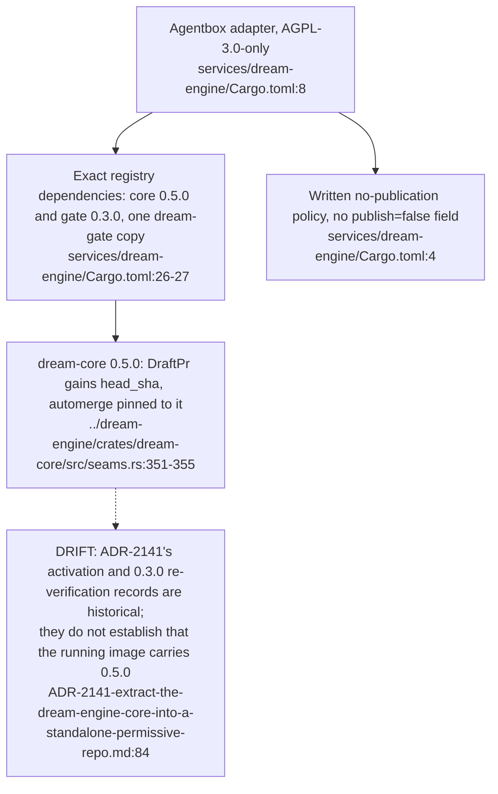

**What it shows.** The frozen AB-23.3 drew the adapter on `dream-core =0.4.1`. Agentbox e31fe2f (PR #53, 2026-11-23) moved it to `=0.5.0`, the release that made the automerge head pin a breaking change (DE-01), and kept `dream-gate =0.3.0`, the gate release 0.5.0 needs. The module map, licence boundary and missing publication guard are otherwise as AB-23.3 draws them. **Why it is this way.** The two pins must name the same dream-gate release, or two copies link and their types do not unify (`../project/agentbox/services/dream-engine/Cargo.toml:24-25`).

## AB-23.26 Draft publication now carries the reviewed branch tip

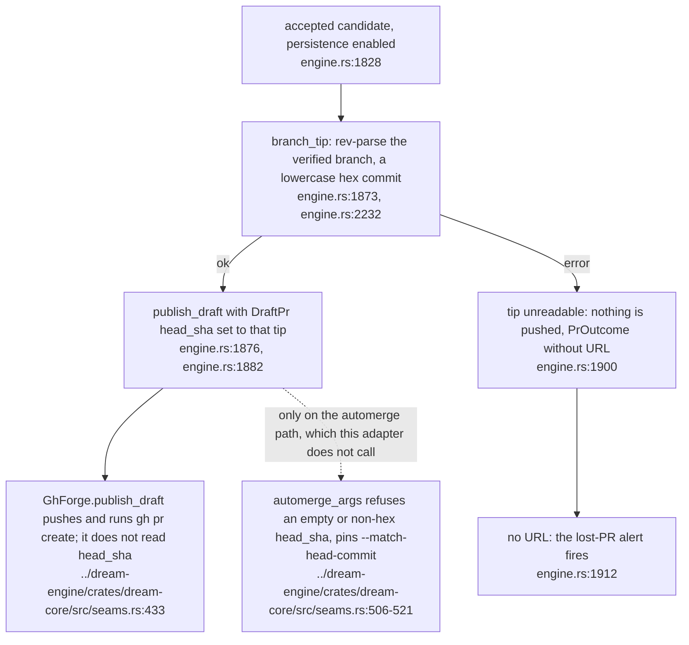

**What it shows.** The frozen AB-23.6 recorded that the adapter built `DraftPr` without `head_sha`. Since e31fe2f it reads the tip of the branch being pushed and passes it; a tip it cannot read publishes nothing and raises the lost-PR alert. **Open (publication identity, narrowed):** the hash now travels with the request, but the adapter still calls only `publish_draft`, which ignores it, so the pinned automerge is never exercised in the estate; a successful create still returns Some even for empty stdout (`../dream-engine/crates/dream-core/src/seams.rs:566`).
