Repair follow-up, 2026-11-03: [AB-41.3](41-process-governance-and-dream-repairs.md#ab-413-supply-the-reusable-core-with-verifiable-host-inputs) and [DE-06](../dream-engine/06-formatting-and-evidence-repairs.md) record the adapter's registry adoption and core formatting/source/integrity repairs. This topic retains its historical source stamp.

This topic draws the adapter and the boundary after the 2026-10-15 extraction (agentbox ADR-2141). The judgement and the loop mechanism moved to the permissive repository DreamLab-AI/dream-engine, mapped in DE-01 and in its own corpus at `../dream-engine/docs/diagrams/README.md`, which is not duplicated here. AB-23.9 onward are adapter-owned and re-cited at the new revision.

State at this stamp: the adapter pins `dream-core =0.4.1` and `dream-gate =0.3.0` from the registry (`../project/agentbox/services/dream-engine/Cargo.toml:26-27`), and the extraction is live: ADR-2141 is `accepted`, `complete`, `live`, with the operator's rebuild activated on 2026-10-16 and later releases adopted since (`../project/agentbox/docs/adr/ADR-2141-extract-the-dream-engine-core-into-a-standalone-permissive-repo.md:6-8`). Three adapter-owned changes since the first stamp are drawn here: source supply as plumbing (AB-23.21, ADR-2143), the opt-in Jev triage before the candidate build (AB-23.22, AB-23-S1-01) and the formatter step inside the core's candidate run (AB-23.4, ADR-DE-009). The crates.io versions are recorded in DE-01.

## AB-23.1 Repo-night phases and early exits

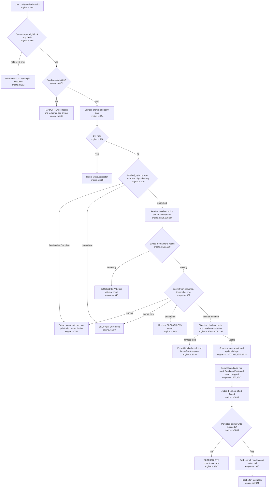

This is the control-flow overview; phase names record progress, not proof that every named action ran. Config loading precedes the lock, admission precedes the finished-night check, and several intermediate phase writes ignore errors (`../project/agentbox/services/dream-engine/src/engine.rs:1029,1192,1473,1617,1696`). AB-23.7 covers recovery in detail.

The [controls probe](../../estate-review/2026-11-01-dream-adapter-controls-and-egress.md) reproduced a completed night gaining a HANDOFF row and an overwritten report after its evaluator config became unusable. `Persisted` suppresses a repeat after a process crash; it neither confirms a draft was delivered nor supplies a power-loss transaction. Those limits are assessed in the [recovery](../../estate-review/2026-11-01-dream-recovery-and-source-supply.md) and [forge](../../estate-review/2026-11-01-dream-forge-and-seam-contracts.md) reviews.

## AB-23.2 Scheduling, admission and finished-night boundaries

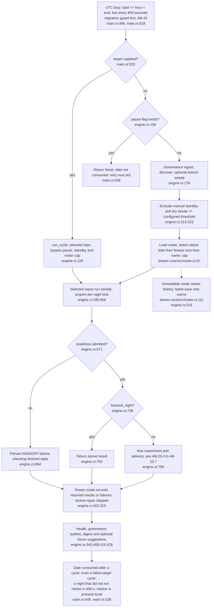

**Limits.** The window controls start time, not a night deadline. Pause is checked only at roster entry, not during a night or targeted execution. Readiness can append HANDOFF to an already finished night; see the 1 November controls audit.

## AB-23.3 Module map and the licence boundary


**What it shows.** The adapter imports the reusable engine and retains product-specific modules. Its exact pins resolve to one dream-gate version. The [migration/provenance audit](../../estate-review/2026-11-01-dream-migration-and-provenance.md) compares all 36 Rust source files in the four consumed crate releases and checks their cached archives against the consumer lockfile.

**Why it is this way.** ADR-2141 separates the engine mechanism from host orchestration. That dependency boundary does not itself enforce the adapter's no-publication policy: offline Cargo metadata leaves publication unrestricted and the selected package files include zone_crypto. No package was uploaded.

**Open (publication control):** the adapter's manifest declares its licence and version but no publication restriction (`../project/agentbox/services/dream-engine/Cargo.toml:4`, `../project/agentbox/services/dream-engine/Cargo.toml:8`). Source placement and stated policy must not be presented as a registry guard.

**Drift (activation evidence):** ADR-2141 records activation on 16 October and a later 0.3.0 re-verification (`../project/agentbox/docs/adr/ADR-2141-extract-the-dream-engine-core-into-a-standalone-permissive-repo.md:84`, `../project/agentbox/docs/adr/ADR-2141-extract-the-dream-engine-core-into-a-standalone-permissive-repo.md:92`). Current source pins core 0.4.1 (`../project/agentbox/services/dream-engine/Cargo.toml:26`); those historical records do not establish its current running image. The local tests in the dated audit use fixture services.

## AB-23.4 Guard ordering and the gate's evidence boundary

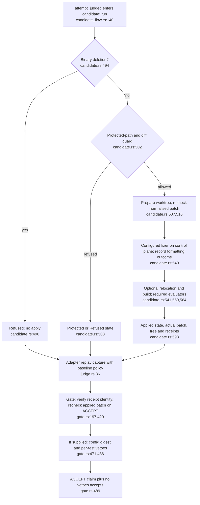

Both the pre-apply guard and the pure gate recheck are present. The gate trusts caller-supplied receipt outcomes and candidate state; it is not an execution attestation. The adapter obtains a candidate config digest through an Option-returning helper, so a missing digest skips that comparison (`../project/agentbox/services/dream-engine/src/candidate_flow.rs:330`; `../dream-engine/crates/dream-gate/src/gate.rs:471`). Required evaluator failures veto an otherwise eligible ACCEPT; unreadable or absent evidence has its own classification.

Formatting is not a confinement boundary: a valid spaced Rust path attribute caused rustfmt to modify an external temporary file in the [candidate probe](../../estate-review/2026-11-01-dream-candidate-and-evidence.md). The same review reproduced an evaluator changing tracked files after the candidate tree was recorded. The repository's own config names no fixer at this stamp, but another nominated repository can enable one (`../project/agentbox/dream.config.json:43`; `../dream-engine/crates/dream-core/src/candidate.rs:540`).

## AB-23.5 Candidate worktree, relocation and apply repair

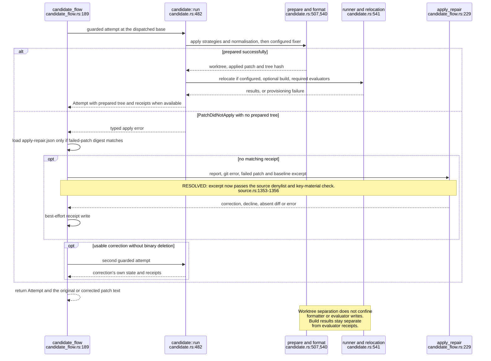

The baseline revision is passed into the candidate worktree, which protects against ordinary HEAD movement. The failing-hunk excerpt bypass the execution review reproduced is RESOLVED at dream-engine b40d507: `failing_excerpt_with` validates the path against the host denylist and withholds a blob with key material (`../dream-engine/crates/dream-core/src/source.rs:1343-1356`), and the adapter passes the source denylist (`../project/agentbox/services/dream-engine/src/candidate_flow.rs:208-214`). Apply repair is keyed to the failed patch, not to a complete baseline/prompt identity, and its receipt write is best effort (`../project/agentbox/services/dream-engine/src/candidate_flow.rs:198-238`). A missing receipt after a crash can therefore permit another repair request; the code does not establish exactly one external call across all failures.

The formatter runs locally before relocation. A successful worktree build does not establish the identity of a remote extracted tree or protect the operator's filesystem from subprocess effects. The [candidate](../../estate-review/2026-11-01-dream-candidate-and-evidence.md) and [annexe](../../estate-review/2026-11-01-dream-annexe-and-receipts.md) probes qualify those guarantees. Full ADR-2114 dispositions are in the [execution review](../../estate-review/2026-11-01-dream-execution-and-triage.md).

## AB-23.6 Persistence and the human merge gate

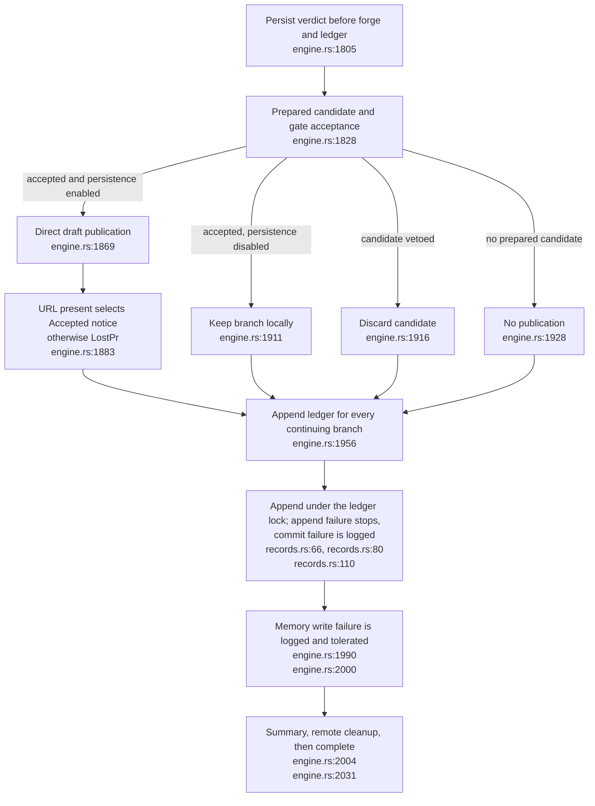

**What it shows.** The adapter checks publication eligibility before calling the forge, and calls `Forge::publish_draft` directly. The common ledger path follows all continuing branches, including vetoed and locally retained candidates. A publication failure does not erase the verdict; it changes the PR reference and notice. Earlier inbox and request-store effects precede the persistence boundary described here.

**Why it is this way.** A human still decides the merge. The core's `autoMerge` policy is only used by `persist::publish`, which this adapter does not call. The [1 November forge/seam audit](../../estate-review/2026-11-01-dream-forge-and-seam-contracts.md) exercises the real GhForge subprocess boundary with local Git remotes and an offline replacement for gh; it does not establish live GitHub behaviour or current deployment.

**Open (publication identity):** the PR request carries a branch name, not the verified commit hash (`../dream-engine/crates/dream-core/src/seams.rs:341`). A successful create command returns Some even for empty stdout (`../dream-engine/crates/dream-core/src/seams.rs:531`); the adapter then selects the acceptance notice by Option presence. The tested command boundary does not validate the URL or bind the pushed head to the evaluated tree.

**Tension (error ownership):** draft creation exposes only pushed and an optional URL, losing the command error detail (`../dream-engine/crates/dream-core/src/seams.rs:425`, `../dream-engine/crates/dream-core/src/seams.rs:512`). Memory errors are journalled and logged but tolerated (`../project/agentbox/services/dream-engine/src/engine.rs:1994`); they are not automatically written into the core run-state last_error field. ADR-DE-005's universal error-propagation wording is broader than this implementation.

## AB-23.7 Run journal — restart, resume, abandonment and the finished-night rule

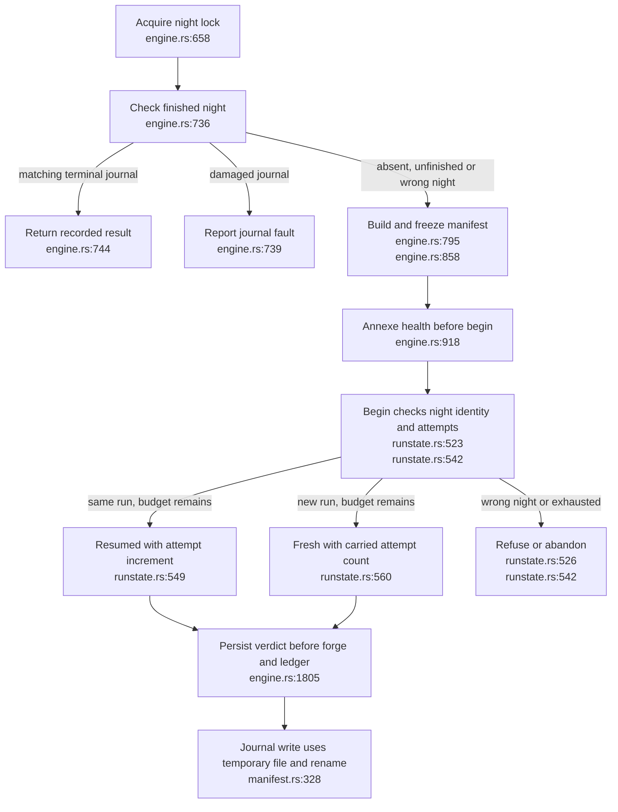


**What it shows.** The early terminal check precedes manifest freezing, but it returns no result for a journal belonging to another night. `begin` rejects that identity later, after freezing and annexe health. Same-run retries increment the attempt; changed-run retries start at Initialised while carrying the night's count. A persisted verdict stops a restart even if HEAD moved.

**Why it is this way.** ADR-DE-007 repairs the earlier run-id-only rule. The [1 November recovery audit](../../estate-review/2026-11-01-dream-recovery-and-source-supply.md) verifies lock release and restart decisions after killing a fixture process before and after persistence. These tests cover process death, not power loss or successful publication. The writer does not synchronise file or directory contents (`../dream-engine/crates/dream-gate/src/manifest.rs:328`); the reset helper uses several link/unlink operations with best-effort rollback (`../dream-engine/crates/dream-core/src/runstate.rs:466`).

**Invariant:** the adapter checks the result of `persist` before attempting accepted-candidate publication (`../project/agentbox/services/dream-engine/src/engine.rs:1805`). At-most-once claims depend on the journal surviving, the lock being honoured and no explicit reset; the library does not reconcile forge outcomes.

## AB-23.8 Core types

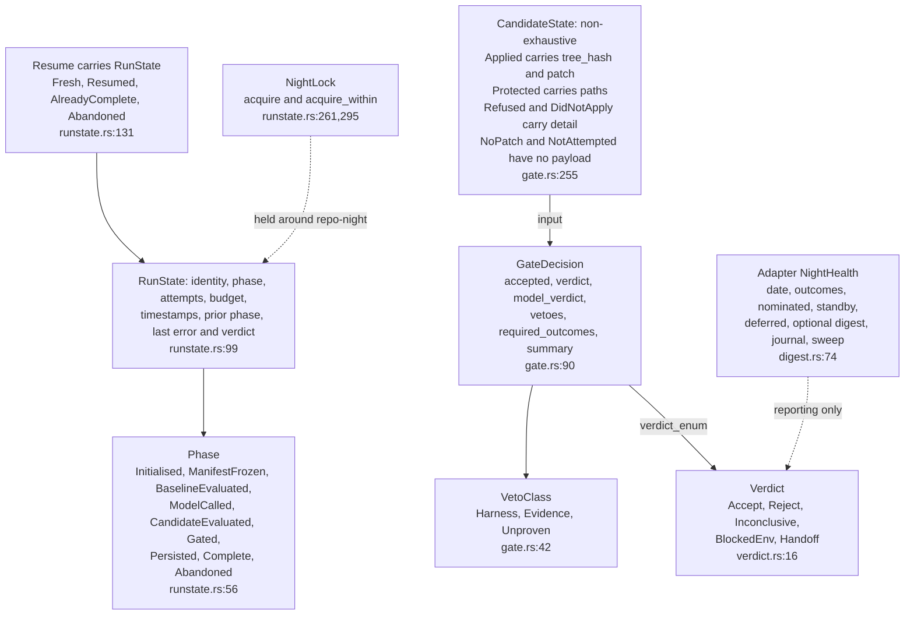


This graph shows selected record fields, phase/resume variants, lock methods, gate result and night-health fields. `CandidateState` is non-exhaustive and its payloads are abbreviated. `NotAttempted` also represents optional triage deferral, and `CandidateEvaluated` can be written when no evaluator ran (`../project/agentbox/services/dream-engine/src/engine.rs:1560,1617`). A type name does not establish execution or delivery.

`NightHealth.digest` is an optional status string. Health records are adapter reporting inputs; they do not attest that ledger rows, publication or all journal calls succeeded. AB-23.23 and AB-23.24 show those evidence boundaries (`../project/agentbox/services/dream-engine/src/digest.rs:86`).

## AB-23.9 Reminder counts local open items, not confirmed forum cases

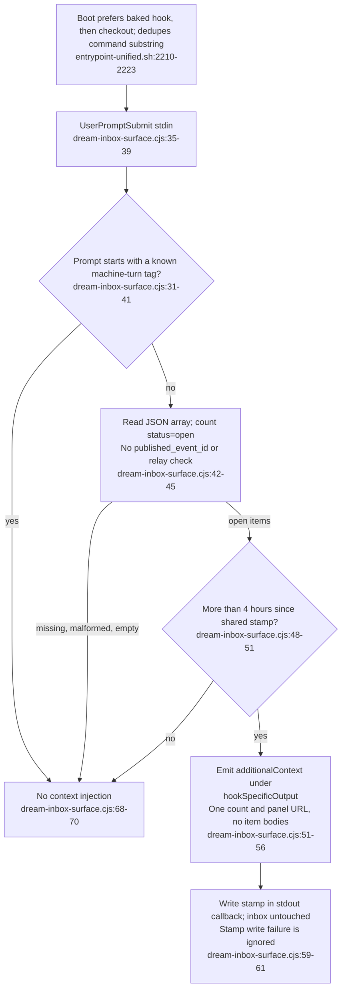

**Meaning.** The pointer says decisions await on the panel even when all open items lack a publication receipt. It measures local backlog; publication success and panel visibility need separate evidence. Existing fixture tests use unpublished items and still receive that wording.
**Limits.** The timestamp is shared by sessions but read and written without locking, so four hours is a sequential suppression policy, not a concurrent delivery guarantee. Failed stamp writes permit another reminder. See the [governance audit](../../estate-review/2026-11-01-dream-governance-and-delivery.md).
**Source pin.** Boot citations use the existing topic revision. The selected registration block is unchanged at the current checkout but moved to lines 2171–2196; the audit manifest records that comparison.

## AB-23.10 Control and reporting surfaces

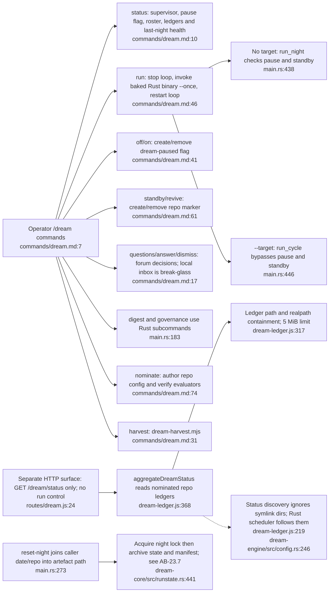

**Scope.** This corrects the stale route from `/dream run` to the legacy JavaScript orchestrator. The skill's fixed window/cap summary is guidance, not effective-config reporting; HTTP status and scheduler discovery can disagree on symlinked nominations.

## AB-23.11 Annexe depth preserves layout, not immutable input identity

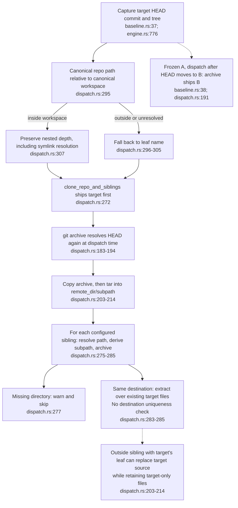

**Boundary.** Canonical depth fixes ordinary relative path dependencies. It does not freeze target/sibling revisions or prevent leaf-name overlays; the receipt audit reproduces both using local transport substitutes. Missing siblings are skipped, while archive/transfer errors propagate.

## AB-23.12 Pipefail preserves pipeline failure, with classification limits

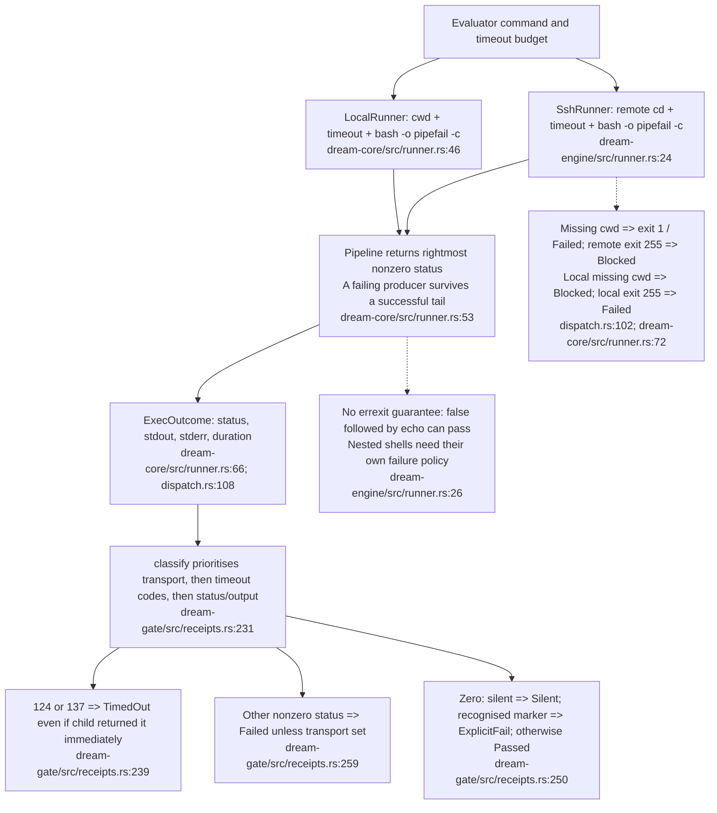

**Scope.** Pipefail preserves the status of this shell's pipeline; it does not prove evaluator sensitivity or identify which process failed. The local and SSH paths can classify the same environment fault differently. GNU Bash specifies the rightmost failing stage, correcting the former first-stage claim.

## AB-23.13 No-patch ACCEPT is unproven, but the adapter still alerts


**Verified distinction.** The no-patch fixture yields INCONCLUSIVE and no Harness veto, but does add an alert. Candidate receipt grading and notification policy are separate; a verdict class alone does not suppress operator messages.

## AB-23.14 Finding selection, validation and append-time repair


**Limits.** Selection establishes syntax and date, not provenance from a particular report section or evaluated deep. The fallback needs the adapter's repair backstop; UTF-16 validation does not make its character truncation equivalent. Unicode parity differences remain recorded in the migration audit.

## AB-23.15 Provider selection, retries and cross-provider fallback


**Egress.** Retaining Z.AI as the default is the recorded operator decision. LAN confinement requires the effective primary, fallback and endpoint policy to agree; a provider label alone does not enforce it. Client-level guarantees remain owned by AB-28.11.

## AB-23.16 Placeholder and dispatch guards have limited coverage


**Limit.** Existing tests cover the original simple-placeholder failures, not a universal ban on unresolved placeholders. The isolated controls probe confirms nested values survive and empty-host scp_from launches a fake executable.

## AB-23.17 Forum decisions — local application and delivery boundaries


**Authority.** Signature validity and rejection of this agent's key do not establish a human decision. The configured relay supplies admission policy; current relay source allows admins and case-delegated reviewers. The adapter also accepts missing request binding and ignores supersession after local resolution; these boundaries are tested in the [governance audit](../../estate-review/2026-11-01-dream-governance-and-delivery.md).
**Delivery.** An accepted deletion is a request acknowledgement, not proof of remote removal, local persistence or live card removal. The relay deletes rows but ignores database errors; the current panel subscription excludes kind 5 and its registry ignores it. Those cross-repository source findings are recorded separately in the audit, without a live UI claim.
**Compatibility.** Shared wire types reduce duplication but do not prevent version drift: the adapter consumes core beta.16 while the inspected forum checkout is beta.19. Missing keys, transport failures and local write errors remain fail-open; a zero-count report is not proof that no work was pending.

## AB-23.18 Annexe health and retention limits

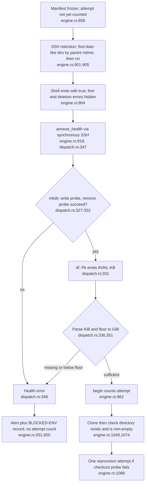

The write test catches failures that a free-space figure alone misses; local fixtures exercise the actual public health function through a substitute SSH executable. The minimum defaults to 10 GiB; an explicit zero disables the capacity floor, not the write test (`../project/agentbox/services/dream-engine/src/engine.rs:2392`). Health checks are observations at that moment, not reservations of space or proof of checkout identity.

The exact retention command deleted a disposable old parent directory containing a freshly written child. It checks neither active jobs nor night locks, and a failing find command still returned success with no stderr. This is fixture evidence, not a claim that a live run was deleted. SSH has a 10-second connection timeout but no overall command deadline (`../project/agentbox/services/dream-engine/src/dispatch.rs:39-60`); a connected hung sweep or probe can therefore hold up later serial work. See the [execution review](../../estate-review/2026-11-01-dream-execution-and-triage.md).

## AB-23.19 ADR-2071 clause (c) — historical acceptance and retained tick

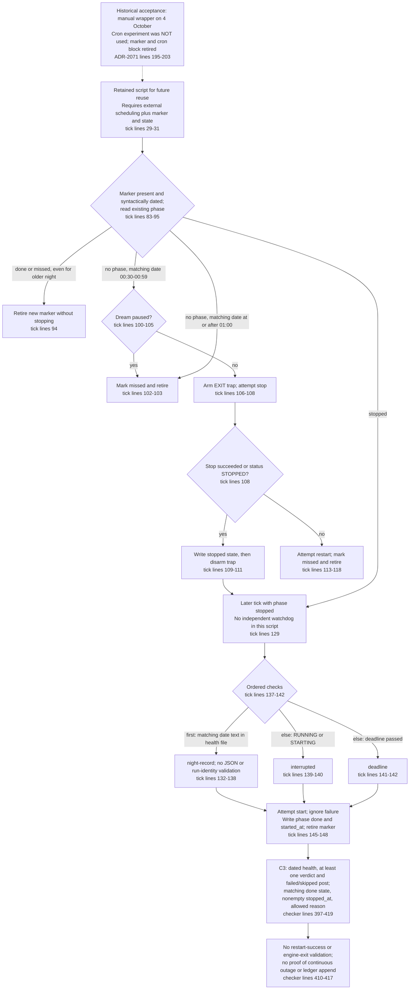

**History.** ADR-2071 records a manual 4 October acceptance run, three newly dreamed repositories and one previously completed skip. This is historical evidence, not a fresh deployment check (`../project/agentbox/docs/adr/ADR-2071-journal-the-nightly-dream-cycle.md:204-212`).
**Current boundary.** The retained tick can consume a fresh marker using old done state, restart before the window from matching date text, mask an interruption and retire after a failed start. C3 trusts aggregate files rather than binding an outage to a specific completed run; see the [journal audit](../../estate-review/2026-11-01-dream-journal-and-api-down.md).
**Recovery limit.** The EXIT trap is removed after writing stopped state; later recovery depends on another tick and a successful supervisor start. It is not an unconditional guarantee that the API returns (`../project/agentbox/scripts/activation/adr-2071-api-down-night.sh:106-111`, `../project/agentbox/scripts/activation/adr-2071-api-down-night.sh:145-148`).

## AB-23.20 Signing keys — the identity-port capability and the local fallback

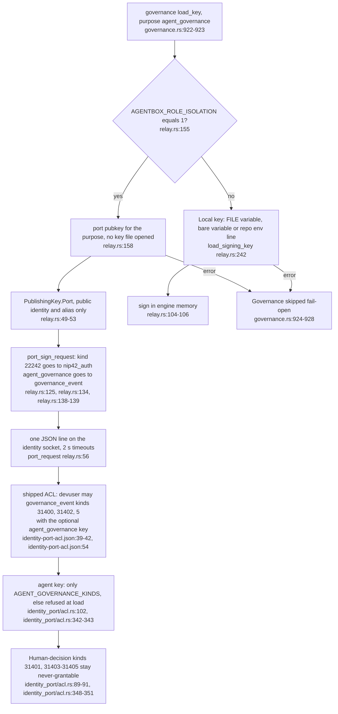

**Correction.** RESOLVED at agentbox 720e0d8 — the dream engine no longer reads its governance key under isolation: it takes a purpose-bound port capability (`../project/agentbox/services/dream-engine/src/relay.rs:150-158`) and the shipped ACL grants `governance_event` for kinds 31400, 31402 and 5 to the optional `agent_governance` key (`../project/agentbox/config/custody/identity-port-acl.json:54`); the key is `required: false` and must be provisioned by the operator before use (`../project/agentbox/config/custody/identity-port-acl.json:41`).
**Activation.** Flag-on behaviour depends on effective boot configuration, ownership and running identity. This pass reads those contracts but does not enable isolation, inspect keys or certify a running image. Key-file precedence alone does not imply the flag is on.
**Scope.** ADR-2122's ER-6 decision is assessed here, not its entire custody programme. Complete the signing, authentication and withdrawal design together, including old-key cases; see the [governance audit](../../estate-review/2026-11-01-dream-governance-and-delivery.md).

## AB-23.21 ADR-2143 — source supply is plumbing, not a decision

```mermaid
flowchart TB
    REPORT["Extract report requests and classify human actions<br/>engine.rs:1743<br/>wanted.rs:191"] --> STORE["Record pending keys or report a repeated inactive key<br/>wanted.rs:231"]
    STORE --> ALERT["Loop alert per record call<br/>engine.rs:1764"]
    STORE --> TAKE["Take active requests and increment each offer count<br/>wanted.rs:276"]
    TAKE --> SCAN["Append path-shaped scan entries<br/>engine.rs:1361"]
    SCAN --> CORE["Validate and select requested entries first<br/>source.rs:1099"]
    CORE --> RENDER["Clip then add markers and redact<br/>source.rs:858"]
    RENDER --> RECEIPT["Return receipt only if a file is marked inlined<br/>source.rs:1192"]
    RECEIPT --> SETTLE["Settle by path or directory prefix<br/>ranges are not compared<br/>wanted.rs:328"]
```


**What it shows.** Requests are offered before planner picks, with scan paths appended afterwards. Reservation counts candidate entries before validation, clipping markers can exceed the nominal byte allocation, and an empty line window can count as honoured. `take_for` counts invocations, not distinct night identifiers; `settle` treats any range from the same path as satisfying all its ranges (`../project/agentbox/services/dream-engine/src/wanted.rs:284`, `../project/agentbox/services/dream-engine/src/wanted.rs:328`). **Why it is this way.** ADR-2143 moves repetitive file requests out of the operator panel, but the [source-supply audit](../../estate-review/2026-11-01-dream-recovery-and-source-supply.md) finds that its completion markers do not prove the requested content was supplied. A requested directory is satisfied by any file under it. An all-refused read returns no source record (`../dream-engine/crates/dream-core/src/source.rs:1192`).

**Drift (question shape):** four fields are the prompt's desired format, not an enforced invariant. Parsing requires only Decision and If approved; unstructured questions pass through unchanged (`../project/agentbox/services/dream-engine/src/inbox.rs:278`, `../project/agentbox/services/dream-engine/src/inbox.rs:289`).

**Tension (expiry and evidence):** source receipt writes and settlement writes are best effort, and the shared request store has no transaction around read-modify-write (`../project/agentbox/services/dream-engine/src/engine.rs:1390`, `../project/agentbox/services/dream-engine/src/wanted.rs:91`). Current source does not establish three distinct nights, exact range delivery or one lifetime loop alert per request.

## AB-23.22 Optional triage can defer without a durable receipt

```mermaid
flowchart TB
    CLAIM{"Report claims ACCEPT and triage enabled?<br/>engine.rs:1534-1536"}
    CLAIM -->|no| BUILD["Proceed to ordinary candidate handling<br/>engine.rs:1560"]
    CLAIM -->|yes| ROUTE{"Endpoint available under configured locality?<br/>jev_triage.rs:147-188"}
    ROUTE -->|no| BUILD
    ROUTE -->|yes| ASK["First request: report head, path hints and evaluator names<br/>jev_triage.rs:320"]
    ASK --> SIGNAL{"Valid typed usefulness and support values?<br/>jev_triage.rs:347"}
    SIGNAL -->|fallback| BUILD
    SIGNAL -->|yes| DEFER["Compute defer from support and explicit threshold<br/>jev_triage.rs:491"]
    DEFER --> SCREEN["Second request: library discipline screen, capped inputs<br/>jev_triage.rs:522; screen.rs:222"]
    SCREEN --> RECORD["Write annotation or screen-fallback record<br/>jev_triage.rs:522-550"]
    RECORD --> CHECK{"Defer computed true?<br/>jev_triage.rs:558"}
    CHECK -->|no| BUILD
    CHECK -->|yes| SKIP["Skip build even if annotation write failed<br/>engine.rs:1560"]
    SKIP --> GATE["NotAttempted: ACCEPT stays unproven<br/>gate.rs:445"]
    RECORD -.-> AUTH["Each HTTP call has 15-second timeout and no redirects<br/>jev_triage.rs:275-279"]
```

Default threshold is unset, so valid signals annotate without deferral. A configured threshold must lie in 0 to 0.5. Neither usefulness nor the discipline score can approve a candidate. The two requests are sequential; the first failing means the second is not sent. An initial fallback writes nothing and leaves any prior annotation in place (`../project/agentbox/services/dream-engine/src/jev_triage.rs:506-512`).

The first request clips the report to 4,000 characters but does not cap the complete request. Its path hints omit deletions and pure renames. The second request retains at most 16 disciplines, while the saved annotation lists the full input set (`../project/agentbox/services/dream-engine/src/jev_triage.rs:306,320,528`; `../dream-engine/crates/dream-core/src/screen.rs:230`). These signals cannot replace evaluator evidence. The [execution review](../../estate-review/2026-11-01-dream-execution-and-triage.md) records transport-free probes, current configuration and the limits of ADR-2155's staged activation record. A staged record does not prove that no other running image has the feature.

## Audit qualification — 2026-10-29

1 November continuation: AB-23.7 and AB-23.21 were reassessed against matching current source and updated for recovery and source-supply limits. Later forge/seam and migration passes also reassessed AB-23.6 and AB-23.3. The controls pass reassessed AB-23.2, AB-23.10, AB-23.15 and AB-23.16. The receipt/depth pass reassessed AB-23.11 to AB-23.14. The execution/triage pass subsequently assessed the six remaining original panels (1, 4, 5, 8, 18 and 22). All 22 original panels and additions 23–24 now have a source assessment across the linked passes; open findings, the separate nested engine corpus and the wider estate audit remain outstanding.

This topic describes the extraction as source at the stamped revisions. ADR-2141 records `implementation_status: complete` and `activation_status: live`: the operator rebuilt and activated the registry-pinned image on 2026-10-16 and the supervised daemon was RUNNING with no degradation (`../project/agentbox/docs/adr/ADR-2141-extract-the-dream-engine-core-into-a-standalone-permissive-repo.md:84`). The later pins (0.2.0, 0.3.0, 0.4.0) are source in `Cargo.toml`; the record carries activation evidence for 0.2.0 only (`../project/agentbox/docs/adr/ADR-2143-source-supply-is-plumbing-and-decisions-are-plain-english.md:57`).

**Resolved:** the earlier follow-on that `ontomark/dream.config.json` (`"adrConvention": "ADR-OM-NNN"`) would not load under the stricter `dream-gate` validation is closed: the legacy free-form template is accepted and rendered with its prefix from `dream-gate` 0.1.1 (`../project/agentbox/docs/adr/ADR-2141-extract-the-dream-engine-core-into-a-standalone-permissive-repo.md:72`).

**Tension (activation records):** ADR-2141 says the image running the adapter was rebuilt and activated (`../project/agentbox/docs/adr/ADR-2141-extract-the-dream-engine-core-into-a-standalone-permissive-repo.md:8`), while ADR-2081 still records `activation_status: staged` for the annexe-depth and receipt corrections that the same engine source carries (`../project/agentbox/docs/adr/ADR-2081-annexe-depth-law-and-honest-evaluator-receipts.md:7`); its review_trigger names the first nightly run on the rebuilt image as the receipt that moves it to live (`../project/agentbox/docs/adr/ADR-2081-annexe-depth-law-and-honest-evaluator-receipts.md:13`); AB-23.11 to AB-23.14 describe source behaviour and claim no live receipt.


## AB-23.23 Journal delivery — local counters and remote evidence

```mermaid
flowchart TB
    SESSION["Night ID plus whole seconds, normalised and truncated to 160<br/>Not unique across all attempts or names<br/>journal.rs:300-315"] --> CALL["called: post tool.called, then increment open_calls<br/>journal.rs:165-187"]
    CALL --> EFFECT["Caller performs effect independently of delivery success<br/>Phase 1 is fail-open, not an approval gate<br/>journal.rs:11-17"]
    EFFECT --> DONE["completed: decrement open_calls BEFORE posting<br/>causation present only if called returned an event ID<br/>journal.rs:199-215"]
    CALL --> HTTP
    DONE --> HTTP
    HTTP{"Client enabled and fewer than 3 consecutive failures?<br/>journal.rs:236-244"}
    HTTP -->|"no client"| OFF["No delivery counters; open_calls still changes<br/>journal.rs:236"]
    HTTP -->|"breaker open"| SKIP["skipped++; no recovery probe this session<br/>journal.rs:237-243"]
    HTTP -->|"yes"| POST["POST /v1/exec/record<br/>same API journal singleton<br/>exec-record.js:59-62"]
    POST --> KEY["Caller key becomes deterministic event ID<br/>Duplicate ID returns prior envelope, without payload comparison<br/>exec-record.js:52-54; execution-journal.js:144-151"]
    KEY --> APPEND["Assign seq, await dispatch, then update in-memory state<br/>Concurrent appends can share seq; restart needs hydration<br/>execution-journal.js:152-185"]
    APPEND --> ACK{"HTTP success and string event_id?<br/>journal.rs:257-270"}
    ACK -->|"yes, including duplicate or empty ID"| REC["recorded++; reset failure streak<br/>journal.rs:267-270"]
    ACK -->|"no"| FAIL["failed++; increment streak; no retry or local outbox<br/>journal.rs:272-276"]
    DONE --> STATS["unpaired = current open_calls, not remote pair reconciliation<br/>journal.rs:224-229"]
    STATS --> HEALTH["Normal path records repo stats, then night-level stats<br/>Early returns and crashes have narrower coverage<br/>engine.rs:359-368; engine.rs:461-462; records.rs:411-428"]
```

**Evidence.** Loopback probes reproduce unmatched remote records with unpaired=0; route probes reproduce changed-payload deduplication, restart sequence reuse and concurrent duplicate sequence numbers while the on-disk hash chain verifies. These are separate integrity properties, detailed in the [journal audit](../../estate-review/2026-11-01-dream-journal-and-api-down.md).
**Coverage.** Several inbox writes have no tool pair, including shared-remote warnings, annexe-health failure and damaged-run alerts; inbox::add does not journal internally (`../project/agentbox/services/dream-engine/src/engine.rs:251`, `../project/agentbox/services/dream-engine/src/engine.rs:933`, `../project/agentbox/services/dream-engine/src/engine.rs:2160`, `../project/agentbox/services/dream-engine/src/inbox.rs:174-215`).
**Skip semantics.** The repo wrapper posts turn.started before calling the body and turn.completed afterwards, including locked or already-finished returns. No tool effect is required for those lifecycle events (`../project/agentbox/services/dream-engine/src/engine.rs:603-624`).


## AB-23.24 Digest — evidence limits and encryption configuration

```mermaid
flowchart TB
    DISK["Read health, configured ledgers and open-item count<br/>digest.rs:386-399"] --> DATE{"Matching health date?<br/>digest.rs:186"}
    DATE -->|no| ABSENT["Text says nothing was tested<br/>Missing evidence does not establish that conclusion<br/>digest.rs:187-191"]
    DATE -->|yes| ANY{"Any scheduled outcomes?<br/>digest.rs:193-217"}
    ANY -->|no| ZERO["No-eligible text and available standby reasons<br/>digest.rs:193-215"]
    ZERO --> LOCAL
    ANY -->|yes| WORDS["Compose from outcome labels and last ledger row<br/>ACCEPT says confirmed; REJECT says disproved<br/>digest.rs:242-275"]
    WORDS --> LOCAL["Append local open count as panel backlog<br/>digest.rs:220-227"]
    ABSENT --> LOCAL
    LOCAL --> ZONE["Resolve section and zone metadata; select encryption plan<br/>digest.rs:421-430"]
    ZONE --> PLAIN["Malformed or absent zones become empty;<br/>unknown section can select first configured zone<br/>zone_crypto.rs:86-105"]
    ZONE --> SECRET["Known encrypted zone with gate on: latest held epoch or refuse<br/>zone_crypto.rs:109-115; zone_crypto.rs:221-233"]
    PLAIN --> FALL["No encrypted match means plaintext plan<br/>zone_crypto.rs:222-224"]
    SECRET -->|"no held key"| STOP["Withhold digest<br/>digest.rs:431-432"]
    SECRET -->|"held key"| POST["Sign and publish; retry once after missing read-back<br/>digest.rs:453-479"]
    FALL --> POST
    POST --> VERIFY["Read-back match checks ID only<br/>Relay query does not verify signature or filter membership<br/>digest.rs:467-476; relay.rs:483-489"]
```

**Presentation.** A missing health file, REJECT label or unpublished inbox count is insufficient for the digest's stronger claims. Standby repositories disappear from the ordinary outcomes branch. Case context now reads the configured ledgerPath, RESOLVED at agentbox 720e0d8 (`../project/agentbox/services/dream-engine/src/governance.rs:279`).
**Privacy.** The no-key refusal applies only after zone policy identifies an encrypted zone. Malformed metadata produces plaintext selection even with the gate on; the probe does not publish plaintext or claim the live relay would admit it. No current zone-key epoch is fetched, so latest means latest locally held.
**Evidence.** The [governance audit](../../estate-review/2026-11-01-dream-governance-and-delivery.md) records isolated probes and the source boundary. Neither a publish ACK nor an ID-only read-back establishes delivery to the operator or a verified current deployment.
