## AB-24.1 Two deployments of one facade contract — topology

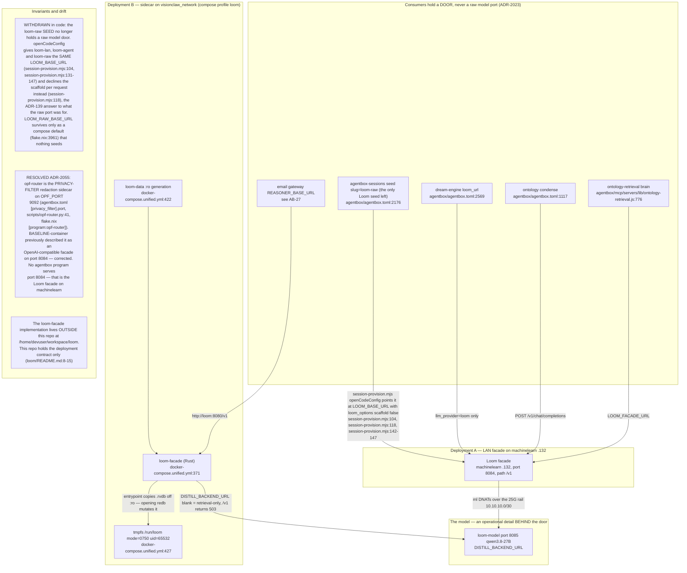

**Drift:** the scaffolded `loom` session seed (`loom-lan/qwen3.8-27B`) was dropped from the manifest, leaving `loom-raw` as the only Loom seed, and the new session plane asserts exactly that roster (`../project/agentbox/agentbox.toml:2175-2179`, `../project/agentbox/services/agentbox-sessions/src/manifest.rs:167-168`); `openCodeConfig` in the provisioner still defines the `loom-lan` provider, so the unscaffolded and scaffolded doors both stay configured (`../project/agentbox/scripts/session-provision.mjs:131-135`). The manifest comment on the neighbouring `deepseek` seed still says "AoE" (`../project/agentbox/agentbox.toml:2169`), and GOVERNANCE-capabilities still describes both a scaffolded `slug = "loom"` seed and a raw `loom-raw/qwen3.8-27B` path via `:8085` (`../project/agentbox/docs/GOVERNANCE-capabilities.md:312-314`).

**Resolved:** the replacement of Agent of Empires is no longer proposed: ADR-2153 is `accepted`, implementation `partial`, activation `live` (`../project/agentbox/docs/adr/ADR-2153-session-plane-replaces-aoe.md:5-7`), so the `loom-raw` seed is hosted by the owned `agentbox-sessions` plane and its OpenCode provider config comes from `scripts/session-provision.mjs`, not from `aoe-seed-sessions.mjs`, which is deleted.

## AB-24.2 selectBackend — which store answers, and why

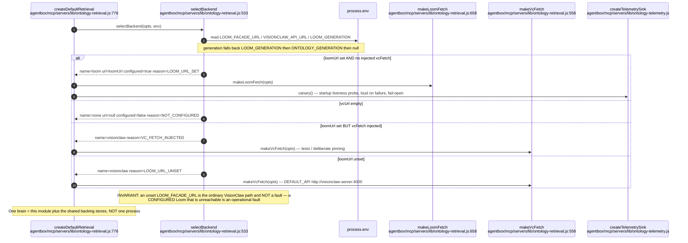

## AB-24.3 Loom-backed retrieval — /loom/search seed then /loom/sparql expand

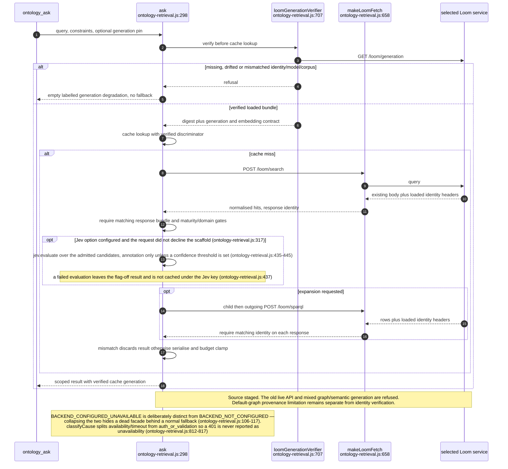

## AB-24.4 Cache key completeness and cache-hit constraint revalidation

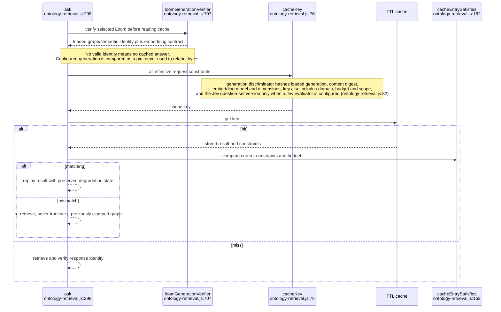

## AB-24.6 POST /v1/chat/completions — scaffold injection then delegate

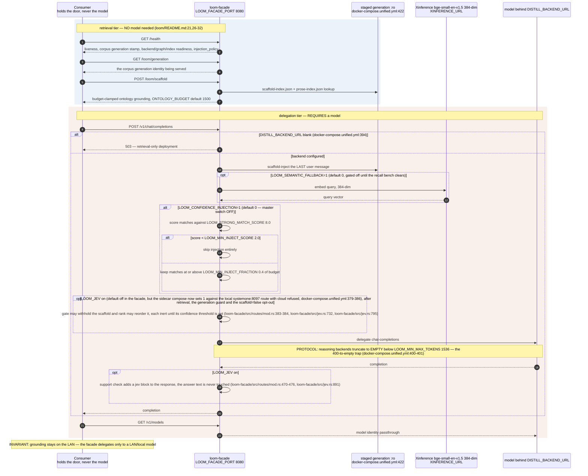

## AB-24.7 Model swap — zero consumer change

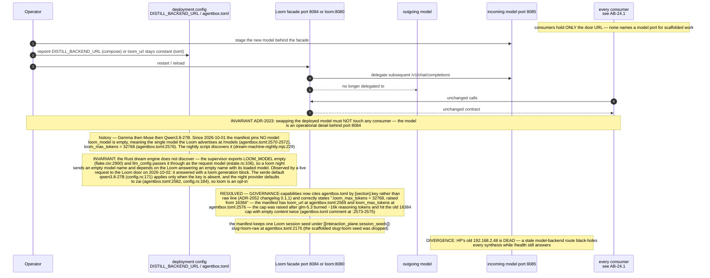

**Drift:** `../project/agentbox/docs/GOVERNANCE-capabilities.md:316` still names **Qwen3.8-27B** as the current model by `[dream_machine].loom_model`, which has been empty since `878f23311` (`../project/agentbox/agentbox.toml:2572`): the manifest now leaves the model to whatever the Loom advertises.

## AB-24.8 Deployment B bring-up and the staging traps

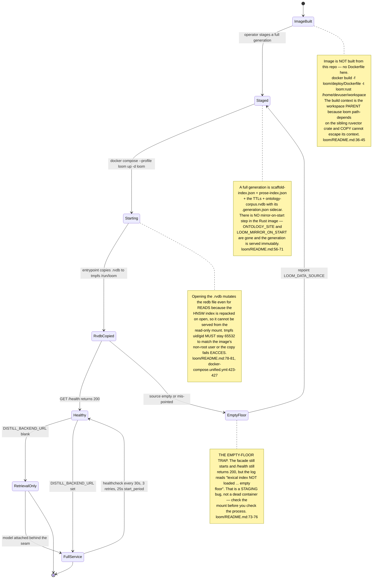

## AB-24.9 Consumer register — which door each one holds

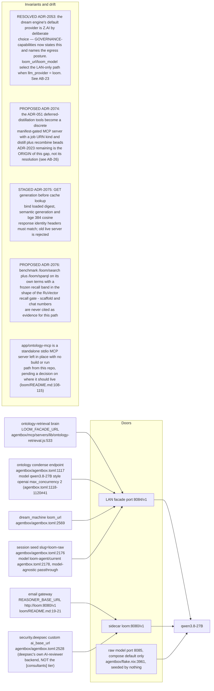

## AB-24.10 ADR-2084 - five callers, one published client

```mermaid
flowchart TB
    subgraph before["Before: five hand-rolled chat-completions clients"]
        B1["each knew a DIFFERENT subset of the same three traps<br/>ADR-2084-one-published-loom-client-for-every-facade-caller.md:21-28"]
        B2["only dream-engine knew a facade can answer 200 with ontology prose<br/>and never call the model"]
        B3["only loom-draft knew about truncation retries and the ADR-139 assertion"]
        B4["only agentbox-mcp floored max_tokens, so the others could ask a<br/>reasoning model for 400 and read empty content as success"]
        B1 --> B2 --> B3 --> B4
    end
    subgraph after["After: the loom-client crate, published from the loom repository"]
        C1["dream-engine call_loom<br/>agentbox/services/dream-engine/src/llm.rs:205"]
        C2["podcast-ingest extraction<br/>agentbox/services/podcast-ingest/src/ingest/loom.rs:34"]
        C3["podcast-ingest promotion<br/>agentbox/services/podcast-ingest/src/promote/loom.rs:69"]
        C4["explainer-loom-draft<br/>agentbox/services/explainer-tools/src/bin/loom_draft.rs:22"]
        C5["web-summary MCP server<br/>agentbox/services/agentbox-mcp/src/web_summary/llm.rs:65"]
    end
    B4 --> C1
    C1 --> C2 --> C3 --> C4 --> C5
    subgraph knows["What the one place now knows"]
        direction TB
        K1["INVARIANT ADR-2084: hand-rolled chat-completions construction against a<br/>facade is PROHIBITED - a sixth caller takes the crate<br/>ADR-2084-one-published-loom-client-for-every-facade-caller.md:37"]
        K2["verbatim and scaffold are INDEPENDENT switches. Three callers sent only<br/>the first and agentbox-mcp sent neither, so a page summary could be<br/>answered from the ontology without the page being read<br/>ADR-2084-one-published-loom-client-for-every-facade-caller.md:30-33"]
        K3["a reasoning model truncated below 1536 tokens returns EMPTY content,<br/>not a short answer - web_summary/llm.rs:20 floors every ask and<br/>web_summary/llm.rs:63 clamps the caller's number up to it"]
        K1 ~~~ K2 ~~~ K3
    end
    C5 -.-> knows
```

**Invariant:** the web-summary path clamps every request to at least 1536 tokens and is pinned by `max_tokens_is_always_clamped_to_at_least_1536` (`../project/agentbox/services/agentbox-mcp/src/web_summary/llm.rs:151`); a scaffold-only serve is reported as a failure, not an answer (`../project/agentbox/services/agentbox-mcp/src/web_summary/llm.rs:198`).

## AB-24.11 ADR-139 - the per-request scaffold opt-out

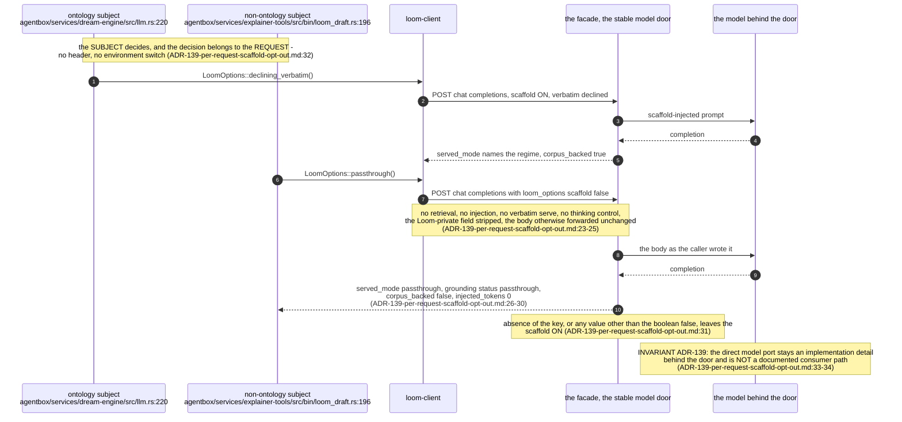

**Debt:** grounding applied to a subject the ontology does not cover is a WRONG answer, not a weak one: on 2026-09-09 a packet about a test script scored the blockchain class Node at 42 and was served from the corpus in 40 ms with zero completion tokens (`../loom/docs/design/ADR-139-per-request-scaffold-opt-out.md:13-16`), which is why `../project/agentbox/services/explainer-tools/src/draft.rs:4` declines the scaffold on every request.

## AB-24.12 ADR-140 — a third door, same gate: the agentic MCP plane

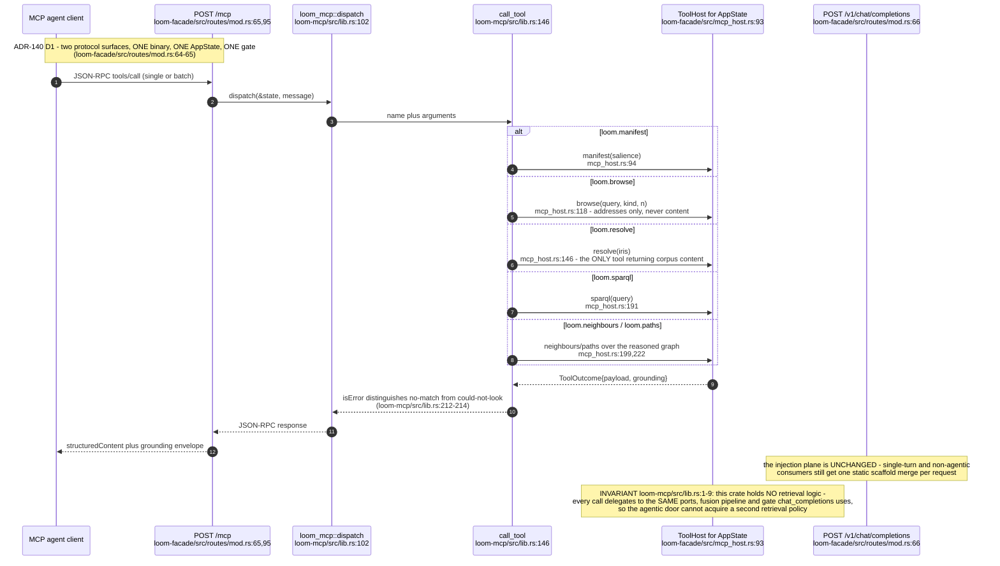

**What it shows:** `/mcp` (ADR-140 D1) puts a JSON-RPC tool surface beside `/v1/chat/completions` in the same `loom-facade` binary, dispatching six tools (`loom.manifest`, `loom.browse`, `loom.resolve`, `loom.sparql`, `loom.neighbours`, `loom.paths`) through the one `ToolHost` implementation the chat plane's scaffold assembly also uses. **Why it is this way:** ADR-139's incident — a static scaffold fragment served the blockchain class `Node` to a consumer discussing a test script — is, per [Evo] (arXiv:2609.15779, cited ADR-140 §1), the generic failure mode of pre-reasoning static injection; per-turn tool-driven retrieval is the ecosystem's answer, and Loom ships it as a second surface rather than replacing the first because non-agentic consumers (the email gateway, single-turn lookups) have nothing to drive a tool loop with.

## AB-24.13 ADR-141 — the served generation becomes `visionGraph@sha`, and a governance ledger route lands

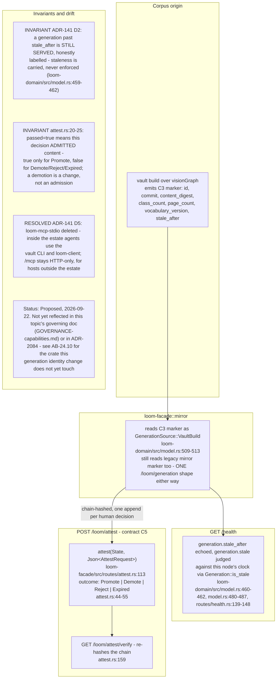

**What it shows:** the corpus stops being GitHub-published; `loom-facade::mirror` now recognises a `vault build` marker (`GenerationSource::VaultBuild`) naming the generation `visionGraph@<sha>`, and `/health` reports a `stale_after` promise plus this node's own staleness judgement without ever refusing to serve. A `POST /loom/attest` route gives the corpus's human promotion/demotion decisions a chain-hashed, restart-surviving ledger. **Why it is this way:** ADR-141 fixes the gap ADR-140 §1.3 measured — a Loom bundle stale by a month against the vault it should mirror — and, per ADR-136 D5, moves `AttestationLedger` from a build/CI-time port to a serving-path writer so `passed` on an entry answers "is this in the corpus because someone said so", the one question the audit trail exists for.

**Debt (corpus door behind the vault, 2026-10-02):** the next generation `visionGraph@015ca2c1f` is built, promoted and verified, but the door still serves `visionGraph@ae913f93…`, and the `vault` 0.1.0 baked into the agentbox image predates the portable-records file, so it cannot produce a promotable bundle (`../loom/docs/design/ADR-141-loom-consumes-the-vault-build.md:141-150`). The pin is fixed in source, since `vaultSrc` now names VisionClaw `f3bbb430ea` (`../project/agentbox/flake.nix:31-32`), but that reaches a running `vault` only at the next image rebuild. ADR-141 also records that the corpus build is now `ontomark build` and `vault` survives only as the governance adapter, with the served identity unchanged (`../loom/docs/design/ADR-141-loom-consumes-the-vault-build.md:9`); AB-24.15 draws who publishes the generation now.

## AB-24.14 Custody X-1 step 1 at the Loom door — what the register and the env classes say

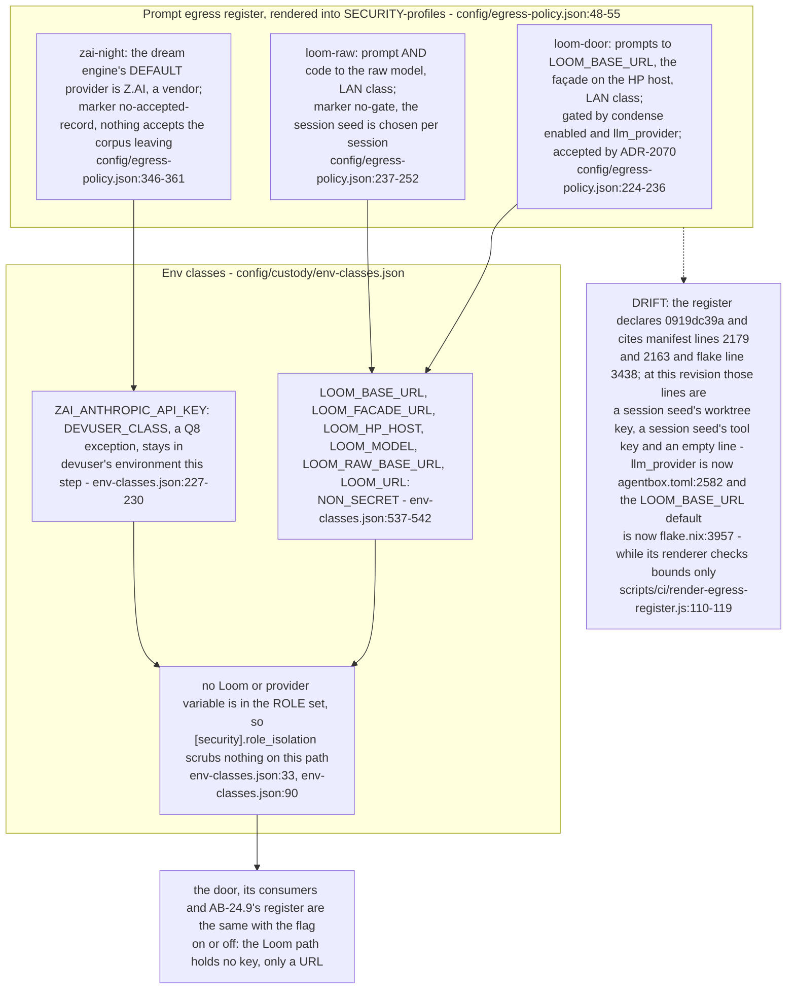

**Invariant:** the Loom path carries no secret: every Loom variable is classified `NON_SECRET`, and the only credential beside it, the Z.AI key the dream engine falls back to, is `DEVUSER_CLASS` by the Q8 exception (`../project/agentbox/config/custody/env-classes.json:537-542`, `../project/agentbox/config/custody/env-classes.json:227-230`). So custody X-1 step 1 changes nothing at this door in either mode.

**Drift (egress register vs the integration head):** the register is stamped `0919dc39a` (`../project/agentbox/config/egress-policy.json:51`), and its loom-door and zai-night rows cite manifest lines 2179 and 2163 and flake line 3438 (`../project/agentbox/config/egress-policy.json:231-232`, `../project/agentbox/config/egress-policy.json:355`). Those were the right lines at that stamp. At this revision the manifest has grown by more than three hundred lines since: line 2179 is a session seed's `worktree = true`, line 2163 is a session seed's `tool = "claude"` and `[dream_machine].llm_provider` is `agentbox.toml:2582` (`../project/agentbox/agentbox.toml:2582`); the façade default moved to `flake.nix:3957` (`../project/agentbox/flake.nix:3957`). The renderer's `--check` only tests that a cited line falls inside the file, so it cannot see the shift (`../project/agentbox/scripts/ci/render-egress-register.js:110-119`).

## AB-24.15 ADR-2140 — the vault stays here, the HP Loom serves a built generation reconciled at every boot

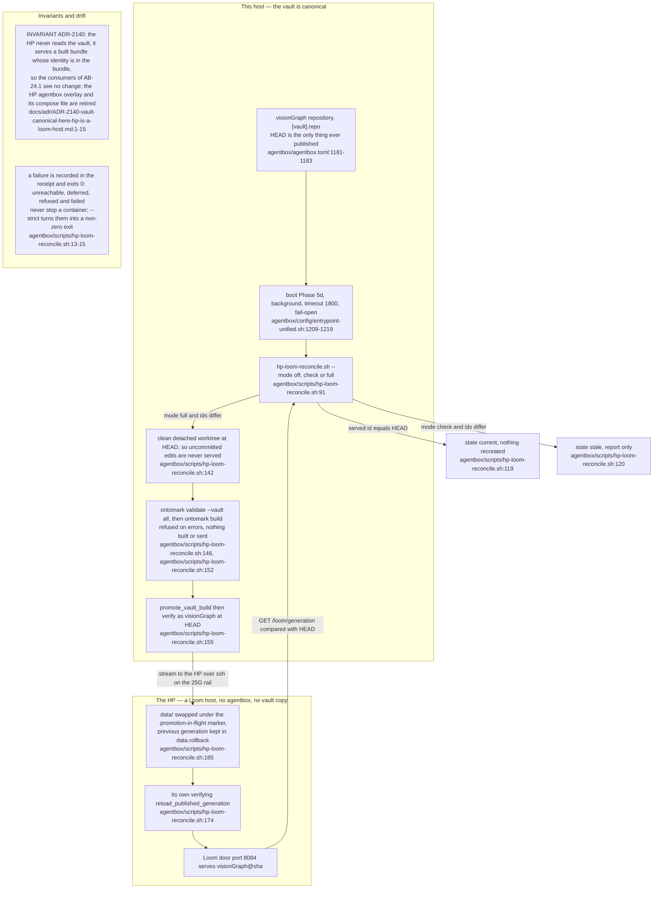

**What it shows:** how the generation behind the Loom door reaches the HP. Every boot starts `hp-loom-reconcile.sh` in the background; it compares the committed vault HEAD with the id `/loom/generation` reports and, in `full` mode only, builds that HEAD from a clean worktree, promotes and verifies the bundle, streams it to the HP, swaps it under an in-flight marker and waits for the door to report the new id (`../project/agentbox/scripts/hp-loom-reconcile.sh:119-120`). **Why it is this way:** on 2026-10-13 the HP held only the Loom's built bundle plus a second agentbox that had drifted from this node; ADR-2140 makes the vault canonical on this host and the reconcile the one publisher, so a vault change cannot silently leave the door serving yesterday's corpus (`../project/agentbox/docs/adr/ADR-2140-vault-canonical-here-hp-is-a-loom-host.md:1-15`). The Python reloader on the HP is gone: the Loom's verifying reload is the Rust `reload_published_generation` binary, and the served bundle under `data/` is no longer tracked in the Loom repository.

**Drift:** ADR-2140 is `accepted`, `complete` and `live` (`../project/agentbox/docs/adr/ADR-2140-vault-canonical-here-hp-is-a-loom-host.md:5-7`), but the governing document never mentions the boot reconcile, the `[vault].loom_sync` key or the retired HP agentbox, and its model-swap section still reads as if the generation were staged by hand (`../project/agentbox/docs/GOVERNANCE-capabilities.md:309-311`).

## Audit qualification - 2026-09-07

The execution pass implements consumer verification in `ontology-retrieval.js::loomGenerationVerifier`: GET generation before every cache lookup, compare the configured pin and loaded digest/model/corpus, and validate identity headers on search/SPARQL responses. The local Loom route implementation preserves response bodies and adds those headers. This source is staged: the live façade was probed and still reports lexical generation 2026-08-22 versus semantic 2026-08-17, without loaded identity/embedding fields. A coordinated bundle/server rollout is required before activating the stricter client. See [execution evidence](../../estate-review/closeout/2026-09-07-execution-agentbox.md). The graph loader still uses the shared default graph, so ADR-2073 remains open. Generation reporting is not an automatic corpus reload.
