## AB-27.1 ComfyUI — builtin loopback gate vs external sidecar integration

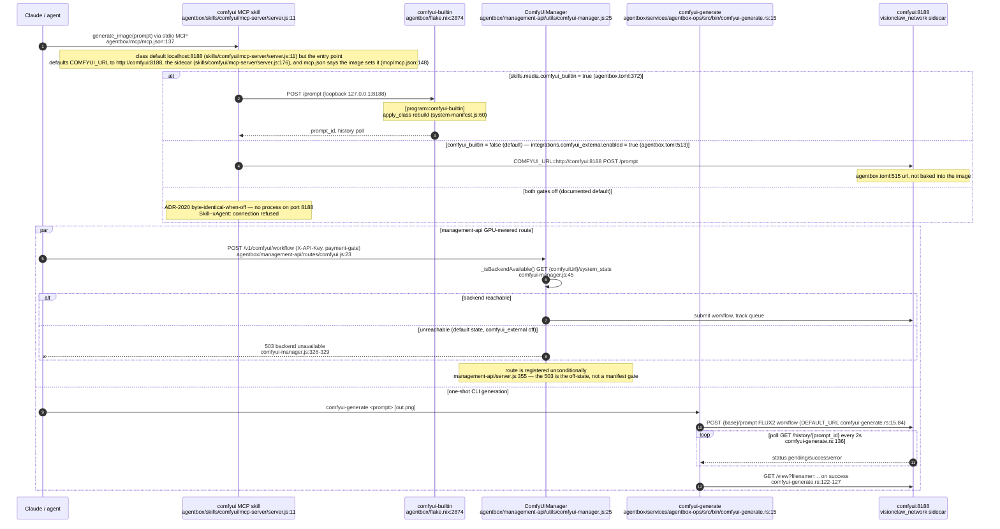

## AB-27.2 Blender MCP dispatch — proxy to the gui-tools GPU sidecar

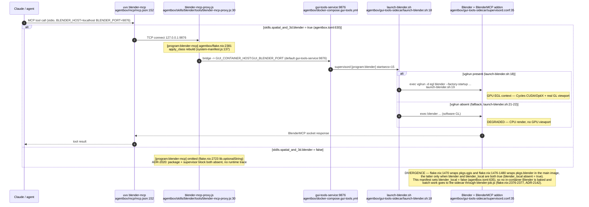

## AB-27.3 QGIS MCP dispatch — headless offscreen server in the same sidecar

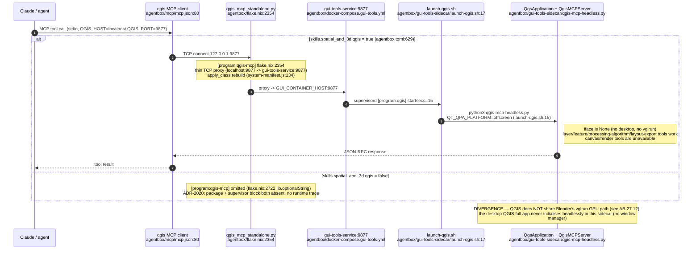

## AB-27.4 ImageMagick MCP dispatch — the 7 rmcp tools

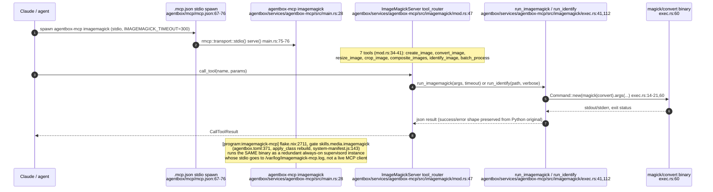

## AB-27.5 JupyterLab dispatch

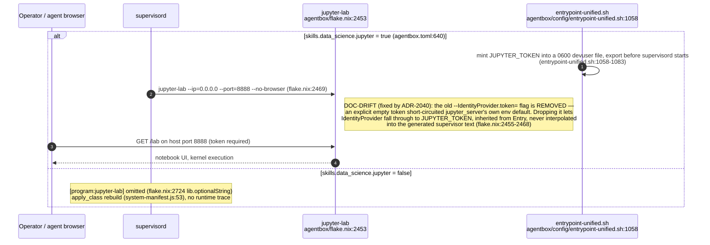

## AB-27.6 code-server dispatch

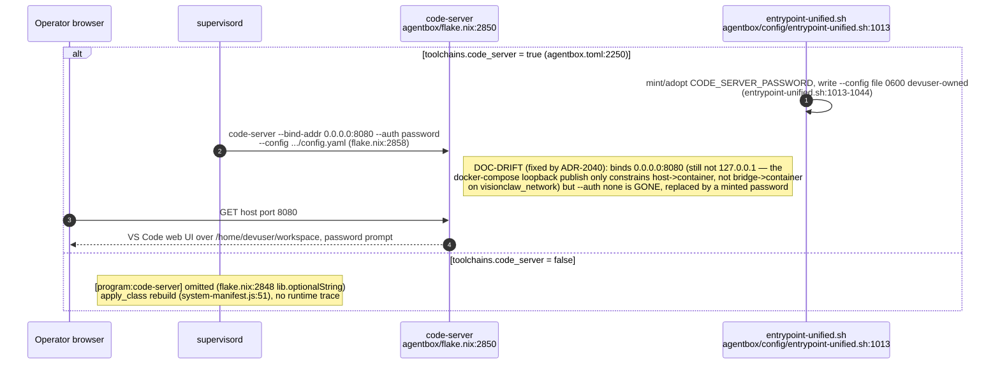

## AB-27.7 Voice / Unmute operator console dispatch — own-lifecycle sidecar

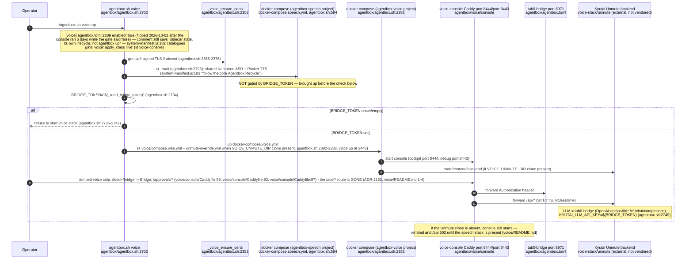

**Tension (ADR-2151 vs manifest):** ADR-2151 records edge voice as `decision_status: proposed`, `implementation_status: none`, `activation_status: inactive` (`../project/agentbox/docs/adr/ADR-2151-voicelink-edge-voice.md:5-7`), while the live manifest sets `[voicelink] enabled = true` and `record_events = true` (`../project/agentbox/agentbox.toml:2226`, `../project/agentbox/agentbox.toml:2233`); it is a separate path from the cockpit drawn here and is mapped in AB-12.

## AB-27.8 openmed clinical-PHI sidecar — triple fail-closed prerequisite gate

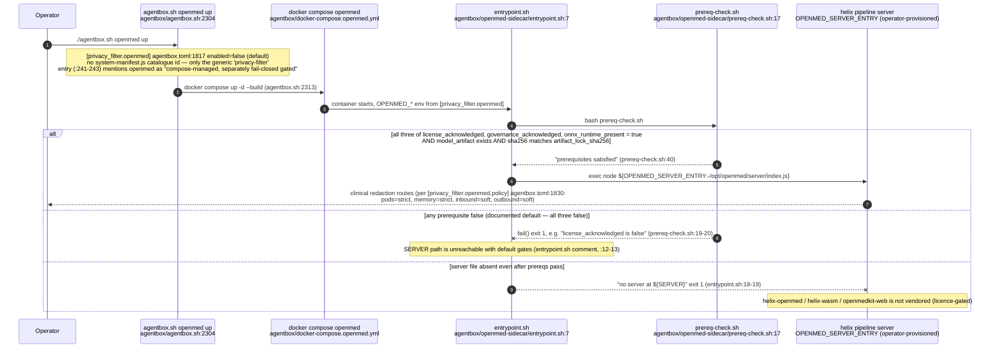

## AB-27.9 3D Gaussian Splatting / LichtFeld — two unrelated paths behind one skill name

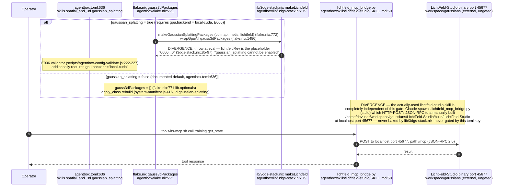

## AB-27.10 Supervision tree — media/GPU supervised programs, ports on the edges

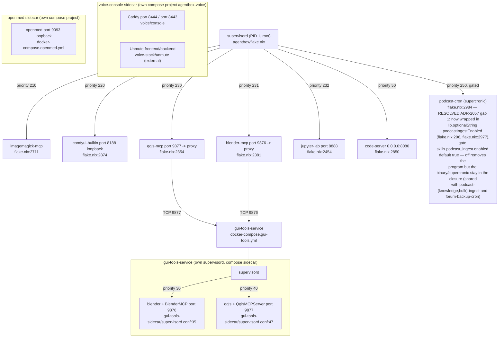

## AB-27.11 Manifest gate to apply_class — media/GPU capability catalogue

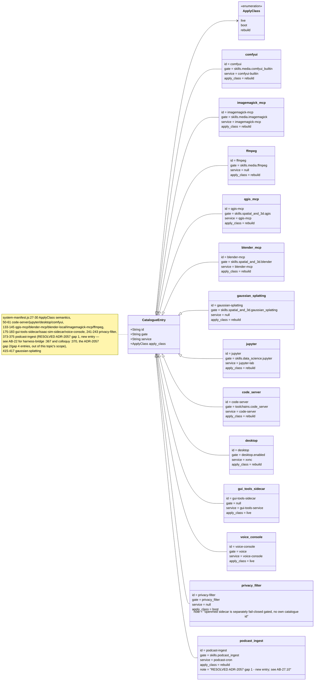

## AB-27.12 gui-tools sidecar GPU path — vglrun/nixGL, shared and unshared

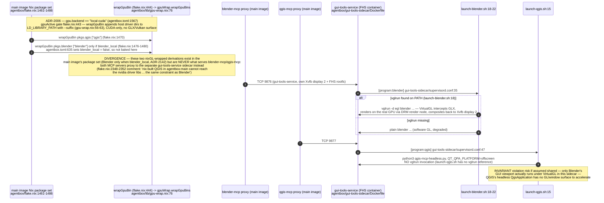

## AB-27.13 xr-runtime sidecar — Monado OpenXR plus Godot, behind Xvfb/VNC

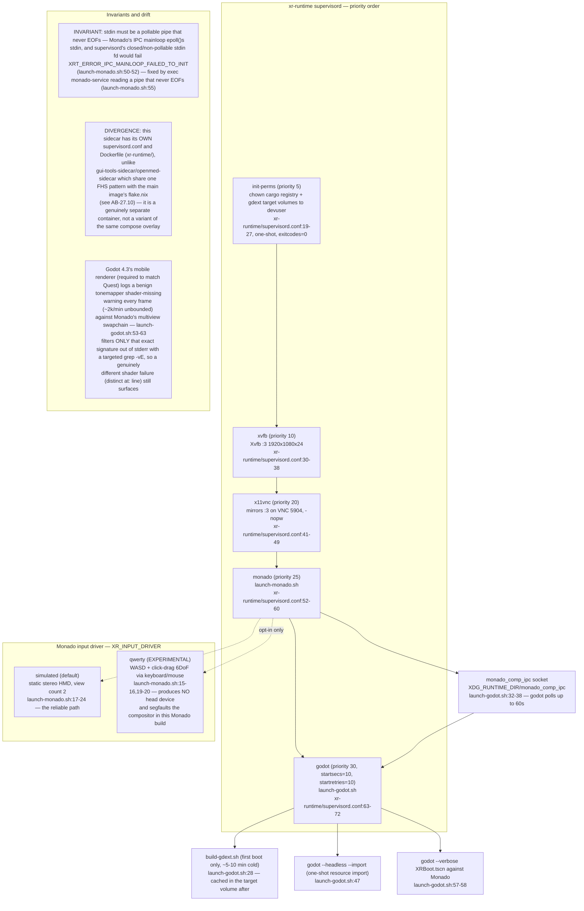

## AB-27.14 Isaac Sim sidecar — opt-in headless physics behind a typed job API

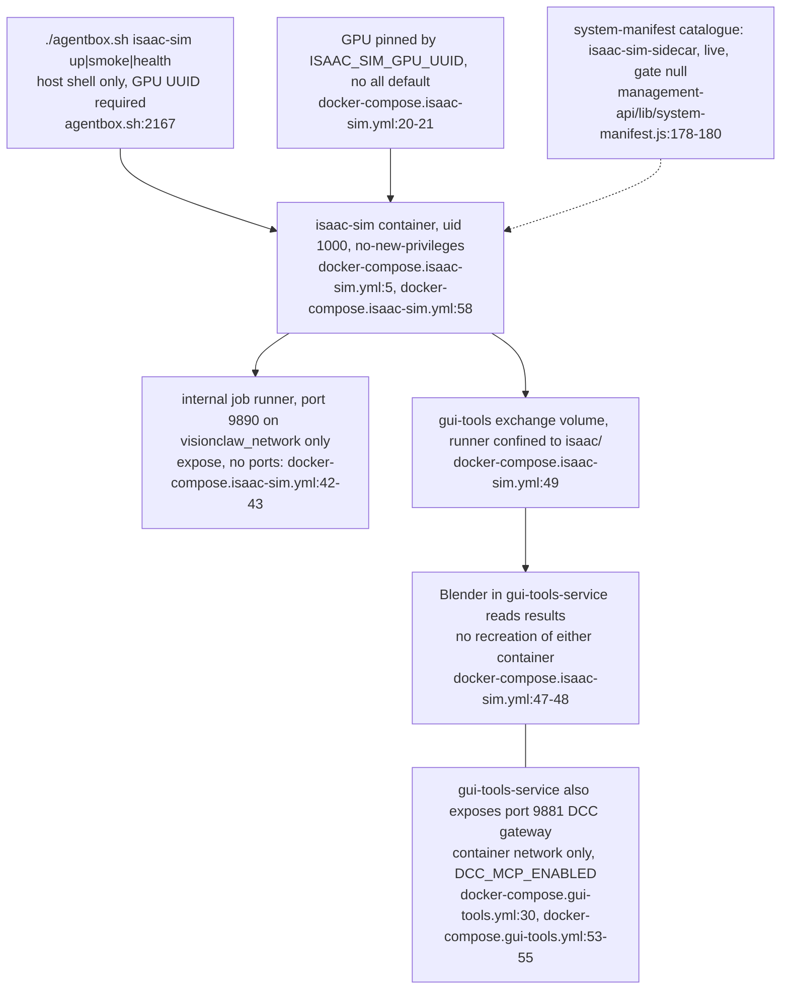

**Open:** ADR-2149 is recorded as `decision_status: proposed`, `implementation_status: partial`, `activation_status: staged`, so this sidecar is drawn as an opt-in design, not a running service; health beyond the control level becomes true only from a succeeded smoke job (`../project/agentbox/docs/adr/ADR-2149-isaac-sim-sidecar.md:5-7`, `../project/agentbox/docs/adr/ADR-2149-isaac-sim-sidecar.md:47-48`).

**Tension (ADR-2149 vs catalogue):** the ADR says the sidecar is live-class and ungated with no manifest section (`../project/agentbox/docs/adr/ADR-2149-isaac-sim-sidecar.md:29`), and the catalogue lists it as `apply_class: 'live'` with `gate: null` (`../project/agentbox/management-api/lib/system-manifest.js:178-180`); the decision itself is still `proposed`, so the catalogue already advertises a capability its record has not accepted.
