The [video measurement and provider audit](38-video-measurements-and-provider-boundaries.md) adds ADR-2150/2163 boundaries; the service traces below are re-read at this topic's own stamp and are not requalified by that audit.

## AB-27.1 ComfyUI — builtin loopback gate vs external sidecar integration

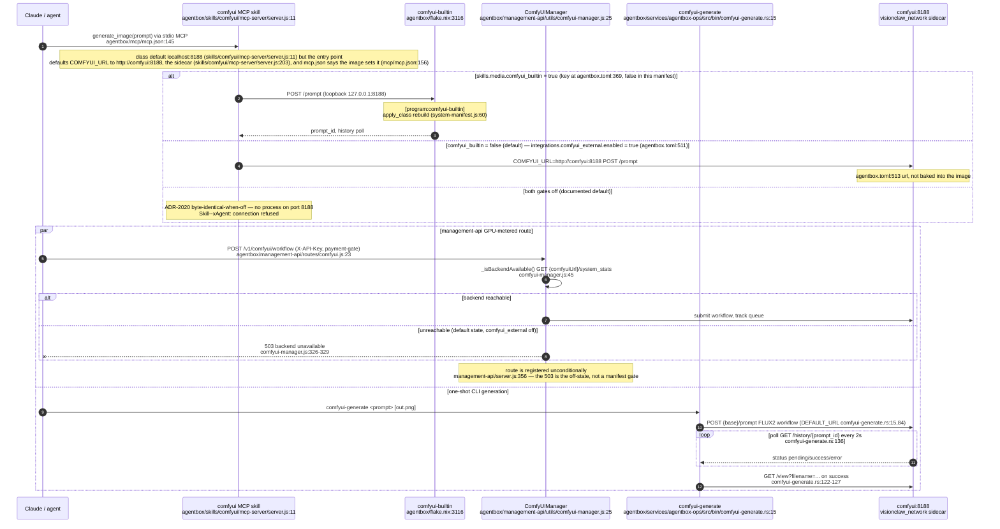

## AB-27.2 Blender MCP dispatch — proxy to the gui-tools GPU sidecar

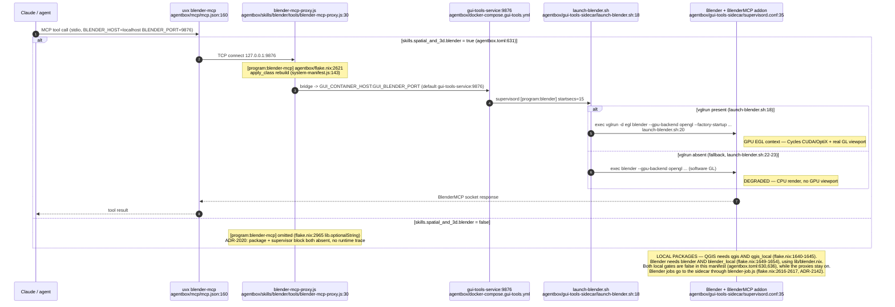

## AB-27.3 QGIS MCP dispatch — headless offscreen server in the same sidecar

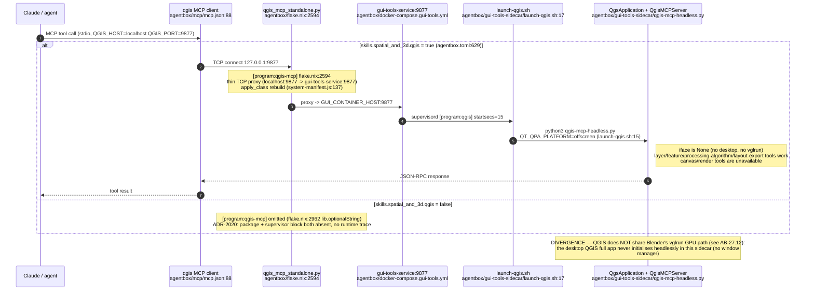

## AB-27.4 ImageMagick MCP dispatch — the 7 rmcp tools

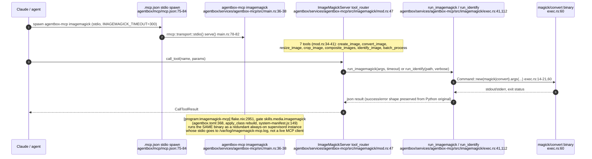

## AB-27.5 JupyterLab dispatch

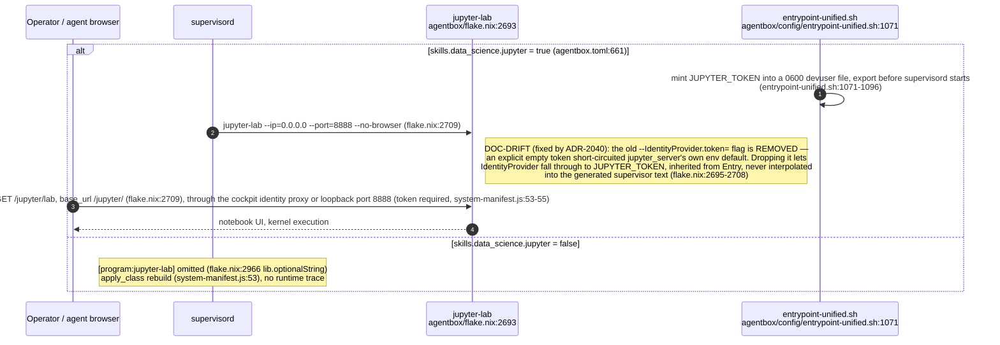

## AB-27.6 code-server dispatch

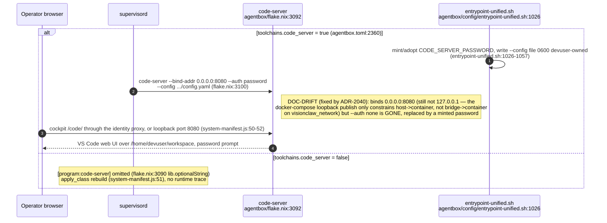

## AB-27.7 Voice / Unmute operator console dispatch — own-lifecycle sidecar

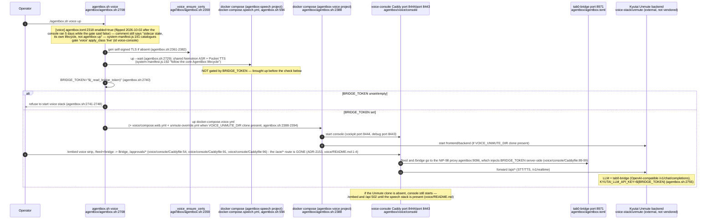

**Tension (ADR-2151 vs manifest, status moved 2026-11-02):** at the previous stamp (`c57d9c0`) ADR-2151 recorded edge voice as `decision_status: proposed`, `implementation_status: none`, `activation_status: inactive`. Its 2026-11-02 external review reconciliation moves implementation to `partial` because the source and the bake exist (`../project/agentbox/docs/adr/ADR-2151-voicelink-edge-voice.md:5-7`, `../project/agentbox/docs/adr/ADR-2151-voicelink-edge-voice.md:21`), which closes the implementation half; the decision is still proposed and activation inactive, and the ADR says acceptance is not inferred from the enabled flag (`../project/agentbox/docs/adr/ADR-2151-voicelink-edge-voice.md:21`). The live manifest sets `[voicelink] enabled = true` and `record_events = true` (`../project/agentbox/agentbox.toml:2335`, `../project/agentbox/agentbox.toml:2342`); it is a separate path from the cockpit drawn here and is mapped in AB-12.

**Resolved in source:** the voice Caddy header, catalogue and CLI now name the surviving voice and governance surface (`../project/agentbox/voice/console/Caddyfile:5-18`, `../project/agentbox/management-api/lib/system-manifest.js:190-192`, `../project/agentbox/agentbox.sh:595`). The separate compose-overlay header still has the retired AoE name (`../project/agentbox/docker-compose.voice.yml:1-9`); no session board route is restored.

## AB-27.8 openmed clinical-PHI sidecar — triple fail-closed prerequisite gate

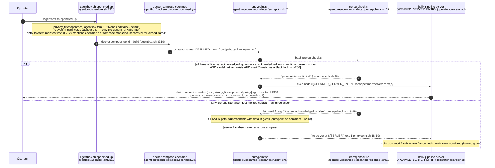

## AB-27.9 Gaussian-splatting preparation — COLMAP and METIS after LichtFeld retirement

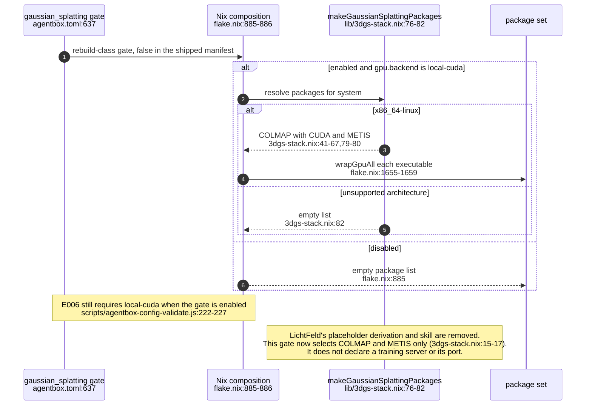

## AB-27.10 Supervision tree — media/GPU supervised programs, ports on the edges

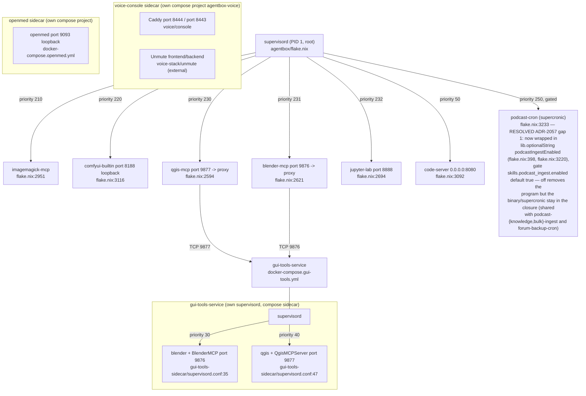

## AB-27.11 Manifest gate to apply_class — media/GPU capability catalogue

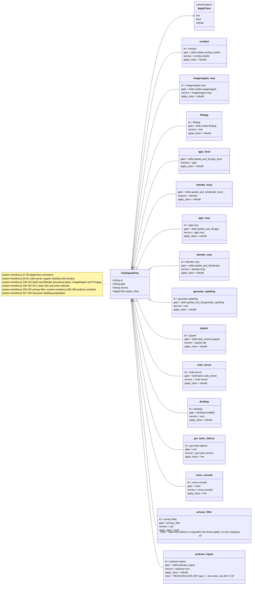

## AB-27.12 GUI sidecar and optional local packages — separate GPU paths

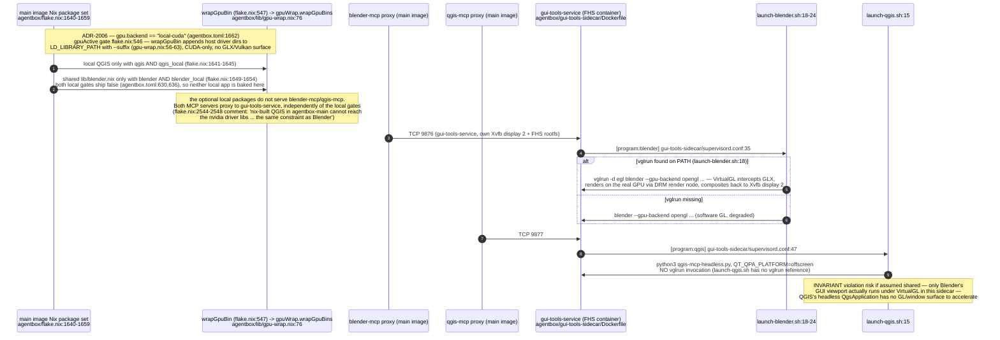

## AB-27.13 xr-runtime sidecar — Monado OpenXR plus Godot, behind Xvfb/VNC

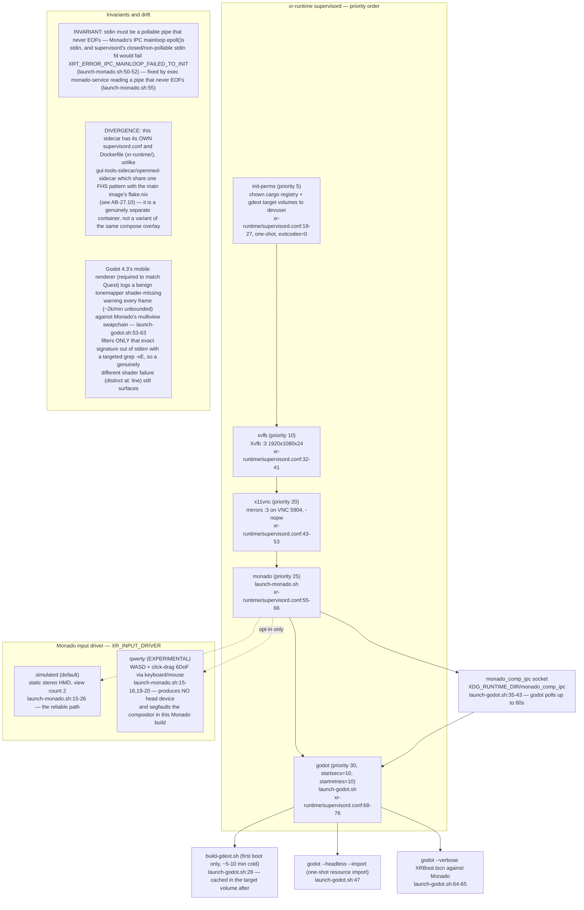

## AB-27.14 Isaac Sim sidecar — opt-in headless physics behind a typed job API

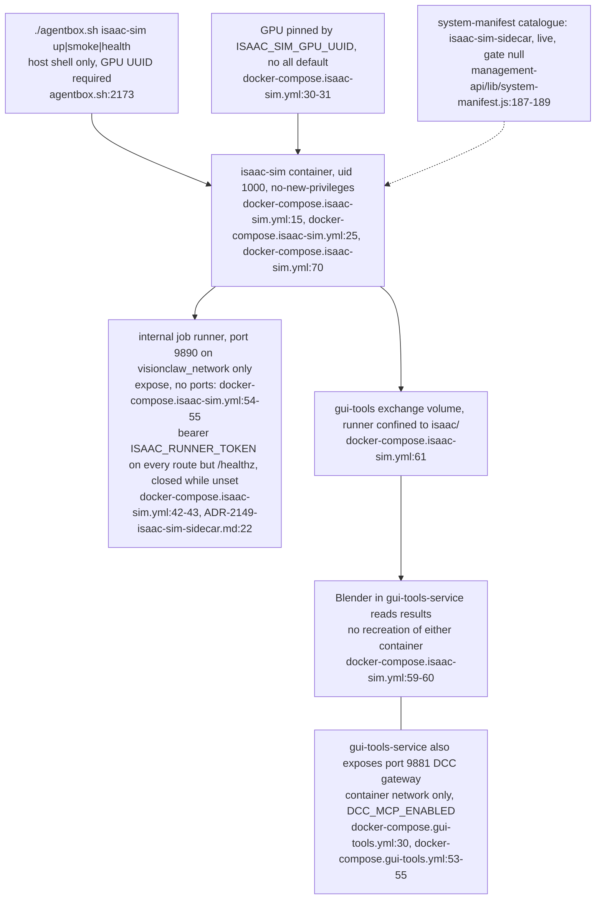

**Open:** ADR-2149 is recorded as `decision_status: proposed`, `implementation_status: partial`, `activation_status: staged`, so this sidecar is drawn as an opt-in design, not a running service; health beyond the control level becomes true only from a succeeded smoke job (`../project/agentbox/docs/adr/ADR-2149-isaac-sim-sidecar.md:5-7`, `../project/agentbox/docs/adr/ADR-2149-isaac-sim-sidecar.md:55-56`).

**Tension (ADR-2149 vs catalogue):** the ADR says the sidecar is live-class and ungated with no manifest section (`../project/agentbox/docs/adr/ADR-2149-isaac-sim-sidecar.md:37`), and the catalogue lists it as `apply_class: 'live'` with `gate: null` (`../project/agentbox/management-api/lib/system-manifest.js:187-189`); the decision itself is still `proposed`, so the catalogue already advertises a capability its record has not accepted. ADR-2149's 2026-11-02 reconciliation keeps that shape on purpose: Decision 1 holds the sidecar live-class and outside agentbox.toml, the record stays proposed/partial/staged pending the named build and simulator fixtures, and no isaac-sim container was running at its read-only inventory (`../project/agentbox/docs/adr/ADR-2149-isaac-sim-sidecar.md:24`).

**Blender release boundary:** the Linux x64 local derivation and GUI build share the checksum-pinned 5.3.0 archive; other platforms retain the native package (`../project/agentbox/lib/blender-release.json:2-5`, `../project/agentbox/lib/blender.nix:1-12`). Both GUI launch branches request OpenGL explicitly for the VirtualGL/Xvfb path (`../project/agentbox/gui-tools-sidecar/launch-blender.sh:18-23`). ADR-2142 records a 12 November writable-layer activation and GPU fixture separately from the still-staged image rebuild; that installation is lost on container recreation until the replacement image is built (`../project/agentbox/docs/adr/ADR-2142-blender-runs-sidecar-first-the-in-container-binary-is-optional.md:248-259`). This review does not repeat that render.
