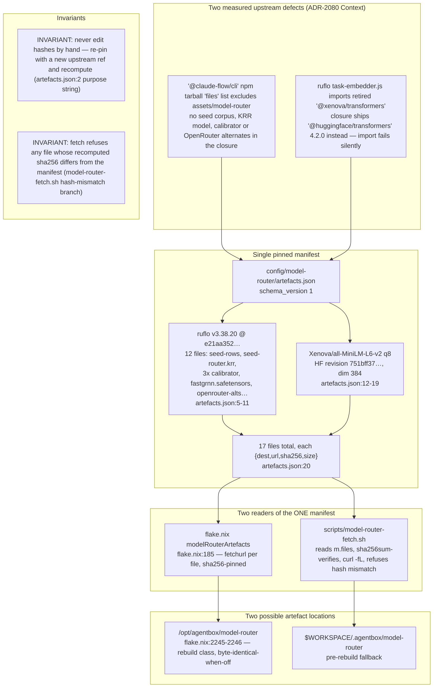
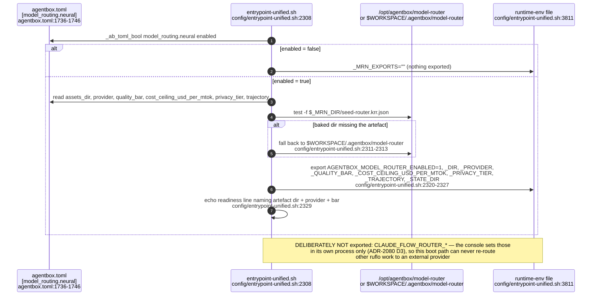
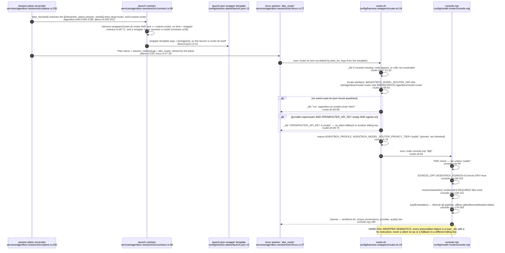
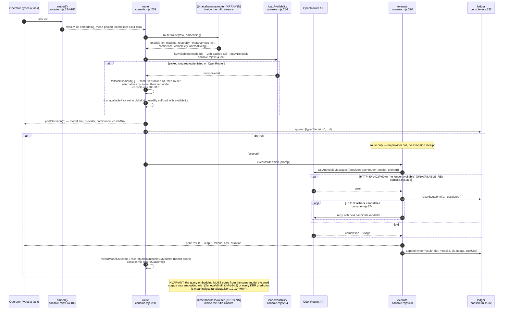
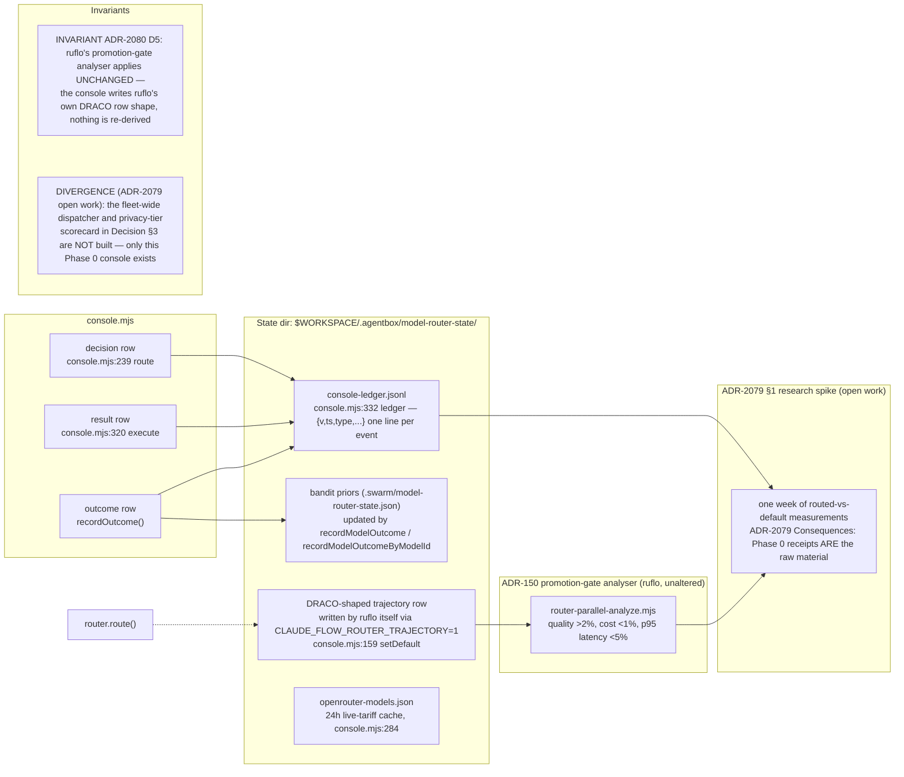
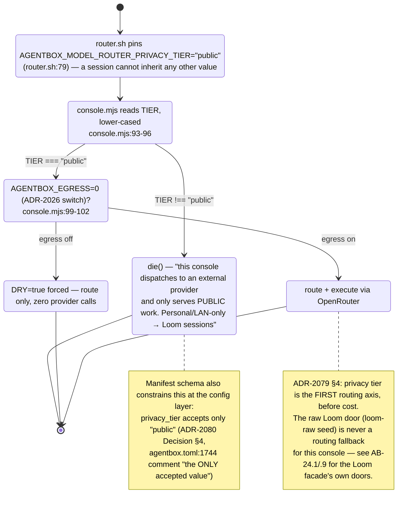
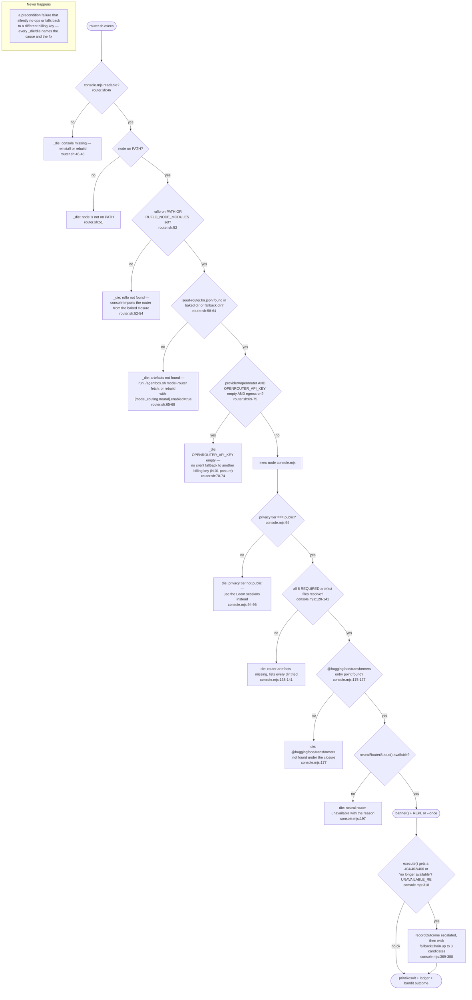
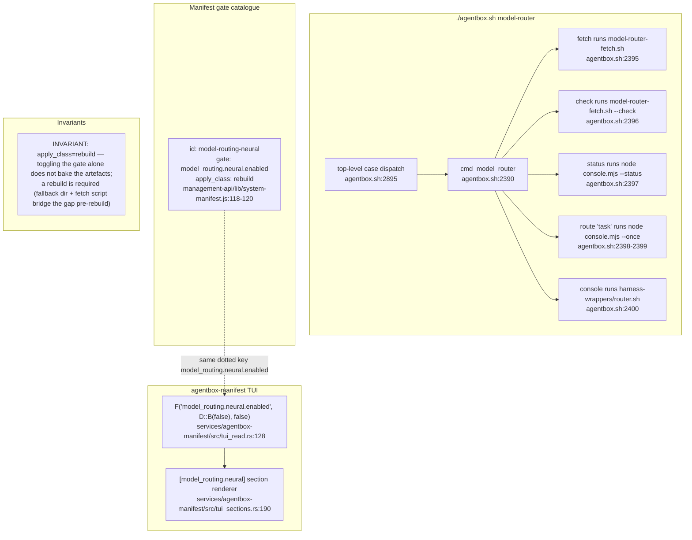
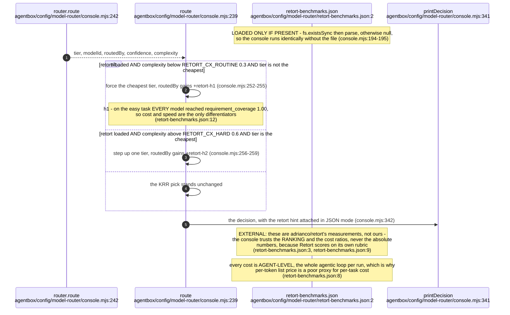

## AB-29.1 Composition — what is baked, and why the npm tarball lacks it

## AB-29.2 Boot env export — [model_routing.neural] to AGENTBOX_MODEL_ROUTER_*

## AB-29.3 Seed → wrapper → console sequence — a task typed in the agentbox-sessions `router` session

**Drift:** the Agent of Empires seeder this topic first drew (`scripts/aoe-seed-sessions.mjs`, `custom_agents.router`) is deleted, yet the wrapper header still says AoE registers and execs it (`../project/agentbox/config/harness-wrappers/router.sh:5-6`), as does the flake comment (`../project/agentbox/flake.nix:2244`) and the `agentbox.toml` seed comment "resolved by the seeder's WRAPPER_SLUGS" (`../project/agentbox/agentbox.toml:2187`).

**Tension (ADR-2079 vs ADR-2153):** ADR-2079, the AoE dispatch-plane record, is `superseded` by ADR-2153 (`../project/agentbox/docs/adr/ADR-2079-aoe-is-the-dispatch-plane-of-a-fleet-model-router.md:5-9`), which is now `accepted`, `implementation_status: partial`, `activation_status: live` and makes the router an ordinary seed (`../project/agentbox/docs/adr/ADR-2153-session-plane-replaces-aoe.md:5-7`, `../project/agentbox/docs/adr/ADR-2153-session-plane-replaces-aoe.md:75`), but its acceptance round trip excludes `router`, so only the clean launch above is evidenced, not a routed task (`../project/agentbox/docs/adr/ADR-2153-session-plane-replaces-aoe.md:65`).

## AB-29.4 Routing decision flow — embed, KRR predict, availability preflight, execute

## AB-29.5 Receipts, trajectory sink and the promotion-gate consumer

## AB-29.6 Privacy/public-only invariant — the tier gate at every layer

## AB-29.7 Failure modes — every hard-fail is loud, with a fix instruction

## AB-29.8 Surfaces — CLI, manifest catalogue gate and TUI field

## AB-29.9 Retort heuristics - external measurements bend the tier, never the price

**Invariant:** the Retort file changes only which tier is chosen; the quality bar, the cost ceiling and the privacy tier stay manifest values projected through `AGENTBOX_MODEL_ROUTER_*` (`../project/agentbox/agentbox.toml:1739`, `../project/agentbox/agentbox.toml:1743`, `../project/agentbox/agentbox.toml:1744`).

**Open:** the manifest now carries Retort's measured guidance as a comment on `quality_bar` (`../project/agentbox/agentbox.toml:1740-1742`) while the shipped default stays 0.50 (`../project/agentbox/agentbox.toml:1739`); nothing records whether the 0.25 to 0.35 band that comment recommends for routine work has been run against this estate's own corpus.
