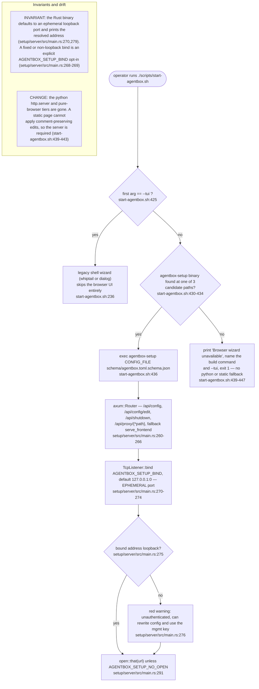
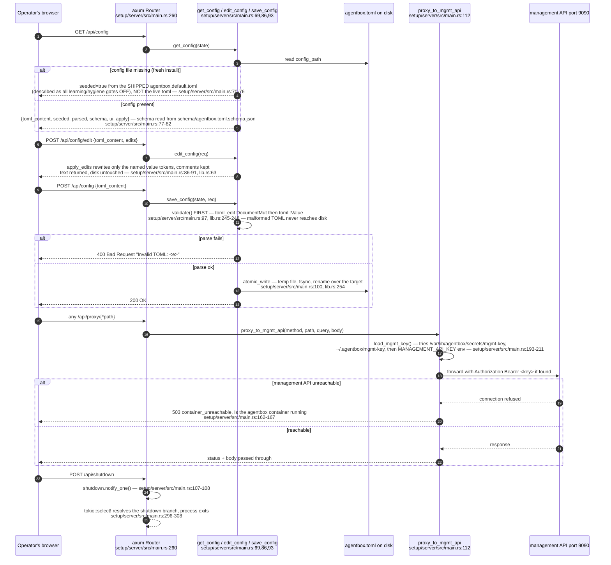
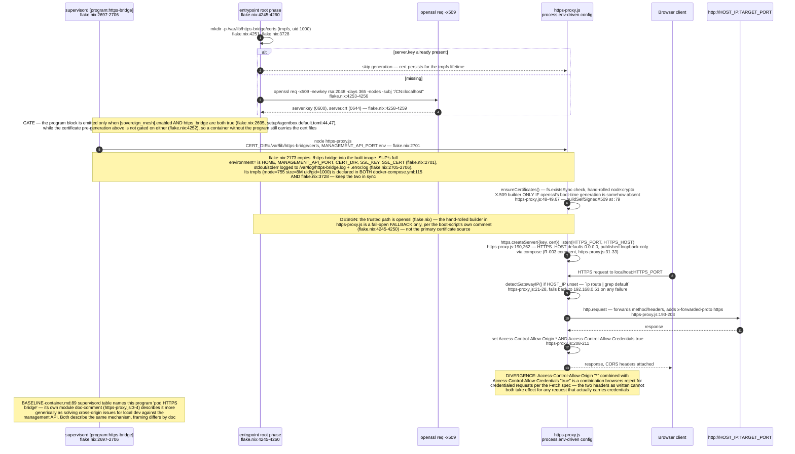

## AB-30.2 setup/server — compiled binary or nothing (legacy-ADR-024 D1 superseded in the launcher)

**Drift:** `docs/user/quickstart.md` still teaches the three-tier wizard, with a python `http.server` tier and a pure-browser drag-and-drop tier (`../project/agentbox/docs/user/quickstart.md:80-84`), and says no dependency is needed beyond Python 3 (`../project/agentbox/docs/user/quickstart.md:75`); the launcher now exits 1 without the compiled binary (`../project/agentbox/scripts/start-agentbox.sh:444-447`).

## AB-30.3 setup/server API surface — config round trip and the management-API proxy

**Drift (default seed vs its own claim):** the seed comment says every learning and hygiene gate ships off (`../project/agentbox/setup/server/src/main.rs:70-72`, repeated in the file header `../project/agentbox/setup/agentbox.default.toml:5-6`), but the shipped default sets `[memory_learning] enabled = true` (`../project/agentbox/setup/agentbox.default.toml:451`) and `[seo_watch] enabled = true` (`../project/agentbox/setup/agentbox.default.toml:845`), so a fresh-install operator is offered both already on.

## AB-30.4 https-bridge — self-signed TLS termination in front of a plain-HTTP target

