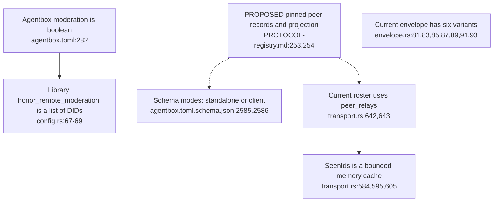
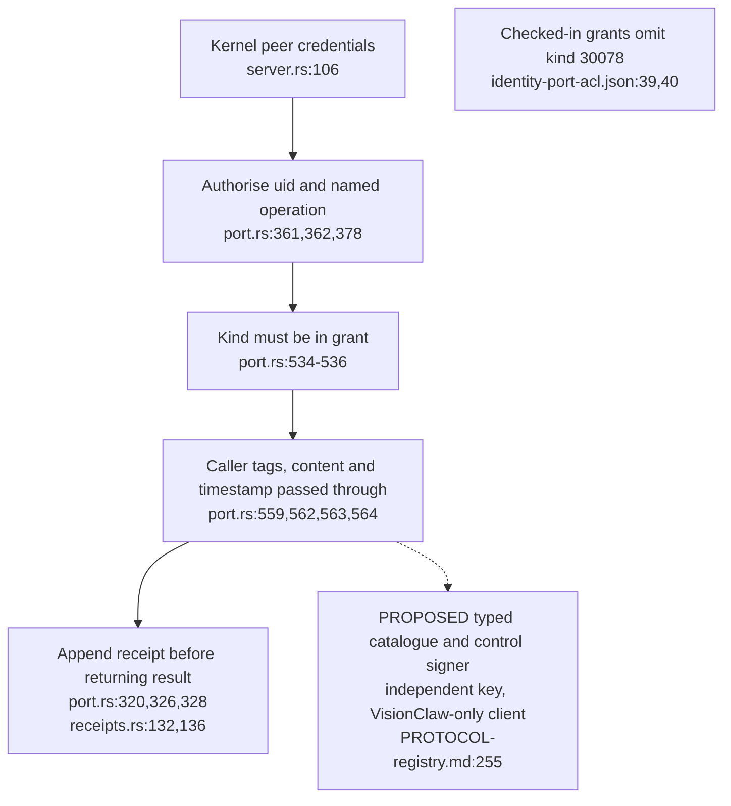
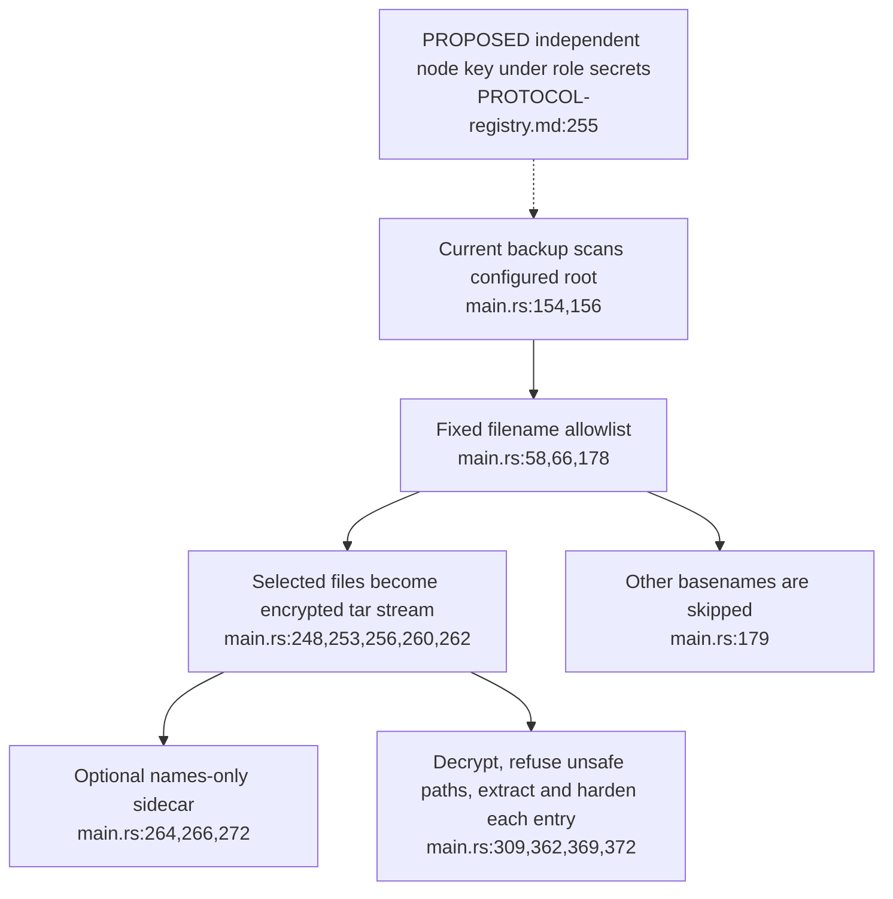
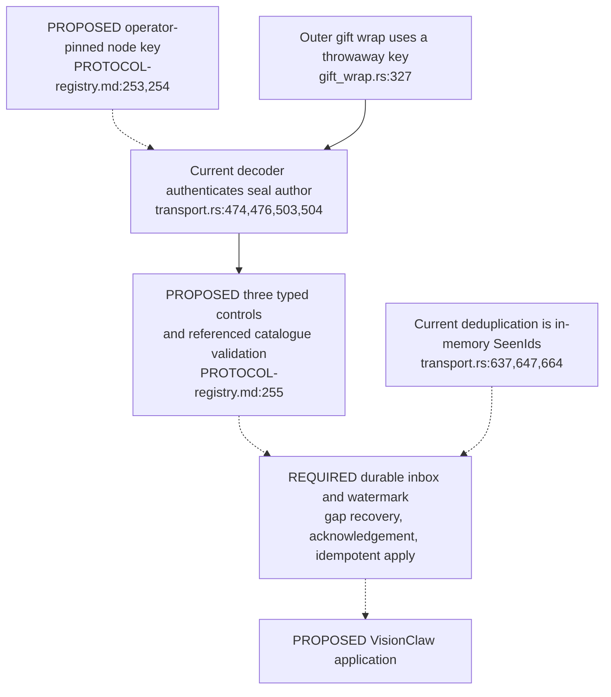

## For developers

The [mesh audit](../../estate-review/2026-11-01-mesh-signer-and-custody.md) runs 65 isolated tests against current modules and library APIs. Proposed nodes describe requirements; no mesh service or production signer was activated.

## For the business

Sharing spaces across nodes still needs compatible configuration, limited signing authority and reliable recovery. A signed event or successful local socket call alone does not prove that a peer applied a change or removed an old link.

## AB-37.1 Current configuration and codec do not implement the proposed peer contract

**What it shows.** Direct configuration reuse fails; current envelope parsing rejects all three proposed control types. **Why it is this way.** The proposal requires schema, codec and service integration beyond the existing library's relay roster and loop-prevention cache.

## AB-37.2 Current identity-port policy stops at account, operation, key and kind

**What it shows.** A synthetic 30078 grant signs an unrelated namespace with no revision; the current checked-in grant refuses that kind. **Why it is this way.** A generic kind allowlist does not enforce catalogue semantics, and UID authorisation requires an exclusive account to identify one workload.

## AB-37.3 Current backup selection is narrower than role-key custody

**What it shows.** Synthetic federation-key filenames are omitted even inside the scan root; selected configuration files still round-trip. **Why it is this way.** The backup tool deliberately uses a small allowlist. The proposed key needs explicit inclusion, recovery-state inventory and an off-host restore rehearsal.

## AB-37.4 Proposed control authority must become a durable delivery protocol

**What it shows.** Seal identity and a pinned peer are only the beginning of control admission; the durable queue remains a requirement. **Why it is this way.** Advancing a watermark before a missing lower-sequence retraction arrives can lose that command. Restart, ordering and restore tests must establish the complete delivery contract.
