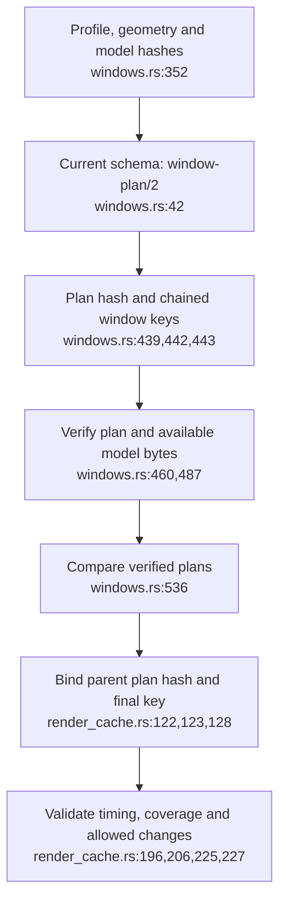
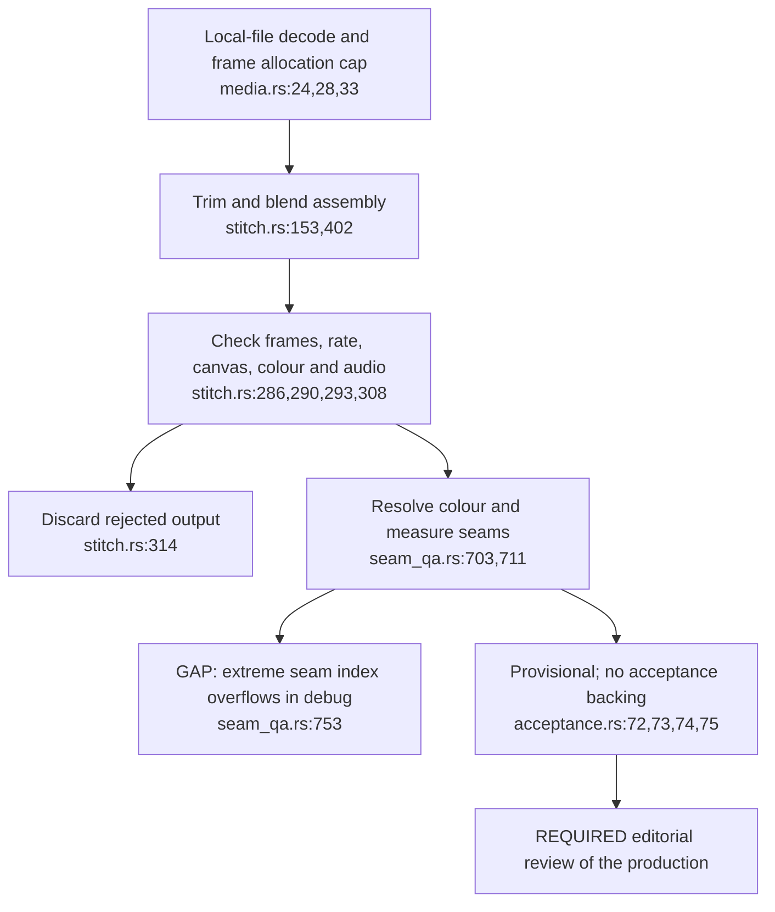
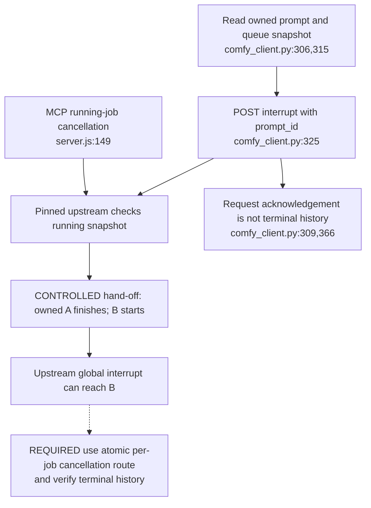
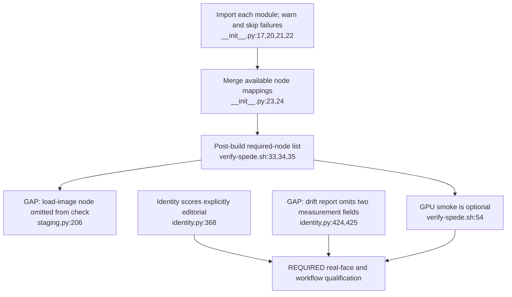

## For developers

The [media audit](../../estate-review/2026-11-01-media-measurements-and-cancellation.md) records 305 passing existing tests, two skips, four audit tests and three controlled cancellation cases. Live model, image-build and GPU qualification remain unrun.

## For the business

Measurements help an editor locate defects and repeat a bounded edit. They do not accept a film or prove that a model workflow runs on the installed GPU.

## AB-38.1 Window lineage constrains selective reruns

**What it shows.** Cache reuse binds the actual parent plan, not only equal frame counts. **Why it is this way.** A seed reroll changes that window and its successors; geometry or model-verification changes deliberately invalidate the broader plan.

## AB-38.2 File validation and measurements precede editorial review

**What it shows.** A supported file can pass technical checks and still need editorial judgement. **Why it is this way.** Thresholds are uncalibrated measurements; stale calibration claims are refused, and untagged YUV needs an explicit supported colour declaration.

## AB-38.3 ID-bearing interrupt still crosses a server race

**What it shows.** An ID in the request does not make the selected server operation atomic. **Why it is this way.** The [pinned upstream handler](https://github.com/Comfy-Org/ComfyUI/blob/faa7e494f3a0c9e45e1c3db8d20ee48fd5fe1b52/server.py#L1258) checks a snapshot before signalling; the audit reproduces the hand-off with controlled effects, without a live queue.

## AB-38.4 Registered nodes and measurements leave qualification work

**What it shows.** CPU tests and registration checks establish limited properties; neither executes the complete model workflow. **Why it is this way.** The staged image, real-face tests and live relay need separate evidence, and the registration list must cover every required node.
