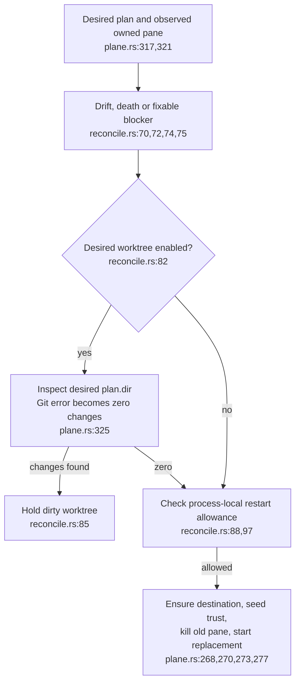
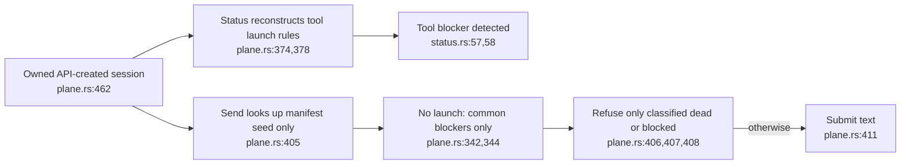
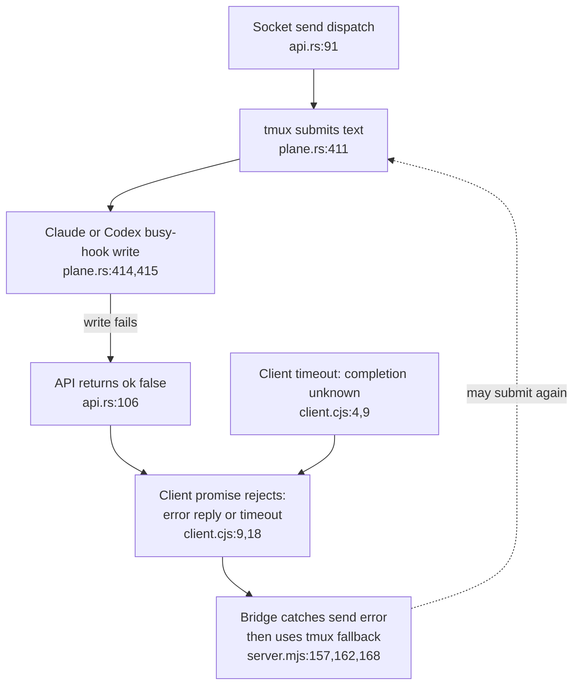
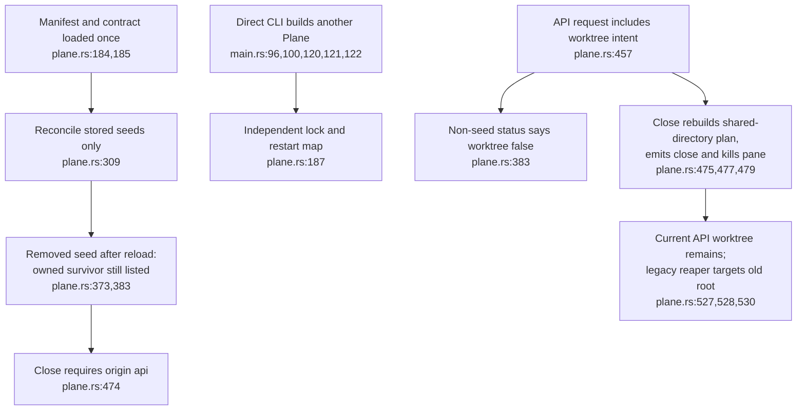
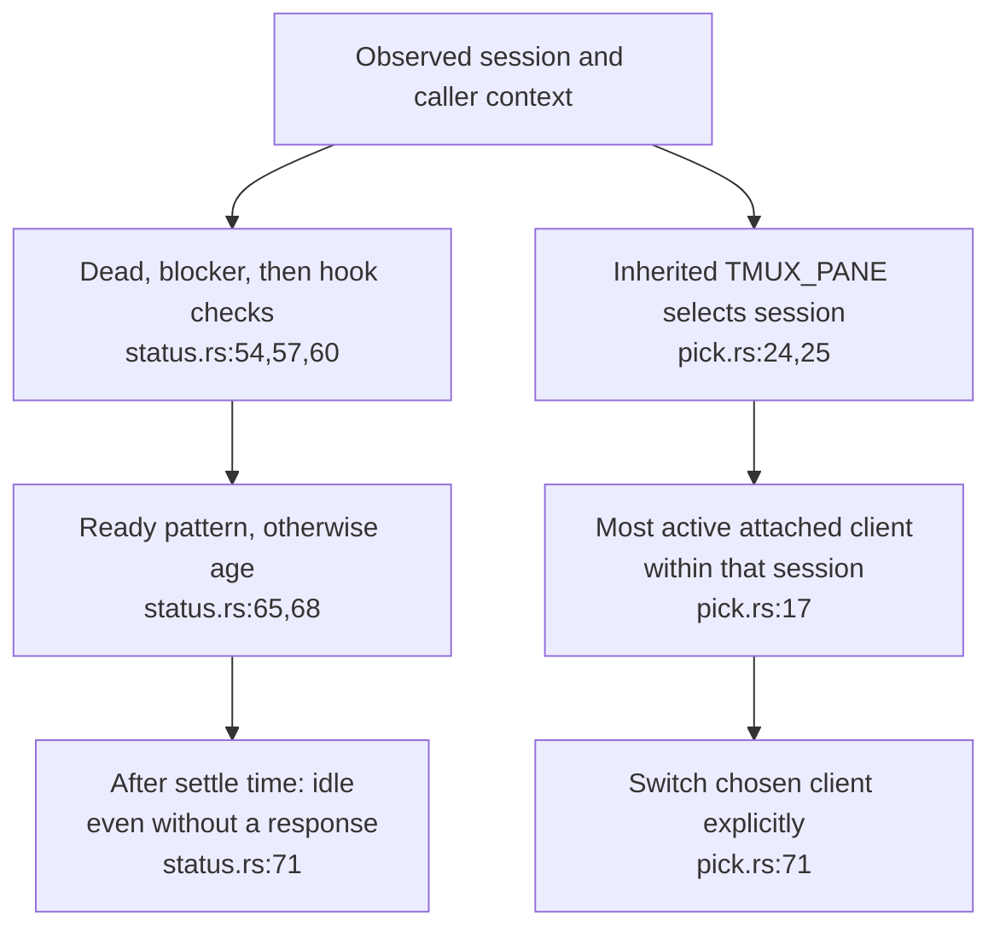

## For developers

The [session lifecycle audit](../../estate-review/2026-11-01-agentbox-session-lifecycle.md) retains seven private-tmux probes, a counterexample and exact source. These diagrams describe the native replacement service; Agent of Empires is retired. Passing defect probes do not establish fixes or provider acceptance.

## For the business

A running pane, a submitted command and a completed agent task are different states. Users need confidence that configuration changes preserve work and that a retry will not submit the same instruction twice.

## AB-39.1 Restart checks use the desired worktree

**What it shows.** A switch to the shared directory skips the worktree check, while a Git inspection failure looks clean. **Why it matters.** Both probes replace a process whose old worktree contains work. Files remain. A prefix-only move is a counterexample: Git refuses the already-checked-out branch before the old pane is killed. Foreign ownership and restart backoff still have separate holds.

## AB-39.2 Listing and sending classify API sessions differently

**What it shows.** An API tool's login pattern can appear in its blocked status row yet be absent from its send check. **Why it matters.** The native probe observes the dummy process consuming input. This is an authorised-caller guard inconsistency, not an ACL bypass.

## AB-39.3 Submission can precede failure and fallback

**What it shows.** The error response does not always mean input was withheld. **Why it matters.** The probe proves delivery followed by failure; duplicate bridge delivery is a source-supported consequence, not a live transmission performed by the audit. A delivery ID and staged receipt are needed before retry can be made reliable.

## AB-39.4 Controller and API worktree lifetimes diverge

**What it shows.** Restarting a controller reloads desired state without defining every surviving-session transition. API close also lacks a current-worktree cleanup contract. **Why it matters.** Orphaned work needs a visible owner and deliberate archive/cleanup policy. Managed configuration uses rebuild; this is not a claim that hot reload was promised.

## AB-39.5 Idle and explicit client targeting have narrower guarantees

**What it shows.** Idle can be a time-based fallback. Explicitly naming a selected client does not prove that it is the invoking client. **Why it matters.** Provider round trips and a two-client picker test must establish the stronger claims. The audit did not attach or switch an operator client.
