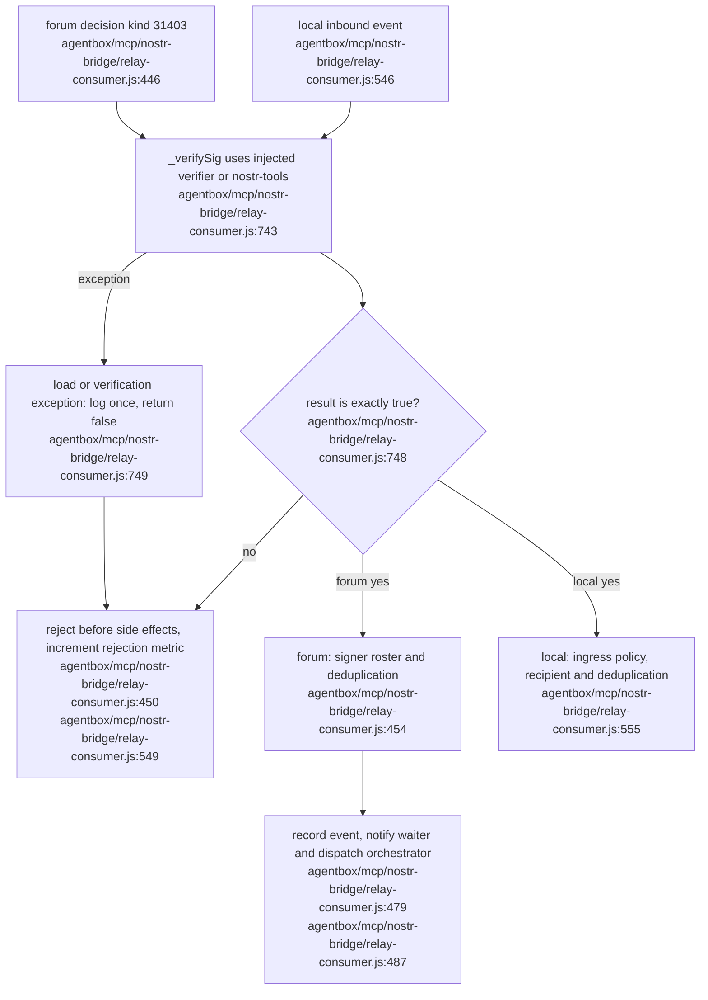

## For developers

This topic records the ABI-05 verification repair. Both the forum-governance and local inbound paths call _verifySig before dispatch. A verifier exception now rejects the event. The existing independent authority consumer already rejects verification exceptions at agentbox/management-api/lib/authority-consumer.js:159; consolidating rosters and ingress remains open.

## For the business

An unavailable signature checker must not turn an unverified decision into permission to act. This repair rejects those decisions. It is merged source, awaiting deployment; it does not certify a running container or complete the wider governance migration.

## AB-40.1 Verification must succeed before a decision has effects

- **What it shows:** explicit signature success precedes other gates and side effects. **Why it is this way:** dependency and verifier failures must reject, including injected test verifiers. **Open:** ABI-05 consumer/roster consolidation and deployment remain unverified; five regression tests include genuine signing and altered content at agentbox/tests/sovereign/relay-signature-failure.test.cjs:43.
