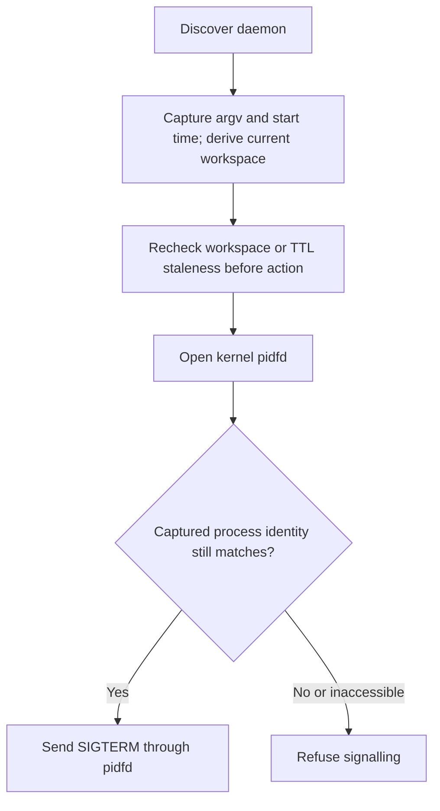
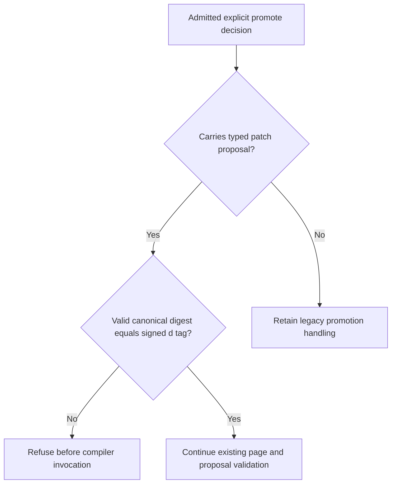
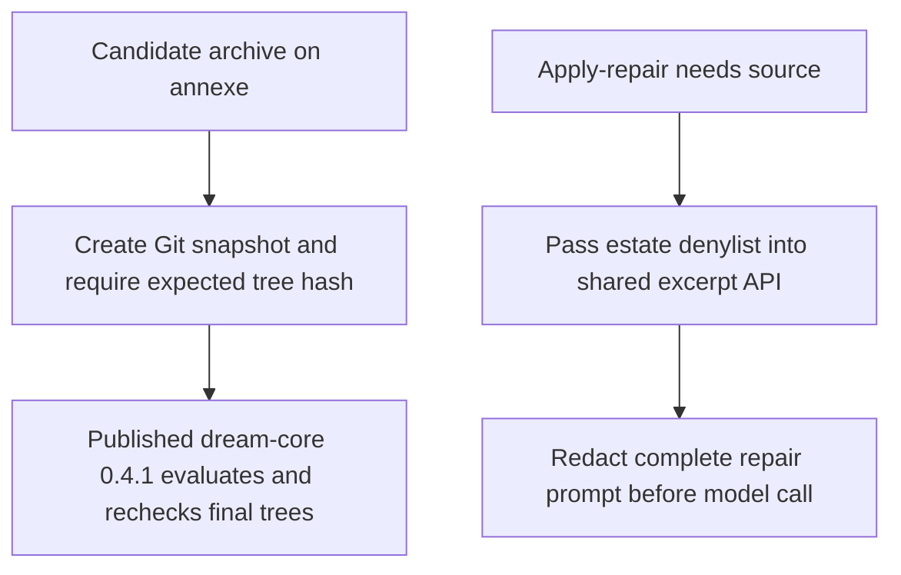

## For developers

This scoped successor covers the repaired reaper, explicit promotion digest and Dream host seams. Historical topics retain their declared revisions; unrelated findings are not closed here.

## For the business

The source now protects against signalling a replacement process, mismatching a promoted patch and evaluating an unidentified archive. Image activation and end-to-end governance delivery remain separate acceptance steps.

## AB-41.1 Pin a process before signalling it

**What it shows:** The reaper no longer treats matching launcher text as proof of the originally discovered process. The owned-child regression exercises refusal and successful pidfd signalling.

**Why it is this way:** ADR-2032 requires stable identity. Failure to open a pidfd fails closed, and delivery is not a claim of confirmed shutdown. The estate-wide signalling inventory remains partial.

## AB-41.2 Explicit promotion binds its typed proposal

**What it shows:** Explicit promote now applies the digest equality already used by approve, with controls for wrong, absent and empty digests and ordinary promotion success.

**Why it is this way:** ADR-2109 binds a human's decision to the proposed change. This panel does not claim grouped application, deployment or a general signer-roster gate on every non-ontology dispatch.

## AB-41.3 Supply the reusable core with verifiable host inputs

**What it shows:** The host adopts the registry release instead of copying formatter or source-scanner logic. The full adapter suite, including 11 whole-night tests, runs against registry checksums.

**Why it is this way:** ADR-2141 keeps reusable mechanisms upstream and estate policy in the adapter. A verified final tree does not sandbox evaluator commands, and local tests do not establish a live annexe run.
