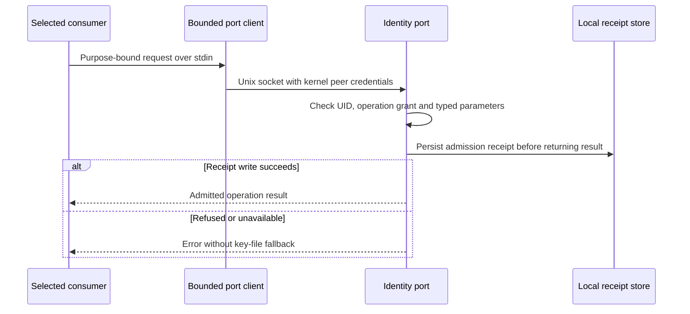
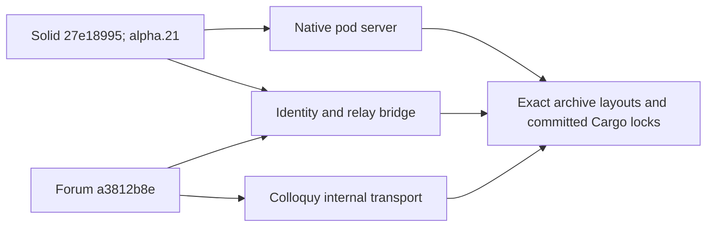
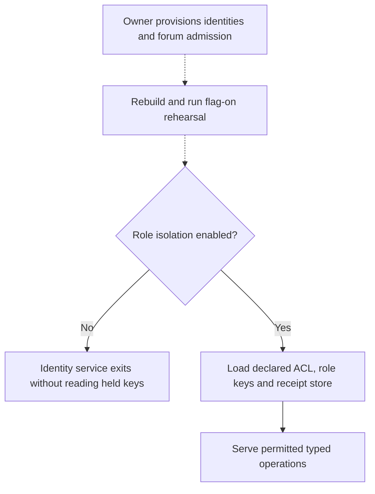

## For developers

This successor records W3b's source wiring and the paired dependency acceptance. AB-36 retains its historical verification; source readiness does not change the role-isolation activation decision.

## For the business

The selected callers can request narrow identity operations without receiving held keys. Owner provisioning, the flag-on rehearsal and deployment are still required before this becomes an active custody boundary.

## AB-42.1 Bounded calls reach the existing receipt boundary

**What it shows:** Typed wrap/open, forum sealing and governance operations use the existing held-key port and maintained signing primitives. This panel does not claim separate identities for callers sharing one UID.

**Why it is this way:** ADR-2122 separates purpose and key selection from runtime provisioning. A receipt precedes response release; it does not prove delivery to a remote relay.

## AB-42.2 Consumer source revisions move together

**What it shows:** The bridge and server share one Solid revision; both forum consumers share one forum revision. Native acceptance caught and repaired the internal Colloquy signing-key dependency mismatch.

**Why it is this way:** Immutable source hashes and lockfiles close the gap between sibling-workspace compilation and the packaged consumer. Nix parsing and native tests do not establish a completed image build.

## AB-42.3 Source readiness stops before owner activation

**What it shows:** The implementation retains flag-off compatibility. Source tests used temporary fixture keys; no live identity, host socket permission or browser vault changed.

**Why it is this way:** Custody activation needs the existing owner-run acceptance procedure. The source merge is not evidence that Docker access or ambient credentials have been restricted in the running estate.
