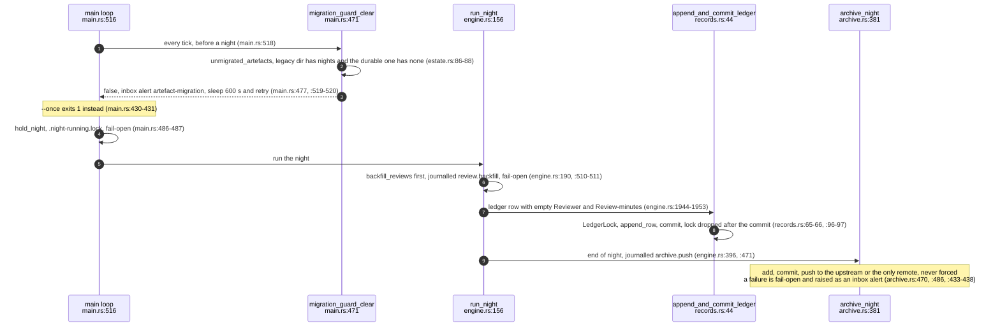
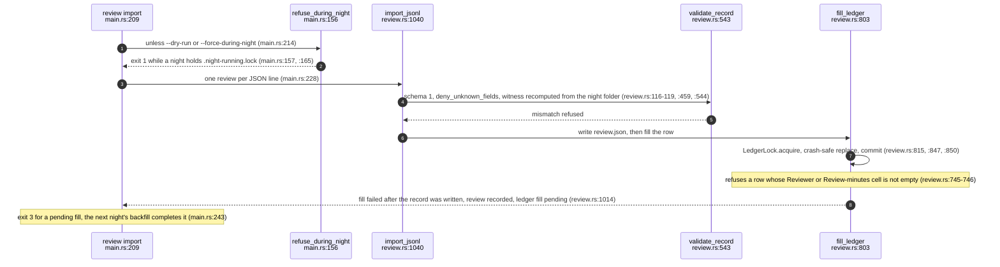
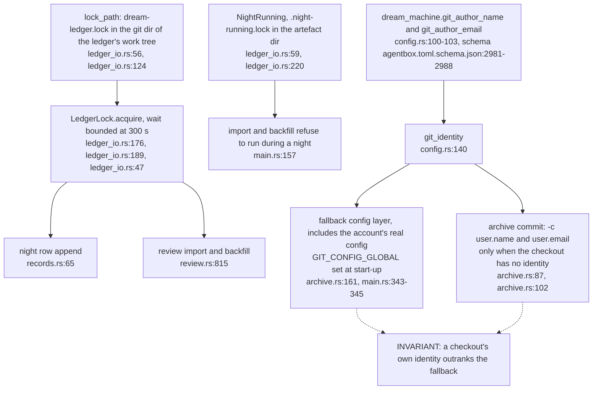
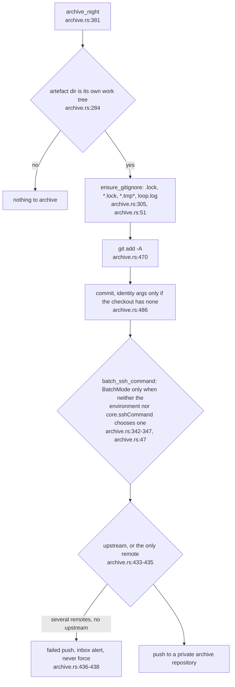

## For developers

ADR-2190 (merged in agentbox PR 43, 795fd6107) amends ADR-2087 point 5: the ledger's `Reviewer` and `Review-minutes` cells now come only from a night's `review.json`, every ledger writer takes one lock per ledger, night artefacts live in a durable directory that is committed and pushed each night to a private archive repository, a configured git identity is a fallback only, and a start-up guard refuses to dream over an un-migrated artefact directory. Read with AB-23 (the nightly loop) and AB-41.

## For the business

A nightly improvement is now reviewed on the record: a person's review is written down against that night's evidence and only then appears in the ledger, so the ledger can no longer claim a human looked at work an agent merged. The evidence for every night is kept and backed up off the machine.

## AB-43.1 One night: start-up guard, backfill, row, archive

**What it shows:** the order of a night after ADR-2190: the migration guard, the review backfill, the row written with empty human cells, and the archive commit and push. **Why it is this way:** the human cells could not be filled honestly from a merge event, because agents merge under the operator's account (comment at `engine.rs:1949-1951`).

**Invariant:** the night's own row never carries a reviewer: both cells are written empty (`../project/agentbox/services/dream-engine/src/engine.rs:1952-1953`) and are filled only by a later backfill from a validated record.

## AB-43.2 Recording a review: import, validate against the night, fill under the lock

**What it shows:** `dream-engine review import` validates each record against the night it names, writes `review.json`, and fills the ledger row under the same lock the night uses. **Why it is this way:** an import runs outside the loop's singleton lock, so without a ledger lock an import and a night could each rewrite the ledger and lose the other's change (ADR-2190 context).

**Open:** the record is explicit but not authenticated: `reviewer` is free text from the importing tool and the witness binds a review to a night, not to a person (`../project/agentbox/docs/adr/ADR-2190-dream-ledger-human-cells-come-only-from-recorded-reviews-and-night-artefacts-are-a-durable-archived-record.md:46`).

## AB-43.3 Locks and identity: who serialises on what

**What it shows:** one advisory lock per ledger shared by every writer, a separate night-in-progress lock that keeps manual imports out of a running night, and a configured identity that only fills a gap. **Why it is this way:** the estate gives checkouts their own identities on purpose, so the engine's identity may not override them (ADR-2190 decision, identity paragraph).

**Debt:** the ledger lock binds only processes that take it; the legacy `scripts/dream-machine-nightly.mjs` fallback and a loop built before this change rewrite the ledger without it (`../project/agentbox/docs/adr/ADR-2190-dream-ledger-human-cells-come-only-from-recorded-reviews-and-night-artefacts-are-a-durable-archived-record.md:52`).

## AB-43.4 The archive step: ignore list, SSH mode, push target

**What it shows:** the end-of-night archive commits whatever the ignore list admits and pushes it to the checkout's own remote. **Why it is this way:** night artefacts were in a temporary directory and nights before 6 October 2026 were lost; the archive repository's name and remote are deliberately kept out of the public repositories (ADR-2190 consequences).

**Debt:** the artefact directory grows without bound; pruning it would orphan every row's witness and is now a decision-level change (`../project/agentbox/docs/adr/ADR-2190-dream-ledger-human-cells-come-only-from-recorded-reviews-and-night-artefacts-are-a-durable-archived-record.md:48`).

**Open:** ADR-2190 is `activation_status: staged` (`../project/agentbox/docs/adr/ADR-2190-dream-ledger-human-cells-come-only-from-recorded-reviews-and-night-artefacts-are-a-durable-archived-record.md:7`); it goes live after a rebuilt image pushes the archive, one real `review import` fills a row and the legacy directory is migrated (`../project/agentbox/docs/adr/ADR-2190-dream-ledger-human-cells-come-only-from-recorded-reviews-and-night-artefacts-are-a-durable-archived-record.md:75`). None of the three is evidenced at 720e0d896.
