Split from AB-23 on 2026-11-23: the adapter's selection, provider, governance, signing, source-supply and delivery boundaries (formerly AB-23.13 to AB-23.24). The night mechanics, module map, persistence, journal and core types stay in AB-23. Old panel IDs resolve through the `aliases:` map above; the stamp is AB-23's, and the panels were not re-read.

## AB-44.1 No-patch ACCEPT is unproven, but the adapter still alerts

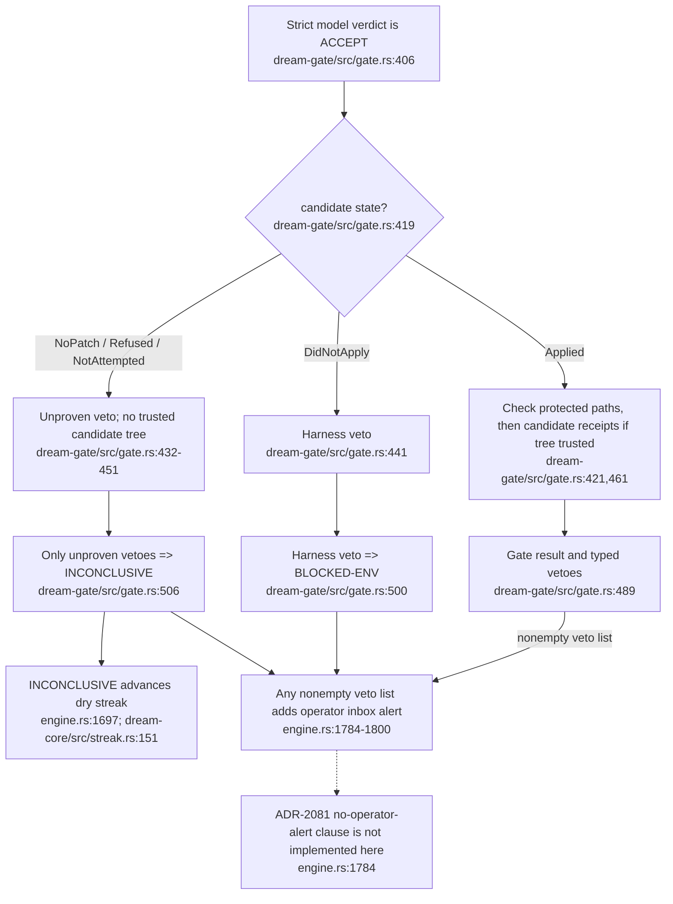

**Verified distinction.** The no-patch fixture yields INCONCLUSIVE and no Harness veto, but does add an alert. Candidate receipt grading and notification policy are separate; a verdict class alone does not suppress operator messages.

## AB-44.2 Finding selection, validation and append-time repair

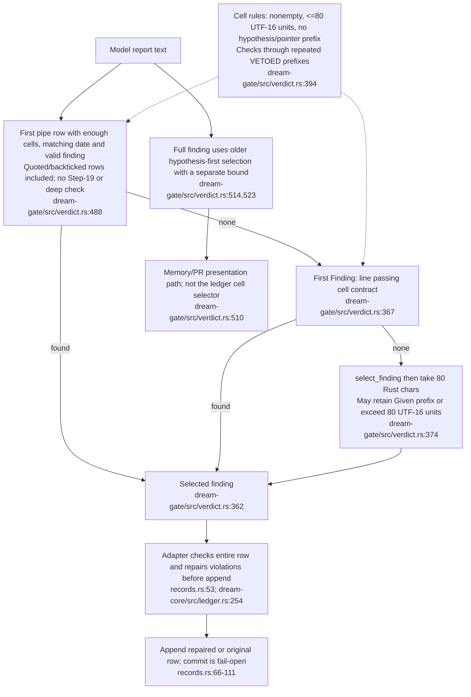

**Limits.** Selection establishes syntax and date, not provenance from a particular report section or evaluated deep. The fallback needs the adapter's repair backstop; UTF-16 validation does not make its character truncation equivalent. Unicode parity differences remain recorded in the migration audit.

## AB-44.3 Provider selection, retries and cross-provider fallback

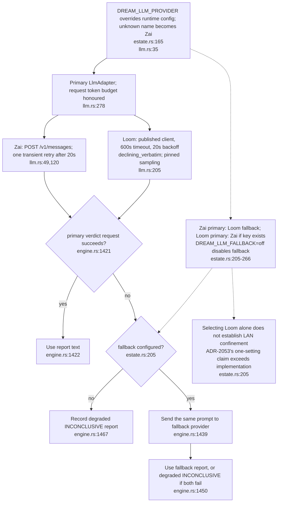

**Egress.** Retaining Z.AI as the default is the recorded operator decision. LAN confinement requires the effective primary, fallback and endpoint policy to agree; a provider label alone does not enforce it. Client-level guarantees remain owned by AB-28.11.

## AB-44.4 Placeholder and dispatch guards have limited coverage

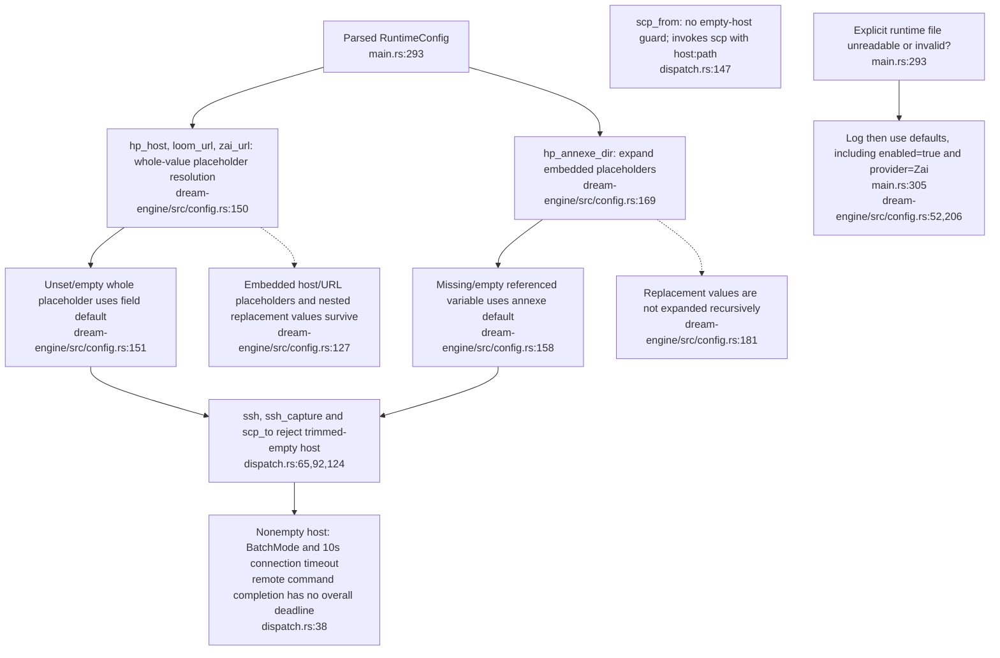

**Limit.** Existing tests cover the original simple-placeholder failures, not a universal ban on unresolved placeholders. The isolated controls probe confirms nested values survive and empty-host scp_from launches a fake executable.

## AB-44.5 Forum decisions — local application and delivery boundaries

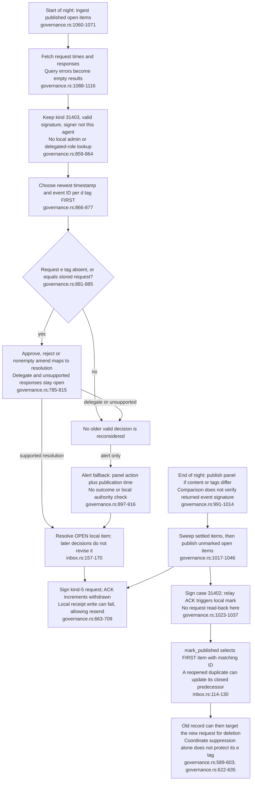

**Authority.** Signature validity and rejection of this agent's key do not establish a human decision. The configured relay supplies admission policy; current relay source allows admins and case-delegated reviewers. The adapter also accepts missing request binding and ignores supersession after local resolution; these boundaries are tested in the [governance audit](../../estate-review/2026-11-01-dream-governance-and-delivery.md).
**Delivery.** An accepted deletion is a request acknowledgement, not proof of remote removal, local persistence or live card removal. The relay deletes rows but ignores database errors; the current panel subscription excludes kind 5 and its registry ignores it. Those cross-repository source findings are recorded separately in the audit, without a live UI claim.
**Compatibility.** Shared wire types reduce duplication but do not prevent version drift: the adapter consumes core beta.16 while the inspected forum checkout is beta.19. Missing keys, transport failures and local write errors remain fail-open; a zero-count report is not proof that no work was pending.

## AB-44.6 Annexe health and retention limits

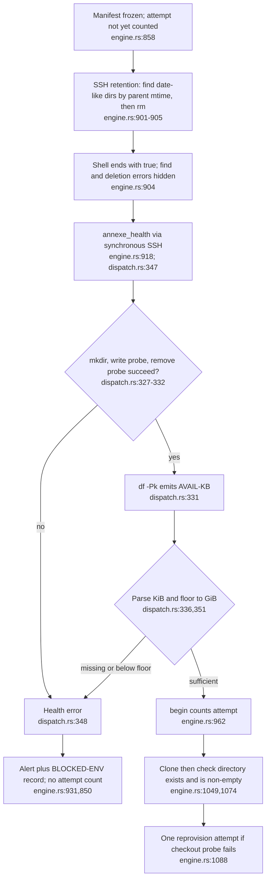

The write test catches failures that a free-space figure alone misses; local fixtures exercise the actual public health function through a substitute SSH executable. The minimum defaults to 10 GiB; an explicit zero disables the capacity floor, not the write test (`../project/agentbox/services/dream-engine/src/engine.rs:2392`). Health checks are observations at that moment, not reservations of space or proof of checkout identity.

The exact retention command deleted a disposable old parent directory containing a freshly written child. It checks neither active jobs nor night locks, and a failing find command still returned success with no stderr. This is fixture evidence, not a claim that a live run was deleted. SSH has a 10-second connection timeout but no overall command deadline (`../project/agentbox/services/dream-engine/src/dispatch.rs:39-60`); a connected hung sweep or probe can therefore hold up later serial work. See the [execution review](../../estate-review/2026-11-01-dream-execution-and-triage.md).

## AB-44.7 ADR-2071 clause (c) — historical acceptance and retained tick

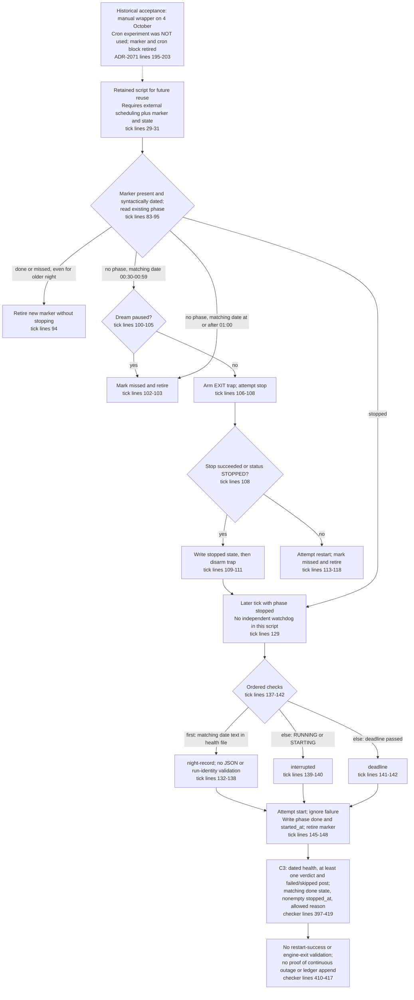

**History.** ADR-2071 records a manual 4 October acceptance run, three newly dreamed repositories and one previously completed skip. This is historical evidence, not a fresh deployment check (`../project/agentbox/docs/adr/ADR-2071-journal-the-nightly-dream-cycle.md:204-212`).
**Current boundary.** The retained tick can consume a fresh marker using old done state, restart before the window from matching date text, mask an interruption and retire after a failed start. C3 trusts aggregate files rather than binding an outage to a specific completed run; see the [journal audit](../../estate-review/2026-11-01-dream-journal-and-api-down.md).
**Recovery limit.** The EXIT trap is removed after writing stopped state; later recovery depends on another tick and a successful supervisor start. It is not an unconditional guarantee that the API returns (`../project/agentbox/scripts/activation/adr-2071-api-down-night.sh:106-111`, `../project/agentbox/scripts/activation/adr-2071-api-down-night.sh:145-148`).

## AB-44.8 Signing keys — the identity-port capability and the local fallback

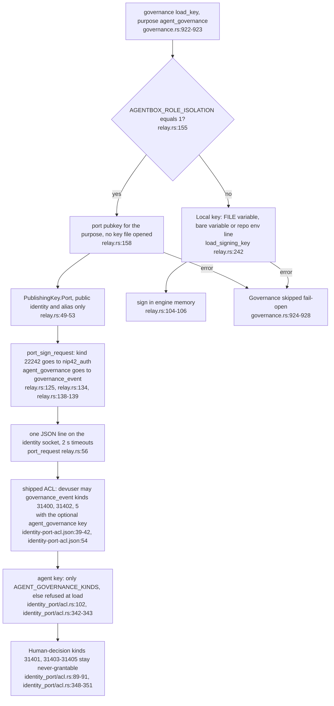

**Correction.** RESOLVED at agentbox 720e0d8 — the dream engine no longer reads its governance key under isolation: it takes a purpose-bound port capability (`../project/agentbox/services/dream-engine/src/relay.rs:150-158`) and the shipped ACL grants `governance_event` for kinds 31400, 31402 and 5 to the optional `agent_governance` key (`../project/agentbox/config/custody/identity-port-acl.json:54`); the key is `required: false` and must be provisioned by the operator before use (`../project/agentbox/config/custody/identity-port-acl.json:41`).
**Activation.** Flag-on behaviour depends on effective boot configuration, ownership and running identity. This pass reads those contracts but does not enable isolation, inspect keys or certify a running image. Key-file precedence alone does not imply the flag is on.
**Scope.** ADR-2122's ER-6 decision is assessed here, not its entire custody programme. Complete the signing, authentication and withdrawal design together, including old-key cases; see the [governance audit](../../estate-review/2026-11-01-dream-governance-and-delivery.md).

## AB-44.9 ADR-2143 — source supply is plumbing, not a decision

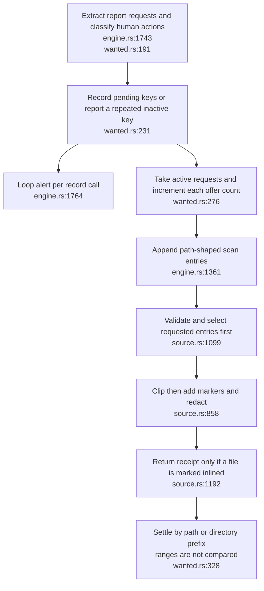

**What it shows.** Requests are offered before planner picks, with scan paths appended afterwards. Reservation counts candidate entries before validation, clipping markers can exceed the nominal byte allocation, and an empty line window can count as honoured. `take_for` counts invocations, not distinct night identifiers; `settle` treats any range from the same path as satisfying all its ranges (`../project/agentbox/services/dream-engine/src/wanted.rs:284`, `../project/agentbox/services/dream-engine/src/wanted.rs:328`). **Why it is this way.** ADR-2143 moves repetitive file requests out of the operator panel, but the [source-supply audit](../../estate-review/2026-11-01-dream-recovery-and-source-supply.md) finds that its completion markers do not prove the requested content was supplied. A requested directory is satisfied by any file under it. An all-refused read returns no source record (`../dream-engine/crates/dream-core/src/source.rs:1192`).

**Drift (question shape):** four fields are the prompt's desired format, not an enforced invariant. Parsing requires only Decision and If approved; unstructured questions pass through unchanged (`../project/agentbox/services/dream-engine/src/inbox.rs:278`, `../project/agentbox/services/dream-engine/src/inbox.rs:289`).

**Tension (expiry and evidence):** source receipt writes and settlement writes are best effort, and the shared request store has no transaction around read-modify-write (`../project/agentbox/services/dream-engine/src/engine.rs:1390`, `../project/agentbox/services/dream-engine/src/wanted.rs:91`). Current source does not establish three distinct nights, exact range delivery or one lifetime loop alert per request.

## AB-44.10 Optional triage can defer without a durable receipt

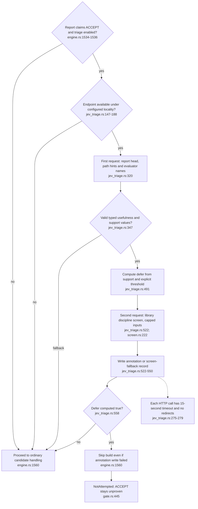

Default threshold is unset, so valid signals annotate without deferral. A configured threshold must lie in 0 to 0.5. Neither usefulness nor the discipline score can approve a candidate. The two requests are sequential; the first failing means the second is not sent. An initial fallback writes nothing and leaves any prior annotation in place (`../project/agentbox/services/dream-engine/src/jev_triage.rs:506-512`).

The first request clips the report to 4,000 characters but does not cap the complete request. Its path hints omit deletions and pure renames. The second request retains at most 16 disciplines, while the saved annotation lists the full input set (`../project/agentbox/services/dream-engine/src/jev_triage.rs:306,320,528`; `../dream-engine/crates/dream-core/src/screen.rs:230`). These signals cannot replace evaluator evidence. The [execution review](../../estate-review/2026-11-01-dream-execution-and-triage.md) records transport-free probes, current configuration and the limits of ADR-2155's staged activation record. A staged record does not prove that no other running image has the feature.

## AB-44.11 Journal delivery — local counters and remote evidence

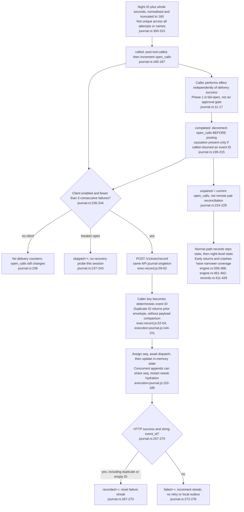

**Evidence.** Loopback probes reproduce unmatched remote records with unpaired=0; route probes reproduce changed-payload deduplication, restart sequence reuse and concurrent duplicate sequence numbers while the on-disk hash chain verifies. These are separate integrity properties, detailed in the [journal audit](../../estate-review/2026-11-01-dream-journal-and-api-down.md).
**Coverage.** Several inbox writes have no tool pair, including shared-remote warnings, annexe-health failure and damaged-run alerts; inbox::add does not journal internally (`../project/agentbox/services/dream-engine/src/engine.rs:251`, `../project/agentbox/services/dream-engine/src/engine.rs:933`, `../project/agentbox/services/dream-engine/src/engine.rs:2160`, `../project/agentbox/services/dream-engine/src/inbox.rs:174-215`).
**Skip semantics.** The repo wrapper posts turn.started before calling the body and turn.completed afterwards, including locked or already-finished returns. No tool effect is required for those lifecycle events (`../project/agentbox/services/dream-engine/src/engine.rs:603-624`).

## AB-44.12 Digest — evidence limits and encryption configuration

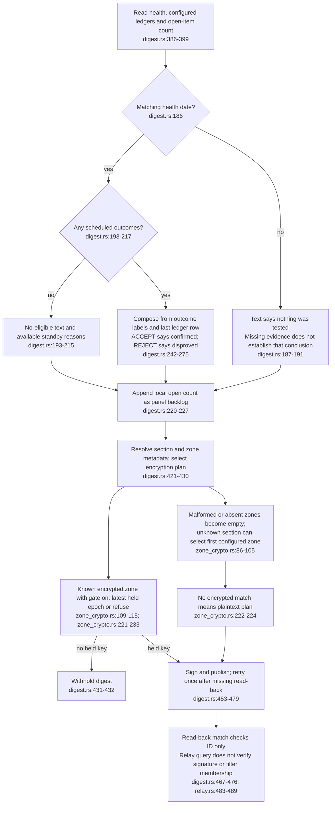

**Presentation.** A missing health file, REJECT label or unpublished inbox count is insufficient for the digest's stronger claims. Standby repositories disappear from the ordinary outcomes branch. Case context now reads the configured ledgerPath, RESOLVED at agentbox 720e0d8 (`../project/agentbox/services/dream-engine/src/governance.rs:279`).
**Privacy.** The no-key refusal applies only after zone policy identifies an encrypted zone. Malformed metadata produces plaintext selection even with the gate on; the probe does not publish plaintext or claim the live relay would admit it. No current zone-key epoch is fetched, so latest means latest locally held.
**Evidence.** The [governance audit](../../estate-review/2026-11-01-dream-governance-and-delivery.md) records isolated probes and the source boundary. Neither a publish ACK nor an ID-only read-back establishes delivery to the operator or a verified current deployment.
