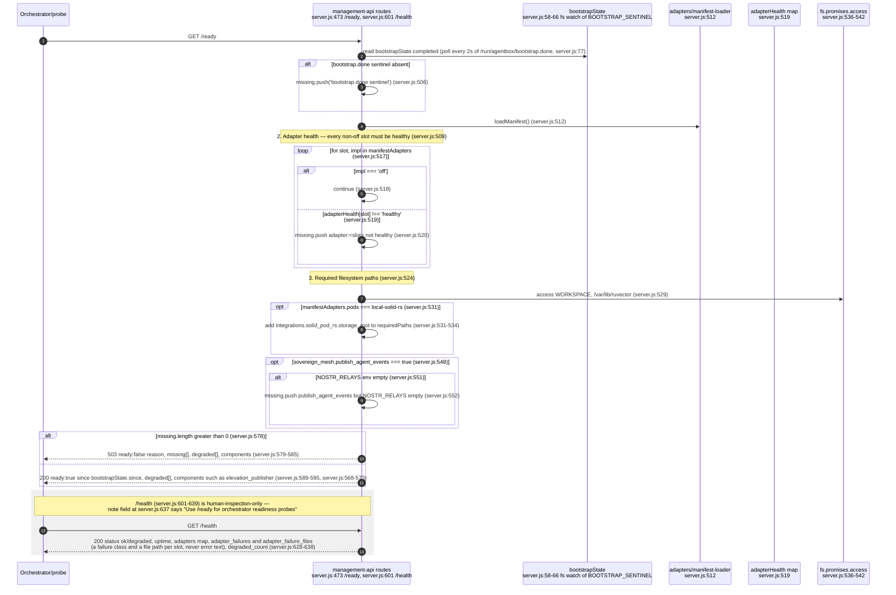
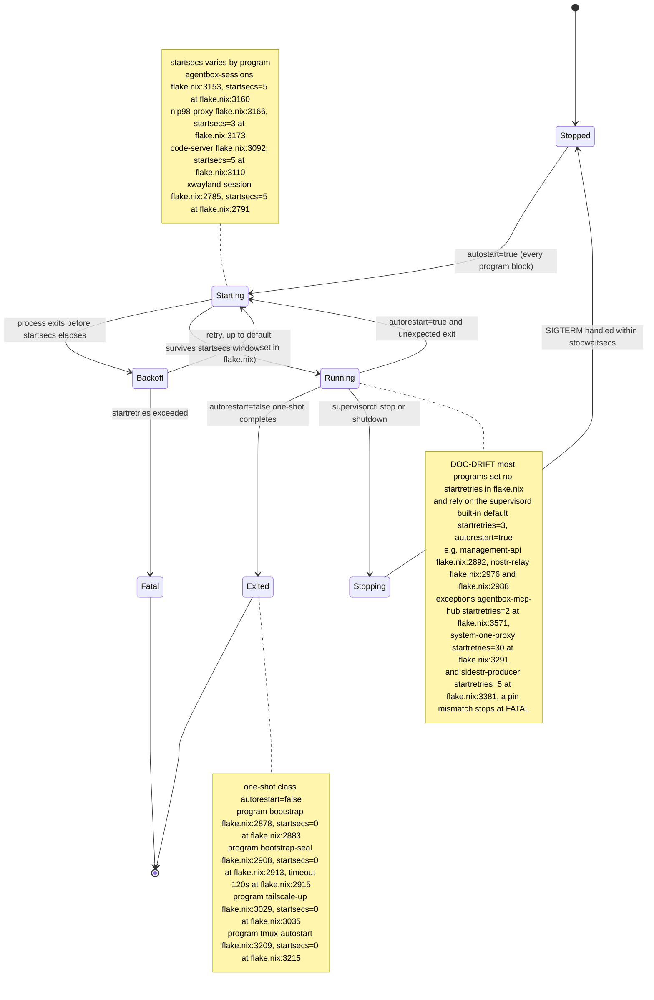
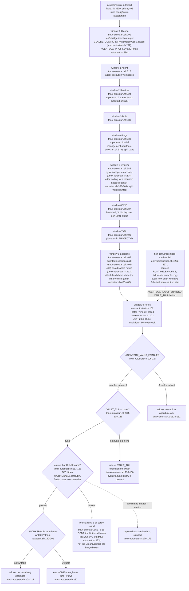
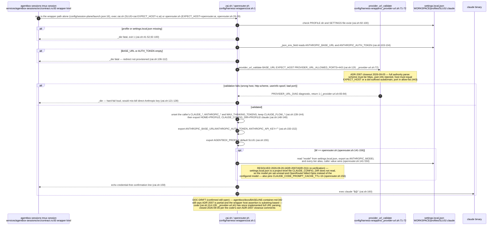
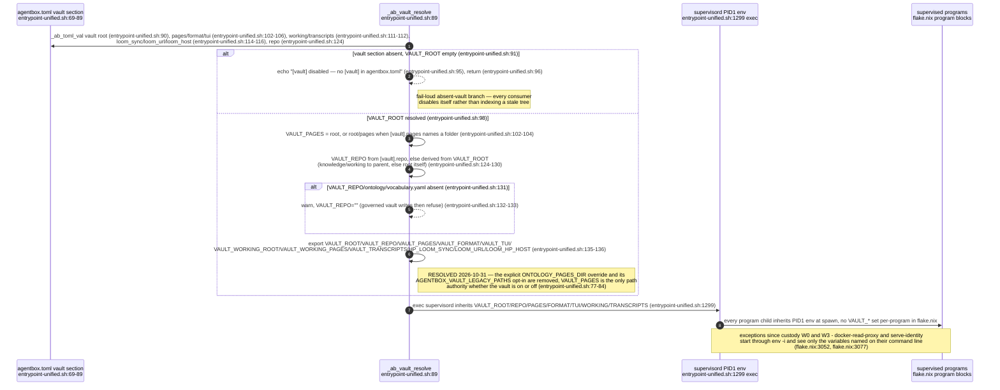
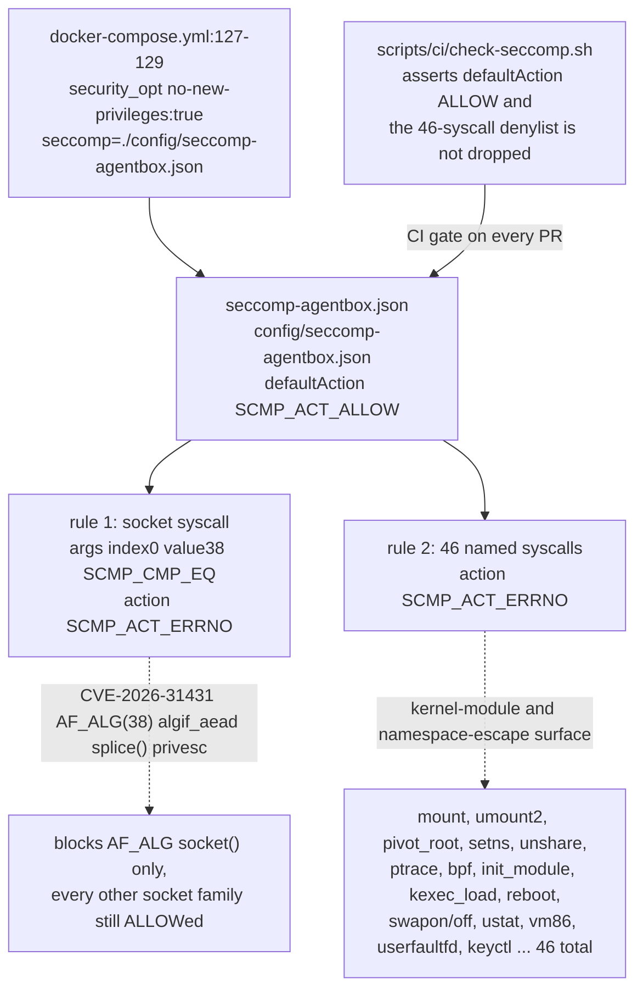

Split from AB-02 on 2026-11-23: what the booted container reports and how its programs and profiles behave (formerly AB-02.9 to AB-02.14 and AB-02.16). Boot phases and the supervision tree stay in AB-02. Old panel IDs resolve through the `aliases:` map above; the stamp is AB-02's, and the panels were not re-read.

## AB-45.1 readiness — /ready vs /health

## AB-45.2 supervisord program lifecycle

## AB-45.3 tmux-autostart window layout

## AB-45.4 profile isolation — per-profile HOME and CLAUDE_CONFIG_DIR (ADR-2007)

```mermaid
sequenceDiagram
    autonumber
    participant E as entrypoint-unified.sh<br/>Phase 4 entrypoint-unified.sh:970-971
    participant AM as agentbox-manifest provision-stacks<br/>services/agentbox-manifest/src/stacks.rs:187 build_profile
    participant FS as WORKSPACE/profiles/STACK
    participant SEED as session-provision.mjs<br/>scripts/session-provision.mjs:203
    participant WRAP as harness wrapper<br/>config/harness-wrappers/zai.sh|openrouter.sh

    E->>AM: agentbox-manifest provision-stacks, runs as root Phase 4 (entrypoint-unified.sh:971)
    loop for each stack in STACKS_JSON (stacks.rs:374-375)
        AM->>FS: build_profile writes root=WORKSPACE/profiles/STACK (stacks.rs:188-189)
        AM->>FS: symlink profiles/STACK/projects and /workspace (stacks.rs:199-200)
        AM->>FS: write .env with AGENT_STACK=STACK (stacks.rs:191-201)
        opt Claude-hosted profile
            AM->>FS: hooks start from learning_hooks (stacks.rs:290), then add the decline-recorder entries on Stop, SubagentStop and UserPromptSubmit when the floor gate is on (stacks.rs:293-308, ADR-2144)
            AM->>FS: add voice-paned record on Stop and Notification when voicelink record_events is on (stacks.rs:311-326, ADR-2151)
            AM->>FS: add session-state.cjs on UserPromptSubmit, Stop and Notification when the session plane is on (stacks.rs:327-337, ADR-2153)
            AM->>FS: add the activity-sink hooks when [integrations.activity_sink] is usable (stacks.rs:338-340, ADR-2146)
            AM->>FS: write .claude/settings.json with the assembled hooks (stacks.rs:342-360)
        end
    end
    Note over E: chown -R 1000:1000 WORKSPACE/profiles after provision-stacks (entrypoint-unified.sh:980)
    SEED->>FS: provision profiles/openrouter/.claude/settings.local.json ANTHROPIC_BASE_URL/AUTH_TOKEN (session-provision.mjs:16-34, run by the daemon at AB-46.3)
    SEED->>FS: provision profiles/zai/.claude/settings.local.json (session-provision.mjs:36-53)
    Note right of SEED: ADR-043 D4.1 — a distinct AGENTBOX_PROFILE per session<br/>yields a distinct persisted did:nostr identity
    Note over WRAP: at session launch the wrapper pins HOME=PROFILE and<br/>CLAUDE_CONFIG_DIR=PROFILE/.claude (see AB-45.5)
    Note over E,WRAP: DIVERGENCE — profile isolation routes configuration under<br/>ONE OS user devuser — harnesses are isolated by directory, not by OS user<br/>(docs/adr/ADR-2007-profile-isolation.md:59), not an OS access boundary
```

## AB-45.5 harness wrapper invocation — Z.AI / OpenRouter redirect assertion

## AB-45.6 VAULT env propagation — resolve to PID1 to supervised programs

## AB-45.7 seccomp profile — supplemental denylist

