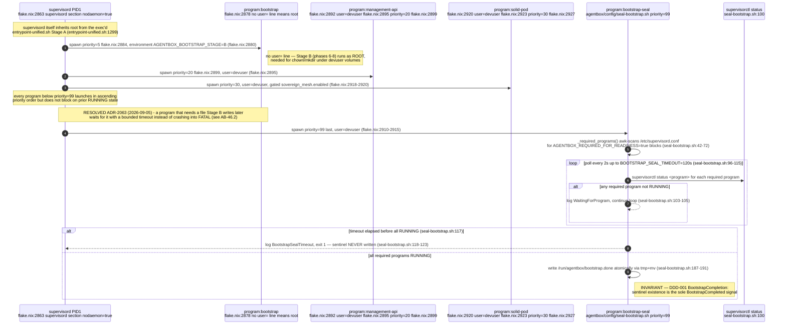
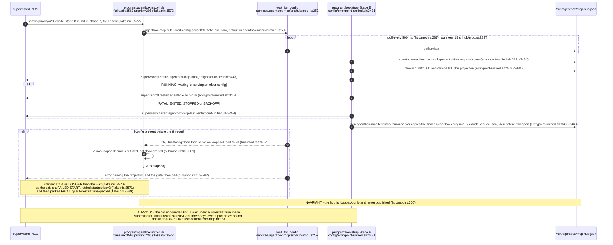
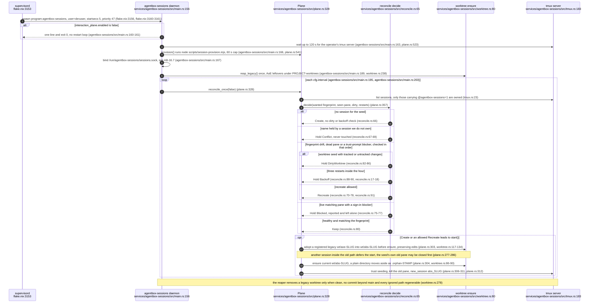
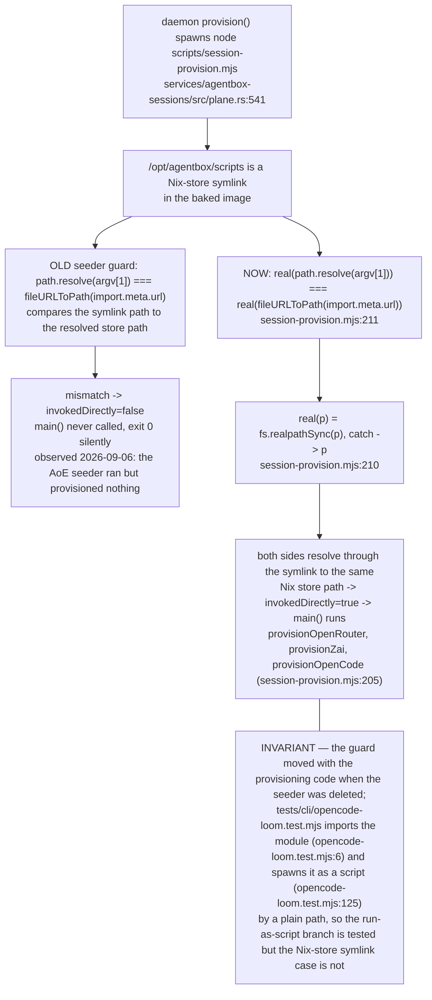
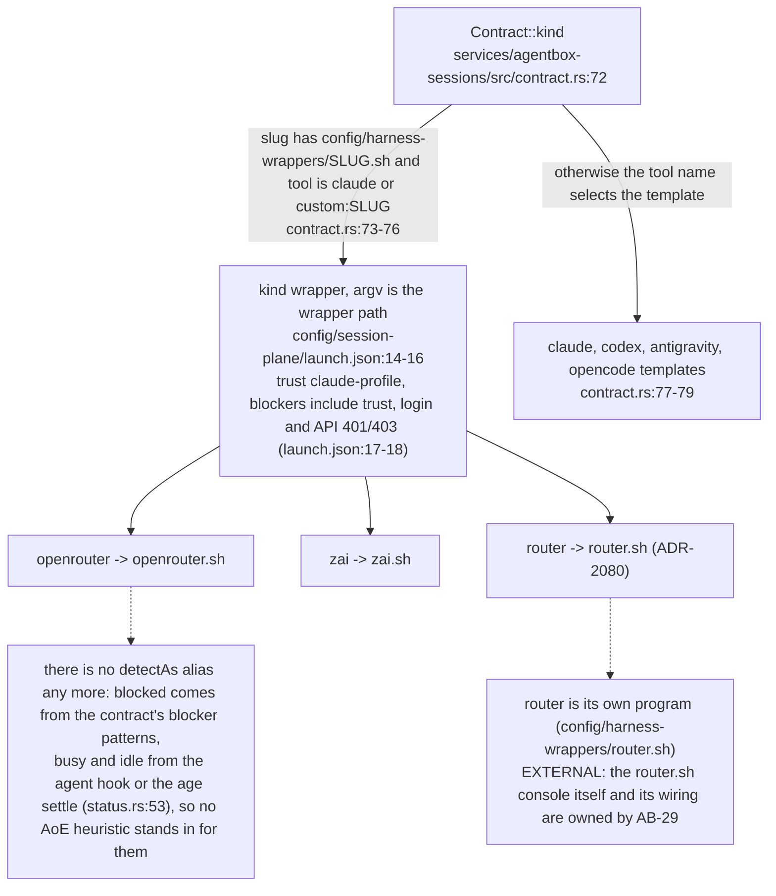
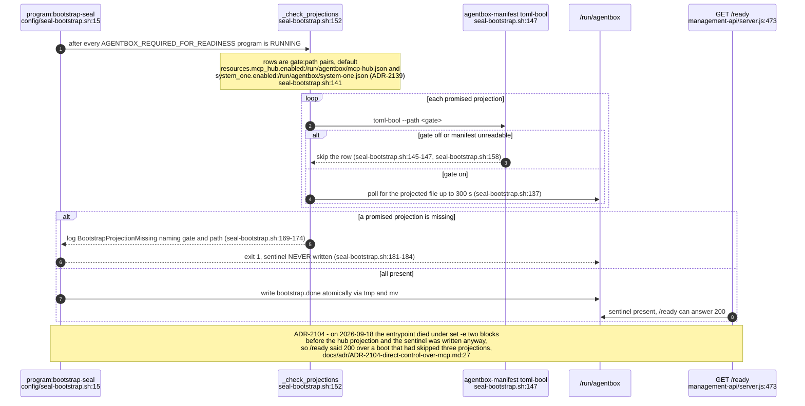
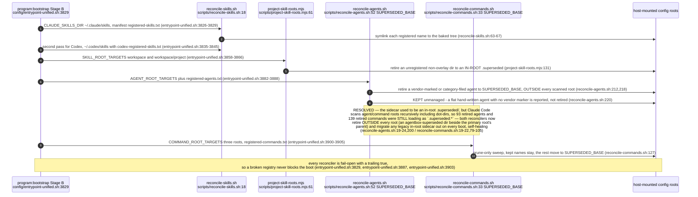
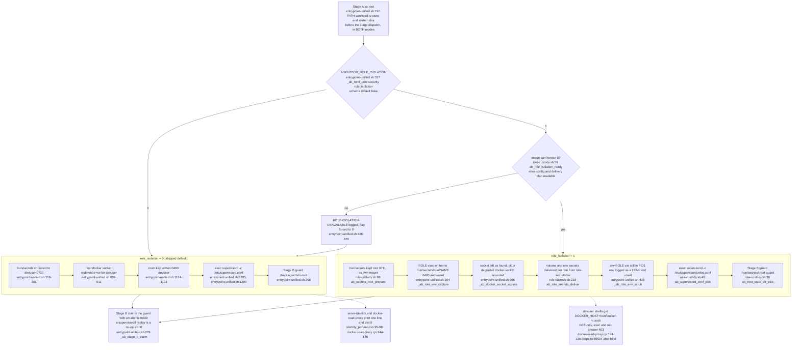

Split from AB-02 on 2026-11-23: PID1 and the bootstrap seal, and the later boot-time additions (formerly AB-02.8 and AB-02.17 to AB-02.24). Old panel IDs resolve through the `aliases:` map above; the stamp is AB-02's, and the panels were not re-read.

## AB-46.1 PID1 root, priority ordering and bootstrap-seal

## AB-46.2 shared MCP hub: bounded wait, then a loud FATAL (ADR-2034, ADR-2104)

**Invariant:** a hub that never receives its projection now fails the start rather than idling, because `startsecs=130` outlives the 120 s wait (`../project/agentbox/flake.nix:3570`, `../project/agentbox/services/agentbox-mcp/src/main.rs:59`).

**Debt:** nine MCP servers are hub-routed and exactly one has a call site in this repository, so a silent hub cost nothing that was noticed for three days (`../project/agentbox/docs/adr/ADR-2104-direct-control-over-mcp.md:30`).

## AB-46.3 session plane — provision, bind, reconcile, bounded restarts (ADR-2153)

**Invariant:** ownership is a marker, not a name: only sessions carrying `@agentbox-sessions=1` are ever recreated, so `agentbox:0` (tab0), a leftover `aoe_*` session and operator sessions are never touched, and a worktree seed holding work in progress is held rather than recreated (`../project/agentbox/services/agentbox-sessions/src/tmux.rs:23`, `../project/agentbox/services/agentbox-sessions/src/reconcile.rs:67-69`, `../project/agentbox/services/agentbox-sessions/src/reconcile.rs:82-86`).
**Invariant:** trust seeding moved into the daemon: `trust::seed` writes the root store, every wrapper-profile store that already exists and the Codex config (`../project/agentbox/services/agentbox-sessions/src/trust.rs:34-39`, `../project/agentbox/services/agentbox-sessions/src/trust.rs:102`), while `trust-seed.cjs` still writes only the root store and an existing profile store (`config/hooks/trust-seed.cjs:78-86`, `config/hooks/trust-seed.cjs:91-95`).
**Acceptance boundary:** ADR-2153 remains accepted, partial and live (`../project/agentbox/docs/adr/ADR-2153-session-plane-replaces-aoe.md:5-7`). Its 14 November source check records worktree adoption and passing offline tests, without a new live provider round trip (`../project/agentbox/docs/adr/ADR-2153-session-plane-replaces-aoe.md:73-75`); its 15 November check finds only a SystemScape comment changed in `tmux-autostart.sh`, with the session-plane commands and tmux ownership unchanged and the live round trip again not rerun (`../project/agentbox/docs/adr/ADR-2153-session-plane-replaces-aoe.md:64-71`). The old profile records were archived and the mount removed from source; deleting the host volume remains an operator step after the rebuild (`../project/agentbox/docs/adr/ADR-2153-session-plane-replaces-aoe.md:93-97`).

## AB-46.4 session-provision.mjs run-as-script guard — realpath fix carried over from the AoE seeder

## AB-46.5 launch contract wrapper kind — router seed joins openrouter/zai (ADR-2080, ADR-2153)

- `Contract::kind` resolves each `[[interaction_plane.session_seeds]]` slug that has a `config/harness-wrappers/<slug>.sh` and a `claude` or `custom:<slug>` tool to the `wrapper` template (`../project/agentbox/services/agentbox-sessions/src/contract.rs:72-76`), so the `router` seed (`tool = "custom:router"`, `../project/agentbox/agentbox.toml:2296`) launches exactly like `openrouter` and `zai`.
- **Residual comment drift:** `agentbox.toml` still says `custom:router` is "resolved by the seeder's WRAPPER_SLUGS" (`../project/agentbox/agentbox.toml:2296`). The wrapper now correctly names the native session plane (`../project/agentbox/config/harness-wrappers/router.sh:5-8`); see AB-29 for its launch flow.

## AB-46.6 bootstrap.done now means the promised projections exist (ADR-2104)

**Invariant:** the sentinel is written only after every gate-on projection in `_PROJECTIONS` exists, so `bootstrap.done` means more than "the daemons came up" (`../project/agentbox/config/seal-bootstrap.sh:181`).

**Open:** the projection table carries two rows today (`mcp_hub` and, since ADR-2139, `system_one`), and nothing forces a new boot-written file into it (`../project/agentbox/config/seal-bootstrap.sh:141`).

## AB-46.7 registry reconciliation at boot: skills, agents, commands (ADR-2092)

**What it shows.** The four boot-phase reconcilers that make the visible skill, agent and command sets a function of checked-in manifests rather than of whatever a vendor installer last dumped into the host mounts.
**Why it is this way.** ADR-2092: the agent roots were ungoverned, so `ruflo init` and `aqe init --auto` accreted 97 agents across two roots, 74 duplicated and 37 byte-divergent, with the nested root shadowing the user root (`config/entrypoint-unified.sh:3868-3876`).

**Invariant:** retirement is always to a recoverable sidecar, never a delete, in all three reconcilers — for agents and commands that sidecar now sits OUTSIDE every scanned root (`../project/agentbox/scripts/reconcile-agents.sh:94-105`, `../project/agentbox/scripts/reconcile-commands.sh:13-14`).

**Invariant:** a hand-written agent placed flat in the root with no vendor marker is preserved and reported, so experiments survive the sweep (`../project/agentbox/scripts/reconcile-agents.sh:220`).

**Debt:** the registries are four separate manifests in three formats (13 agents, 1 command, 22 Claude skills and 17 Codex skills; the entrypoint comment still says it "links the 12 registered agents", `config/entrypoint-unified.sh:3877`), with the skill counts taken from `skills/registered-skills.txt` and `skills/codex-registered-skills.txt`, each reconciled by its own script with its own retirement rules (`../project/agentbox/agents/registered-agents.txt:1`, `../project/agentbox/config/registered-commands.txt:1`).

## AB-46.8 the role_isolation boot branch — one image, two supervisor configs (ADR-2122)

**What it shows.** The single decision the custody change adds to the boot: `[security].role_isolation` is read once in Stage A and exported, and it selects between today's boot and the isolated one. Both supervisor configs, the role accounts and the delivery plan ship in every image, so the supervisor branch is chosen at boot; the devuser sudo drop, however, is baked from the flag at build time (`../project/agentbox/flake.nix:4290-4297`), so the flag is rebuild-class end to end: an image built off and booted on reports `degraded:devuser-sudo` until rebuilt (see the Drift below). The PATH sanitiser and the Stage B one-shot guard sit outside the branch and apply in both modes.
**Why it is this way.** The custody design (ADR-2122, X-1 step 1) closes three bypasses: root running devuser-planted code, devuser driving the host Docker daemon, and role secrets inherited by every process from PID 1. The first is closed unconditionally. The other two change what devuser can do, so they sit behind a flag that ships off until the owner's boot rehearsal passes. Per-role detail, the identity port and the rehearsal are in AB-36.

**Invariant:** root's boot PATH holds only `/nix/store` entries and the image's fixed system directories, in both modes, so a binary planted in the devuser-owned workspace cargo bin can no longer run as root (`../project/agentbox/config/entrypoint-unified.sh:175`, `../project/agentbox/config/entrypoint-unified.sh:190`). The cargo bin reaches devuser shells only, appended (`../project/agentbox/config/entrypoint-unified.sh:4165`).

**Invariant:** Stage B runs once per container start: a `supervisorctl start bootstrap` replay finds `stage-b.claimed` already made and exits 0 without running anything, and a missing or squatted guard directory makes Stage B refuse (`../project/agentbox/config/entrypoint-unified.sh:229-233`, `config/entrypoint-unified.sh:1328-1332`).

**Invariant:** devuser is not a member of group `root`, unconditionally: the baked group file now reads `root:x:0:` with no members, and undoing it needs a rebuild (`../project/agentbox/flake.nix:4282`).

**Invariant (under role_isolation):** no ROLE variable is in PID 1's environment when supervisord starts, so no supervised program inherits a signing key. The capture writes each to a 0400 file and unsets it, and a final scrub logs and unsets any that reappear (`../project/agentbox/config/entrypoint-unified.sh:382`, `../project/agentbox/config/entrypoint-unified.sh:1298`). With the flag off both functions return at their first line, and PID 1 still carries every `.env` key.

**Invariant (under role_isolation):** the entrypoint does not widen the host Docker socket for devuser (`../project/agentbox/config/entrypoint-unified.sh:609`). With the flag off it still runs `chmod o+rw` on every boot.

**Debt:** `[program:docker-read-proxy]` has no `user=` and drops privilege itself. Its comment still names a W1 follow-up to move it into `lib/role-accounts.nix` with its own account (`flake.nix:3050-3051`), but the role registry W1 shipped is `config/role-accounts.json` (`../project/agentbox/config/role-accounts.json:3`), and it has no row for the proxy.

**Drift:** `docs/BASELINE-container.md:115` calls `[security].role_isolation` boot-class, but the manifest catalogue entry is `apply_class: 'rebuild'` (`management-api/lib/system-manifest.js:97-99`) and the entrypoint comment says rebuild-class since ER-9 because the devuser sudo drop is baked (`config/entrypoint-unified.sh:314`, `flake.nix:4290-4297`).
