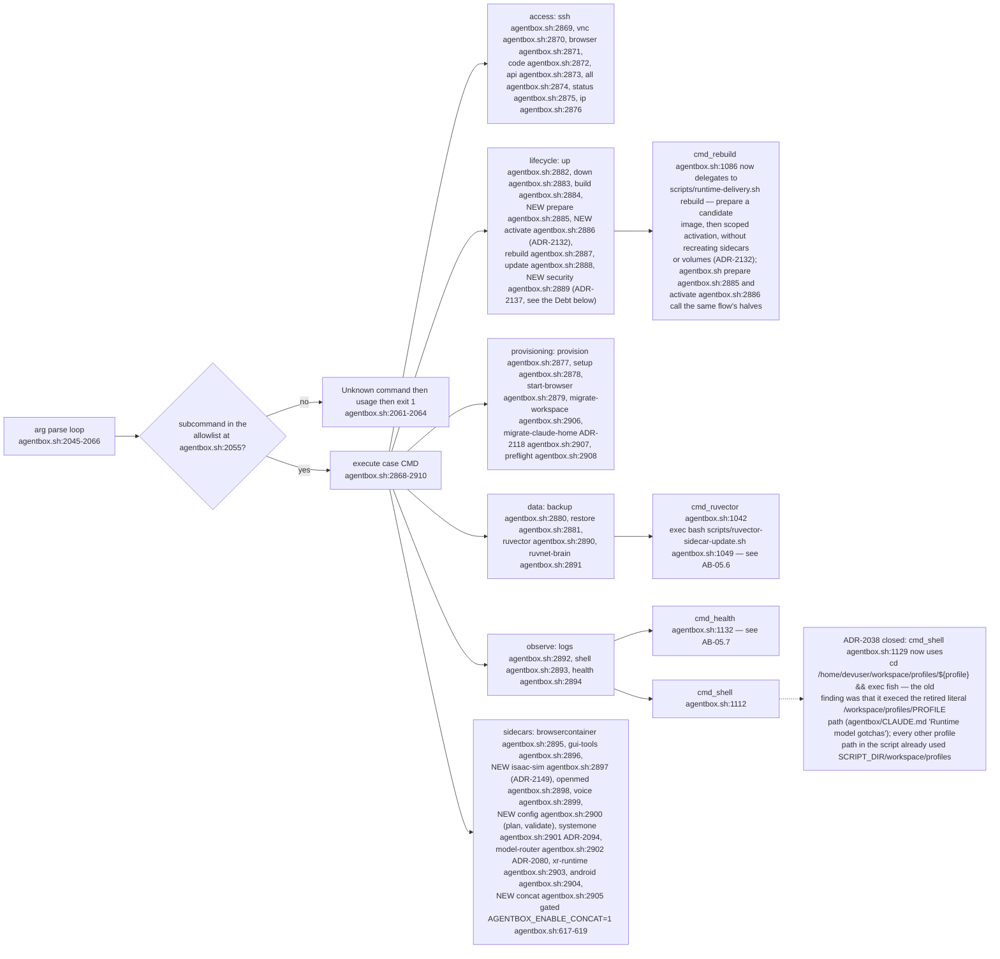
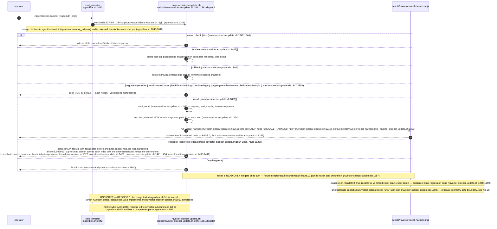
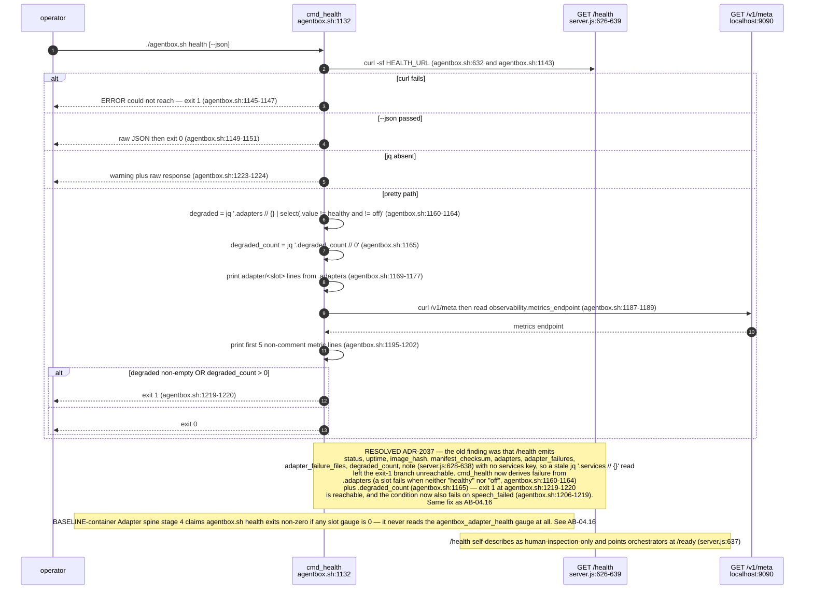
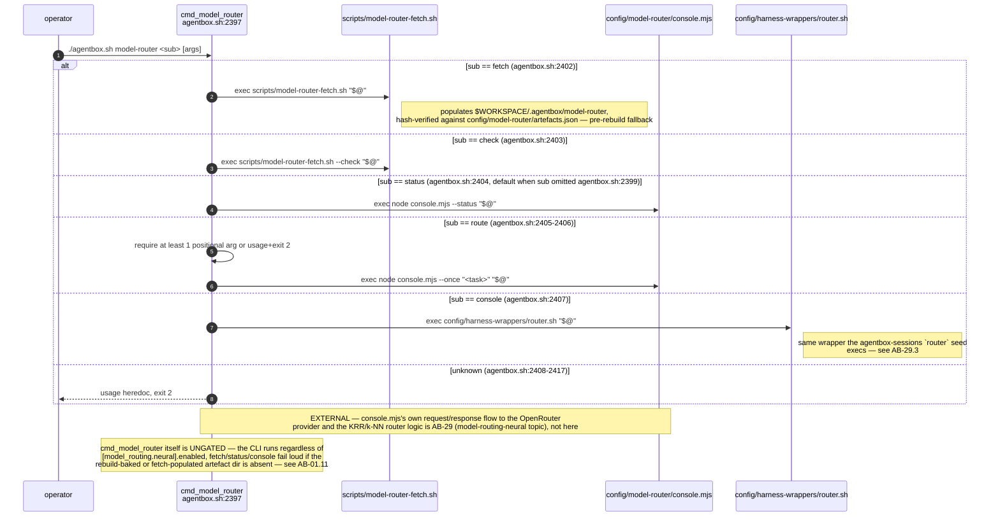

Split from AB-05 on 2026-11-23 (formerly AB-05.6, AB-05.7 and AB-05.11), plus the successor to the frozen AB-05.5. Stamped at agentbox 1d26ebe, not AB-05's 59b1aca: agentbox.sh gained one usage line at line 62, so every agentbox.sh anchor in the moved panels moved down one line and was re-derived against 1d26ebe by content, not by offset alone. Old panel IDs resolve through the `aliases:` map above.

## AB-47.1 agentbox.sh top-level subcommand dispatch — config now on the allowlist

**Invariant (successor to AB-05.5, true at 1d26ebe):** `config` is on the allowlist (`../project/agentbox/agentbox.sh:2055`) and in the usage text (`../project/agentbox/agentbox.sh:62`), so the `config` arm (`../project/agentbox/agentbox.sh:2900`) is reachable and runs `cmd_config` (`../project/agentbox/agentbox.sh:2448-2454`): `plan` and `validate` only, anything else exits 2.

**Drift (resolved, `security` subcommand):** the `security` arm used to be unreachable because the allowlist omitted it; the allowlist at this stamp lists `security` (`../project/agentbox/agentbox.sh:2055`) and the arm runs `scripts/security-scan.sh` (`../project/agentbox/agentbox.sh:2889`), which `cmd_up --build` and `cmd_build` also call directly (`../project/agentbox/agentbox.sh:766`, `agentbox.sh:941`).

## AB-47.2 agentbox.sh ruvector — a dispatch table split across two files

## AB-47.3 agentbox.sh health — exit-code contract

## AB-47.4 agentbox.sh model-router — ADR-2080 CLI dispatch, gated by [model_routing.neural]

