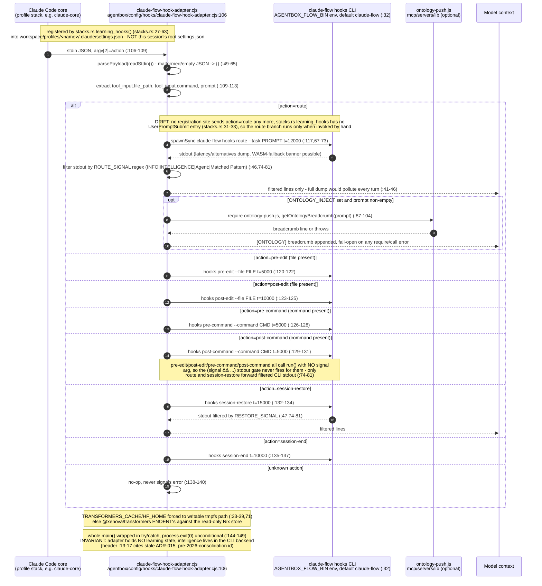
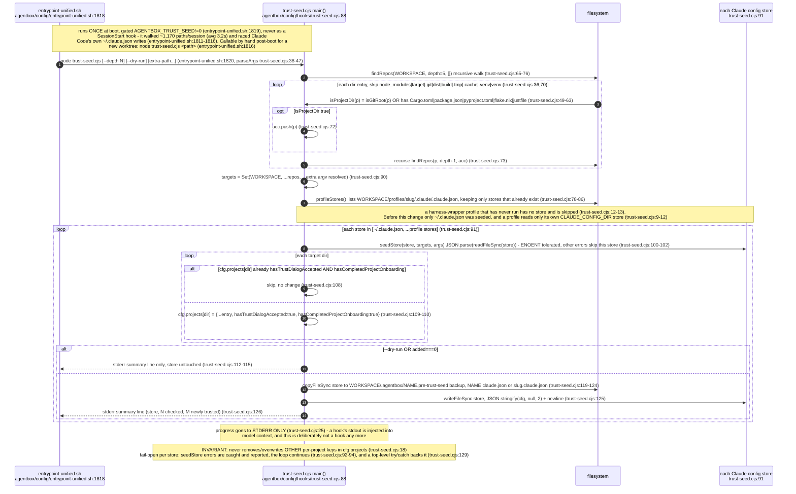
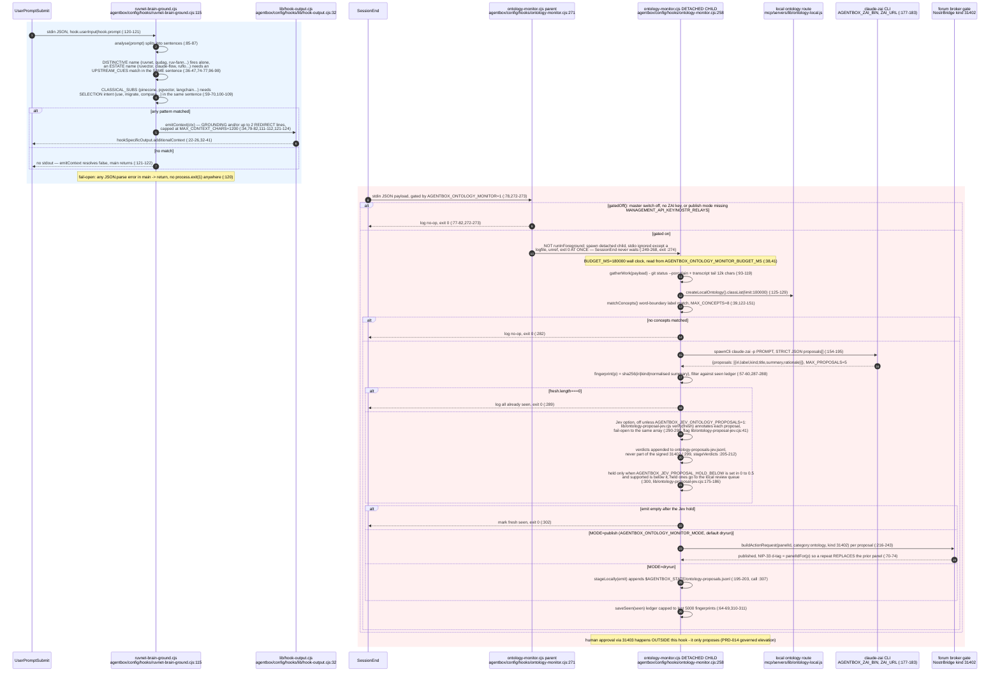
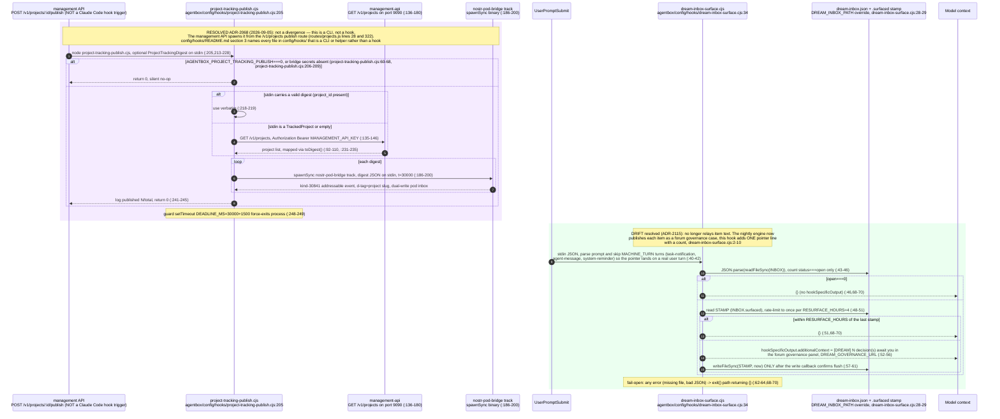
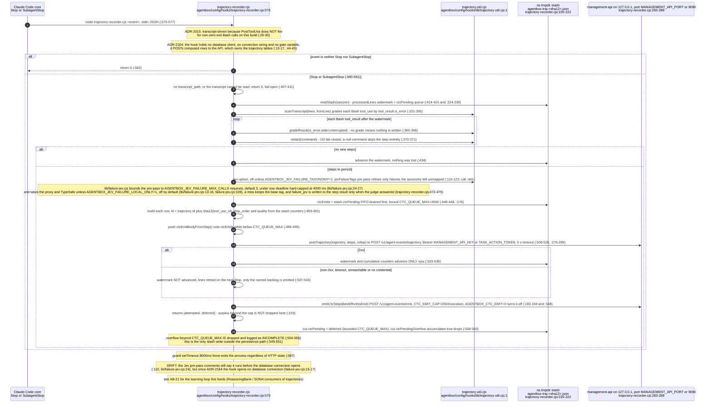
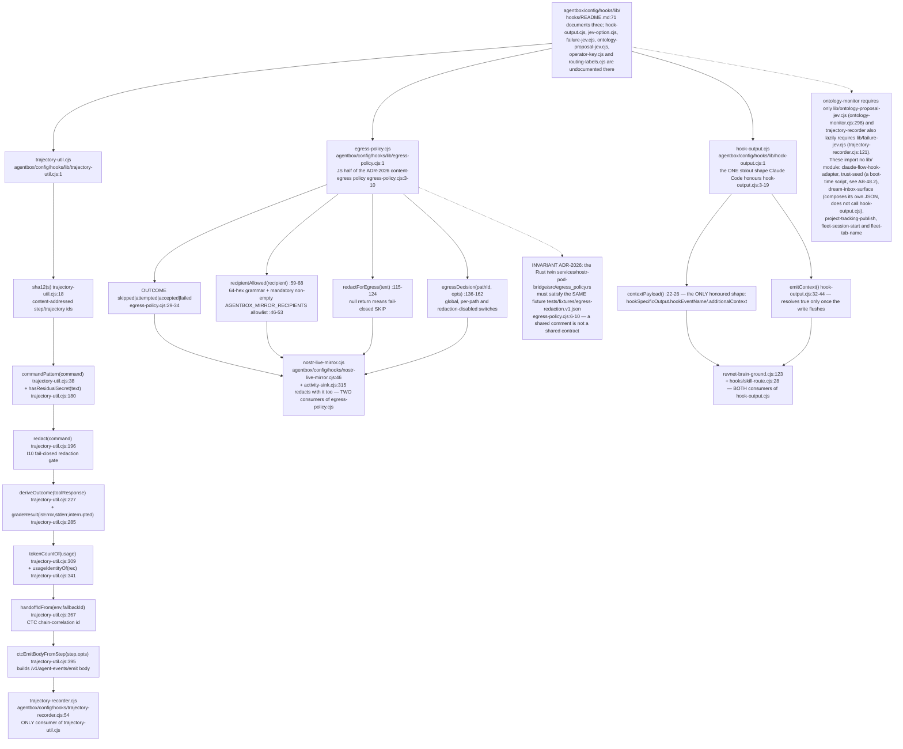

Split from AB-08 on 2026-11-23: the individual handler scripts and their shared helpers (formerly AB-08.8 and AB-08.10 to AB-08.14). Registration, the per-event pipelines and the registration mechanisms stay in AB-08. Old panel IDs resolve through the `aliases:` map above; the stamp is AB-08's, and the panels were not re-read.

## AB-48.1 claude-flow-hook-adapter.cjs — stdin-to-CLI translation (per-profile stacks only)

**Drift:** the adapter still handles `action=route`, but no registration site sends it any more: `learning_hooks` has no `UserPromptSubmit` entry (`../project/agentbox/services/agentbox-manifest/src/stacks.rs:31-33`), so the route branch and its ontology breadcrumb run only when invoked by hand.
## AB-48.2 trust-seed.cjs — a BOOT-TIME script now, not a hook; folder-trust, worktree discovery and per-profile stores

## AB-48.3 ruvnet-brain-ground.cjs (rewritten trigger logic) and ontology-monitor.cjs (now detached)

## AB-48.4 project-tracking-publish.cjs and dream-inbox-surface.cjs — DREAM-2115: a reminder pointer, not a relay

## AB-48.5 trajectory-recorder.cjs — Stop/SubagentStop boundary, persisted through the Management API

**Drift:** the Jev pre-pass comments still say it runs before the database connection opens (`../project/agentbox/config/hooks/trajectory-recorder.cjs:110`, `../project/agentbox/config/hooks/lib/failure-jev.cjs:24`), but since ADR-2164 the hook holds no database client and persists only through `POST /v1/agent-events/trajectory` (`../project/agentbox/config/hooks/trajectory-recorder.cjs:13-17`).
## AB-48.6 lib/ shared helpers — consumers

Session-mirror egress: see AB-13.9.
