## AB-49.1 The gate families added since 2026-09-06 — the System One local_only comment now matches the manifest

```mermaid
flowchart TB
    TOML["agentbox.toml"]
    TOML --> F1["[features.jev_compaction] enabled = true, fallback = rules<br/>agentbox.toml:764, agentbox.toml:802, agentbox.toml:824"]
    TOML --> F2["[features.sovereign_system_one] enabled = false<br/>agentbox.toml:1020, agentbox.toml:1045"]
    TOML --> F3["[skills.routing] router = jev, cascade, label_log<br/>label_log = false since 2026-10-04 — the bounded EXP-B8 run<br/>STOPPED (WITHDRAW, commit b1e42f148)<br/>agentbox.toml:1343, agentbox.toml:1363, agentbox.toml:1401, agentbox.toml:1415<br/>bypass_projects = [] agentbox.toml:1389 (ADR-2090, E083)"]
    TOML --> F4["[resources] mcp_hub, hooks.shim, session_hygiene<br/>agentbox.toml:1673, agentbox.toml:1691, agentbox.toml:1703, agentbox.toml:1707"]
    TOML --> F5["[voice] enabled = true<br/>agentbox.toml:2319-2320"]
    TOML --> F6["NEW ADR-2116: [claude_code] permission_mode agentbox.toml:726,<br/>permission_deny agentbox.toml:735-739"]
    TOML --> F7["NEW ADR-2118: config/instructions/ (not a toml key —<br/>gate is null, the directory's own presence)"]
    TOML --> F8["NEW ADR-2118: [toolchains] claude_code = true agentbox.toml:2347<br/>service claude-cred-sync"]
    TOML --> F9["NEW PRD-024 P1: [sidechain] enabled, mirror, faucet<br/>agentbox.toml:2028-2034; enabled = true again after the ENOSPC recovery (agentbox.toml:2030)"]
    TOML --> F11["NEW ADR-2134: [claude_code] model, effort, advisor_model<br/>agentbox.toml:749-751"]
    TOML --> F12["NEW ADR-2135: [features.jev_checkpoints] enabled = true<br/>agentbox.toml:829"]
    TOML --> F13["NEW ADR-2139: [system_one] enabled = true, backend laya, local by default since the 2026-11-17 amendment<br/>(owner decision of the 2026-11-15 estate review, agentbox.toml:914), local_backend laya agentbox.toml:913,<br/>bind 0.0.0.0:8094 with network = true (docker networks only, never published, 2026-10-30) agentbox.toml:915-916,<br/>local_only names eighteen consumers, which stay on the laya route even if backend moves to a cloud vendor agentbox.toml:924-943,<br/>skill_list_at_least = 0.6 (router lists runner-up skills, needs skill_verify) agentbox.toml:944<br/>[system_one] agentbox.toml:885, enabled agentbox.toml:912<br/>subq state_budget_tokens 73000 agentbox.toml:997 (E082)"]
    TOML --> F14["NEW ADR-2155: [system_one.consumers], 19 keys: eighteen true, skill_intent false<br/>14 exported as AGENTBOX_JEV_*, 5 exported only for other repos<br/>agentbox.toml:955-976"]
    F9 ~~~ F10["NEW 2026-10-02: [sovereign_mesh] junkiejarvis = true<br/>the only switch, the env override is gone<br/>agentbox.toml:50, junkiejarvisEnabled junkiejarvis-clarify.js:447-453"]
    TOML --> F10

    F1 --> C1["catalogue jev-compaction (factrail), apply_class REBUILD<br/>since ADR-2121, was boot - system-manifest.js:277-278"]
    F2 --> C2["catalogue sovereign-system-one, apply_class boot<br/>system-manifest.js:289-290"]
    F3 --> C3["catalogue skill-router system-manifest.js:354-355, skill-router-cascade system-manifest.js:357-358,<br/>routing-teacher-labels system-manifest.js:360-361, off_values table, all apply_class boot"]
    F4 --> C4["catalogue mcp-hub, hook-shim, teammate-gc, all rebuild<br/>system-manifest.js:445-453"]
    F5 --> C5["catalogue voice-console, apply_class live<br/>system-manifest.js:190-191"]
    F6 --> C6["NEW catalogue claude-code-permissions, apply_class boot<br/>system-manifest.js:262-264"]
    F7 --> C7["NEW catalogue instruction-tiers, gate null, apply_class boot<br/>system-manifest.js:268-270"]
    F8 --> C8["NEW catalogue claude-cred-sync, apply_class rebuild<br/>system-manifest.js:274-276"]
    F9 --> C9["NEW catalogue sidechain, three gates, apply_class rebuild<br/>a false parent gate reports off - system-manifest.js:394-396, system-manifest.js:479"]

    C1 --> B1["flake.nix bakes factrail pinned to rev af23eca6, 0.1.2 (lib/factrail.nix:36), which records the judge that answered from the proxy headers,<br/>then the entrypoint sets CLAUDE_CODE_ENABLE_FUNCTION_HOOKS,<br/>drops any retired jev-compaction install, migrates its store, installs factrail@agentbox<br/>entrypoint-unified.sh:3108, entrypoint-unified.sh:3118-3122, entrypoint-unified.sh:3132, entrypoint-unified.sh:3205 - gate off uninstalls entrypoint-unified.sh:3216-3227"]
    C2 --> B2["the entrypoint runs agentbox-manifest sso-project and<br/>projects baseUrl, model and backendLocal into the plugin<br/>entrypoint-unified.sh:2719-2722"]
    C3 --> B3["the entrypoint registers or de-registers the<br/>UserPromptSubmit hook, see AB-08<br/>entrypoint-unified.sh:2833, entrypoint-unified.sh:2851"]
    C6 --> B6["agentbox-manifest permissions-project reconciles root<br/>settings.json and every profile's settings every boot — not seed-if-unset<br/>entrypoint-unified.sh:1837-1846"]
    C7 --> B7["agentbox-manifest instructions-project composes<br/>~/.claude/CLAUDE.md, ~/workspace/AGENTS.md, ~/workspace/CLAUDE.md<br/>from config/instructions/ every boot — entrypoint-unified.sh:3026-3048"]
    F11 --> C11["NEW catalogue claude-code-model-roles, gate claude_code.advisor_model,<br/>off_values off, apply_class boot - system-manifest.js:265-267"]
    F12 --> C12["NEW catalogue jev-checkpoints, apply_class rebuild<br/>system-manifest.js:280-282"]
    F13 --> C13["NEW catalogue system-one-proxy, service system-one-proxy, apply_class boot (system-manifest.js:283-285),<br/>and system-one-network, gate system_one.network, apply_class boot (system-manifest.js:286-288)"]
    C11 --> B11["permissions-project writes model, effortLevel and advisorModel into settings<br/>every boot, skipping gateway profiles<br/>services/agentbox-manifest/src/main.rs:247"]
    C12 --> B12["the entrypoint installs jev-checkpoints@agentbox with the manifest as userConfig<br/>entrypoint-unified.sh:3231, entrypoint-unified.sh:3099"]
    C13 --> B13["system-one-project writes /run/agentbox/system-one.json and projects the proxy URL<br/>entrypoint-unified.sh:2689-2702, see AB-02.3"]
    F14 --> C14["NEW catalogue system-one-consumer-* x19, requires system_one.enabled, boot class<br/>except solid-pod-advisories, ontomark-suggestions and vault-rank, rebuild<br/>system-manifest.js:297-353"]
    C14 --> B14["system_one.rs exports one AGENTBOX_JEV_* flag per in-repo consumer (system_one.rs:425-532),<br/>the skill_list_at_least rate only with skill_verify on (system_one.rs:485-497), then AGENTBOX_JEV_X_LOCAL_ONLY for the twelve keys of the thirteen consumers,<br/>1 when the consumer is named in [system_one].local_only and 0 otherwise (system_one.rs:578-593),<br/>the five external consumers get VISIONFLOW_JEV, DREAMLAB_JEV, SOLID_POD_JEV,<br/>VISIONCLAW_JEV_PATCH_RANK and ONTOMARK_JEV exports, each with _ALLOW_CLOUD=1<br/>and no laya endpoint unless listed, which pins it to the laya route or switches it off (system_one.rs:553-639).<br/>The live list names all eighteen (agentbox.toml:924-943), so every key is 1 and every external export is pinned to laya.<br/>The comment above AGENTBOX_LOCAL now agrees: an absent key means empty, and the shipped<br/>agentbox.toml lists every consumer with a private route (system_one.rs:534-537)<br/>services/agentbox-manifest/src/system_one.rs:425-639"]
    C9 --> B9["flake.nix bakes program:sidestr-producer, -mirror, -faucet<br/>see AB-01.1 and AB-02.6"]
    C8 --> B8["[program:claude-cred-sync] polls container ~/.claude/.credentials.json<br/>against host-claude bind every 2s, later expiresAt wins<br/>flake.nix:3539-3551, services/agentbox-manifest/src/cred_sync.rs"]

    C5 --> DIV["the manifest declares voice on, apply-class sidecar,<br/>so a running console reports state on, agentbox.toml:2320"]
    F10 --> C10["catalogue junkiejarvis, layer surface, gate sovereign_mesh.junkiejarvis,<br/>apply_class boot - system-manifest.js:80-82;<br/>server.js:1503-1504 and the forum-suggestions tenant<br/>both call junkiejarvisEnabled(manifest)"]
    C4 --> REB["INVARIANT - mcp-hub is rebuild-class because its supervisor<br/>program is composed into the image, so flipping the gate and<br/>restarting does not add it, system-manifest.js:445-447"]
    subgraph OPENAT["Still open at ca07b59"]
        direction TB
        O1["OPEN: ADR-2155 accepted, complete, activation staged<br/>ADR-2155-system-one-consumer-activation.md:5-7;<br/>five consumers are exports only, deployed outside Agentbox<br/>system-one-activation.md:23-26"]
        O2["DOC-DRIFT: the activation note still names SubQ<br/>as the running public vendor, system-one-activation.md:3-6,<br/>against ADR-2139's amendments<br/>ADR-2139-system-one-judge-as-a-vendor-slot.md:331-345,<br/>ADR-2139-system-one-judge-as-a-vendor-slot.md:349-370,<br/>ADR-2139-system-one-judge-as-a-vendor-slot.md:468-471"]
        O3["DEBT: payment_settlement is zero-tolerance<br/>agentbox.toml:1497, agentbox.toml:1545, but only<br/>mandate_revoke reaches the authority gate<br/>llm-marketplace.js:473"]
        O4["TENSION: the withdrawn EXP-B8 tick signs and<br/>publishes as JunkieJarvis without junkiejarvisEnabled<br/>exp-b8-label-log.cjs:524-526, exp-b8-label-log.cjs:546-559"]
        O5["DEBT: the ADR-2092 registries have no gate<br/>and no catalogue entry<br/>entrypoint-unified.sh:3891, system-manifest.js:39"]
        O6["TENSION: BASELINE gates sidestr-producer on<br/>[sidechain.signer].enabled, BASELINE-container.md:455,<br/>the code on [sidechain].enabled, agentbox.toml:2030;<br/>the schema has sidechain but no signer or bridge<br/>agentbox.toml.schema.json:4112-4116"]
        O7["INVARIANT: state_budget_tokens is projected only<br/>when declared, system_one.rs:680, system_one.rs:695;<br/>a non-integer is refused, E082<br/>agentbox-config-validate.js:1647"]
        O1 --- O2 --- O3 --- O4 --- O5 --- O6 --- O7
    end
    REB -.-> OPENAT
```

**What it shows.** Successor to the frozen AB-05.13, re-derived at agentbox ca07b59 (AB-05 stays at 59b1aca): the same gate families from `agentbox.toml` to catalogue entry and boot step. The DOC-DRIFT it recorded is closed: agentbox 469e553 rewrote the comment above `AGENTBOX_LOCAL`, line-count neutral, so it no longer says `local_only` is empty by default (`../project/agentbox/services/agentbox-manifest/src/system_one.rs:534-537`). Entrypoint anchors sit five lower and flake.nix anchors four lower than at 59b1aca, each checked by content. The markers still open are carried in the subgraph.

## AB-49.2 Gate families added in October 2026 — ADR-2151's Verification section now matches its reconciliation

```mermaid
flowchart TB
    TOML["agentbox.toml"]
    TOML --> G1["[claude_code] floor = true<br/>agentbox.toml:762, ADR-2144 accepted and live"]
    TOML --> G2["[voicelink] enabled = true, record_events = true<br/>agentbox.toml:2336, agentbox.toml:2343, ADR-2151 proposed, partial since 2026-11-02, inactive"]
    TOML --> G3["[integrations.activity_sink] enabled = false<br/>agentbox.toml:527, ADR-2146 accepted, complete, inactive"]
    TOML --> G4["[integrations.solid_pod_rs] trust_proxy = true and .forge enable = true<br/>agentbox.toml:551, agentbox.toml:606, ADR-2145 accepted and live"]
    TOML --> G5["[skills.spatial_and_3d] blender_local = false<br/>agentbox.toml:636, sidecar-first Blender"]
    TOML --> G6["[vault] loom_sync = full<br/>agentbox.toml:1238, ADR-2140 accepted and live"]
    NOKEY["no manifest key: the Isaac Sim sidecar is opt-in through<br/>./agentbox.sh isaac-sim, ADR-2149 proposed, partial, staged<br/>agentbox.sh:2897"]

    G1 --> C1["catalogue collaboration-floor, apply_class boot<br/>system-manifest.js:271-273"]
    G2 --> C2["catalogue voicelink, apply_class rebuild system-manifest.js:193-195<br/>and voicelink-hooks, apply_class boot system-manifest.js:196-198"]
    G3 --> C3["catalogue activity-sink, apply_class boot<br/>system-manifest.js:366-368"]
    G4 --> C4["catalogue solid-pod-forge system-manifest.js:207, solid-pod-trust-proxy system-manifest.js:210,<br/>both apply_class rebuild"]
    G5 --> C5["catalogue blender-local, requires skills.spatial_and_3d.blender,<br/>apply_class rebuild, system-manifest.js:145-147"]
    G6 --> C6["catalogue vault-loom-sync, apply_class boot<br/>system-manifest.js:418-420"]
    NOKEY --> C7["catalogue isaac-sim-sidecar, gate null, apply_class live<br/>system-manifest.js:187-189"]

    C1 --> B1["entrypoint projects the floor tier to /etc/claude-code/CLAUDE.md and<br/>registers decline-recorder on Stop and SubagentStop, see AB-05.14<br/>entrypoint-unified.sh:2115-2142, entrypoint-unified.sh:3026-3039"]
    C2 --> B2["flake.nix bakes voice-paned only when voicelinkOn, linked at<br/>/opt/agentbox/bin/voice-paned - flake.nix:2039-2041, flake.nix:2333;<br/>entrypoint registers Stop and Notification hooks entrypoint-unified.sh:2162-2204<br/>and the Codex notify line entrypoint-unified.sh:907-940"]
    C3 --> B3["entrypoint registers config/hooks/activity-sink.cjs only when enabled<br/>and the url is http or https - entrypoint-unified.sh:2894-2912"]
    C4 --> B4["flake.nix adds forge-full and the --trust-proxy launcher flag<br/>flake.nix:1730, flake.nix:1811"]
    C5 --> B5["flake.nix bakes the in-container Blender only when blender and blender_local<br/>flake.nix:1653, flake.nix:4599"]
    C6 --> B6["every boot runs hp-loom-reconcile.sh in the background, fail-open<br/>entrypoint-unified.sh:1222-1232"]
    G2 --> T1["TENSION: ADR-2151 is still proposed, activation inactive<br/>ADR-2151-voicelink-edge-voice.md:5-7, while the manifest enables it, agentbox.toml:2336, agentbox.toml:2343"]
    T1 --> T2["Verification now agrees with the 2026-11-02 reconciliation: partial is set because<br/>voice-paned is baked and the hook spool registered; the end-to-end link test gates<br/>activation and any step past partial, ADR-2151-voicelink-edge-voice.md:43, ADR-2151-voicelink-edge-voice.md:21"]
    G3 --> OA["OPEN: ADR-2146 accepted, complete, inactive<br/>ADR-2146-activity-sink-hook.md:5-7, manifest off with an empty url, agentbox.toml:527"]
    G1 --> OM["OPEN: ADR-2152 is superseded by ADR-2154, accepted, partial, staged<br/>ADR-2152-render-mermaid-in-browsercontainer.md:5, ADR-2154-pele-renders-mermaid-in-the-image.md:5-7,<br/>while the artifact probe already runs the Pele check, artifact-probes.json:75-78"]
    NOKEY --> OI["OPEN: ADR-2149 proposed, staged, yet catalogued live and ungated<br/>ADR-2149-isaac-sim-sidecar.md:5, ADR-2149-isaac-sim-sidecar.md:24, system-manifest.js:187"]
```

**What it shows.** Successor to the frozen AB-05.17, re-derived at agentbox ca07b59. The second ADR-2151 tension is closed: agentbox 1d26ebe rewrote the Verification section, which now sets `partial` from the bake and the registered hook spool, as the 2026-11-02 reconciliation does, and keeps the end-to-end link test as the gate for activation (`../project/agentbox/docs/adr/ADR-2151-voicelink-edge-voice.md:43`, `ADR-2151-voicelink-edge-voice.md:21`). The first tension stands: the decision is still `proposed` and activation `inactive` while the manifest enables voicelink.
