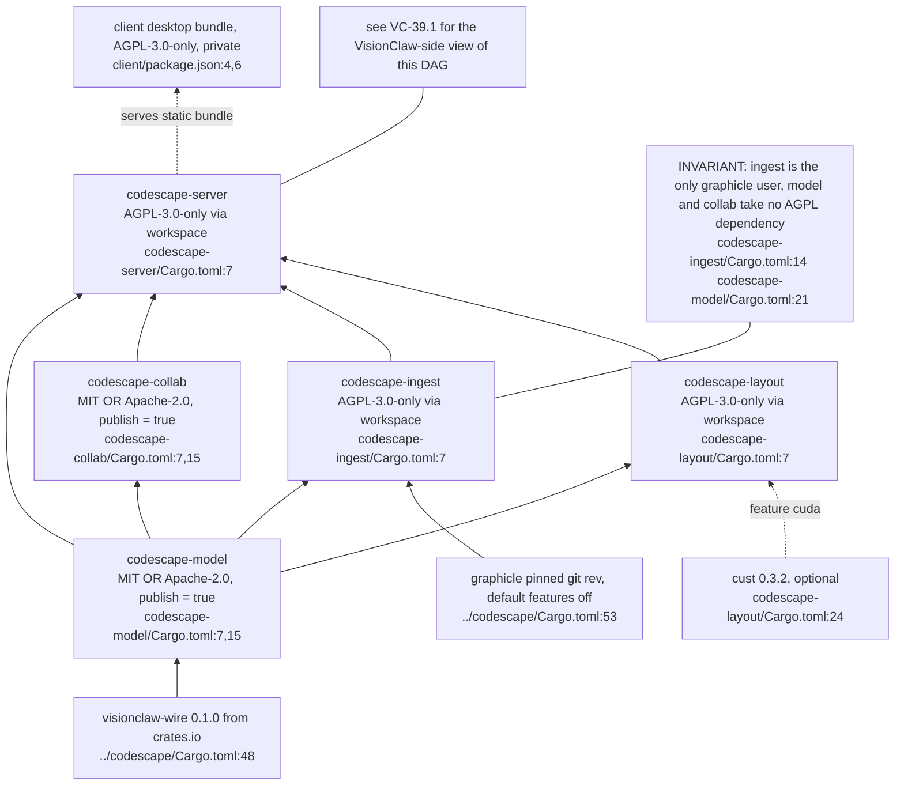
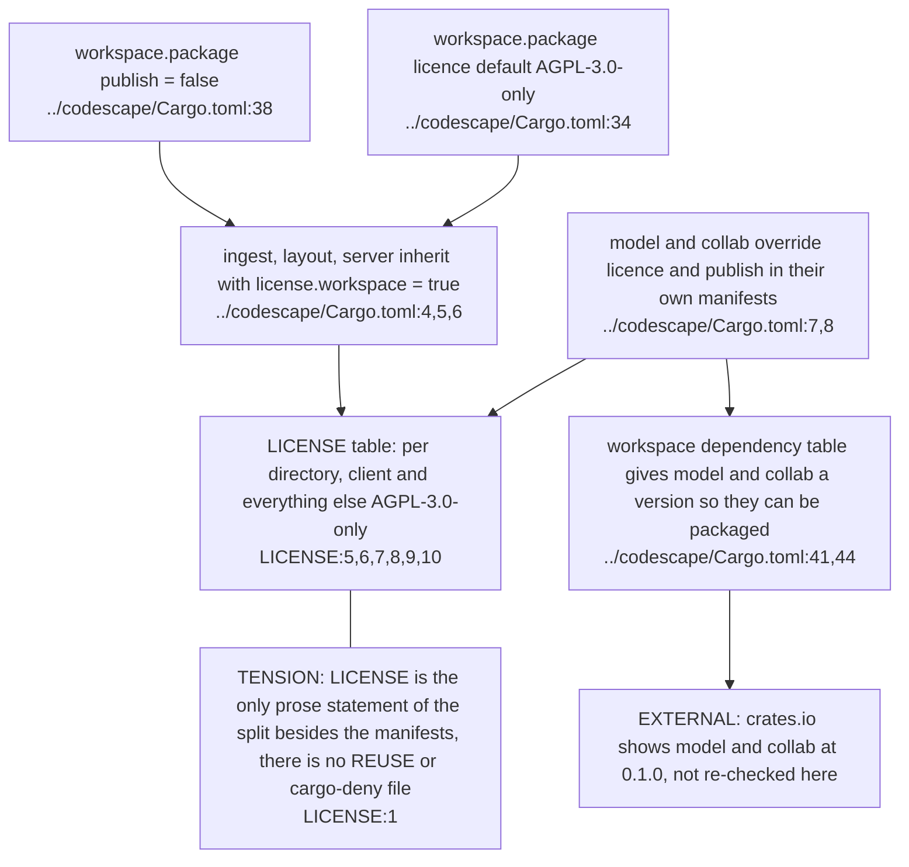
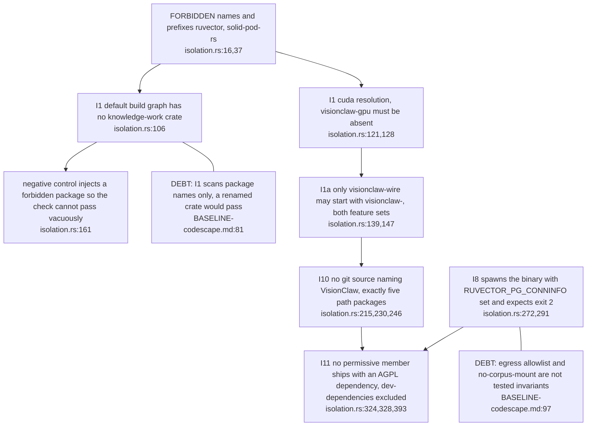
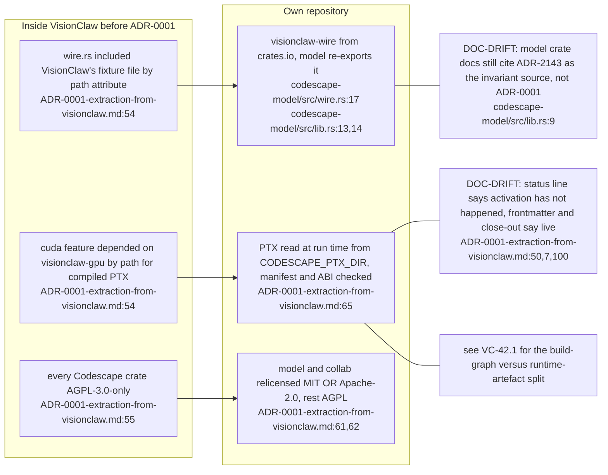
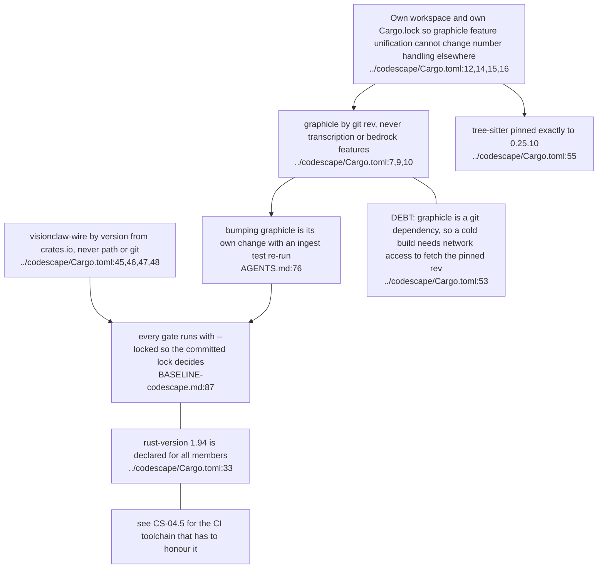

## CS-01.1 The five crates and their dependency direction

**What it shows.** Arrows run from dependency to dependent; the two I/O-free crates are the permissive pair, everything that does I/O is AGPL. The cuda feature adds only cust to layout (`codescape-server/Cargo.toml:22`).

## CS-01.2 Where each crate gets its licence

**What it shows.** AGPL is the default and the two permissive crates opt out in their own manifests (`codescape-model/Cargo.toml:7`). Packaging them needs versioned workspace entries, which is why `codescape-ingest` has none (`../codescape/Cargo.toml:42`).

## CS-01.3 Isolation tests that hold the fence

**What it shows.** Every check runs `cargo metadata --locked`, in the default and the `--all-features` resolution (`isolation.rs:126,143,223`). The boot refusal is the one runtime check, using the real binary rather than the runner's own environment (`isolation.rs:273`).

## CS-01.4 What the extraction removed and what replaced it

**What it shows.** ADR-0001 swapped two path couplings for a published crate and a runtime artefact (`ADR-0001-extraction-from-visionclaw.md:64,65`). The ADR keeps a stale status paragraph under later close-out sections.

## CS-01.5 Pinned external inputs and why the lock stays separate

**What it shows.** The separate lock is the structural form of invariant I6 (`BASELINE-codescape.md:87`). The two third-party pins are the places an upgrade changes extraction output.
