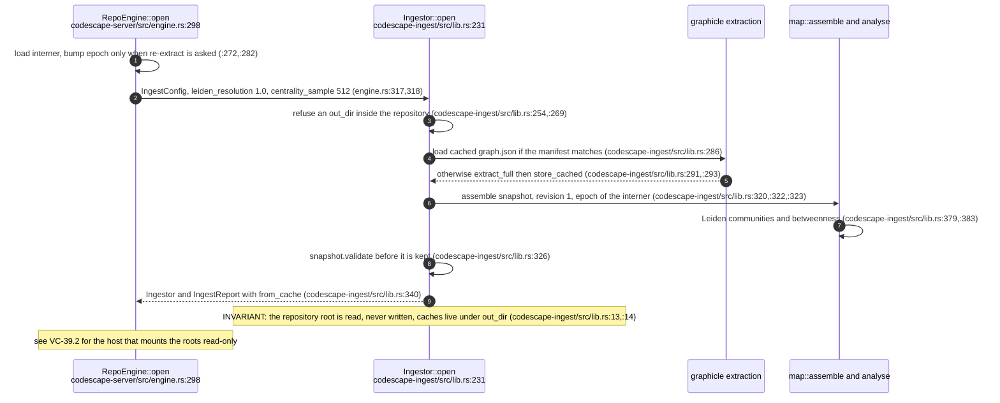
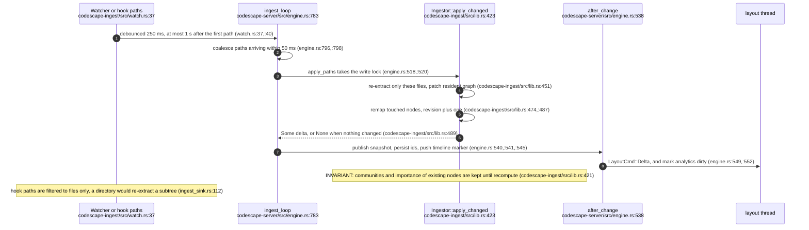
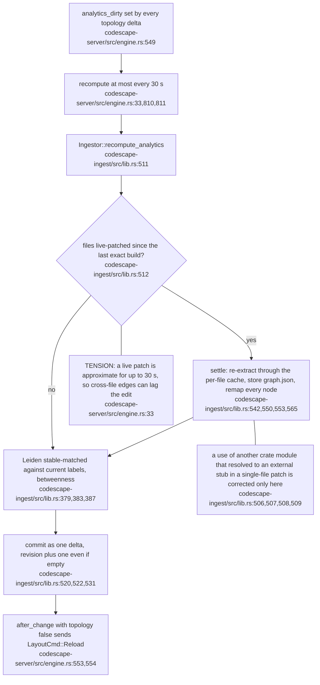
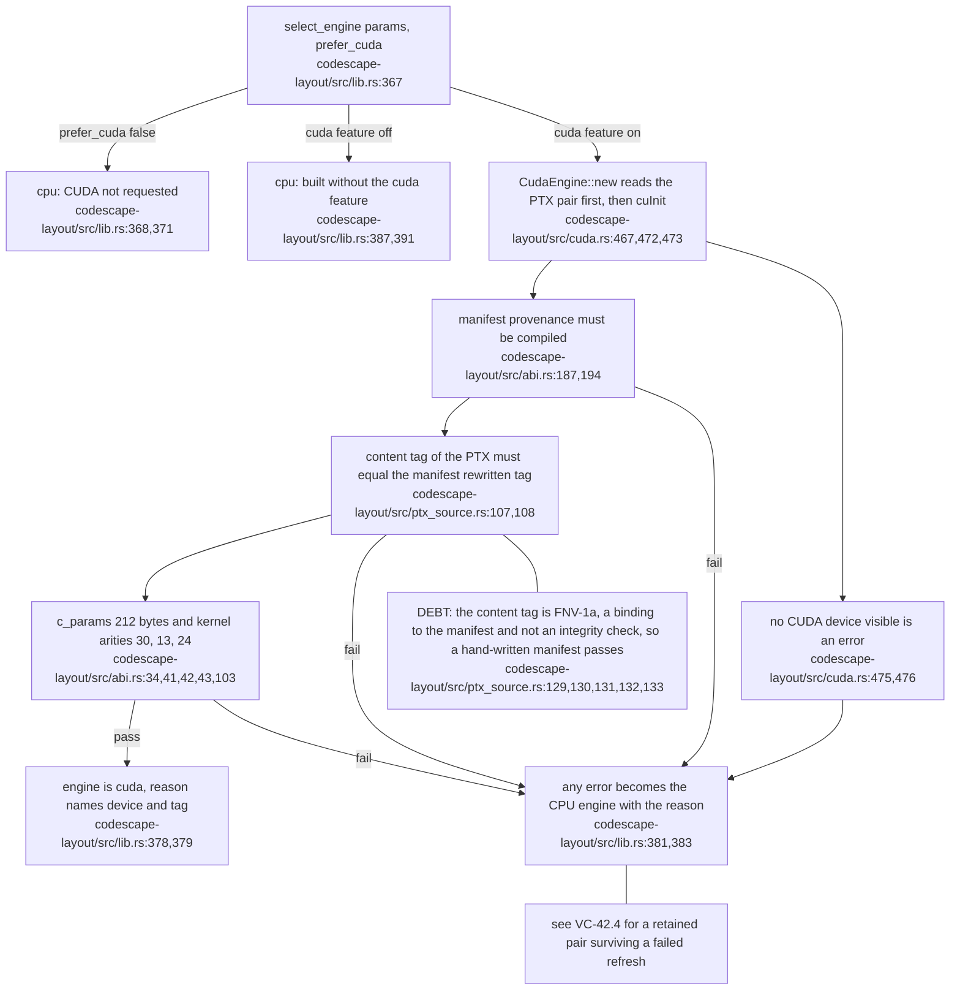
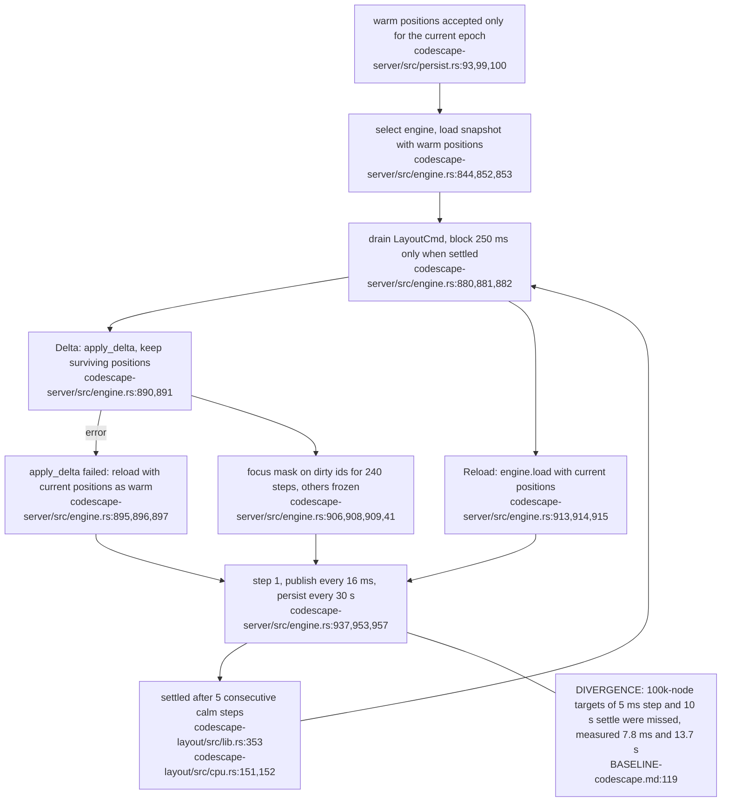
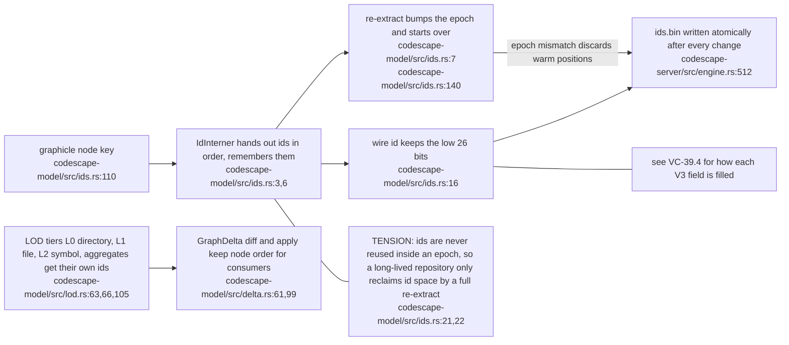

## CS-02.1 Cold open of one repository

**What it shows.** One cold start produces a validated revision-1 snapshot, from graphicle's cache when the file manifest is unchanged. Nothing graphicle-typed leaves the ingest crate (`codescape-ingest/src/lib.rs:3,:4` of its crate docs).

## CS-02.2 A file change becomes a delta and a layout command

**What it shows.** Two path sources feed one coalescing loop, so the watcher and the activity hook cannot apply the same file twice in one batch. The delta, not the snapshot, is what reaches the layout thread.

## CS-02.3 Analytics recompute and the settle correction

**What it shows.** Live patches are cheap and approximate; the periodic settle makes the graph exact again. Community labels survive because the new labels are matched to the old ones (`codescape-ingest/src/lib.rs:376,377`).

## CS-02.4 Engine selection and the PTX acceptance gate

**What it shows.** The CPU engine is both the default and the universal fallback, so a missing device, feature or artefact never stops the server. The reason string reaches `/api/health` (`codescape-layout/src/lib.rs:18,19` crate docs).

## CS-02.5 The layout loop between deltas

**What it shows.** Edits move only the dirty bodies for a bounded burst, so an agent typing in one file does not re-energise the whole scene. A failed incremental update degrades to a warm reload rather than an error (`codescape-server/src/engine.rs:895`).

## CS-02.6 Ids, epochs and what the wire record carries

**What it shows.** Interned ids replace hashing because a 200k-symbol graph would collide in 26 bits (`codescape-model/src/ids.rs:5`). The epoch is the only reset, and it also invalidates persisted positions.
