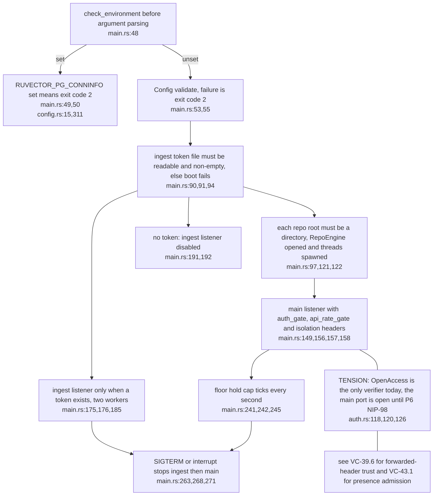
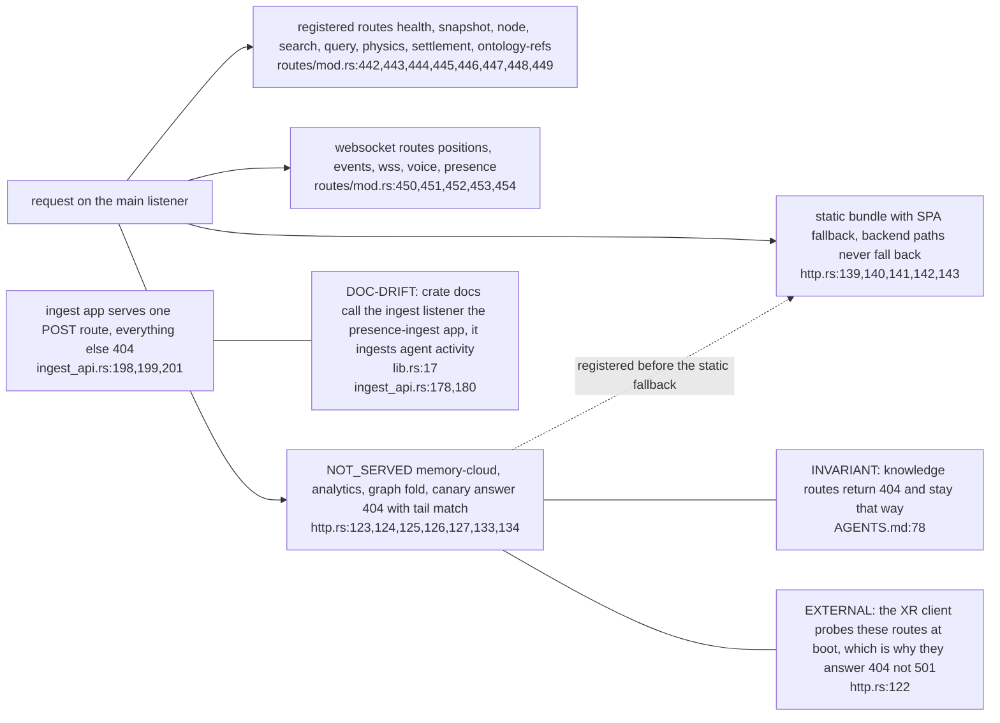
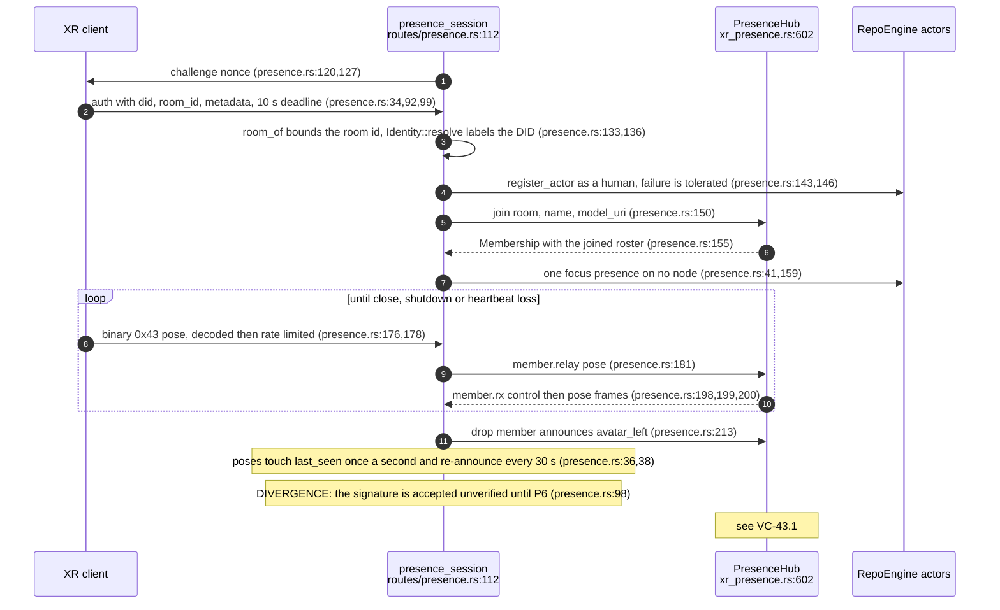
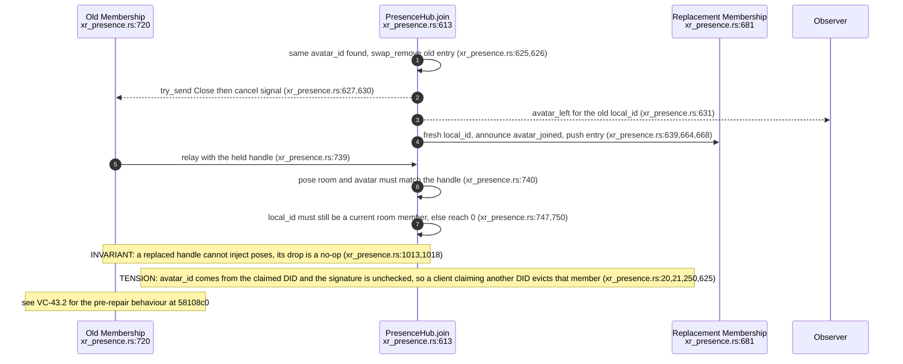
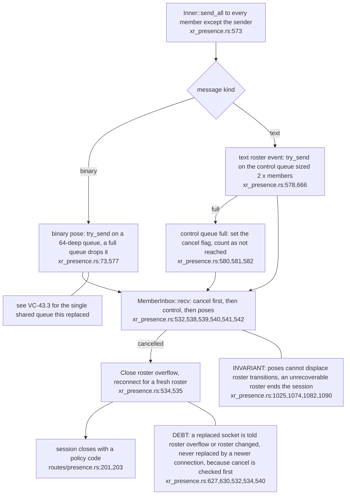
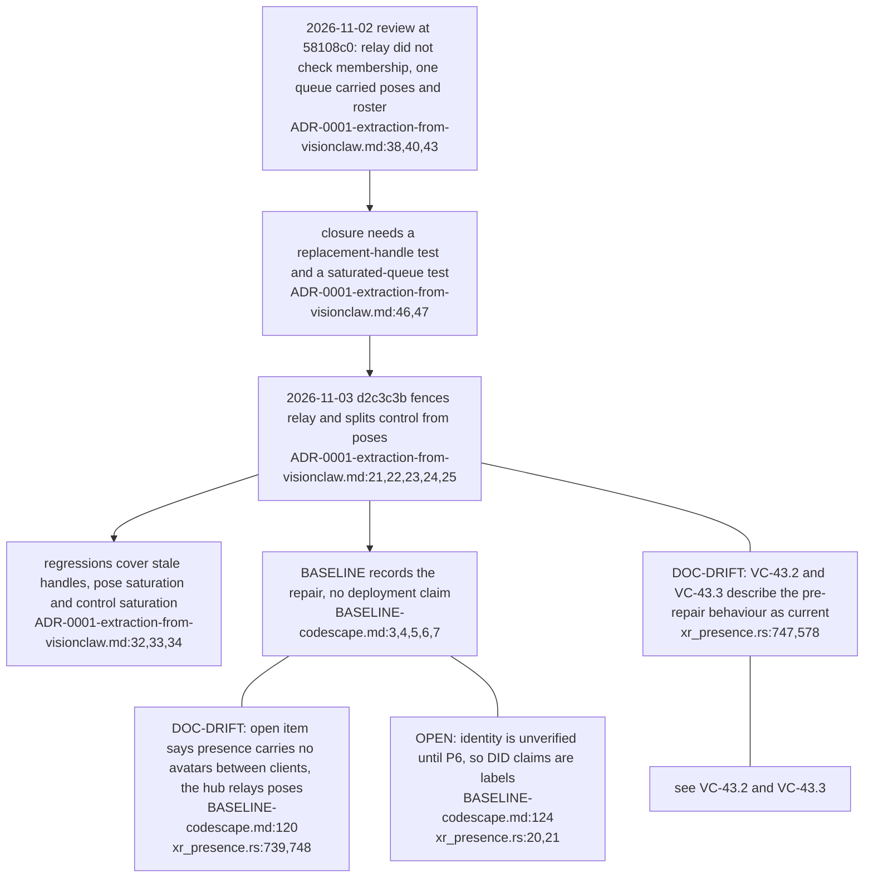

## CS-03.1 Boot order and the two listeners

**What it shows.** The memory-store refusal runs before anything else, then the token decides whether the second listener exists at all. Both listeners share one shutdown flag (`main.rs:116,267`).

## CS-03.2 Route surface and the routes that must stay 404

**What it shows.** The knowledge-work routes are explicit 404s ahead of the SPA fallback, so a client cannot mistake them for a page. Hook callers can only appear as agents (`ingest_api.rs:178,180`).

## CS-03.3 One XR presence session

**What it shows.** The session is a thin shell: all room state lives in the hub, and the desktop sees XR members as ordinary human actors. Poses never heat code nodes (`routes/presence.rs:12`).

## CS-03.4 Replacement and relay fencing after the 2026-11-03 repair

**What it shows.** Relay now checks membership, not just room and avatar, which closes the stale-handle gap recorded at `ADR-0001-extraction-from-visionclaw.md:44,45`. Eviction by DID claim remains because identity is open.

## CS-03.5 Two queues per member and the roster-overflow close

**What it shows.** Lossy poses and reliable roster events no longer share a bound, and exhausting the reliable one disconnects rather than diverges. The test accepts any Close, so the wrong reason text is not pinned (`xr_presence.rs:1001`).

## CS-03.6 How the presence gaps were found, repaired and left documented

**What it shows.** The repair is source and test closure only; the ADR states no service was deployed (`ADR-0001-extraction-from-visionclaw.md:34`). Two older documents still describe the earlier behaviour.
