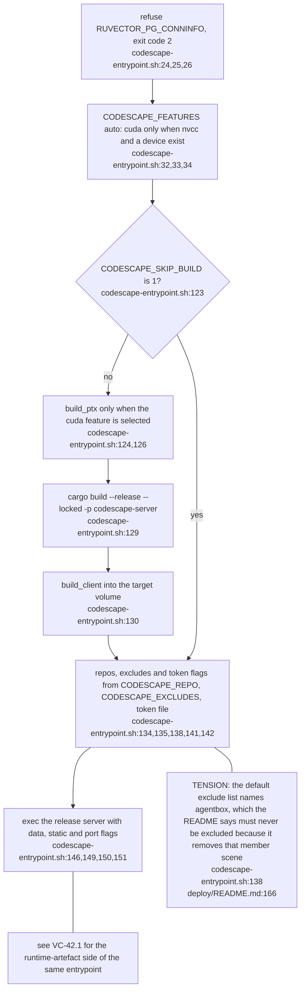
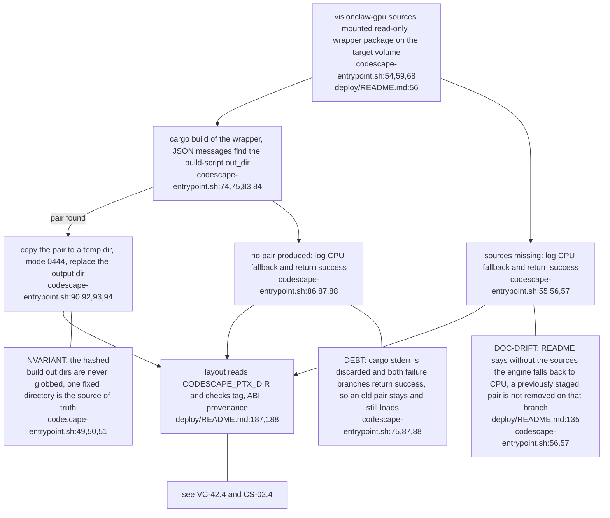
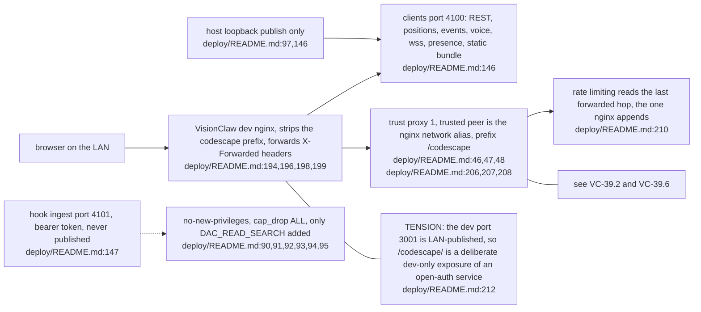
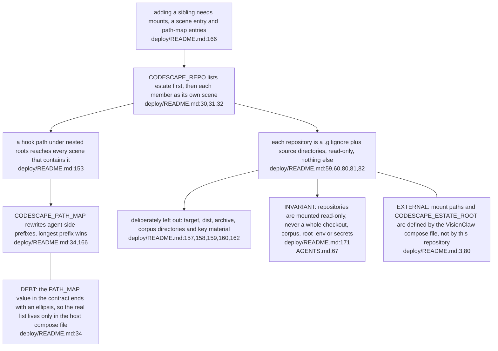
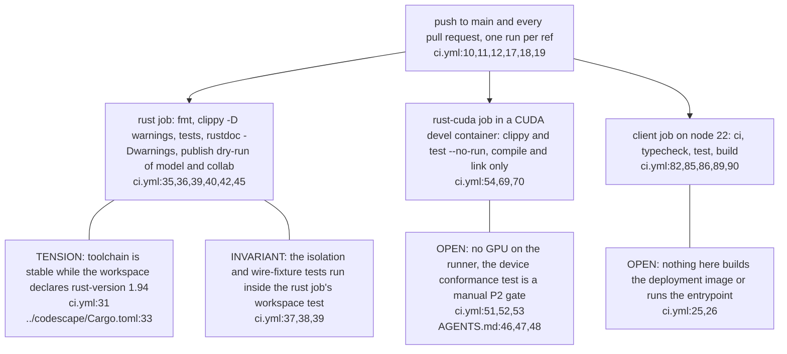
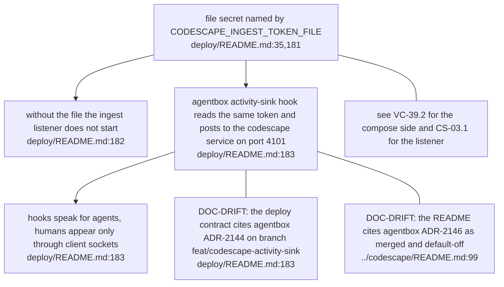

## CS-04.1 Entrypoint phases from guard to exec

**What it shows.** Every phase is a build step except the final exec, and the skip switch jumps straight to the last build. The compose file overrides the exclude list (`deploy/README.md:33`), so the tension bites only a host that relies on the default.

## CS-04.2 PTX staging between the VisionClaw build and the layout loader

**What it shows.** The PTX pair is produced by VisionClaw's own build script and only copied here, never written by hand (`codescape-entrypoint.sh:46,47`). A failed refresh leaves the previous pair in place.

## CS-04.3 Ports, proxy trust and what is published

**What it shows.** Only port 4100 is ever reachable from outside the container network, and trust in forwarded headers is narrowed to one named peer. Production nginx carries no Codescape location until P6 (`deploy/README.md:212`).

## CS-04.4 One service, many scenes: the estate mount rules

**What it shows.** The estate view is a nested-root trick: member repositories are ingested once each, and the umbrella scene is another walk over the same mounts. The exclude list is a second fence, not the first (`deploy/README.md:166`).

## CS-04.5 CI jobs and what they do not prove

**What it shows.** CI proves the permissive crates package and the CUDA feature links, nothing about a running GPU or a deployed container. Phase evidence for those is committed separately (`ADR-0001-extraction-from-visionclaw.md:110,114`).

## CS-04.6 Ingest token and the activity hook, with the record that disagrees

**What it shows.** Two documents in this repository name different ADR numbers and branch states for the same hook. The estate repository map follows the branch reading, which is the one to verify against agentbox.
