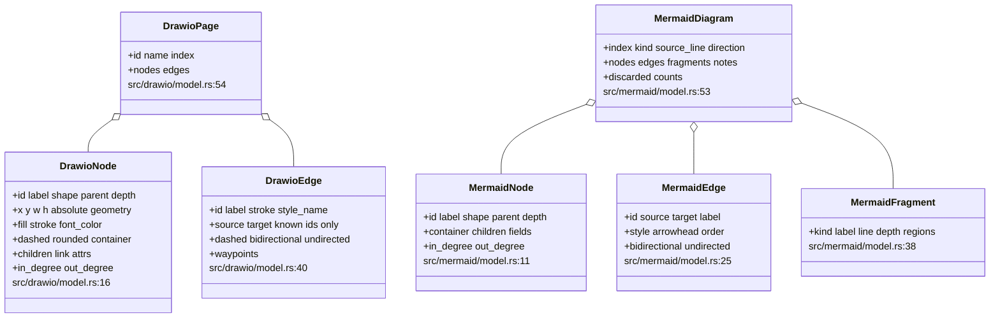
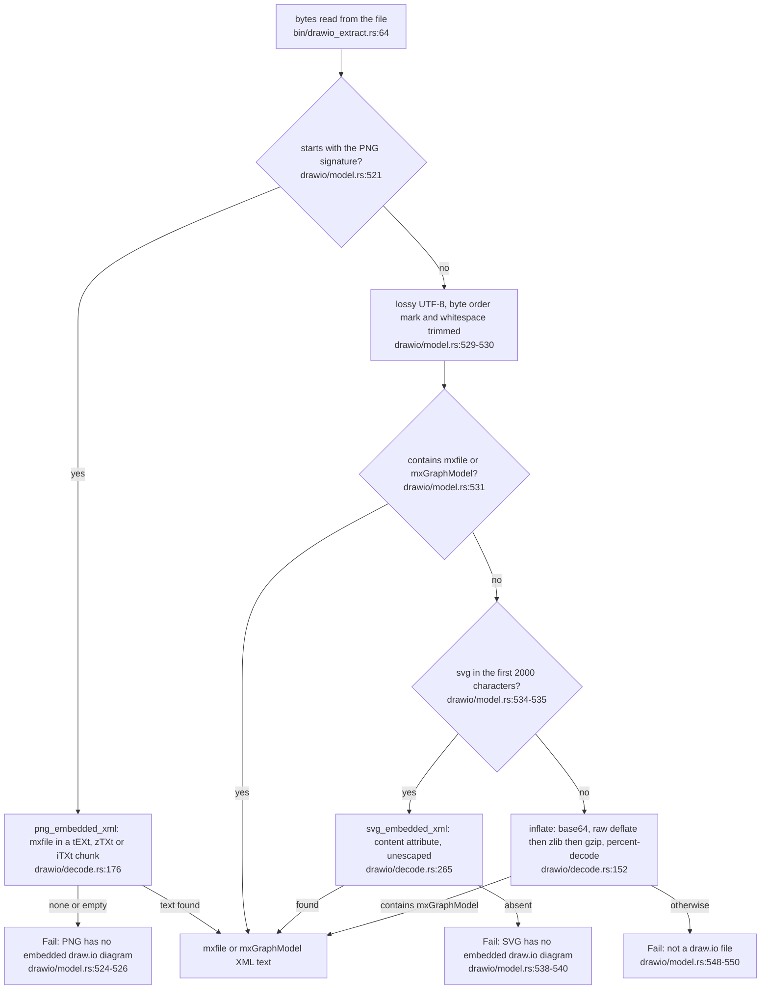
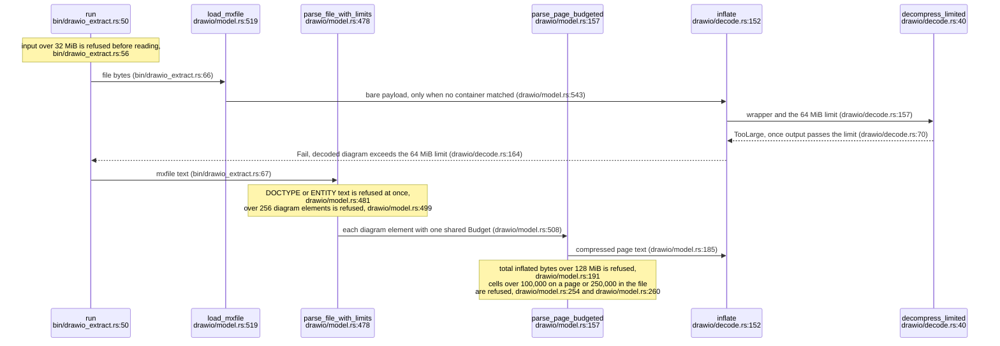
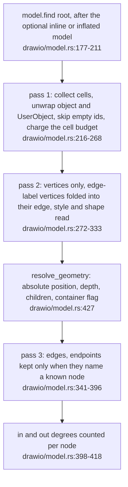
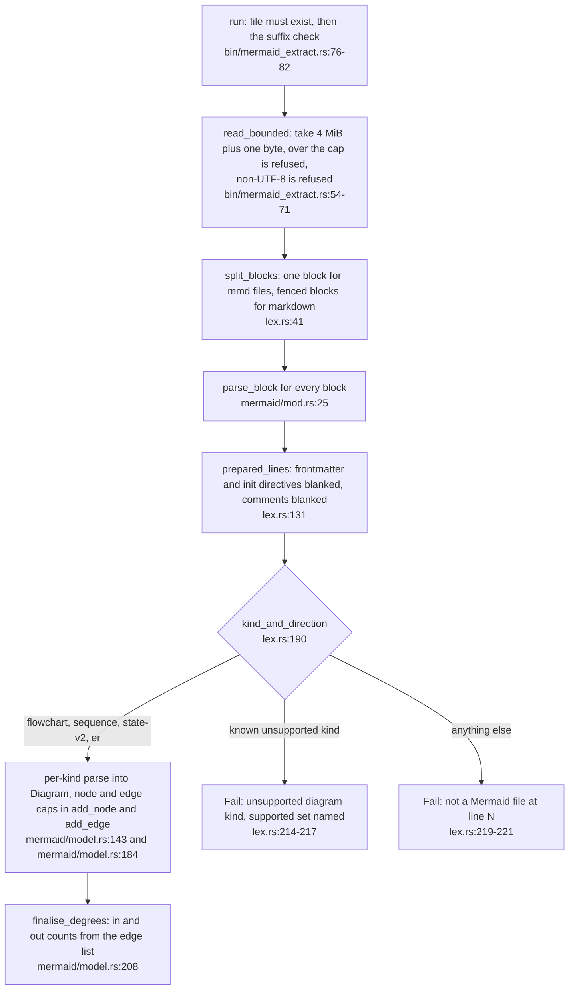
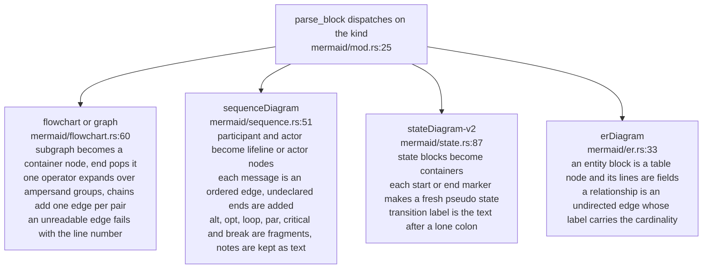

## For developers

`diagram-ir` turns a draw.io file or a Mermaid source into typed nodes, typed edges and a few structural signals, so that a reader (usually an LLM agent) never has to open the storage format. The README describes the result as one Rust struct shared by both formats (`../diagram-ir/README.md:19-20`). The code has two parallel type families instead: a draw.io `Node`, `Edge` and `Page` (`../diagram-ir/src/drawio/model.rs:16-60`) and a Mermaid `Node`, `Edge`, `Fragment` and `Diagram` (`../diagram-ir/src/mermaid/model.rs:11-66`). They share a field vocabulary (id, label, shape, parent, depth, container, children, in and out degree) but not a type, and the two analysers and the two digests are separate code. DI-02 covers what consumes them.

Every failure on both sides is one value, `Fail`, a message string wrapped in a tuple struct (`../diagram-ir/src/lib.rs:22`), returned through `Failable` (`../diagram-ir/src/lib.rs:38`). Both binaries print it behind their own prefix and exit with status 2 (`../diagram-ir/src/bin/drawio_extract.rs:45-48`, `../diagram-ir/src/bin/mermaid_extract.rs:47-50`).

The draw.io side starts with `load_mxfile`, which accepts four shapes of input: a PNG with an `mxfile` text chunk, raw `mxfile` or `mxGraphModel` XML, an SVG whose `content` attribute carries the XML, and a bare base64 payload (`../diagram-ir/src/drawio/model.rs:519-551`). Compressed pages are undone by `inflate`: lenient base64, then raw deflate, zlib and gzip tried in that order, then percent-decoding (`../diagram-ir/src/drawio/decode.rs:152-173`). `parse_file_with_limits` then builds a page per `diagram` element, and `parse_page_budgeted` flattens each model in three passes plus a geometry resolver (`../diagram-ir/src/drawio/model.rs:157-421`). The CLI parses every page before it selects one, so a limit breached on page 3 stops a run that asked for page 0 (`../diagram-ir/src/bin/drawio_extract.rs:67-68`).

The draw.io caps are the `Limits` struct and one constant. The constants are 256 pages, 100,000 cells per page, 250,000 cells per file and twice the per-page inflate cap in total inflated bytes (`../diagram-ir/src/drawio/model.rs:134-142`). The per-page inflate cap is `MAX_XML_BYTES`, 64 MiB, checked while inflating (`../diagram-ir/src/drawio/decode.rs:20`, `../diagram-ir/src/drawio/decode.rs:70-72`). The whole-file input cap, `MAX_INPUT_BYTES`, is 32 MiB (`../diagram-ir/src/drawio/decode.rs:19`). The page cap is checked once the `mxfile` is parsed (`../diagram-ir/src/drawio/model.rs:499-505`). The cell caps are checked as each cell is collected, so a page of exactly the cap parses and one cell more fails (`../diagram-ir/src/drawio/model.rs:253-265`, `../diagram-ir/tests/drawio.rs:494-513`). The total-bytes cap is charged only by pages stored as a compressed payload, after each is inflated (`../diagram-ir/src/drawio/model.rs:190-196`). The caps arrived in commit `a3b20a7`, tracked upstream as finding COV-A-F2 (`../diagram-ir/src/drawio/model.rs:103-108`). Exceeding any of them is an error, never a truncated page (`../diagram-ir/src/drawio/model.rs:476-477`).

The Mermaid side is a lexer plus one parser per kind. The CLI checks the suffix, reads at most 4 MiB plus one byte, splits fenced blocks, and parses every block before selecting one (`../diagram-ir/src/bin/mermaid_extract.rs:82-89`). `prepared_lines` blanks frontmatter and directive lines instead of interpreting them (`../diagram-ir/src/mermaid/lex.rs:131-167`), `kind_and_direction` recognises four kinds and names the supported set when it meets a known unsupported one (`../diagram-ir/src/mermaid/lex.rs:190-224`), and `parse_block` dispatches (`../diagram-ir/src/mermaid/mod.rs:25-37`). The node and edge caps, 2,000 and 5,000 per `Diagram` (each fenced block gets its own, so a Markdown file with several blocks can exceed them in total), sit in `Diagram::add_node` and `Diagram::add_edge`, so every kind passes through them (`../diagram-ir/src/mermaid/model.rs:143-145`, `../diagram-ir/src/mermaid/model.rs:184-186`). Style directives and click handlers are counted and dropped, never kept (`../diagram-ir/src/mermaid/flowchart.rs:16-30`).

## For the business

A diagram stored as a draw.io file or a Mermaid snippet is unreadable to an automated assistant without help. This component does that reading and nothing else: it never draws, never runs anything embedded in a file and never reaches out to the network. Its safety promise is that a hostile or simply enormous file is refused with a plain message rather than exhausting a machine's memory.

The practical limits are generous for people and tight for attackers: a draw.io file may be up to 32 MiB on disk, 256 pages and 250,000 shapes and lines in total; a Mermaid source up to 4 MiB, with 2,000 nodes and 5,000 edges per diagram. Anything over is refused with the limit named. Two things to know when planning around it. Only four Mermaid diagram kinds are understood (flowchart, sequence, state, entity-relationship); others are refused by name. And a file is parsed in full before the requested page or diagram is picked, so one bad page makes the whole run fail.

## DI-01.1 Two IR families with one vocabulary

**What it shows.** Each import path produces its own types. draw.io carries geometry, colours and a free-form attribute map that Mermaid has no equivalent for, while Mermaid carries edge order, arrowhead names, entity fields and sequence fragments that draw.io does not.

**Why it is this way.** The source comments tie field order to the earlier Python dataclasses, whose `asdict()` output `--json` must reproduce (`../diagram-ir/src/drawio/model.rs:13-14`, `../diagram-ir/src/mermaid/model.rs:1-2`). The source does not record why the two families were not merged into one.

**Drift (README vs code):** the README says both formats share a single Rust struct (`../diagram-ir/README.md:19-20`), and that the golden tests show the same logical diagram in both formats giving equivalent IR (`../diagram-ir/README.md:154-155`). The code has two type families, and the golden tests compare each format's output with captured output of the replaced Python, not with each other (`../diagram-ir/tests/golden_parity.rs:1-2`).

## DI-01.2 From file bytes to draw.io XML

**What it shows.** `load_mxfile` is a first-match dispatch. A truncated PNG metadata chunk is its own failure, raised inside `png_embedded_xml` (`../diagram-ir/src/drawio/decode.rs:188-190`), and a payload that inflates past the cap fails with the limit in its message (`../diagram-ir/src/drawio/decode.rs:163-168`).

**Why it is this way.** draw.io writes the same model in several containers, and the importer has to meet each. Decompression is bounded at every step, because a small payload can expand without limit.

**Invariant:** `decompress_limited` returns `TooLarge` as soon as the output passes the limit, checked after every 64 KiB scratch read (`../diagram-ir/src/drawio/decode.rs:58-72`). The test `decompression_is_bounded` exercises it (`../diagram-ir/tests/drawio.rs:201`).

## DI-01.3 Where each draw.io limit fires

**What it shows.** Five separate ceilings guard one file: the on-disk size in the binary, the inflate size per payload, the page count, the inflated total and the cell counts. The file-size cap runs before the file is read. The inflate cap runs wherever a payload is decoded: before any XML parsing for a bare payload, and per page, after the outer `mxfile` has been parsed, for compressed `diagram` elements (`../diagram-ir/src/drawio/model.rs:482`, `../diagram-ir/src/drawio/model.rs:185`). The page count, the inflated total and the cell counts are enforced by `parse_file_with_limits` and its helper, which share one `Budget` across pages (`../diagram-ir/src/drawio/model.rs:146-149`).

**Why it is this way.** Before commit `a3b20a7` only the per-page inflate cap existed, so memory grew with pages times 64 MiB and with the number of cells (`../diagram-ir/src/drawio/model.rs:103-108`). The totals are the fix. `parse_page` alone starts a fresh `Budget`, so the whole-file totals bind only through `parse_file_with_limits` (`../diagram-ir/src/drawio/model.rs:152-154`).

**Invariant:** a cell or page count over its limit is an error, not a clipped result: a page at the cap parses and one cell more fails, three pages of 40 cells fail a 100-cell file total, and a third page fails a two-page limit (`../diagram-ir/tests/drawio.rs:494-536`, `../diagram-ir/tests/drawio.rs:538-559`).

**Open:** the 32 MiB and 4 MiB input caps are enforced only by the two binaries (`../diagram-ir/src/bin/drawio_extract.rs:56`, `../diagram-ir/src/bin/mermaid_extract.rs:60`). The library entry points `load_mxfile`, `parse_file` and `split_blocks` take text already read and apply no input-size cap of their own (`../diagram-ir/src/drawio/model.rs:519`, `../diagram-ir/src/mermaid/lex.rs:40-41`), while `../diagram-ir/src/lib.rs:4-7` words the cap as a property of every entry point. Nothing states whether a library caller is expected to bound its own input.

**Drift (README vs code):** the README lists "XML attributes per element" and "XML nesting depth" as "bounded by xmldom" and describes `xmldom` as having attribute and depth limits (`../diagram-ir/README.md:76-77`, `../diagram-ir/README.md:65`). The tree builder pushes onto an unbounded stack and collects every attribute with no count or depth check (`../diagram-ir/src/xmldom.rs:82-130`, `../diagram-ir/src/xmldom.rs:132-149`). The bound that exists is indirect: the inflate cap and the CLI's file cap limit how many bytes can reach the parser.

**Drift (README vs code):** the README table lists "Max nodes 2,000" and "Max edges 5,000" beside the draw.io limits (`../diagram-ir/README.md:74-75`). Those are Mermaid constants (`../diagram-ir/src/mermaid/mod.rs:20-21`); draw.io has no node or edge cap, only the cell caps above, which count vertices, edges and edge labels together (`../diagram-ir/src/drawio/model.rs:113-114`).

## DI-01.4 Flattening a draw.io model into a page

**What it shows.** A page is built in a fixed order, and each pass reads only what the previous one stored. Edge endpoints that name no node become `None`, which the analyser later counts as dangling (`../diagram-ir/src/drawio/model.rs:373-374`).

**Why it is this way.** draw.io stores everything as flat cells with `parent` links, so containment and absolute coordinates must be reconstructed. Label cells parented to an edge are text on that edge and are joined into its label with ` / ` (`../diagram-ir/src/drawio/model.rs:282-296`, `../diagram-ir/src/drawio/model.rs:357-366`).

**Debt:** `resolve_geometry` deliberately reproduces the earlier Python's double count for nodes at depth two or deeper, because it resolves in place and walks the parent chain again; its own comment says the behaviour is observable and so is reproduced rather than corrected (`../diagram-ir/src/drawio/model.rs:423-426`).

**Invariant:** DOCTYPE and ENTITY declarations are refused twice, once by a case-folded text scan and once by the XML reader, so no input can pull in external data (`../diagram-ir/src/drawio/model.rs:75-83`, `../diagram-ir/src/xmldom.rs:95-97`).

## DI-01.5 The Mermaid import pipeline

**What it shows.** The suffix gate runs before any byte is read, and the size gate runs while reading, so neither needs the whole file in memory (`../diagram-ir/src/mermaid/lex.rs:28-38`, `../diagram-ir/src/bin/mermaid_extract.rs:52-53`). Fence errors are explicit: an unterminated fence names its opening line and a file with no fence is refused (`../diagram-ir/src/mermaid/lex.rs:80-92`).

**Why it is this way.** Mermaid has no layout and no container format, so the only trust work is bounding the text and not interpreting directives. Frontmatter and `init` directives are blanked rather than parsed, and a frontmatter block is only recognised within 40 lines (`../diagram-ir/src/mermaid/lex.rs:16`, `../diagram-ir/src/mermaid/lex.rs:112-127`).

**Invariant:** a duplicate node id merges into the existing node and does not count against the node cap, since the cap is checked only after the id lookup misses (`../diagram-ir/src/mermaid/model.rs:124-145`).

## DI-01.6 How each Mermaid kind lands in the IR

**What it shows.** Four parsers write to one `Diagram`. Flowchart edges are found by a masked scan that ignores brackets and quotes, and both `A-- text -->B` and `A-->|text|B` carry a label (`../diagram-ir/src/mermaid/shapes.rs:287`). A line that looks like an edge but cannot be read is an error, not a skipped line (`../diagram-ir/src/mermaid/flowchart.rs:121-130`, `../diagram-ir/src/mermaid/flowchart.rs:149-151`, `../diagram-ir/src/mermaid/sequence.rs:163-165`, `../diagram-ir/src/mermaid/state.rs:144-146`, `../diagram-ir/src/mermaid/er.rs:98-99`).

**Why it is this way.** The IR is deliberately the common denominator a reader can reason over, so a sequence message and a state transition both become an edge, with kind-specific facts (`order`, `arrowhead`, `fields`, `fragments`) alongside. Nothing in a label is evaluated, and retained labels are inert text (`../diagram-ir/src/mermaid/mod.rs:1-4`).

**Debt:** the README says the other Mermaid kinds (class, Gantt, pie, mindmap and so on) are not yet parsed (`../diagram-ir/README.md:202-204`), and the lexer holds a fixed list of twelve names it refuses by name (`../diagram-ir/src/mermaid/lex.rs:174-187`).
