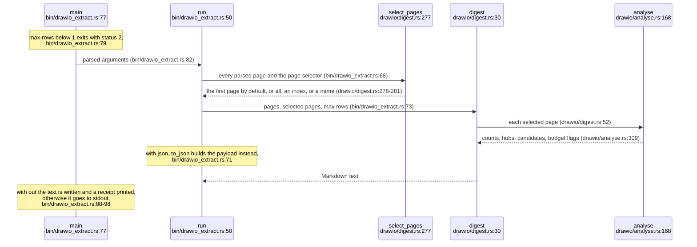
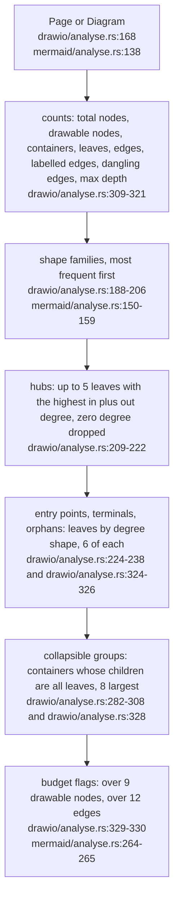
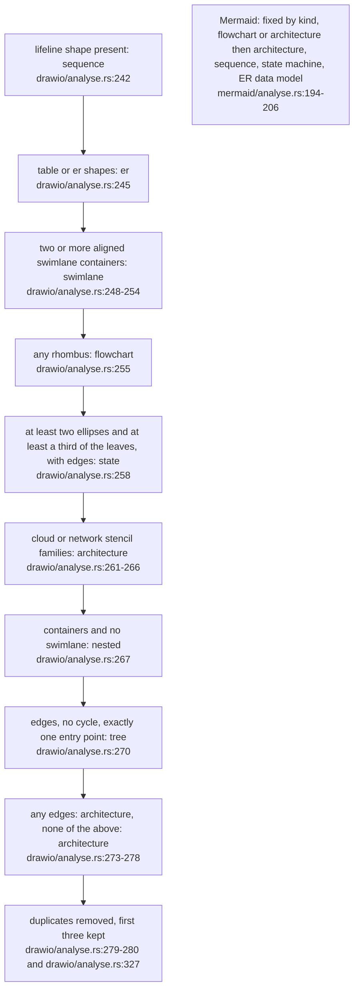
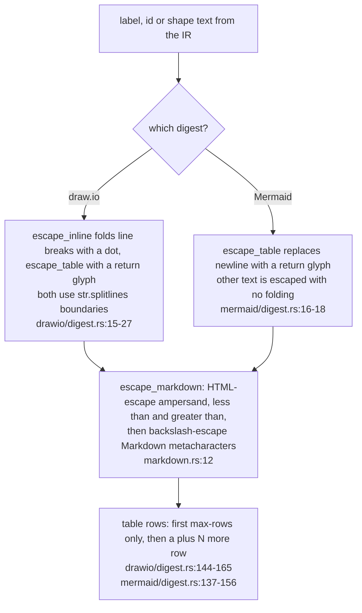
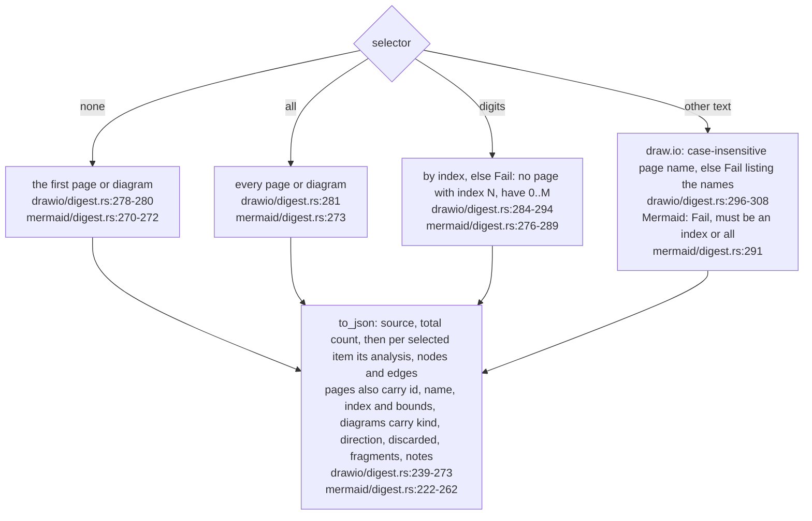

## For developers

The README is explicit that this crate does not render: "the IR is data, not pixels" (`../diagram-ir/README.md:195`). The only output stage is therefore text. Each IR gets two surfaces, a compact Markdown digest meant to be read into an agent's context and a pretty-printed JSON dump of the whole IR, and both are built by the same module that holds the other half of the import path. draw.io has `digest`, `to_json` and `select_pages` (`../diagram-ir/src/drawio/digest.rs:30`, `../diagram-ir/src/drawio/digest.rs:239`, `../diagram-ir/src/drawio/digest.rs:277`); Mermaid has the same three (`../diagram-ir/src/mermaid/digest.rs:21`, `../diagram-ir/src/mermaid/digest.rs:222`, `../diagram-ir/src/mermaid/digest.rs:266`). Between the IR and either surface sits `analyse`, which adds structural signals and never decides anything (`../diagram-ir/src/drawio/analyse.rs:1`).

The digests and the signals are exact ports of earlier Python, and the code says so throughout. Python `repr`, `str.splitlines` and `bool` spellings are reproduced rather than approximated (`../diagram-ir/src/pyfmt.rs:1-6`), and eleven golden tests compare every output byte for byte with captured Python output (`../diagram-ir/tests/golden_parity.rs:1-2`, `../diagram-ir/tests/golden_parity.rs:19`). That explains several oddities below: the two digests escape text differently, tie-breaking differs between the two analysers, and a byte count is really a character count.

A page of draw.io output and a diagram of Mermaid output have the same sections (counts, shapes, type candidates, budget flag, hubs, entry points, terminals, unconnected, collapsible groups, a node table and an edge table). Mermaid adds a line for discarded style and click directives, fragments and notes (`../diagram-ir/src/mermaid/digest.rs:72-99`). Tables are cut at `--max-rows`, default 40, with a final `+N more (use --json)` row (`../diagram-ir/src/drawio/digest.rs:160-165`, `../diagram-ir/src/mermaid/digest.rs:151-156`). The JSON surface is not cut.

The two binaries have the same shape: reject `--max-rows` below 1, run, then either write the file and print a one-line receipt or print to stdout (`../diagram-ir/src/bin/drawio_extract.rs:77-100`, `../diagram-ir/src/bin/mermaid_extract.rs:97-121`).

## For the business

The output is what lets an assistant "see" a diagram: a short report of how many boxes and arrows there are, which boxes are the busiest, where flow starts and ends, which groups could be collapsed to simplify the picture, and a suggested diagram type. It is advice for a reader, not a verdict, and the code labels its type suggestions "advisory only" (`../diagram-ir/src/drawio/analyse.rs:240`). The same report can be requested in a machine-readable form that carries every box and arrow in full.

Two behaviours matter in practice. A long diagram is cut to 40 rows per table by default and says how many rows were left out, so a reader knows to ask for the complete version. And the numeric "budget" flag (more than nine drawable shapes or twelve arrows is marked OVER) is a rule of thumb for legibility when redrawing, not a limit on what can be read.

## DI-02.1 From arguments to the text a reader gets

**What it shows.** The draw.io path; the Mermaid binary has the same shape, with `select_diagrams` and `to_json` from `mermaid/digest.rs` (`../diagram-ir/src/bin/mermaid_extract.rs:89-94`). Any `Fail` raised on the way is printed on stderr behind `drawio_extract: ` (or `mermaid_extract: `) and the process exits with status 2 (`../diagram-ir/src/bin/drawio_extract.rs:45-48`, `../diagram-ir/src/bin/drawio_extract.rs:82-85`).

**Why it is this way.** The program is described as the deterministic half of an import flow that "never makes a design decision" (`../diagram-ir/src/bin/drawio_extract.rs:3-4`), so everything the model is told comes from counted facts.

**Debt:** with `--out`, the receipt reads `wrote PATH (N bytes)` but `N` is a character count, kept so the output matches the Python it replaced (`../diagram-ir/src/bin/drawio_extract.rs:91`, `../diagram-ir/src/pyfmt.rs:152-157`). For text containing the dash and carriage glyphs the digest itself emits, bytes and characters differ.

**Drift (README vs code):** the README describes `pyfmt` as "Python format-string interpolation for template variables" (`../diagram-ir/README.md:64`). The module is Python-compatible `repr`, `splitlines`, `strip`, `bool` and path helpers for the digests, and nothing in it interpolates template variables (`../diagram-ir/src/pyfmt.rs:1-6`).

## DI-02.2 The signals that analyse adds

**What it shows.** The same signal set is computed from each IR, over leaves rather than containers for degree facts. The two analysers differ in what they count as drawable: draw.io excludes `text` shapes and unlabelled childless nodes (`../diagram-ir/src/drawio/analyse.rs:173-178`), Mermaid takes every leaf (`../diagram-ir/src/mermaid/analyse.rs:237`). Mermaid always reports zero dangling edges, since its parsers create the endpoint nodes (`../diagram-ir/src/mermaid/analyse.rs:249`).

**Why it is this way.** Ties are broken differently: draw.io sorts hubs by degree only, so equal degrees keep document order, and a source comment ties its stable sort to the Python it replaced (`../diagram-ir/src/drawio/analyse.rs:197`, `../diagram-ir/src/drawio/analyse.rs:209-212`), while Mermaid sorts by degree then id, descending (`../diagram-ir/src/mermaid/analyse.rs:161-166`). The source does not record the reason for Mermaid's ordering. Shape families are ordered by count then first sighting for draw.io and by count then name for Mermaid (`../diagram-ir/src/drawio/analyse.rs:197-202`, `../diagram-ir/src/mermaid/analyse.rs:154-155`).

**Debt:** the legibility budget (9 nodes, 12 edges) is written as a bare literal in four places, the two analysers and the two digest lines that print it, rather than as one constant (`../diagram-ir/src/drawio/analyse.rs:329-330`, `../diagram-ir/src/mermaid/analyse.rs:264-265`, `../diagram-ir/src/drawio/digest.rs:91`, `../diagram-ir/src/mermaid/digest.rs:66`).

## DI-02.3 How the diagram type is suggested

**What it shows.** For draw.io the suggestion is an ordered list of tests, strongest first, and the digest prints the first three. For Mermaid the author already chose the kind, so the list is fixed by it, with only a flowchart containing a rhombus promoted ahead of `architecture`.

**Why it is this way.** The signal is advisory input for choosing how to redraw a diagram, and the order records which evidence is stronger. The swimlane test uses an 8 unit alignment tolerance (`../diagram-ir/src/drawio/analyse.rs:252`, `../diagram-ir/src/drawio/analyse.rs:123-138`).

**Invariant:** a cycle test never follows an edge whose endpoint is unknown, and treats an unknown target as already finished, so dangling edges cannot create a cycle (`../diagram-ir/src/drawio/analyse.rs:61-87`, `../diagram-ir/src/drawio/analyse.rs:104-112`). The test `cycle_detection_ignores_dangling_edges` covers it (`../diagram-ir/tests/drawio.rs:381`).

## DI-02.4 Escaping and truncation in the digests

**What it shows.** Every label reaches the digest through one escaping function, `escape_markdown`, which HTML-escapes without touching quotes and then backslash-escapes a fixed set of Markdown metacharacters (`../diagram-ir/src/markdown.rs:12-39`, `../diagram-ir/src/entities.rs:20-31`). The module comment states that the two digests' newline folding is deliberately not shared (`../diagram-ir/src/markdown.rs:1-5`).

**Why it is this way.** The goldens pin the exact bytes the Python emitted, so a "tidy" shared helper would change them. The draw.io digest also lists only nodes that have a label or children, while the Mermaid table lists every node (`../diagram-ir/src/drawio/digest.rs:139-143`, `../diagram-ir/src/mermaid/digest.rs:137`).

**Open:** the Mermaid node table writes `shape` and `parent` without escaping, where the draw.io table escapes them (`../diagram-ir/src/mermaid/digest.rs:143-145`, `../diagram-ir/src/drawio/digest.rs:149-151`). Both values are constrained upstream, the shape name by a lowercase letters, digits and hyphen pattern and a node id by a word, dot, colon and hyphen pattern (`../diagram-ir/src/mermaid/shapes.rs:105`, `../diagram-ir/src/mermaid/shapes.rs:110`), but nothing records that the digest relies on that.

## DI-02.5 Selecting what is printed, and the JSON payload

**What it shows.** Selection is the same decision tree for both formats except for names: draw.io can pick a page by name, Mermaid diagrams have none, so only an index or `all` works. JSON carries the full IR plus the `analysis` block the digest summarises, and it is pretty-printed from a map that preserves insertion order (`../diagram-ir/src/drawio/digest.rs:273`, `../diagram-ir/Cargo.toml:31`).

**Why it is this way.** The digest is bounded and lossy by design and the JSON is the escape hatch, which is what the `+N more (use --json)` row points to. Insertion order is kept so the JSON matches the key order the Python dataclasses serialised (`../diagram-ir/src/drawio/analyse.rs:24`, `../diagram-ir/src/mermaid/model.rs:1-2`).
