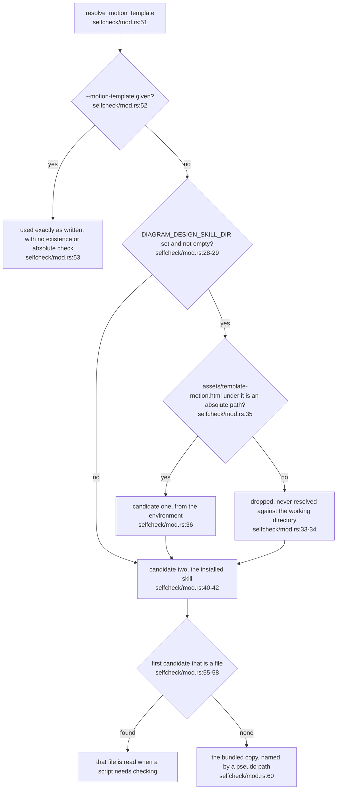
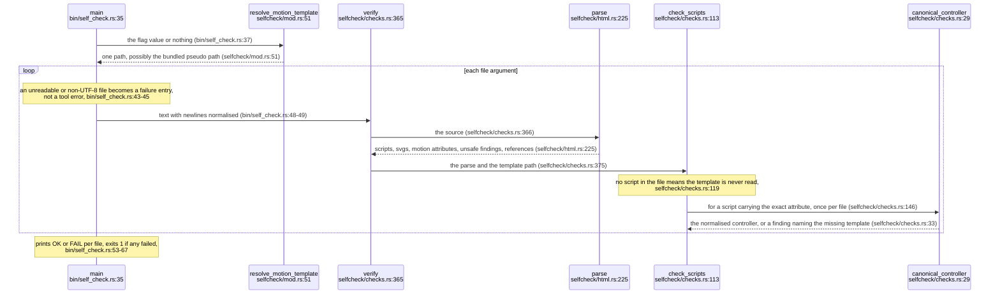
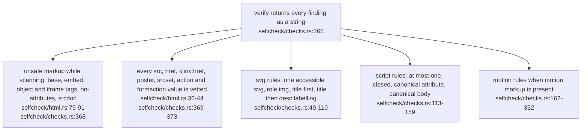
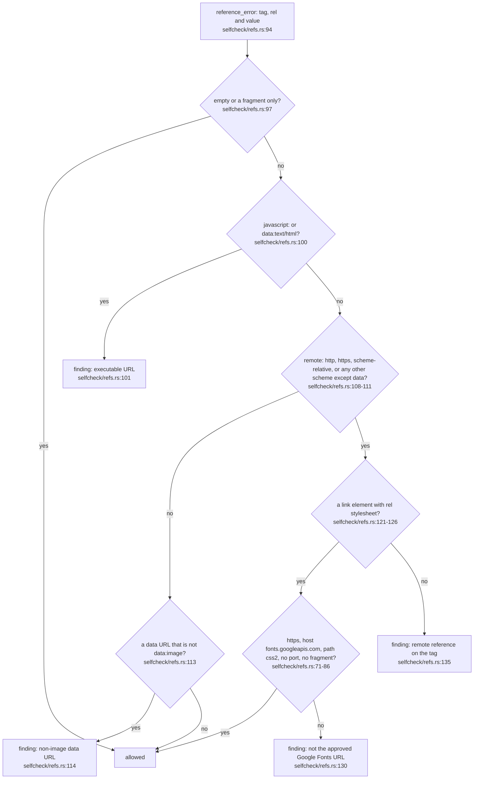
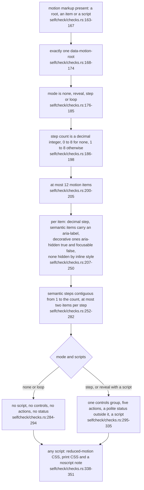

## For developers

`diagram-self-check` is the third binary in the crate. It does not read diagrams in the sense of the other two; it checks a generated diagram HTML file against the accessible-diagram contract: at least one accessible SVG with the right roles and labels, no remote assets beyond one approved Google Fonts stylesheet, no executable attributes, no script except one canonical motion controller, and, when motion markup is present, the structural motion contract (`../diagram-ir/src/bin/self_check.rs:1-9`). The rules are a "distilled subset" of two repository gates that stay the authority for contributions to the repository itself (`../diagram-ir/src/selfcheck/mod.rs:1-3`). Those gates are not in this repository, so the parity of the subset is not something these sources can show.

The entry point `verify` runs five groups and concatenates their findings: the unsafe-markup findings gathered while scanning, a vetting of every reference-bearing attribute, the SVG rules, the script rules and the motion rules (`../diagram-ir/src/selfcheck/checks.rs:365-378`). The scan is a hand-written tolerant HTML reader that models only start tags, end tags, character data and the raw-text mode of `script` and `style`; nothing is executed or fetched (`../diagram-ir/src/selfcheck/html.rs:1-6`, `../diagram-ir/src/selfcheck/html.rs:225`).

The script rule is where the template matters. A diagram may carry at most one script, it must be closed and carry exactly one attribute, `data-diagram-controls` with no value, and its body must equal the canonical controller after newline normalisation and trimming (`../diagram-ir/src/selfcheck/checks.rs:122-127`, `../diagram-ir/src/selfcheck/checks.rs:131-155`). The canonical controller is the single script inside `template-motion.html`, which must itself contain exactly one closed script (`../diagram-ir/src/selfcheck/checks.rs:41-45`). That file ships in the crate as `assets/template-motion.html` and is compiled into the library with `include_str!` (`../diagram-ir/src/selfcheck/mod.rs:15`); its controller is the script at `../diagram-ir/assets/template-motion.html:237`.

Where the template comes from is decided by `resolve_motion_template`: an explicit `--motion-template`, then an absolute `DIAGRAM_DESIGN_SKILL_DIR`, then the installed skill path, then the bundled copy (`../diagram-ir/src/selfcheck/mod.rs:51-61`). Every on-disk candidate the function builds itself is absolute, and a relative `DIAGRAM_DESIGN_SKILL_DIR` is dropped, so a file planted in the directory the tool runs from cannot stand in for the canonical controller (`../diagram-ir/src/selfcheck/mod.rs:35`). The change landed in commit `4a84e0d`, tracked upstream as finding COV-A-F6 (`../diagram-ir/src/selfcheck/mod.rs:22-25`), and the tests assert it (`../diagram-ir/tests/selfcheck.rs:389-408`).

## For the business

Every generated diagram page that moves, such as a stepped animation, runs one small script. The self-check is the guard that only the approved script is present, unmodified, and that the page stays readable and safe: screen-reader labels exist, nothing loads from the open internet except the one approved font stylesheet, and the page still shows a complete static picture without script, in reduced-motion settings and in print.

For a deployment the template choice is a trust decision: whichever controller the checker compares against defines what "approved" means. The design is that a standalone install needs no extra files, an installed design skill can pin its own version of the controller, and nothing found next to wherever the command happens to be run can take its place. One caveat is worth knowing: if an installed copy and the built-in copy ever differ, the installed one is the one that counts.

## DI-03.1 Where the canonical controller is found

**What it shows.** Four sources in strict order. The bundled copy is a constant compiled into the library (`../diagram-ir/src/selfcheck/mod.rs:15`), and its pseudo path is recognised by `canonical_controller` so that it is read from memory and not from disk (`../diagram-ir/src/selfcheck/checks.rs:30-32`). A test confirms that the bundled text equals the asset in the repository, that its controller parses, and that a compliant file passes against it (`../diagram-ir/tests/selfcheck.rs:365-386`).

**Why it is this way.** The binary no longer lives inside the skill, so it cannot assume a skill checkout; the order lets a deployment pin a controller while a standalone install still works (`../diagram-ir/src/selfcheck/mod.rs:46-50`).

**Invariant:** no automatically built candidate is relative: the environment path is pushed only when absolute and the installed path is a literal absolute path (`../diagram-ir/src/selfcheck/mod.rs:35`, `../diagram-ir/src/selfcheck/mod.rs:40-42`). The tests check every candidate and a relative override (`../diagram-ir/tests/selfcheck.rs:389-408`).

**Open:** an explicit `--motion-template` is returned as written and later opened with the ordinary file read, so a relative value is read against the working directory (`../diagram-ir/src/selfcheck/mod.rs:52-54`, `../diagram-ir/src/selfcheck/checks.rs:33`), while the README says nothing is resolved against the working directory (`../diagram-ir/README.md:121-122`). The README's reason, a planted file standing in for the controller, does not apply when the caller names the path, but the sentence is broader than the code.

**Open:** the library says the installed and bundled controllers "are expected to be byte-identical" (`../diagram-ir/src/selfcheck/mod.rs:13-14`). Nothing compares them at run time, and the only test compares the bundled text with the asset in this repository (`../diagram-ir/tests/selfcheck.rs:365-374`). When an installed copy exists it wins (`../diagram-ir/src/selfcheck/mod.rs:55-59`).

## DI-03.2 A run of the binary, file by file

**What it shows.** The template path is resolved once, before any file is read, but the template is read lazily and only when a file has a script that passes the attribute test. A missing or malformed template therefore shows up as a finding on that file, not as a start-up error, and a file without scripts passes without the template existing (`../diagram-ir/src/selfcheck/checks.rs:119-121`, `../diagram-ir/tests/selfcheck.rs:318-330`).

**Why it is this way.** A diagram file is checked by value: `verify` takes source text and a template path and returns a list of strings, so the same function serves the binary, the tests and any library caller (`../diagram-ir/src/selfcheck/checks.rs:364-366`).

**Drift (README vs code):** the README gives exit code 2 as "tool error" for this binary (`../diagram-ir/README.md:127`). The exit paths in `main` itself end in 0 or 1, and the header documents only those (`../diagram-ir/src/bin/self_check.rs:11`, `../diagram-ir/src/bin/self_check.rs:63-67`); a file it cannot read or decode is a `FAIL` entry with exit 1 (`../diagram-ir/src/bin/self_check.rs:43-45`), so the most obvious tool error does not give 2. What status a rejected command line gives is decided by the argument parser, which these sources do not show.

## DI-03.3 The five rule groups in verify

**What it shows.** The groups are independent and all run, so one file can report findings from several. The SVG rules apply to SVGs that are not `aria-hidden`; a file with none is itself a finding (`../diagram-ir/src/selfcheck/checks.rs:50-62`). Each accessible SVG needs `role="img"`, a non-empty `title` and `desc` with diagram-prefixed ids, `title` as its first child, and an `aria-labelledby` naming title then desc (`../diagram-ir/src/selfcheck/checks.rs:65-108`).

**Why it is this way.** The contract is accessibility first: the picture must be understood without sight and without script, and the single-file rule keeps a diagram a self-contained document.

**Invariant:** a script must have exactly the attribute list `data-diagram-controls` with an empty value, or the file is failed and the body is not compared (`../diagram-ir/src/selfcheck/checks.rs:134-145`).

## DI-03.4 Which references are allowed

**What it shows.** The only network address that passes is one stylesheet link. Anything else that is remote, including a scheme the rule does not know, is a finding, as is any `data:` URL that is not an image. Local paths and fragments pass. A URL is only parsed into scheme, host, port, path and fragment, never resolved or fetched (`../diagram-ir/src/selfcheck/refs.rs:1-5`).

**Why it is this way.** Single-file safety means a diagram cannot depend on or leak to a third party. The Google Fonts stylesheet is the one exception, and the exception is narrow: an explicit port disqualifies the URL (`../diagram-ir/src/selfcheck/refs.rs:75-78`). The shipped template's own font link is this form (`../diagram-ir/assets/template-motion.html:7`).

## DI-03.5 The motion contract

**What it shows.** The contract is a staged check that stops early only when there is not exactly one motion root. The five actions are `play`, `pause`, `replay`, `prev` and `next`, and the modes are the four listed (`../diagram-ir/src/selfcheck/checks.rs:13-14`). A controlled mode needs a status element with `role=status`, `aria-live=polite` and `aria-atomic=true` placed outside the controls (`../diagram-ir/src/selfcheck/checks.rs:315-331`).

**Why it is this way.** Each rule protects a reader who cannot use the animation: the static frame must be visible in the source (`../diagram-ir/src/selfcheck/checks.rs:242-249`), the semantic steps must read as a short ordered sequence, and the fallbacks cover reduced motion, print and no script.

**Invariant:** the scan counts motion items, actions, controls and status only while inside a motion root, so markup elsewhere on the page cannot satisfy or break the contract (`../diagram-ir/src/selfcheck/html.rs:106-125`).
