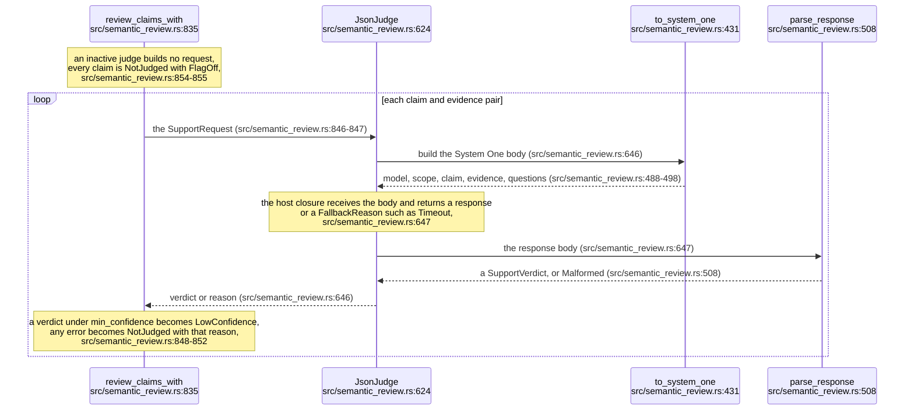
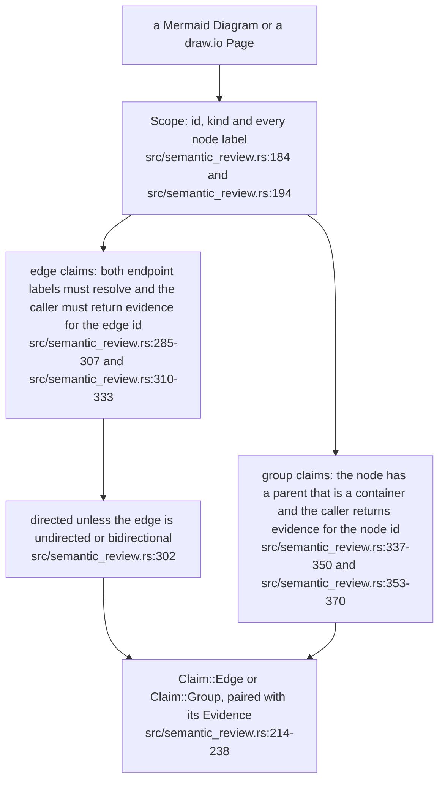
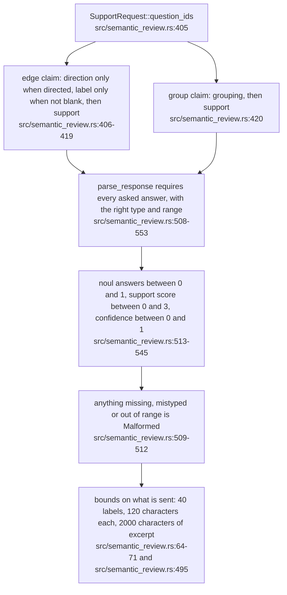
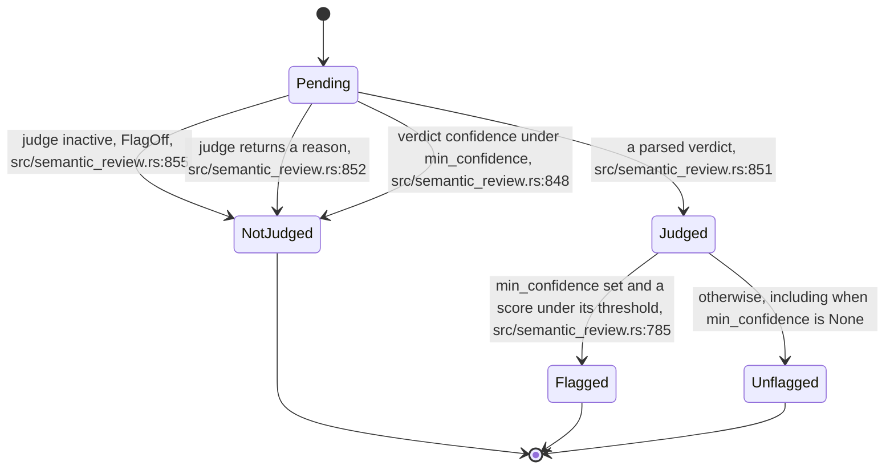

## For developers

Extraction in this crate is syntactic: it can say that an edge runs from `A` to `B` with the label `calls`, not whether the source material says so. `semantic_review` is an opt-in layer a consumer can run beside extraction. Given one claim from the IR and the evidence the caller supplies for it, it builds a typed question set and asks a decision service whether the evidence supports the claim (`../diagram-ir/src/semantic_review.rs:1-10`). Its own header calls it the Jev option and carries an upstream work-item id, `DI-01-S1-01`, which is unrelated to this corpus's topic ids (`../diagram-ir/src/semantic_review.rs:1-2`).

Three properties define the module. It performs no network I/O and has no transport of its own: the service sits behind the `SupportJudge` trait, and the host supplies the transport through `JsonJudge` (`../diagram-ir/src/semantic_review.rs:14-17`, `../diagram-ir/src/semantic_review.rs:575-590`, `../diagram-ir/src/semantic_review.rs:624-652`). It never changes extraction: a review is a separate value, and an "all not judged" review is exactly the state before the module existed (`../diagram-ir/src/semantic_review.rs:18-20`). And it never certifies: a supported claim means the evidence states it, not that the architecture is right (`../diagram-ir/src/semantic_review.rs:21-24`).

Candidate generation stays with the caller. Four helpers turn an IR into `(Claim, Evidence)` pairs, for edges and for group membership, from either format, and each takes a closure that returns the evidence for an id or nothing (`../diagram-ir/src/semantic_review.rs:285`, `../diagram-ir/src/semantic_review.rs:310`, `../diagram-ir/src/semantic_review.rs:337`, `../diagram-ir/src/semantic_review.rs:353`). `review_claims` then runs each pair through a judge and always returns a value; any failure becomes a `NotJudged` entry carrying the reason (`../diagram-ir/src/semantic_review.rs:826-865`).

The default judge, `NotJudged`, reports itself inactive, so no request is built at all (`../diagram-ir/src/semantic_review.rs:592-601`). The README states the status plainly: a proposed research candidate with no measured uplift (`../diagram-ir/README.md:163-165`). The tests check wiring and fallback with a stand-in oracle, for example that every failure mode equals the default review and that a seeded reversed edge is flagged against it (`../diagram-ir/tests/semantic_review.rs:74`, `../diagram-ir/tests/semantic_review.rs:334-363`).

## For the business

The syntactic checks can prove a diagram is well formed and accessible; they cannot tell whether an arrow points the right way or whether two boxes really belong together. This option lets a team ask an external reviewing service that question for specific arrows and groupings, against the text that is supposed to back them, and get back an annotation. It is off by default, adds nothing to what the extractors produce, and a failed or slow service simply means no annotation.

Two things matter before relying on it. Whatever the host sends goes to whichever endpoint the host picks, so private material belongs on a local endpoint (`../diagram-ir/README.md:167-171`). And no result is acted on until someone has measured the service on cases with known answers and fixed a threshold; until then it records verdicts and flags nothing (`../diagram-ir/README.md:176-181`).

## DI-04.1 One review, claim by claim

**What it shows.** The only I/O is the host's closure. A missing endpoint, timeout, transport failure and a non-2xx status are the host's to report as a `FallbackReason`; a body that fails the shape and range checks is turned into `Malformed` by the parser (`../diagram-ir/src/semantic_review.rs:77-92`, `../diagram-ir/src/semantic_review.rs:508-553`).

**Why it is this way.** The module is deliberately fail-open: a judge that is inactive, errs, times out or returns something malformed yields `NotJudged` for that claim and the rest of the review continues (`../diagram-ir/src/semantic_review.rs:821-825`).

**Invariant:** the one outward call in the module is the host-supplied closure inside `JsonJudge::judge`, and the module documents that it performs no network I/O (`../diagram-ir/src/semantic_review.rs:647`, `../diagram-ir/src/semantic_review.rs:14-17`).

## DI-04.2 How an IR becomes claims

**What it shows.** A claim is only built when the IR and the caller agree it is reviewable. An edge whose endpoint is unknown, or that has no evidence, is skipped without a trace; so is a node with no container parent (`../diagram-ir/src/semantic_review.rs:296-306`, `../diagram-ir/src/semantic_review.rs:341-349`). The scope carries node labels, not ids (`../diagram-ir/src/semantic_review.rs:188`, `../diagram-ir/src/semantic_review.rs:198`).

**Why it is this way.** The module judges meaning only; which claims are worth asking about, and which text backs them, is left to caller code (`../diagram-ir/src/semantic_review.rs:21-24`). The IR already marks which edges have a direction, so the direction question is asked only for those.

**Open:** a claim silently dropped for lack of evidence is indistinguishable from a claim never considered: the helpers return only the pairs they built and no list of what was skipped (`../diagram-ir/src/semantic_review.rs:285-307`).

## DI-04.3 What is asked, and what the answer must look like

**What it shows.** Each question is independent, so a reversed edge can fail the direction question while the label question passes. The support question is a four-level ordered score that runs from the excerpt contradicting the claim to stating it explicitly, and its instructions say to judge only what the excerpt says (`../diagram-ir/src/semantic_review.rs:478-487`).

**Why it is this way.** Question ids are not shown to the model, so every instruction names the fields it refers to and carries its full meaning (`../diagram-ir/src/semantic_review.rs:34-36`). The question set is versioned as `diagram-ir.di-01-s1-01.v1` so results can be tied to the instructions that produced them (`../diagram-ir/src/semantic_review.rs:62-64`).

**Open:** the README lists what leaves a host as node labels, the claim and the evidence excerpt (`../diagram-ir/README.md:167-171`). The request also carries the scope id and kind, the claim id and the evidence source name, and none of those is clipped (`../diagram-ir/src/semantic_review.rs:203-208`, `../diagram-ir/src/semantic_review.rs:461`, `../diagram-ir/src/semantic_review.rs:494`). Nothing states whether those fields are expected to be short.

## DI-04.4 From one claim to a flag

**What it shows.** Every claim ends in one of three states. Flagging is a separate step on the finished `Review`: under the default policy `min_confidence` is `None`, so `flagged` returns nothing even when verdicts exist. With a threshold set, a direction, label or grouping probability under 0.5, or an overall support score under 1.5, makes a finding (`../diagram-ir/src/semantic_review.rs:715-733`, `../diagram-ir/src/semantic_review.rs:785-822`).

**Why it is this way.** The thresholds are placeholders: the default policy flags nothing until a threshold has been fitted on labelled cases such as seeded reversed edges and mislabellings (`../diagram-ir/src/semantic_review.rs:710-714`, `../diagram-ir/README.md:179-181`).

**Debt:** the 0.5 and 1.5 thresholds and the whole flagging step are unvalidated by the crate's own account, and the README records "no measured uplift" (`../diagram-ir/src/semantic_review.rs:726-733`, `../diagram-ir/README.md:163-165`).

**Invariant:** `flagged` returns an empty list unless a minimum confidence is configured, and skips every claim that was not judged (`../diagram-ir/src/semantic_review.rs:785-796`).
