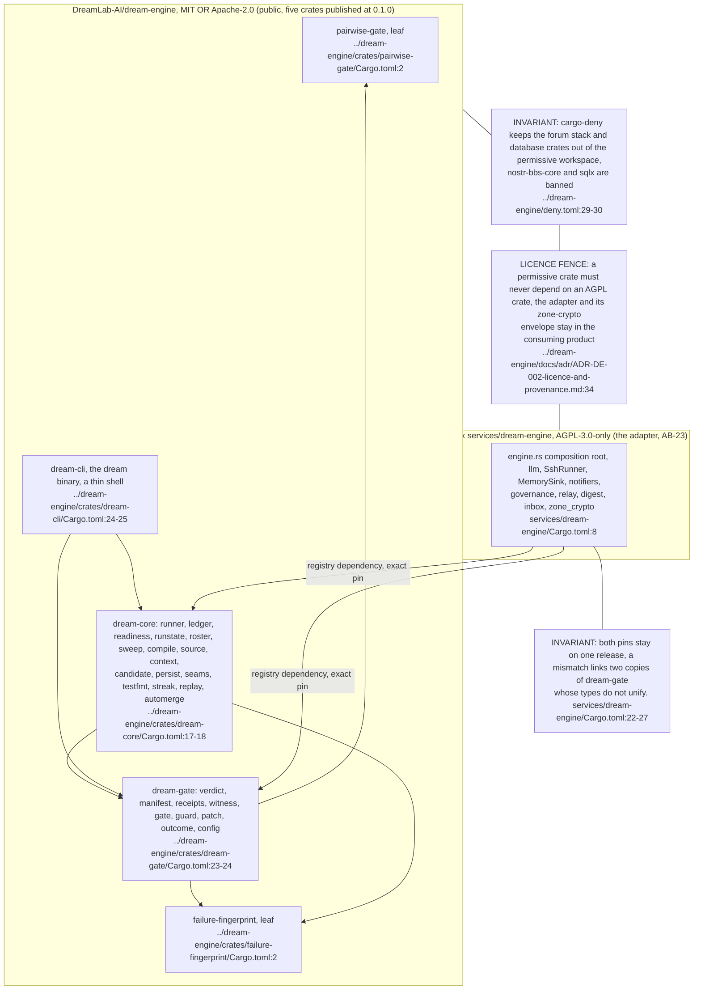

The repository's own corpus (eight topics in four areas: nightly, gate, crates, selection) lives at `../dream-engine/docs/diagrams/README.md` and is not duplicated here. This area records only the estate's view of it: the crate DAG, the licence fence, the consumer and the open items. The estate adapter is AB-23. State on 2026-10-16, each checked that day: `DreamLab-AI/dream-engine` is public with `main` at 5578a24 (`git ls-remote origin main`); `pairwise-gate`, `failure-fingerprint`, `dream-gate`, `dream-core` and `dream-cli` are all published at 0.1.0 (crates.io API `max_version`); the TypeScript fork is renamed `DreamLab-AI/dream-machine` and archived (`gh repo view`, `isArchived: true`). The adapter side is agentbox pull request 28, open and not merged, head 8b8497bc2, so the agentbox stamp is the head of an unmerged branch.

## DE-01.1 The crate DAG, the licence fence and the consumer

**Invariant:** the five crates are one licence expression, `MIT OR Apache-2.0`, and the fence is physical because the code that signs Nostr events is not in this repository at all (`../dream-engine/Cargo.toml:8`, `../dream-engine/docs/adr/ADR-DE-002-licence-and-provenance.md:23-33`).

## DE-01.2 What is open, and where the estate still says otherwise

```mermaid
flowchart TB
    L["built clean-room, one workspace, edition 2021<br/>../dream-engine/Cargo.toml:3, ../dream-engine/Cargo.toml:6"]
    P1["DONE 2026-10-16: pushed to DreamLab-AI/dream-engine, the TypeScript fork renamed to<br/>DreamLab-AI/dream-machine and archived"]
    P2["DONE 2026-10-16: five crates at 0.1.0 on crates.io, badges for two of them<br/>../dream-engine/README.md:9-10"]
    P3["adapter pins =0.1.0 from the registry, lockfile carries the checksums, no outputHashes needed<br/>../project/agentbox/docs/adr/ADR-2141-extract-the-dream-engine-core-into-a-standalone-permissive-repo.md:31"]
    M["OPEN: agentbox PR 28 not yet merged, adapter pin merged is pending that merge"]
    LIVE["NOT YET LIVE: the image rebuild is the operator's step, until then guard before apply,<br/>the finished-night rule and the corrected dry streak do not run in the supervised engine<br/>../project/agentbox/docs/adr/ADR-2141-extract-the-dream-engine-core-into-a-standalone-permissive-repo.md:40"]
    L --> P1 --> P2 --> P3 --> M --> LIVE
    subgraph STALE["DRIFT: estate files that still describe the fork"]
        direction TB
        R1["roster row: provenance imported, role fork of ruvnet/dream-machine<br/>scripts/estate-health/roster.json:21"]
        R2["release manifest generator seeds the same row as imported<br/>scripts/generate-release-manifest.sh:102"]
        R3["the release-manifest gate asserts exactly two imported repositories<br/>tests/gates/release-manifest.test.sh:68-69"]
        R4["DEBT: the browser journey probes the fork's Pages site, the new repository has no such page<br/>scripts/estate-browser-journeys.mjs:24"]
        R1 --- R2 --- R3 --- R4
    end
    P1 -.-> STALE
    subgraph LIMITS["OPEN: recorded limits of the new engine"]
        direction TB
        K1["publish outcomes are not reconciled after a crash, at-most-once<br/>../dream-engine/docs/adr/ADR-DE-007-a-night-is-identified-by-its-directory.md:34"]
        K2["the automerge forge step was not exercised against real GitHub, and only persist::publish applies the policy<br/>../dream-engine/README.md:67-71"]
        K3["the first host publishes through publish_draft, so autoMerge is inert there<br/>../dream-engine/docs/adr/ADR-DE-006-automerge-is-an-option.md:44-48"]
        K4["a darwin evaluator without a sandbox flag is refused at admission, a read-only check<br/>../dream-engine/crates/dream-core/src/readiness.rs:228-232"]
        K1 --- K2 --- K3 --- K4
    end
    LIVE -.-> LIMITS
```

**Tension (roster vs rename):** after the rename the slug names a first-party repository, so the next collection would measure it under a provenance label that no longer describes it (`scripts/estate-health/roster.json:21`), and the gate asserting two imported rows fails the day the row is corrected (`tests/gates/release-manifest.test.sh:68-69`), so row, generator and test must move in one change.

**Open (PR 28):** the adapter side is pull request 28 on DreamLab-AI/agentbox, open at head 8b8497bc2 and not merged, so "adapter pin merged" is not yet true. A squash merge would leave 8b8497bc2 off `main`, which would need this topic and AB-23 to be re-stamped once more. **Debt (no CI gate):** the agentbox repository's GitHub Actions have not run since 2026-10-08 (`gh run list`, latest run 2026-10-08T18:49Z, and `gh pr checks 28` reports no checks), so PR 28 has no CI gate and its tests ran only locally.

**Drift (autoMerge inert):** the permissive repository's option exists but the adapter publishes through `Forge::publish_draft` (`../project/agentbox/services/dream-engine/src/engine.rs:1667`), and the dream-engine README and ADR-DE-006 now say that path never merges, whatever `autoMerge` says (`../dream-engine/README.md:67-71`, `../dream-engine/docs/adr/ADR-DE-006-automerge-is-an-option.md:44-48`). See ES-05 and AB-23.6. **Invariant (darwin):** darwin entrypoints are still refused by evaluator readiness as a safety check. `assess` only appends an `Unusable::DarwinSandboxMissing` problem for the report and changes nothing (`../dream-engine/crates/dream-core/src/readiness.rs:228-232`).
