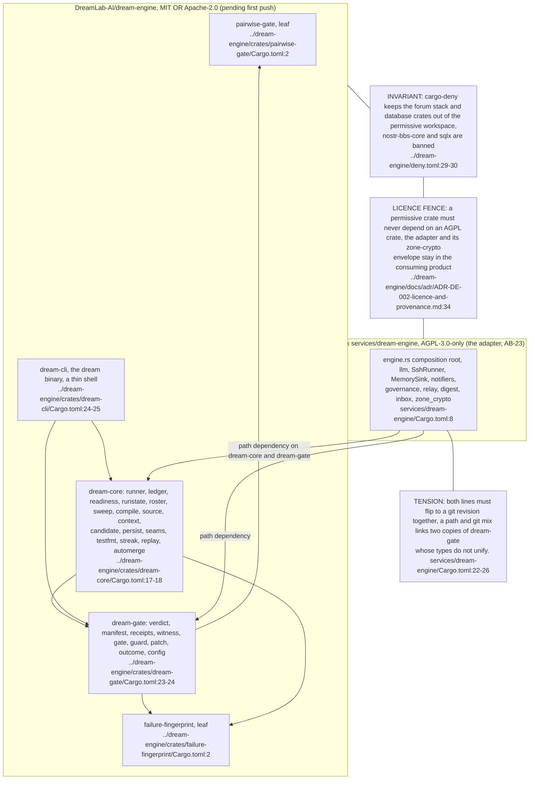
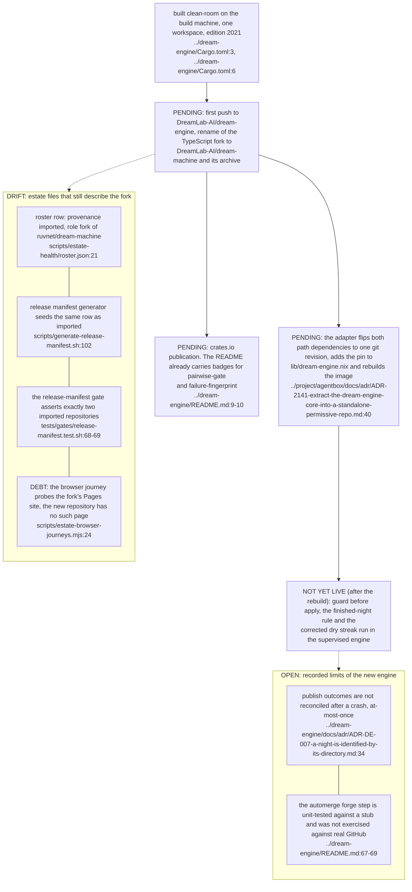

The repository's own corpus (eight topics in four areas: nightly, gate, crates, selection) lives at `../dream-engine/docs/diagrams/README.md` and is not duplicated here. This area records only the estate's view of it: the crate DAG, the licence fence, the consumer and the pending items. The estate adapter is AB-23. Both stamps are provisional: the agentbox revision is the head of an unmerged worktree branch and the dream-engine revision is an unpushed local head, so re-stamp after the merge and the push.

## DE-01.1 The crate DAG, the licence fence and the consumer

**Invariant:** the five crates are one licence expression, `MIT OR Apache-2.0`, and the fence is physical because the code that signs Nostr events is not in this repository at all (`../dream-engine/Cargo.toml:8`, `../dream-engine/docs/adr/ADR-DE-002-licence-and-provenance.md:23-33`).

## DE-01.2 What is pending, and where the estate still says otherwise

**Tension (pending push):** nothing outside the build machine can resolve the adapter's dependencies until the repository is pushed, and the image keeps the pre-extraction binary until then (`../project/agentbox/services/dream-engine/Cargo.toml:27-28`).

**Tension (roster vs rename):** after the rename the slug names a first-party repository, so the next collection would measure it under a provenance label that no longer describes it (`scripts/estate-health/roster.json:21`), and the gate asserting two imported rows fails the day the row is corrected (`tests/gates/release-manifest.test.sh:68-69`), so row, generator and test must move in one change.

**Open:** crates.io publication is recorded nowhere as done, though the README displays badges for two crates (`../dream-engine/README.md:9-10`), and the adapter publishes through the draft path only and never applies the automerge option (AB-23.6).
