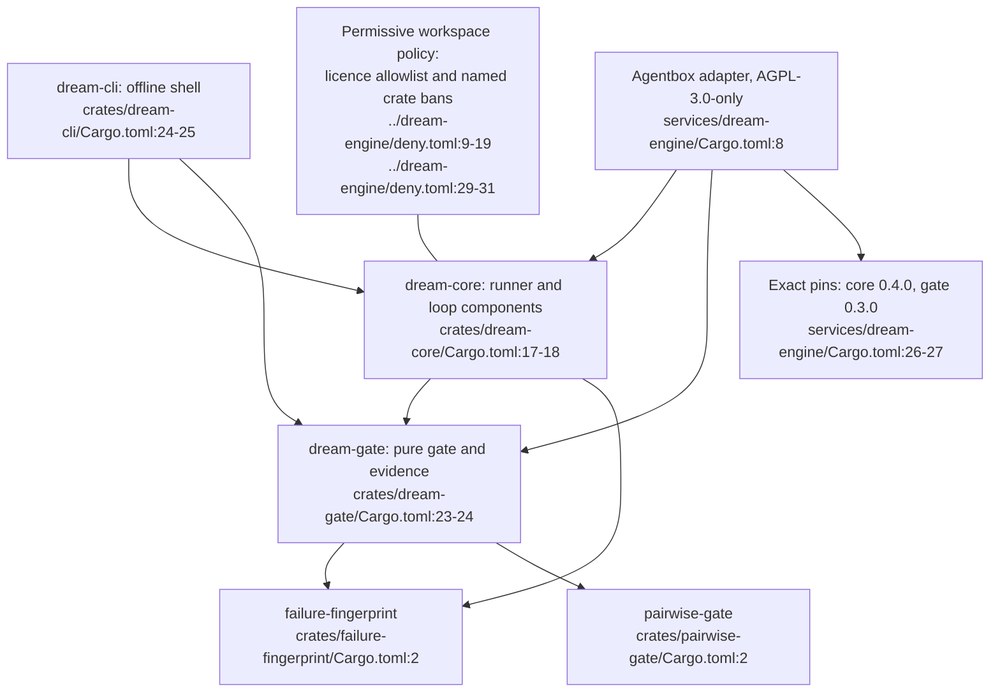
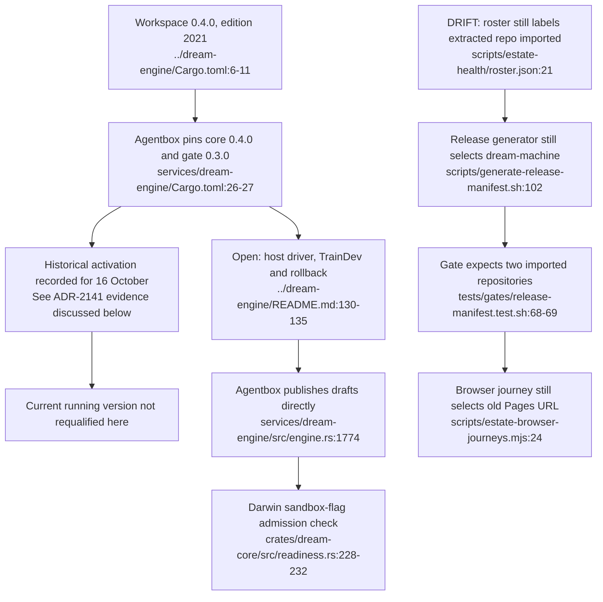

DE-01 to DE-06 are the estate's view of dream-engine. The repository's own corpus is DE-07 to DE-14 in this area (moved on 2026-11-05); DE-11 draws the same crate DAG and licence boundary from inside the repository.

Current audit qualification, 1 November 2026: [candidate and evidence boundary review](../../estate-review/2026-11-01-dream-candidate-and-evidence.md). Package, repository and daemon observations dated below remain historical; this pass does not re-establish deployment or registry freshness. Source at `815f963` matches the retained dream-engine pin for these declared inputs. The new DE-02 topic records reproduced formatter and evidence-boundary gaps. The repository's own corpus (eight topics in four areas: nightly, gate, crates, selection) lives at `../dream-engine/docs/diagrams/README.md` and is not duplicated here. This area records only the estate's view of it: the crate DAG, the licence fence, the consumer and the open items. The estate adapter is AB-23. State on 2026-10-16, each checked that day: `DreamLab-AI/dream-engine` is public with `main` at 5578a24; the five crates were published at 0.1.0; the TypeScript fork was renamed `DreamLab-AI/dream-machine` and archived; the adapter side was agentbox pull request 28, merged as aa9b094c3. State re-checked on 2026-10-29 against this stamp (`61581d3`): crates.io `max_version` reads `dream-core` 0.4.0, `dream-gate` 0.3.0, `dream-cli` 0.2.0, `pairwise-gate` 0.1.0 and `failure-fingerprint` 0.1.0 (crates.io API); `DreamLab-AI/dream-machine` is archived (`gh repo view`); `git ls-remote origin main` reads 59a3e21, which is not the stamped head. The workspace version is 0.4.0 (`../dream-engine/Cargo.toml:11`) while `dream-cli` is published at 0.2.0, so the shell crate is not released with the library crates. Three releases followed the extraction: 0.2.0 honours requested sources first (ADR-DE-008), 0.3.0 formats a candidate before the gate judges it (ADR-DE-009, `dream-gate` 0.3.0) and 0.4.0 adds opt-in hypothesis screening in `dream-core` (`../dream-engine/crates/dream-core/src/lib.rs:57`).

## DE-01.1 The crate DAG, the licence fence and the consumer

**Invariant (declared dependency boundary):** the five crates declare `MIT OR Apache-2.0`; the adapter is outside the workspace (`../dream-engine/Cargo.toml:8`, `../dream-engine/docs/adr/ADR-DE-002-licence-and-provenance.md:23-33`). The [migration/provenance audit](../../estate-review/2026-11-01-dream-migration-and-provenance.md) verifies the current dependency direction and consumed source identity. This does not prove authorship or enforce the adapter’s prohibition on publication; Cargo package lists also omit the repository NOTICE from the five crates.

## DE-01.2 What is open, and where the estate still says otherwise

**Tension (roster vs rename):** after the rename the slug names a first-party repository, so the next collection would measure it under a provenance label that no longer describes it (`scripts/estate-health/roster.json:21`), and the gate asserting two imported rows fails the day the row is corrected (`tests/gates/release-manifest.test.sh:68-69`), so row, generator and test must move in one change.

**Resolved (PR 28):** the adapter pin merged on agentbox `main` (merge commit aa9b094c3, `gh pr view 28` reads `MERGED`). **Historical activation:** the ADR records a rebuild and activation of the registry-pinned image on 2026-10-16 (`../project/agentbox/docs/adr/ADR-2141-extract-the-dream-engine-core-into-a-standalone-permissive-repo.md:47`); the later releases (0.2.0 to 0.4.0) are adopted in `Cargo.toml` and their image activation is not recorded in the ADR (`../project/agentbox/services/dream-engine/Cargo.toml:26-27`). **Resolved (CI):** the agentbox GitHub Actions run again, with the CI, ShellCheck and Secret Scan workflows green on 2026-10-29 (`gh run list`).

**Drift (ADR-2141 vs the manifest):** the record's Pinning bullet names `dream-core` and `dream-gate` `=0.2.0` (`../project/agentbox/docs/adr/ADR-2141-extract-the-dream-engine-core-into-a-standalone-permissive-repo.md:31`) and its last re-verification adopts `=0.3.0` for both (`../project/agentbox/docs/adr/ADR-2141-extract-the-dream-engine-core-into-a-standalone-permissive-repo.md:55`), while the adapter pins `dream-core =0.4.0` and `dream-gate =0.3.0` (`../project/agentbox/services/dream-engine/Cargo.toml:26-27`).

**Drift (autoMerge inert):** the permissive repository's option exists but the adapter publishes through `Forge::publish_draft` (`../project/agentbox/services/dream-engine/src/engine.rs:1774`), and the dream-engine README and ADR-DE-006 now say that path never merges, whatever `autoMerge` says (`../dream-engine/README.md:130-135`, `../dream-engine/docs/adr/ADR-DE-006-automerge-is-an-option.md:44-48`). See ES-05 and AB-23.6. **Invariant (darwin):** darwin entrypoints without the declared sandbox flag are refused by evaluator readiness as a safety check. `assess` only appends an `Unusable::DarwinSandboxMissing` problem for the report and changes nothing (`../dream-engine/crates/dream-core/src/readiness.rs:228-232`). **Open (candidate and evidence boundaries):** source-level checks do not establish formatter confinement or evidence integrity. DE-02 records an out-of-worktree formatter write, duplicate test-name collapse, receipt filename collisions and manifest archive replacement, reproduced against the same production source.
