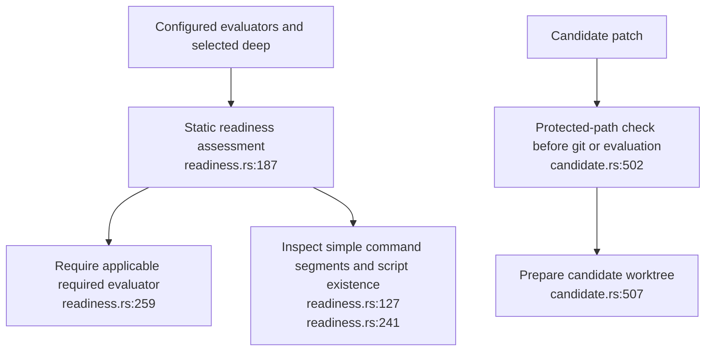
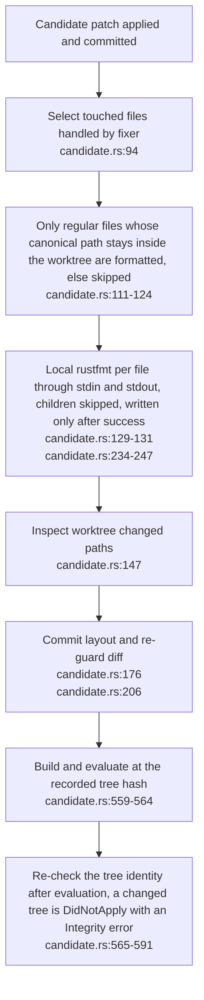
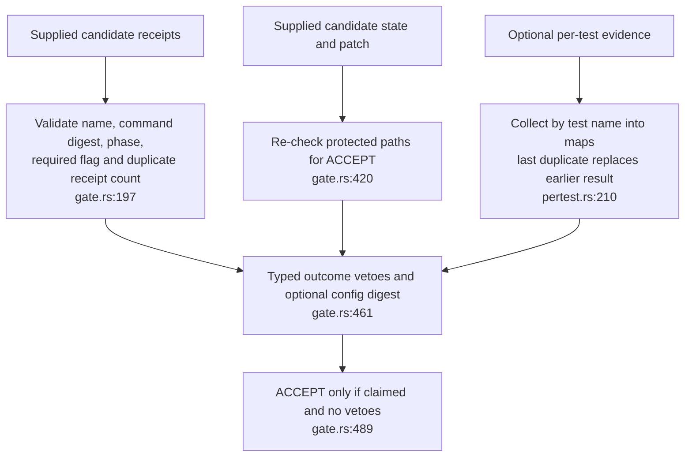
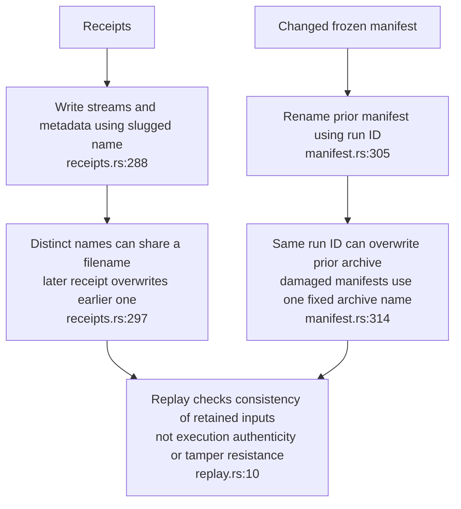

## For developers

**Repair follow-up, 2026-11-03:** [DE-06](06-formatting-and-evidence-repairs.md) records explicit-file formatting and post-evaluator tree checks. DE-02.2 now draws those repairs; other gate and persistence observations are not closed.

Candidate construction and receipt checking are separate contracts. The pure gate checks command identity, requiredness and the supplied patch; it trusts the caller's candidate tree and typed outcome. Readiness and replay add checks but do not make those inputs intrinsically authentic. The [1 November audit](../../estate-review/2026-11-01-dream-candidate-and-evidence.md) records executed counterexamples and distinguishes direct API behaviour from the agentbox integration.

## For the business

The engine can compare a proposed change with configured tests and produce a reviewable decision. Confidence depends on the tested files staying fixed, the tests meaningfully examining them, and the retained evidence identifying each result uniquely. Passing tests do not establish isolation of the evaluator host or a complete record after interruption.

## DE-02.1 Admission and patch protection

**What it shows.** Readiness rejects an empty evaluator set and some constant commands. Its filesystem existence check does not verify tracking at the dispatched commit: an untracked script can pass admission, and a shell-wrapped constant command is not recognised as non-probative.

**Why it is this way.** The patch guard and config-bound policy implement ADR-DE-003. Static command heuristics are an admission aid, not proof that an evaluator observes the candidate's behaviour.

## DE-02.2 Formatting before evaluation

**What it shows.** ADR-DE-009 places formatting before evaluation and records the resulting patch. The literal `#[path` substring test that earlier missed `#[ path` syntax is gone: formatting now accepts only explicit regular files inside the worktree and formats through stdin, so it never follows module declarations.

**Why it is this way.** Formatting is intended to remove mechanical layout failures without widening the candidate. After the evaluators run, `candidate::run` verifies the worktree and, when the tree was relocated, the evaluated copy against the recorded tree hash before returning `Applied`; the checks run on the same host and the evaluator host is still not a sandbox.

**Tension (ADR-DE-009 confinement):** RESOLVED at dream-engine b40d507 — the out-of-worktree-write probe and the missing post-evaluation tree check are closed by explicit-file formatting and the final tree identity check (`../dream-engine/crates/dream-core/src/candidate.rs:111-124`, `../dream-engine/crates/dream-core/src/candidate.rs:565-591`); DE-06 records the repair.

## DE-02.3 What the pure gate validates

**What it shows.** A required receipt cannot downgrade itself or change its command. However, the gate does not reclassify raw streams or prove the candidate tree exists; `GateContext::new` omits config-digest checking. An empty required set does not itself veto acceptance. The host must apply admission and establish these facts.

**Why it is this way.** This is a pure decision function over caller-supplied evidence. Replay verification separately checks receipt classification; neither mechanism supplies an execution sandbox. Per-test evidence is additive, and duplicate test identifiers currently make its verdict order-dependent. Parser deduplication can create another collision: `x, x, x~2` becomes `x, x~2, x~2` (testfmt.rs:80-89).

## DE-02.4 Retaining and replaying evidence

**What it shows.** Atomic replacement of individual files does not preserve every prior record. Receipt names `a b` and `a-b` collide. Repeated model changes within one run ID replace the earlier manifest archive; repeated corrupt input replaces the fixed damaged-manifest archive.

**Why it is this way.** The persistence helpers use deterministic filenames. These are different paths from `runstate::reset_night`'s unique hard-link archives; the latter's non-overwrite guarantee does not apply to manifest freezing or receipt persistence.
