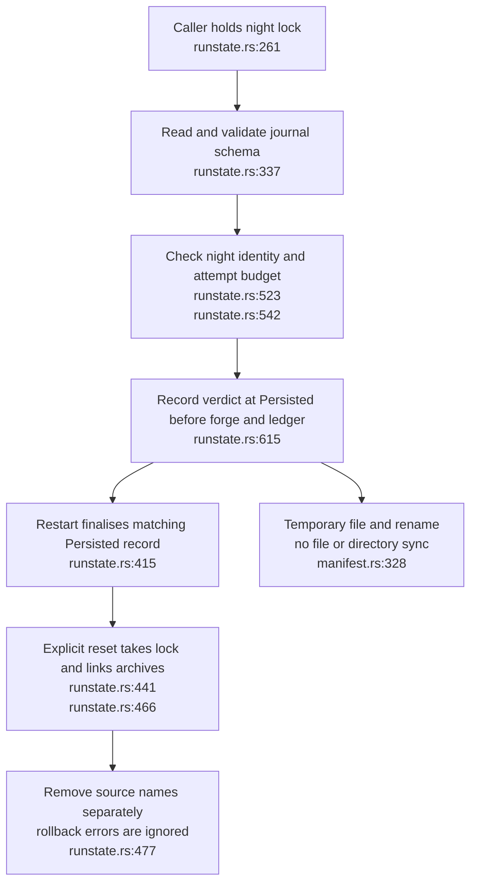
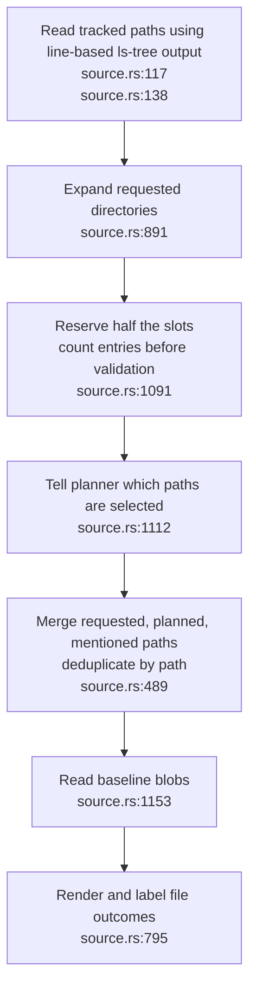
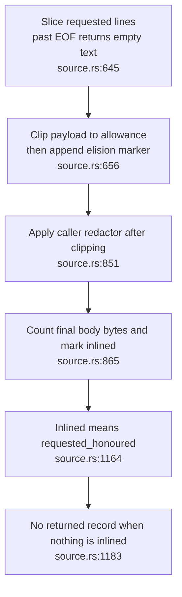

## For developers

Night recovery and source requests both carry state across attempts. The journal distinguishes a finished experiment from one that may run again; the source record describes what the next model call was shown. The [dated audit](../../estate-review/2026-11-01-dream-recovery-and-source-supply.md) tests process-crash recovery and counterexamples to source completion and budget claims.

## For the business

A stopped job can resume without automatically repeating publication after the persistence boundary. That trades possible missing drafts for fewer duplicate attempts, subject to retained storage and the host following the lock contract. A source request marked met does not yet prove that its requested lines reached the model, which can create avoidable operator alerts and unsuccessful nights.

## DE-03.1 Recovery depends on retained state

**What it shows.** A real fixture process was killed after ModelCalled and after Persisted. The lock released in both cases; the former resumed at attempt two and the latter returned AlreadyComplete despite a different run ID. This is process-death evidence, not a power-loss test.

**Why it is this way.** ADR-DE-007 makes completion and attempt limits belong to the night. Reset preserves archives on successful completion, but its multi-file sequence and ignored rollback failures do not make it a crash-atomic transaction. The separate manifest-freeze archive issue remains documented in DE-02. **Open (storage fault model):** temporary-file replacement is not evidence of durable storage after power loss; at-most-once publication requires the persisted journal to survive.

## DE-03.2 Requested paths pass through several different filters

**What it shows.** Invalid or duplicate requests consume positions in the reservation before usable files are selected. Git's quoted non-ASCII paths are retained as quoted text by the line parser, so a tracked file can be missed. The controlled probe reads the same file directly with git show, confirming the failure is in path accounting.

**Why it is this way.** ADR-DE-008 prioritises unmet requests while retaining room for planner choices. Its current implementation reserves input positions rather than a count of successfully supplied files. Directory expansion and path deduplication also lose the identity of individual range requests.

## DE-03.3 A completion marker can outstate the supplied content

**What it shows.** A request beyond EOF is honoured with zero bytes and a reversed displayed line interval. Clipping markers make body usage exceed both the requested half-budget and the overall budget. At default settings the probe records 30,134 requested bytes and 60,134 total body bytes, before section headers.

**Why it is this way.** File status is based on completing the rendering branch rather than validating meaningful range coverage. The caller needs refusal records even when every file fails; the current Option return loses those details. AB-23.21 shows how the adapter settles requests from these markers.

**Drift (ADR-DE-008 delivery):** the half-byte allocation and complete honoured/refused accounting are weaker than the decision describes. Empty ranges, duplicate ranges and all-refused reads are reproduced in the audit.
