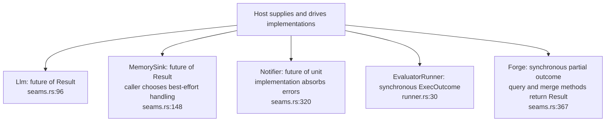
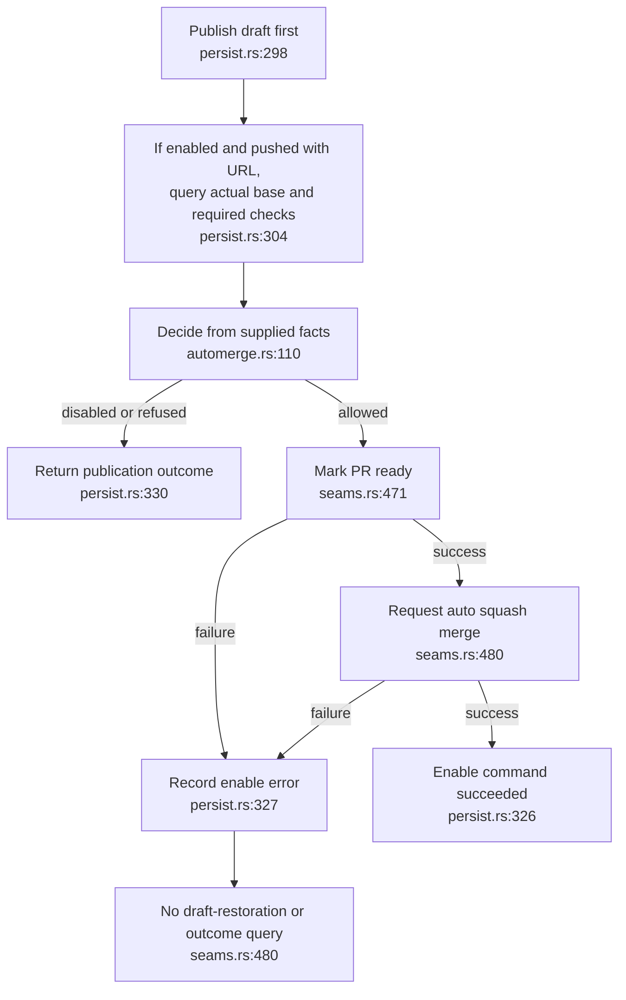
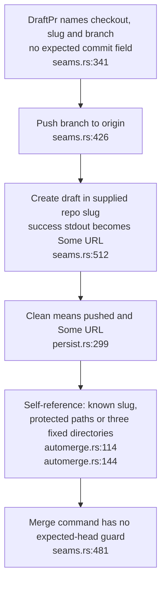

## For developers

Five interfaces let a host supply models, execution, memory, notifications and publication. Their failure contracts differ: three use futures, two are synchronous, and a publication outcome is not an error-bearing Result. The [dated audit](../../estate-review/2026-11-01-dream-forge-and-seam-contracts.md) distinguishes these APIs from the consumer's orchestration and verifies the GhForge command boundary offline.

## For the business

An accepted experiment, a pushed branch, an opened draft and an enabled merge are distinct outcomes. Default behaviour requests a draft for human review. The optional merge path can leave a ready-for-review PR when enabling the merge fails; its result does not prove that a merge happened or that the remotely published head matches the evaluated change.

## DE-04.1 Five seams, different error contracts

**What it shows.** Llm, MemorySink and Notifier return boxed futures. Forge and EvaluatorRunner are synchronous. LocalRunner uses a shell timeout but always sets timed_out to false; the receipt classifier separately recognises exit 124 and 137 (`runner.rs:69`, `receipts.rs:239`).

**Why it is this way.** The host owns sequencing and error policy. Returning unit from Notifier excludes a returned error; it does not enforce a deadline or prevent an implementation from panicking. No seam automatically records errors in a run journal.

## DE-04.2 Publication precedes the optional merge decision

**What it shows.** A rejected verdict or self-referential target prevents merge enablement but does not prevent this helper from first publishing a draft. The adapter separately gates publication before calling the lower-level forge. With the option off, only draft publication is attempted.

**Why it is this way.** ADR-DE-006 governs merging, while callers own publication eligibility. A successful ready command followed by a failed merge command leaves a partial transition; the offline command fixture reproduces that sequence and absence of an undo command.

## DE-04.3 Identity checks are narrower than a verified remote change

**What it shows.** Empty successful stdout qualifies as Some URL. A tracked crate named dream-gate under a different directory is not recognised by the fixed-path check. Neither the request nor merge command carries the evaluated commit hash.

**Why it is this way.** The API assumes the caller supplies the correct checkout and branch and that those identities stay suitable. The [audit](../../estate-review/2026-11-01-dream-forge-and-seam-contracts.md) records these limits; it does not claim that a live unverified commit was merged.

**Drift (draft after enable failure):** Published's error-field documentation says the PR stays a draft (`persist.rs:278`), but successful ready followed by failed merge does not restore draft status.
