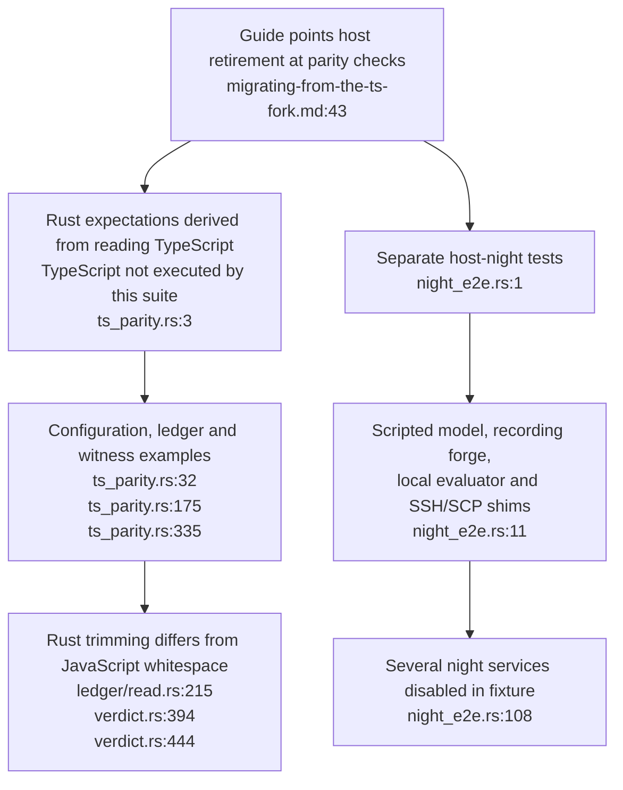
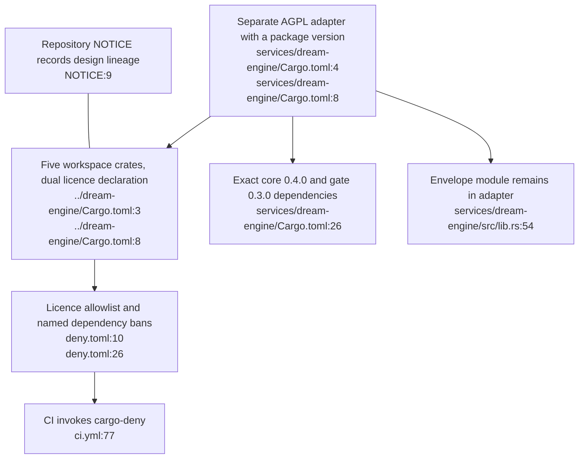

## For developers

Migration evidence has several scopes: fixture compatibility, actual old/new validator behaviour, isolated host orchestration and deployed operation. The [dated audit](../../estate-review/2026-11-01-dream-migration-and-provenance.md) checks the first three without claiming the fourth. Package metadata and cached archive checks bind the inspected consumer to four engine releases.

## For the business

Passing a compatibility suite does not prove that an existing installation can retire its old nightly driver. Package consumers also need the promised provenance information and an enforced boundary around components the owner intends never to publish. The current implementation supplies part of this evidence and leaves explicit migration and release-control gaps.

## DE-05.1 Fixture compatibility is narrower than a host migration

**What it shows.** Compatibility fixtures and isolated host tests establish different facts. The audit runs both and separately executes the old validator, exposing U+FEFF and U+0085 differences. No live host migration is certified.

**Why it is this way.** The standalone repository supplies mechanisms and offline checks; the host owns scheduling and delivery. The guide's retirement condition therefore needs evidence beyond the named library suite. That suite is also excluded from the dream-core package (`../dream-engine/crates/dream-core/Cargo.toml:11`).

## DE-05.2 Dependency policy and publication policy have different controls

**What it shows.** The dependency direction and licence policy exist, while the adapter manifest has no publish=false restriction. Offline package lists include its envelope module and omit root NOTICE from all five permissive packages. These are package-selection observations, not an upload or a legal compliance verdict.

**Why it is this way.** ADR-DE-002 separates reusable engine code from product-specific code and prohibits publishing the adapter. Source placement supports the first boundary; a written prohibition alone does not enforce the second. The audit records the missing guard and provenance evidence without changing release policy.
